# AGILE SRS - AI HEDGE FUND (aihf)

Tài liệu đặc tả yêu cầu phần mềm Agile (Living Requirements Specification), biên soạn theo kỹ thuật reverse-engineering từ mã nguồn và bộ kiểm thử hiện hành.

## Kiểm soát tài liệu

| Thuộc tính | Giá trị |
|---|---|
| Sản phẩm | `aihf` - quỹ đầu tư do AI vận hành (CLI + TUI), gói Python `aihf` |
| Phiên bản mã nguồn | 2.6.4 (`pyproject.toml`), commit cơ sở `37c5aa1` |
| Tiêu chuẩn tham chiếu | ISO/IEC/IEEE 26515:2018 (tài liệu hóa trong môi trường Agile) |
| Kỹ năng áp dụng | `.claude/skills/ba-agile-srs-generator/SKILL.md` |
| Dữ liệu quét | `.are/summary.md`, `.are/GENERATION-PLAN.md` (ARE 1.2.21, lệnh `discover`) |
| Ngày biên soạn | 2026-11-02 |
| Phương pháp | Mọi User Story được bóc tách từ hàm xử lý, ràng buộc miền và kiểm thử pytest hiện có |

### Nhãn trạng thái bằng chứng

| Nhãn | Ý nghĩa |
|---|---|
| `[OK]` | Có trong mã nguồn, có truy vết tệp và hàm |
| `[SPEC]` | Được nêu trong tài liệu dự án (VISION.md, ROADMAP.md), chưa có trong mã |
| `[PROPOSED]` | Đề xuất của tài liệu này, chưa có trong mã |
| `[ASSUMPTION]` | Giả định cần xác nhận |
| `[UNKNOWN]` | Không tìm thấy bằng chứng trong mã nguồn |
| `[OPEN]` | Câu hỏi mở dành cho Product Owner |

### Ghi chú về phương pháp và sai lệch so với khuôn mẫu

| Hạng mục | Ghi nhận |
|---|---|
| Ứng dụng | Ứng dụng terminal (Python, Textual). Không có HTTP route, ORM, migration, RBAC hay message queue. Các mục tương ứng trong khuôn mẫu được chuyển đổi sang điểm vào CLI/TUI, mô hình Pydantic, tệp trên đĩa và ranh giới giao thức. |
| Lệnh quét | ARE 1.2.21 không có lệnh `are scan`. Lệnh `discover` đã được chạy (138 tệp nhận diện, 35 tệp loại trừ); `.are/summary.md` là bản hợp nhất thủ công. |
| Kịch bản kiểm tra Mermaid | `scripts/validate-mermaid.mjs` chưa có trong kho mã khi bắt đầu; kịch bản được bổ sung cùng `scripts/check_mockups.py` (Phụ lục C). |
| Đánh số mục | Mục 1-7 theo thứ tự giai đoạn của yêu cầu biên soạn; Mục 8-9 bổ sung NFR và DoR/DoD theo khuôn mẫu ISO/IEC/IEEE 26515. |

---

## 1. PRODUCT VISION & VALUE PROPOSITION

### 1.1 Value Proposition Canvas

| Phân vùng | Nội dung | Bằng chứng |
|---|---|---|
| Tác vụ của khách hàng (Customer Jobs) | Kiểm chứng chiến lược đầu tư do LLM và mô hình định lượng điều hành; vận hành quỹ giấy (paper) theo từng phiên giao dịch thật; kiểm toán lý do của mọi quyết định | `README.md`, `VISION.md` |
| Trở ngại quy trình (Pains) | Script LLM một lần không lưu sổ sách; backtest và vận hành thực tế dùng hai đường mã khác nhau; kết quả backtest bị nhiễm ký ức của LLM về công ty; sổ ghi chép có thể bị sửa mà không phát hiện | `pipeline/session.py`, `signals/llm_agent.py` (chế độ blind), `paper/ledger.py` |
| Lợi ích mong đợi (Gains) | Một đường mã `advance` cho mọi chế độ; hồ sơ NAV không bị đặt lại; mỗi tín hiệu kèm luận điểm (thesis); giới hạn rủi ro mà analyst không thể vượt | `pipeline/session.py`, `risk/limits.py` |
| Sản phẩm và dịch vụ | Mandate (YAML), backtest, paper fund, ledger băm chuỗi, scorecard, TUI Textual, CLI JSON | `fund/spec.py`, `backtesting/fund.py`, `paper/*`, `tui/*`, `run.py` |
| Giảm trở ngại (Pain Relievers) | Vòng `advance` dùng chung; ledger append-only có hash; đối soát sổ broker và ledger trước mỗi phiên; kill switch; prompt blind khi backtest | `pipeline/session.py`, `paper/ledger.py`, `signals/llm_agent.py` |
| Tạo lợi ích (Gain Creators) | Scorecard theo chân trời tín hiệu; mô hình chi phí giao dịch (spread, hoa hồng, tác động thị trường); bộ nhớ đệm đĩa giảm chi phí gọi API | `scorecard/*`, `brokers/costs.py`, `data/cached.py`, `llm/cache.py` |

### 1.2 Product Vision Statement

- Dành cho (For): nhà nghiên cứu định lượng, lập trình viên và nhà đầu tư cá nhân.
- Những người cần (Who): kiểm chứng và vận hành chiến lược đầu tư do AI điều hành, với sổ sách có thể kiểm toán.
- Sản phẩm (The): `aihf`.
- Là (Is a): ứng dụng terminal quản lý quỹ đầu tư như một thực thể bền vững gồm mandate, analyst, strategy, quản trị rủi ro và sổ cái.
- Mang lại (That): cùng một đường thực thi cho backtest và paper trading, mỗi quyết định được lưu kèm luận điểm trong sổ cái băm chuỗi.
- Khác với (Unlike): các script giao dịch LLM chạy một lần và thoát.
- Điểm khác biệt (Our product): quỹ là đối tượng sống, lịch sử không thể sửa ngầm, rủi ro do mã tất định kiểm soát.

Giới hạn pháp lý `[OK]`: dự án phục vụ mục đích giáo dục; không đưa ra lời khuyên đầu tư và không thực hiện giao dịch thật (`README.md`, Disclaimer).

### 1.3 Scope & Boundaries

| Phạm vi | Nội dung | Trạng thái |
|---|---|---|
| In-Scope Epic | EP-FUND, EP-ALPHA, EP-PORT, EP-BT, EP-PAPER, EP-LEDGER, EP-SCORE, EP-DATA, EP-CFG (Mục 4.2) | `[OK]` |
| Out-of-Scope (ngoài kế hoạch hiện tại) | Giao dịch thật qua broker (Interactive Brokers, Alpaca): giao thức `Broker` đã sẵn, chưa có bản cài đặt | `[SPEC]` ROADMAP |
| Out-of-Scope | Ollama (LLM cục bộ), danh mục analyst bổ sung (Cathie Wood, Burry, Ackman, Damodaran và các persona khác), mô hình định lượng bổ sung (regime, momentum, mean reversion) | `[SPEC]` |
| Out-of-Scope | Cổng kiểm định CPCV và PBO (`hedge_fund/validation` chỉ có docstring) | `[SPEC]` |
| Out-of-Scope | Allocator (CIO) động, strategy generator, auto-promotion, web dashboard, điều khiển bằng ngôn ngữ tự nhiên | `[SPEC]` |
| Out-of-Scope | Scheduler theo lịch thị trường, thông báo, heartbeat (hiện dùng cron gọi `aihf paper tick` hoặc runner) | `[SPEC]` |
| Spike khả dụng | Nghiên cứu nguồn dữ liệu thay thế (ảnh vệ tinh, xu hướng tải ứng dụng, dữ liệu vận tải) | `[SPEC]` |

### 1.4 Technical Assumptions & Dependencies

| Hạng mục | Chi tiết | Bằng chứng |
|---|---|---|
| Ngôn ngữ và công cụ | Python `^3.11`, Poetry, script `aihf = hedge_fund.run:main` | `pyproject.toml` |
| Thư viện chính | `pydantic ^2.4.2`, `textual ^8.2.8`, `rich ^14.2.0`, `requests`, `pandas`, `numpy`, `scipy`, `pyyaml`, `langchain-*` (Anthropic, OpenAI, DeepSeek, Google, xAI) | `pyproject.toml` |
| Dịch vụ dữ liệu | Financial Datasets API (`https://api.financialdatasets.ai`), khóa `FINANCIAL_DATASETS_API_KEY` | `data/client.py`, `.env.example` |
| Nhà cung cấp LLM | Anthropic, OpenAI, DeepSeek, Google, xAI, Kimi, TypeSafe (Jev); mặc định `claude-opus-5-5` | `llm/registry.py`, `llm/api_models.json` |
| Lưu trữ | Hệ thống tệp tại `~/.hedge-fund/` (mandates, paper, research, cache, `.env`) | `paths.py` |
| Múi giờ | `America/New_York` cho lưới phiên và cửa sổ giao dịch | `data/sessions.py`, `data/bars.py` |
| Lập lịch | Cron hệ điều hành gọi `aihf paper tick`, hoặc tiến trình `aihf paper run` | `run.py`, `paper/runner.py` |
| Giả định | `[ASSUMPTION]` Người vận hành chạy đơn tác nhân trên một máy; mỗi quỹ có tối đa một tiến trình runner | `paper/runner.py` (pid file) |
| Ràng buộc | Phiên giao dịch "hoàn tất" là mọi ngày New York trước ngày hiện tại, kể cả sau giờ đóng cửa | `data/sessions.py: completed_through` |

### 1.5 Domain Glossary (Ubiquitous Language)

| Thuật ngữ | Định nghĩa | Nguồn |
|---|---|---|
| Mandate (FundSpec) | Cấu hình quỹ: strategy, rủi ro, chi phí, vốn, nhịp tái cân bằng. Không chứa mã cổ phiếu | `fund/spec.py` |
| Universe | Danh sách mã cổ phiếu, chỉ cố định khi backtest hoặc triển khai paper | `fund/spec.py: normalize_universe` |
| Strategy (pod) | Tập analyst cộng chính sách pha trộn và tỷ trọng vốn | `fund/spec.py: StrategySpec` |
| AlphaModel / Analyst | Mô hình tạo Signal; hai loại: LLM persona và mô hình định lượng | `signals/base.py` |
| Signal | Quan điểm có độ tin cậy trong khoảng -1 đến +1, kèm lý do | `models.py` |
| Sleeve | Danh mục mục tiêu của một strategy trước khi bù trừ | `portfolio/construction.py` |
| Netting | Cộng các sleeve theo tỷ trọng vốn thành một sổ mục tiêu | `pipeline/stages.py: assess_fund` |
| Clamp | Một giới hạn rủi ro kích hoạt và được ghi nhận | `risk/limits.py: ClampEvent` |
| Session | Một đơn vị công việc của quỹ: ngày hoàn tất hoặc thanh (bar) với quỹ phút | `pipeline/session.py` |
| Advance | Hàm thực hiện một phiên: đối soát, thực thi quyết định chờ, định giá, đánh giá | `pipeline/session.py` |
| Decision / Cycle | Quyết định (đánh giá tại T) và chu kỳ (thực thi tại T+1) | `pipeline/models.py` |
| Ledger | Sổ cái append-only, mỗi bản ghi mang hash của bản ghi trước | `paper/ledger.py` |
| Kill switch | Cờ dừng giao dịch lưu trong `control.json` | `paper/ledger.py` |
| Deployed fund | Mandate đã gắn universe và có thư mục riêng trên đĩa | `paper/deployed.py` |
| Blind | Chế độ che mã, ngành, ngày lịch trong prompt khi backtest | `signals/llm_agent.py` |
| Book mismatch | Sổ broker khác sổ ledger suy ra | `pipeline/session.py: BookMismatch` |
| Horizon | Số phiên giao dịch mà scorecard dùng để chấm một quan điểm | `signals/base.py` |

---

## 2. USER PERSONAS & ROLE MATRIX

### 2.1 User Personas

Ứng dụng không có tài khoản, đăng nhập hay token. Persona được suy ra từ các điểm vào (`run.py`, `tui/`), điểm mở rộng (`signals/__init__.py: ALPHA_MODEL_REGISTRY`) và tác nhân hệ thống (cron, runner).

| ID | Persona | Mục tiêu chính | Trở ngại quy trình | Mức kỹ thuật | Điểm vào |
|---|---|---|---|---|---|
| P-01 | Nhà vận hành quỹ (Fund Operator) | Triển khai và chạy quỹ giấy theo từng phiên; dừng khẩn cấp khi cần | Khó đối chiếu quyết định với lý do; rủi ro chạy trên sổ sai lệch | Trung bình | TUI `Paper trading`, CLI `aihf paper ...` |
| P-02 | Nhà nghiên cứu (Quant Researcher) | Backtest mandate trên lịch sử, so với benchmark, xem scorecard | Rò rỉ dữ liệu tương lai; ký ức LLM làm sai lệch kết quả | Cao | TUI `Backtesting`, CLI `aihf backtest` |
| P-03 | Người xây dựng quỹ (Fund Builder) | Lắp ráp mandate từ thư viện strategy và analyst | Cấu hình sai khó phát hiện trước khi chạy | Trung bình | TUI `BuilderScreen`, tệp YAML |
| P-04 | Người đóng góp mô hình (Model Contributor) | Thêm analyst, strategy, nguồn dữ liệu mới theo giao thức | Cần hợp đồng giao diện rõ ràng và kiểm thử | Cao | `AlphaModel`, `DataClient`, `Broker` (giao thức) |
| P-05 | Bộ lập lịch (Scheduler Actor) | Gọi `aihf paper tick` sau mỗi phiên đóng cửa, an toàn khi gọi lặp | Gọi lặp vào sổ hỏng gây hậu quả dây chuyền | Hệ thống | cron, `aihf paper run` |
| P-06 | Kiểm toán viên (Auditor) | Xác minh chuỗi băm, đọc luận điểm và lệnh đã khớp | Không thể tin sổ nếu bản ghi có thể bị sửa | Trung bình | `Ledger.replay`, `aihf paper status/scorecard` |

### 2.2 Role & Permission Matrix

Không có cơ chế phân quyền theo vai trò `[UNKNOWN]` (không tìm thấy guard, middleware hay claim). Quyền thực thi được thể hiện qua các guard nghiệp vụ dưới đây.

| Năng lực | P-01 | P-02 | P-03 | P-04 | P-05 | P-06 | Guard / điều kiện tiên quyết | Bằng chứng |
|---|---|---|---|---|---|---|---|---|
| Chạy backtest | - | X | - | - | - | - | Mandate hợp lệ; universe không rỗng; có khóa API | `run.py: _backtest`, `fund/spec.py: load_spec` |
| Tạo mandate | - | - | X | - | - | - | Tên chưa tồn tại (mở tệp chế độ `x`) | `fund/storage.py: save_spec` |
| Triển khai paper fund | X | - | - | - | - | - | Tên hợp lệ theo `validate_fund_name`; thư mục chưa tồn tại | `paper/deployed.py: deploy` |
| Chạy một phiên (tick) | X | - | - | - | X | - | Quỹ không bị halt; có phiên đến hạn; sổ broker khớp ledger | `paper/tick.py: tick`, `pipeline/session.py: reconcile` |
| Chạy runner nền | X | - | - | - | X | - | Chưa có tiến trình runner cho quỹ (pid file) | `paper/runner.py: serve` |
| Halt / resume | X | - | - | - | - | - | Cần lý do khi halt qua CLI (`--reason` bắt buộc) | `run.py`, `paper/ledger.py: halt` |
| Chạy lại phiên gần nhất (redo) | X | - | - | - | - | - | Quỹ không bị halt; đã có ít nhất một phiên | `paper/tick.py: redo` |
| Đọc ledger, chạy scorecard | X | X | - | - | - | X | Chuỗi băm toàn vẹn khi replay | `paper/ledger.py: replay`, `scorecard/*` |
| Thêm analyst mới | - | - | - | X | - | - | Khai báo `investment_approach` và `horizon_days` trên lớp đăng ký | `signals/__init__.py` |
| Đặt khóa API, chọn mô hình | X | X | X | - | - | - | Khóa theo nhà cung cấp của mô hình đã chọn | `tui/keys.py`, `tui/home.py` |

Ký hiệu: `X` có năng lực; `-` không áp dụng.

---

## 3. AGILE USER STORY MAPPING (USM)

### 3.1 Backbone: hành trình theo giai đoạn

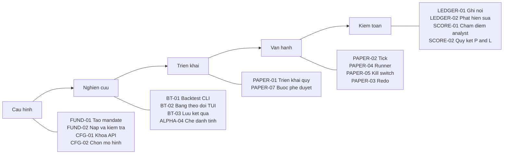

### 3.2 Hành trình theo Persona

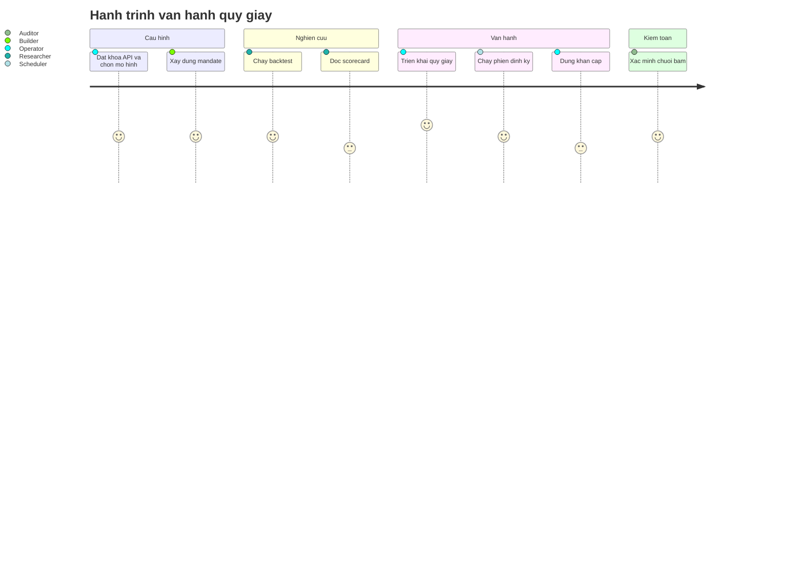

### 3.3 Walking Skeleton (lát cắt tối thiểu đầu-cuối)

Lát cắt không phụ thuộc LLM, chứng minh toàn bộ đường dữ liệu từ mandate đến sổ cái:

| Bước | Story | Kết quả |
|---|---|---|
| 1 | US-FUND-02 | Nạp mandate YAML hợp lệ |
| 2 | US-DATA-01 | Truy xuất giá và dữ liệu point-in-time |
| 3 | US-ALPHA-02 | Tín hiệu PEAD (định lượng, không gọi LLM) |
| 4 | US-PORT-01, US-PORT-02, US-PORT-04 | Sleeve, giới hạn rủi ro, lệnh delta |
| 5 | US-PAPER-01, US-PAPER-02 | Triển khai quỹ và chạy một phiên |
| 6 | US-LEDGER-01 | Bản ghi băm chuỗi đầu tiên được ghi |

### 3.4 Release Slices

| Release | Phạm vi | Trạng thái |
|---|---|---|
| R1 - Engine | `advance`, backtest, SimBroker, mô hình chi phí, ledger, kill switch, CLI JSON | `[OK]` |
| R2 - Analyst và TUI | 5 LLM persona, PEAD, cache prompt, blind backtest, TUI Textual, runner, quỹ phút, scorecard | `[OK]` |
| R3 - Vận hành tự động | Scheduler theo lịch thị trường, thông báo, heartbeat, quan sát sự kiện | `[SPEC]` |
| R4 - Kiểm định và phân bổ | Cổng CPCV/PBO, allocator động, risk budget theo pod | `[SPEC]` |
| R5 - Mở rộng | Broker thật, Ollama, analyst và nguồn dữ liệu bổ sung, web dashboard | `[SPEC]` |

---

## 4. HIGH-LEVEL ARCHITECTURE & COMPONENT BOUNDARIES

### 4.1 Architecture Overview

Kiến trúc là một tiến trình đơn (monolith modular). Tầng "Gateway" của khuôn mẫu tương ứng với lớp điều phối tham số và thông tin xác thực (`run.py: main`, `tui/keys.py: apply_credentials`); không có HTTP gateway.

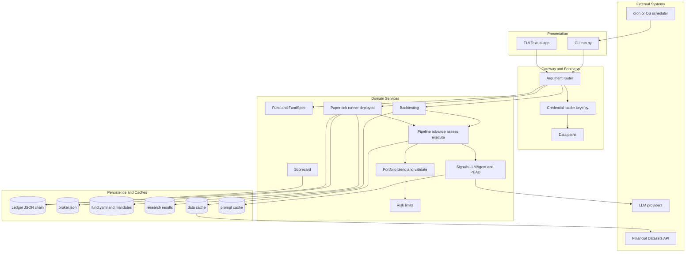

### 4.2 Epic Hierarchy Matrix

| Epic ID | Epic Name | Core Goal | Primary Persona | Mapped Modules |
|---|---|---|---|---|
| EP-FUND | Quản lý Mandate | Định nghĩa, kiểm tra và lưu cấu hình quỹ | P-03 | `fund/`, `strategies/`, `tui/builder.py`, `tui/funds.py` |
| EP-ALPHA | Analyst và Tín hiệu | Tạo quan điểm có luận điểm từ LLM và mô hình định lượng | P-04, P-02 | `signals/`, `llm/`, `features/` |
| EP-PORT | Danh mục và Rủi ro | Biến quan điểm thành lệnh trong giới hạn cứng | P-02, P-01 | `portfolio/`, `risk/`, `pipeline/stages.py`, `pipeline/execution.py` |
| EP-BT | Backtesting | Phát lại mandate trên lịch sử bằng đúng đường mã vận hành | P-02 | `backtesting/`, `tui/backtest.py`, `run.py` |
| EP-PAPER | Paper Trading | Triển khai và tiến hành quỹ giấy từng phiên | P-01, P-05 | `paper/`, `tui/paper.py`, `tui/paper_view.py` |
| EP-LEDGER | Sổ cái và Toàn vẹn | Bảo đảm sổ không thể sửa ngầm và khớp sổ broker | P-06, P-01 | `paper/ledger.py`, `pipeline/session.py`, `brokers/paper.py` |
| EP-SCORE | Scorecard | Chấm điểm analyst và quy kết lãi lỗ theo strategy | P-02, P-06 | `scorecard/`, `tui/scorecard_view.py` |
| EP-DATA | Dữ liệu Thị trường | Cung cấp dữ liệu point-in-time, fail-loud, có cache | P-02, P-04 | `data/` |
| EP-CFG | Khóa API và Mô hình | Thiết lập khóa nhà cung cấp và chọn LLM | P-01, P-02, P-03 | `tui/keys.py`, `tui/home.py`, `llm/registry.py` |

---

## 5. LIVING DOMAIN MODEL & DATA CONTRACTS

Hệ thống không dùng cơ sở dữ liệu quan hệ. "Bảng" là mô hình Pydantic, được tuần tự hóa thành JSON/YAML trong `~/.hedge-fund/`. Khóa chính (PK) và khóa ngoại (FK) dưới đây là khóa logic, được thực thi bằng mã (tên tệp, hash, giá trị trường), không bằng ràng buộc cơ sở dữ liệu.

### 5.1 Entity-Relationship Diagram (quỹ, sổ cái, quyết định)

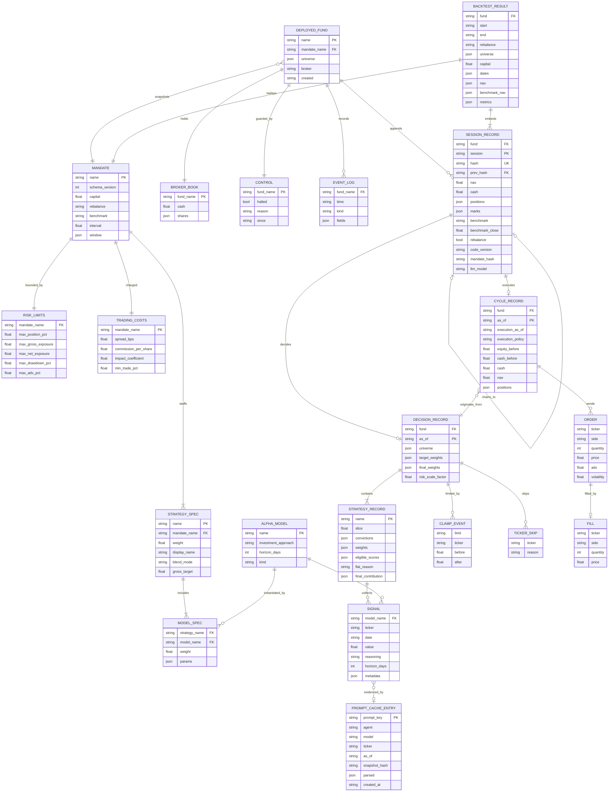

Quy ước quan hệ:

| Quan hệ | Loại | Cơ chế thực thi |
|---|---|---|
| MANDATE - STRATEGY_SPEC | 1-n | `FundSpec.strategies` (`min_length=1`, tên duy nhất) |
| STRATEGY_SPEC - ALPHA_MODEL | n-n qua MODEL_SPEC | `ModelSpec.name` phải thuộc `ALPHA_MODEL_REGISTRY` |
| DEPLOYED_FUND - MANDATE | n-1 (bản chụp) | `DeployedFund.spec` sao chép mandate tại thời điểm triển khai |
| DEPLOYED_FUND - SESSION_RECORD | 1-n | Thư mục `ledger/`, một tệp mỗi phiên |
| SESSION_RECORD - SESSION_RECORD | 1-1 tự tham chiếu | `prev_hash` bằng `hash` của bản ghi trước |
| SESSION_RECORD - DECISION_RECORD | 1-0..1 | Trường `decision` nhúng |
| SESSION_RECORD - CYCLE_RECORD | 1-0..1 | Trường `executed` nhúng |
| SIGNAL - PROMPT_CACHE_ENTRY | n-0..1 | `metadata.prompt_key` (chỉ với LLM agent) |

### 5.2 Entity-Relationship Diagram (dữ liệu thị trường)

Dữ liệu thị trường là hợp đồng với Financial Datasets API, khóa theo `ticker`, không được lưu như thực thể của hệ thống (chỉ có bộ nhớ đệm JSON).

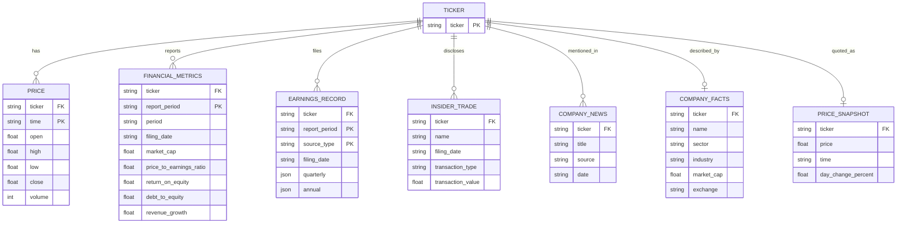

### 5.3 Data Dictionary - Aggregate Roots và Entities cốt lõi

#### 5.3.1 MANDATE (`FundSpec`, `fund/spec.py`) - Aggregate Root

| Thuộc tính | Kiểu | Ràng buộc | Mặc định |
|---|---|---|---|
| `schema_version` | int | Bắt buộc, giá trị `2`; thiếu trường bị từ chối với thông báo "older format" | - |
| `name` | string | Bắt buộc; dùng làm tên tệp `<name>.yaml` | - |
| `strategies` | list[StrategySpec] | `min_length=1`; tên strategy duy nhất | - |
| `risk` | RiskLimits | Bắt buộc | - |
| `costs` | TradingCosts | Chỉ tuần tự hóa khi khác giá trị mặc định | `TradingCosts()` |
| `capital` | float | `> 0` | 100000.0 |
| `rebalance` | enum | `minute`, `daily`, `weekly`, `monthly` | `weekly` |
| `interval` | float | `> 0`; chỉ hợp lệ khi `rebalance = minute`; sàn 1 giây | 1.0 (phút) |
| `window` | TradingWindow | Chỉ hợp lệ với quỹ phút; `04:00 <= start < end <= 20:00` ET | `09:30`-`16:00` |
| `benchmark` | string | Chuyển thành chữ hoa; nguồn lưới phiên | `SPY` |

Cấu hình `extra="forbid"`: khóa lạ bị từ chối (kiểm thử `test_typo_key_rejected`).

#### 5.3.2 STRATEGY_SPEC / MODEL_SPEC / BLEND

| Thực thể.Thuộc tính | Kiểu | Ràng buộc |
|---|---|---|
| StrategySpec.`weight` | float | `> 0`; tỷ trọng vốn tương đối, chuẩn hóa khi bù trừ |
| StrategySpec.`models` | list[ModelSpec] | `min_length=1` |
| ModelSpec.`name` | string | Phải có `investment_approach` và `horizon_days` khai báo trên chính lớp đăng ký |
| ModelSpec.`weight` | float | `> 0` |
| BlendPolicy.`mode` | enum | `long_only`, `long_short`, `dollar_neutral` |
| BlendPolicy.`gross_target` | float | `> 0`, mặc định 1.0 |

#### 5.3.3 RISK_LIMITS (`risk/limits.py`)

| Thuộc tính | Ràng buộc | Tác động |
|---|---|---|
| `max_position_pct` | `0 < x <= 1` | Trần |w| mỗi mã |
| `max_gross_exposure` | `> 0` | Trần tổng |w| |
| `max_net_exposure` | `> 0`, tùy chọn | Dải |long - short| |
| `max_drawdown_pct` | `0 < x < 1`, tùy chọn | Dừng lỗ, bán toàn bộ về tiền mặt |
| `max_adv_pct` | `0 < x <= 1`, tùy chọn | Trần kích thước lệnh theo ADV 20 phiên |

#### 5.3.4 TRADING_COSTS (`brokers/costs.py`)

| Thuộc tính | Mặc định | Ràng buộc |
|---|---|---|
| `spread_bps` | 5.0 | `>= 0`; nửa spread mỗi phía |
| `commission_per_share` | 0.005 | `>= 0` |
| `impact_coefficient` | 1.0 | `>= 0`; hệ số Y của luật căn bậc hai |
| `min_trade_pct` | 0.005 | `0 <= x < 1`; dải không giao dịch cho lệnh tăng |

#### 5.3.5 SESSION_RECORD (`pipeline/session.py`) - Aggregate Root của sổ cái

| Thuộc tính | Kiểu | Ràng buộc |
|---|---|---|
| `schema_version` | Literal[2] | Cố định |
| `fund`, `session` | string | `session` là `YYYY-MM-DD` (ngày) hoặc `YYYY-MM-DDTHH:MM:SS` (thanh) |
| `nav`, `cash` | float | `nav = cash + sum(shares x mark)` |
| `positions` | dict[str, int] | Số cổ phiếu có dấu; âm là vị thế bán khống |
| `marks` | dict[str, float] | Giá đóng cửa dùng định giá sổ |
| `prev_hash` | string hoặc null | Phải bằng `hash` của bản ghi liền trước |
| `hash` | string | SHA-256 của JSON bản ghi (loại trừ `hash`); loại trừ `snapshot_times` khi null |
| `executed` | CycleRecord hoặc null | Quyết định chờ được thực thi tại phiên này |
| `decision` | DecisionRecord hoặc null | Quyết định mới, thực thi ở phiên kế tiếp |
| `code_version`, `mandate_hash`, `llm_model` | string | Dấu vết phiên bản mã, mandate, mô hình LLM |

Index logic: tên tệp `ledger/<session>.json` (ngày) hoặc `ledger/<date>/<HHMMSS>.json` (thanh); sắp xếp theo chuỗi.

#### 5.3.6 DECISION_RECORD và CYCLE_RECORD (`pipeline/models.py`)

| Thực thể | Thuộc tính trọng yếu | Ghi chú |
|---|---|---|
| DecisionRecord | `as_of`, `spec`, `universe`, `marks`, `skipped`, `strategies`, `target_weights`, `clamps`, `final_weights` | Không chứa lệnh hay sổ broker |
| CycleRecord | `equity_before`, `cash_before`, `orders`, `fills`, `positions`, `cash`, `nav`, `original_assessment`, `refreshed_assessment`, `execution_as_of`, `execution_policy` | `execution_policy` là `next_close` hoặc `next_bar` |
| CycleRecord (tính toán) | `slippage`, `spread_cost`, `impact`, `commission`, `trading_cost` | Suy ra từ sổ, không lưu |

#### 5.3.7 SIGNAL (`models.py`)

| Thuộc tính | Kiểu | Ràng buộc |
|---|---|---|
| `model_name` | string | Khóa vào `ALPHA_MODEL_REGISTRY` |
| `ticker`, `date` | string | `date` là thời điểm quan điểm được hình thành |
| `value` | float | Trong `[-1, 1]`; ngoài khoảng bị `blend_signals` từ chối |
| `reasoning` | string | Luận điểm; bắt đầu bằng `abstained:` khi không có quan điểm |
| `horizon_days` | int hoặc null | `> 0`; do engine gắn từ khai báo của analyst; không tuần tự hóa khi null |
| `metadata.abstained` | bool | `true` loại tín hiệu khỏi mẫu số của phép pha trộn |

#### 5.3.8 Tệp trạng thái quỹ trên đĩa (`paths.py`, `paper/*`)

| Đường dẫn | Nội dung | Ghi |
|---|---|---|
| `~/.hedge-fund/mandates/<name>.yaml` | Mandate | `save_spec` (chế độ `x`, không ghi đè) |
| `~/.hedge-fund/paper/<name>/fund.yaml` | `DeployedFund` | Tại `deploy` |
| `.../broker.json` | `{cash, shares}` | Ghi nguyên tử sau mỗi lệnh khớp |
| `.../ledger/**.json` | `SessionRecord` | `Ledger.append` (ghi nguyên tử) |
| `.../ledger/<date>/checkpoint.json` | `FundState` cuối ngày (quỹ phút) | `Ledger.checkpoint` |
| `.../ledger/superseded/` | Bản ghi bị thay bởi redo | `Ledger.rewind` |
| `.../control.json` | `{halted, reason, since}` | `halt`, `resume` |
| `.../events.jsonl` | Nhật ký sự kiện dạng dòng JSON | `Ledger.log_event` |
| `.../runner.pid`, `runner.log` | Tiến trình runner | `serve`, `spawn_runner` |
| `~/.hedge-fund/research/<fund>-<start>-<end>-<stamp>.json` | `FundBacktestResult` | `save_result` |
| `~/.hedge-fund/cache/data/<key>.json` | Phản hồi API đã nhớ đệm | `CachedDataClient` |
| `~/.hedge-fund/cache/llm/<key>.json` | Prompt và phản hồi LLM | `PromptCache.put` |
| `~/.hedge-fund/.env` | Khóa API | `tui/keys.py: save_credential` |

### 5.4 Quy tắc bất biến của miền

| ID | Bất biến | Bằng chứng |
|---|---|---|
| INV-01 | Quyết định tại phiên T chỉ được thực thi tại phiên kế tiếp, không bao giờ cùng giá đóng cửa | `pipeline/session.py` (docstring), `test_session.py` |
| INV-02 | Phiên rebalance chỉ phụ thuộc phiên hiện tại và phiên trước | `is_rebalance_session` |
| INV-03 | Bản ghi hash sai, đứt chuỗi hoặc trùng phiên bị từ chối khi ghi và khi replay | `Ledger.append`, `Ledger.replay` |
| INV-04 | Sổ broker phải khớp sổ ledger đến từng cent trước khi giao dịch | `reconcile`, `_CASH_TOLERANCE = 0.01` |
| INV-05 | Giới hạn rủi ro chỉ thu nhỏ vị thế, không phân bổ lại phần bị cắt | `risk/limits.py` (docstring) |
| INV-06 | Tổng đóng góp của các strategy phải bằng trọng số cuối cùng của mỗi mã | `portfolio/validation.py` |
| INV-07 | Lỗi hạ tầng dữ liệu phải ném ngoại lệ; chỉ HTTP 404 nghĩa là "không có dữ liệu" | `data/client.py: _request` |
| INV-08 | Mandate đổi sau khi đánh giá thì quyết định bị từ chối thực thi | `stages.py: execute_decision` |

---

## 6. SERVICE CONTRACTS & EXTERNAL BOUNDARIES

Ứng dụng không phơi bày HTTP API. Hợp đồng dịch vụ gồm: (1) giao diện dòng lệnh, (2) giao thức Python (`DataClient`, `Broker`, `LLMClient`, `AlphaModel`, `Clock`), (3) hợp đồng với dịch vụ ngoại vi.

### 6.1 Hợp đồng CLI (`aihf`)

| Lệnh | Tham số | Đầu ra | Mã thoát |
|---|---|---|---|
| `aihf` | không | Mở TUI | 0 |
| `aihf backtest <mandate> --universe T1,T2 [--start] [--end] [--out] [--model]` | `--universe` bắt buộc | stdout: JSON `FundBacktestResult`; stderr: tóm tắt, bảng scorecard | 0; lỗi tham số: 2 |
| `aihf paper create <name> --mandate <file> --universe <tickers>` | cả ba bắt buộc | stderr: xác nhận triển khai | 0; tên trùng hoặc không hợp lệ: 2 |
| `aihf paper tick <name> [--session] [--again]` | `--session` phải là phiên kế tiếp chưa ghi | stdout: JSON `SessionRecord` | 1 khi `FundHalted`, `NothingDue`, `LedgerError` |
| `aihf paper run <name>` | - | Vòng lặp nền; log trên stderr | 1 nếu đã có runner |
| `aihf paper stop <name>` | - | Gửi SIGTERM tới runner | 0 |
| `aihf paper status <name>` | - | stdout: dòng trạng thái, quyết định chờ, sổ vị thế | 0 |
| `aihf paper list` | - | stdout: một dòng mỗi quỹ | 0 |
| `aihf paper scorecard <name>` | - | stdout: JSON `Scorecard` | 0 |
| `aihf paper halt <name> --reason <text>` | `--reason` bắt buộc | Ghi `control.json` | 0 |
| `aihf paper resume <name>` | - | Xóa cờ halt | 0 |

Quy ước luồng: stdout chỉ chứa JSON thuần; trạng thái và tóm tắt ghi ra stderr (`run.py: main`).

### 6.2 Response Envelope và Error Wrapper

Không có phong bì HTTP. Hợp đồng tương đương:

| Thành phần | Mô tả | Bằng chứng |
|---|---|---|
| Phong bì thành công | Một đối tượng JSON `SessionRecord` (tick) hoặc `FundBacktestResult` (backtest) hoặc `Scorecard`; `schema_version = 2` | `pipeline/session.py`, `backtesting/fund.py` |
| Lỗi cấu hình | `ValueError` với tiền tố đường dẫn tệp: `<path>: <field>: <message>` | `fund/spec.py: _validation_message` |
| Lỗi trạng thái quỹ | `FundHalted`, `NothingDue`, `LedgerError`, `BookMismatch` | `pipeline/session.py`, `paper/*` |
| Lỗi dữ liệu | `FDClientError(message, status_code, path)` | `data/client.py` |
| Lỗi LLM | `LLMCallError(message, diagnostic_record)`, `LLMParseError` | `llm/client.py` |
| Hợp đồng lỗi LLM trong analyst | Lỗi gọi hoặc phân tích bị chuyển thành Signal `value = 0.0`, `metadata.abstained = true`; lỗi dữ liệu thì lan truyền | `signals/llm_agent.py` |

Hợp đồng đầu ra LLM persona (JSON): `{"signal": "bullish|neutral|bearish", "confidence": 0-100, "reasoning": string}`; `Signal.value = dấu x confidence / 100`.

### 6.3 Hợp đồng giao thức nội bộ

| Giao thức | Phương thức | Hợp đồng hành vi |
|---|---|---|
| `DataClient` (`data/protocol.py`) | `get_prices`, `get_snapshot`, `get_financial_metrics`, `get_news`, `get_insider_trades`, `get_company_facts`, `get_earnings`, `get_earnings_history`, `get_market_cap` | Rỗng hoặc `None` nghĩa là không có dữ liệu; lỗi hạ tầng phải ném ngoại lệ; `get_financial_metrics` phải point-in-time theo `filing_date` |
| `Broker` (`brokers/protocol.py`) | `positions()`, `cash()`, `place_order(order)` | Khớp trọn lệnh hoặc ném ngoại lệ; không khớp từng phần; không có `equity()` |
| `LLMClient` (`llm/client.py`) | `model`, `complete(system, user) -> str` | Ném ngoại lệ khi lỗi truyền tải; tùy chọn `cache_key(agent, system, user)` |
| `AlphaModel` (`signals/base.py`) | `name`, `predict(ticker, date, data_client) -> Signal`; `investment_approach`, `horizon_days` | Chỉ dùng thông tin tại hoặc trước `date`; trả giá trị trong `[-1, 1]` |
| `Clock` (`pipeline/clock.py`) | `is_complete`, `previous`, `marks`, `session_date` | `marks` trả giá hữu hạn, dương cho mọi mã tại đúng phiên, nếu không ném ngoại lệ |

### 6.4 Danh mục kết nối ngoại vi

| ID | Hệ thống | Giao thức / Điểm cuối | Xác thực | Chính sách lỗi | Bằng chứng |
|---|---|---|---|---|---|
| EXT-01 | Financial Datasets | HTTPS GET `/prices/`, `/prices/snapshot/`, `/financial-metrics/`, `/news/`, `/insider-trades/`, `/company/facts/`, `/earnings/` | Header `X-API-Key` | Thử lại 429 sau 5, 15, 30 giây; 404 thành `None`; mã >= 400 khác ném `FDClientError`; theo `next_page_url`; hết thời gian 30 giây | `data/client.py` |
| EXT-02 | Anthropic | Thư viện `langchain-anthropic` | `ANTHROPIC_API_KEY` | Lỗi chuyển thành abstain | `llm/client.py` |
| EXT-03 | OpenAI, DeepSeek, Google, xAI, Kimi | Thư viện `langchain-*`; Kimi nhận `KIMI_API_KEY` hoặc `MOONSHOT_API_KEY` | Biến môi trường theo nhà cung cấp | Như EXT-02 | `llm/registry.py`, `test_client.py` |
| EXT-04 | TypeSafe (Jev) | HTTPS POST `https://api.typesafe.ai/v1/systemone` | `Authorization: Bearer` | Thử lại một lần với 429, 500, 502, 503, 504, 529; không theo chuyển hướng; ẩn khóa trong chẩn đoán; hết thời gian 60 giây | `llm/client.py: JevLLM` |
| EXT-05 | Danh sách breakpoint vốn hóa | Tệp CSV tải xuống, nhớ đệm đĩa | Không | Giữ bản cũ khi tải lỗi; ném ngoại lệ khi không có bản nào | `features/breakpoints.py` |
| EXT-06 | cron / OS scheduler | Tiến trình gọi `aihf paper tick` | Không | Tick lặp an toàn (idempotent) | `paper/tick.py` |
| EXT-07 | Hệ thống tệp của tác nhân vận hành | `~/.hedge-fund/` | Quyền tệp hệ điều hành | Ghi nguyên tử qua tệp tạm và `os.replace` | `paths.py: write_atomic` |

Webhook, hàng đợi thông điệp, broker thật: `[UNKNOWN]` trong mã; broker thật là `[SPEC]`.

### 6.5 Biến môi trường

| Biến | Vai trò |
|---|---|
| `FINANCIAL_DATASETS_API_KEY` | Khóa dữ liệu |
| `ANTHROPIC_API_KEY`, `OPENAI_API_KEY`, `DEEPSEEK_API_KEY`, `GOOGLE_API_KEY`, `XAI_API_KEY`, `KIMI_API_KEY` (hoặc `MOONSHOT_API_KEY`), `TYPESAFE_API_KEY` | Khóa nhà cung cấp LLM |
| `HEDGE_FUND_LLM_MODEL` | Mô hình LLM đang chọn; ghi đè bởi `--model` |
| `MOONSHOT_BASE_URL` | Địa chỉ Kimi cho khu vực Trung Quốc đại lục |

---

## 7. DETAILED EPICS & USER STORIES (SPECIFICATION BY EXAMPLE)

Quy ước chung cho Mục 7:

| Quy ước | Nội dung |
|---|---|
| Mã Story | `US-[EPIC]-[STT]`, ví dụ `US-FUND-01` |
| Truy vết mã | Đường dẫn tệp và hàm xử lý trong kho mã |
| Truy vết kiểm thử | Tệp kiểm thử pytest và tên hàm kiểm thử hiện có; "không có" nghĩa là chưa có kiểm thử chuyên biệt |
| Wireframe | Mẫu A (biểu mẫu), B (bảng theo dõi), C (danh sách); giao diện là TUI Textual hoặc đầu ra CLI, khung 74 ký tự |
| Tiêu chuẩn nghiệm thu | Gherkin; câu khẳng định khách quan; dữ liệu mẫu trích từ kiểm thử |
| Tác nhân | Persona P-01 đến P-06 (Mục 2.1) |

Danh mục Epic và số lượng Story:

| Epic | Số Story | Story |
|---|---|---|
| EP-FUND | 3 | US-FUND-01 đến US-FUND-03 |
| EP-ALPHA | 4 | US-ALPHA-01 đến US-ALPHA-04 |
| EP-PORT | 5 | US-PORT-01 đến US-PORT-05 |
| EP-BT | 3 | US-BT-01 đến US-BT-03 |
| EP-PAPER | 7 | US-PAPER-01 đến US-PAPER-07 |
| EP-LEDGER | 3 | US-LEDGER-01 đến US-LEDGER-03 |
| EP-SCORE | 2 | US-SCORE-01, US-SCORE-02 |
| EP-DATA | 2 | US-DATA-01, US-DATA-02 |
| EP-CFG | 2 | US-CFG-01, US-CFG-02 |

---

### EP-FUND - Quản lý Mandate

Mục tiêu nghiệp vụ: mandate là "bàn giao dịch" (strategy, nhân sự analyst, rủi ro, vốn, nhịp tái cân bằng) ở dạng dữ liệu, được kiểm tra nghiêm ngặt trước khi chạy và không chứa mã cổ phiếu.

#### US-FUND-01 - Xây dựng mandate bằng wizard

**User Story:**
Với tư cách là Người xây dựng quỹ (P-03), tôi muốn lắp ráp mandate qua các bước tên, strategy, vốn, nhịp tái cân bằng và mã giao dịch, để tạo một cấu hình quỹ hợp lệ mà không phải viết YAML thủ công.

**Source Code Traceability:**
- `hedge_fund/tui/builder.py` - `BuilderScreen` (các bước: tên, chọn strategy, nhân sự, vốn, cadence, interval, window, tickers, hoàn tất)
- `hedge_fund/fund/spec.py` - `custom_strategy`, `FundSpec`, `TradingWindow`
- `hedge_fund/fund/storage.py` - `save_spec`
- `hedge_fund/tui/funds.py` - `fund_name_taken`

**Automated Test Traceability:**
- `hedge_fund/tui/test_builder.py` - `test_builder_derives_rules_and_back_navigation_does_not_duplicate`, `test_builder_existing_name_and_save_race_never_overwrite`, `test_builder_paper_mode_builds_a_live_fund_and_refuses_taken_names`, `test_builder_minute_path_sets_interval_and_window_and_offers_start_running`, `test_builder_replaces_a_taken_name_only_after_yes_and_only_at_the_end`
- `hedge_fund/fund/test_spec.py` - `test_custom_rules_derive_with*`

**UI Interaction Wireframe (Mẫu A):**

```text
┌────────────────────────────────────────────────────────────────────────┐
│  STORY: US-FUND-01 - BUILD A FUND                       [Esc] back  [X]│
├────────────────────────────────────────────────────────────────────────┤
│  EPIC CONTEXT: EP-FUND | STEP: Starting capital                        │
│  Progress: [●] Name --- [●] Strategies --- [●] Capital --- [○] Cadence │
├────────────────────────────────────────────────────────────────────────┤
│  BUILD A FUND                                                          │
│  * Name your fund               * Starting capital ($)                 │
│  ┌──────────────────────────┐   ┌────────────────────────────────┐     │
│  │ alpha-one                │   │ 100000                         │     │
│  └──────────────────────────┘   └────────────────────────────────┘     │
│                                                                        │
│  * Rebalance cadence                                                   │
│  (•) weekly   ( ) daily   ( ) monthly   ( ) minute                     │
│                                                                        │
│  [!] Business Validation Notice: tên đã tồn tại bị từ chối khi lưu.    │
├────────────────────────────────────────────────────────────────────────┤
│  [ < Back ]                                       [ Enter: Continue > ]│
└────────────────────────────────────────────────────────────────────────┘
```

**Business Logic & Decision Flowchart:**

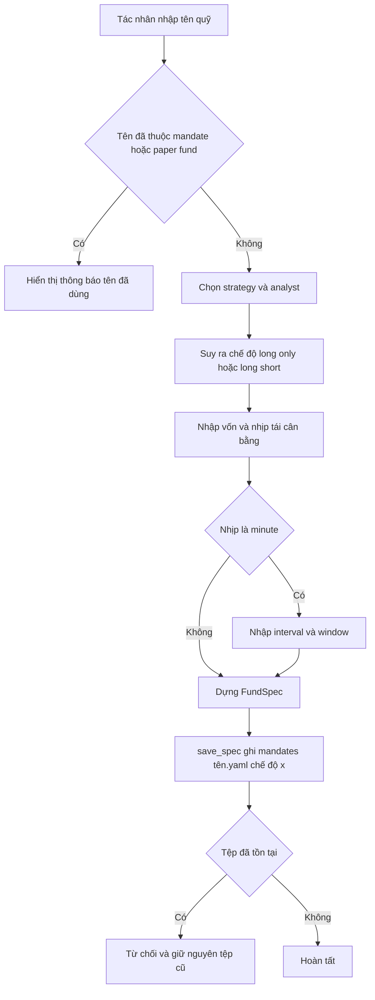

**Runtime Call-Stack Sequence Diagram:**

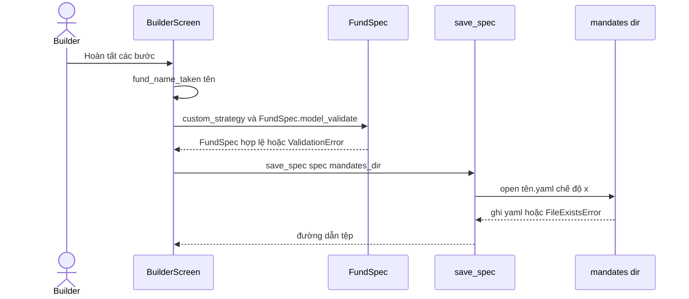

**Acceptance Criteria (BDD / Gherkin):**

```gherkin
Scenario 1: Happy Path - lưu mandate mới
  Given tên "alpha-one" chưa có trong mandates/ và paper/
  And Tác nhân chọn strategy "deep-value" và vốn 100000
  When Tác nhân xác nhận bước cuối của wizard
  Then hệ thống ghi tệp mandates/alpha-one.yaml với schema_version 2
  And chế độ pha trộn được suy ra từ hồ sơ analyst đã khai báo

Scenario 2: Edge Case - tên bị chiếm trong lúc lưu
  Given một tệp mandates/alpha-one.yaml xuất hiện sau khi wizard kiểm tra tên
  When hệ thống gọi save_spec
  Then save_spec ném FileExistsError
  And nội dung tệp có sẵn không bị thay đổi

Scenario 3: Edge Case - thay thế tên đã dùng
  Given tên "alpha-one" đã thuộc một quỹ
  When Tác nhân chọn thay thế
  Then hệ thống yêu cầu xác nhận "yes" trước khi xóa
  And việc xóa chỉ được thực hiện ở bước cuối của wizard
```

---

#### US-FUND-02 - Nạp và kiểm tra mandate YAML

**User Story:**
Với tư cách là Nhà nghiên cứu (P-02), tôi muốn hệ thống kiểm tra mandate YAML và báo lỗi theo đường dẫn tệp và tên trường, để phát hiện cấu hình sai trước khi tốn chi phí gọi API.

**Source Code Traceability:**
- `hedge_fund/fund/spec.py` - `load_spec`, `load_strategy`, `_read_yaml`, `_validation_message`, `FundSpec` (validators), `StrategySpec`, `TradingWindow`, `normalize_universe`
- `hedge_fund/run.py` - `_universe`, `_backtest` (gọi `parser.error` khi `ValueError`)

**Automated Test Traceability:**
- `hedge_fund/fund/test_spec.py` - `test_yaml_load_happy_path`, `test_typo_key_rejected`, `test_unversioned_files_are_rejected_without_changes`, `test_rebalance_cadence_validated`, `test_minute_fund_rejects_bad_intervals_and_windows`, `test_interval_and_window_are_refused_on_slower_cadences`, `test_duplicate_strategy_name_rejected`, `test_strategy_needs_models`, `test_mandate_carries_no_tickers`, `test_normalize_universe`, `test_unknown_analyst_names_valid_keys`
- `hedge_fund/test_run.py` - `test_cli_rejects_invalid_configuration_before_clients`
- `hedge_fund/fund/test_strategy_library.py` - `test_shipped_strategy_library_is_valid`, `test_packaged_example_uses_current_format`

**UI Interaction Wireframe (Mẫu A, đầu ra CLI):**

```text
┌────────────────────────────────────────────────────────────────────────┐
│  STORY: US-FUND-02 - VALIDATE MANDATE                     [CLI: stderr]│
├────────────────────────────────────────────────────────────────────────┤
│  EPIC CONTEXT: EP-FUND | CMD: aihf backtest bad.yaml --universe AAPL   │
├────────────────────────────────────────────────────────────────────────┤
│  $ aihf backtest ~/.hedge-fund/mandates/bad.yaml --universe AAPL       │
│                                                                        │
│  usage: aihf backtest [-h] --universe UNIVERSE mandate                 │
│  aihf backtest: error: bad.yaml: risk.max_position_pct: Input should be│
│  greater than 0; benchmark_ticker: Extra inputs are not permitted      │
│                                                                        │
│  [!] Business Validation Notice: lỗi nêu đường dẫn tệp và tên trường;  │
│      không tạo client dữ liệu, không gọi API.                          │
├────────────────────────────────────────────────────────────────────────┤
│  exit code: 2                                                          │
└────────────────────────────────────────────────────────────────────────┘
```

**Business Logic & Decision Flowchart:**

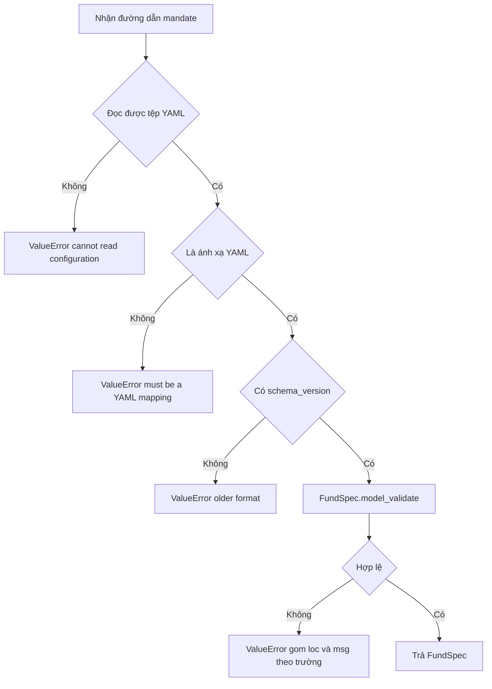

**Runtime Call-Stack Sequence Diagram:**

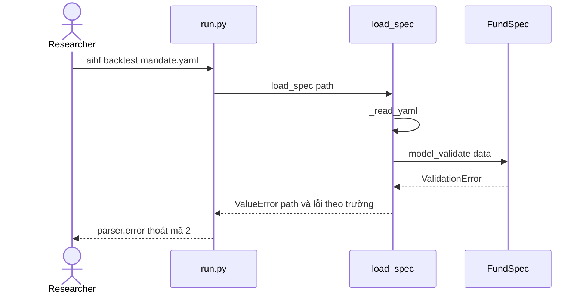

**Acceptance Criteria (BDD / Gherkin):**

```gherkin
Scenario 1: Happy Path
  Given một mandate có schema_version 2, strategy hợp lệ và risk hợp lệ
  When hệ thống gọi load_spec
  Then hệ thống trả FundSpec với benchmark viết hoa và vốn mặc định 100000

Scenario 2: Validation Failure - khóa không hợp lệ
  Given mandate chứa một khóa không thuộc lược đồ
  When hệ thống gọi load_spec
  Then hệ thống ném ValueError nêu đường dẫn tệp và tên khóa

Scenario 3: Validation Failure - thiếu phiên bản lược đồ
  Given mandate không có schema_version
  When hệ thống gọi load_spec
  Then hệ thống từ chối với thông báo định dạng cũ
  And tệp không bị sửa đổi

Scenario 4: Validation Failure - interval trên nhịp không phải minute
  Given mandate có rebalance "weekly" và trường interval
  When hệ thống gọi load_spec
  Then hệ thống từ chối và nêu "only a minute fund has these"
```

---

#### US-FUND-03 - Duyệt và xóa mandate trong thư viện

**User Story:**
Với tư cách là Nhà nghiên cứu (P-02), tôi muốn xem danh sách mandate đã lưu kèm kết quả backtest gần nhất và xóa mandate không còn dùng, để quản lý thư viện cấu hình mà không bị chặn bởi tệp lỗi.

**Source Code Traceability:**
- `hedge_fund/tui/funds.py` - `FundSelectScreen`, `ConfirmDeleteScreen`, `ConfirmWipeScreen`, `_delete_fund`, `wipe_fund`, `_wipe_manifest`
- `hedge_fund/fund/storage.py` - `discover_funds`, `SavedFund`
- `hedge_fund/backtesting/research.py` - `receipts`, `last_score`

**Automated Test Traceability:**
- `hedge_fund/tui/test_funds.py` - `test_both_pickers_disable_only_invalid_configurations`, `test_all_invalid_funds_do_not_crash_home_picker`, `test_latest_backtest_sets_headline_regardless_of_version`
- `hedge_fund/backtesting/test_research.py` - `test_research_history_is_matched_on_the_fund_field_not_the_filename_prefix`

**UI Interaction Wireframe (Mẫu C):**

```text
┌────────────────────────────────────────────────────────────────────────┐
│  STORY: US-FUND-03 - MANDATE LIBRARY                                   │
├────────────────────────────────────────────────────────────────────────┤
│  Keys: [Enter] open   [d] delete mandate   [Esc] back                  │
├────────────────────────────────────────────────────────────────────────┤
│  Mandate          Strategies          Last backtest        State       │
│  example-fund     deep-value, drift   +4.1% vs SPY +2.3%   valid       │
│  alpha-one        deep-value          none                 valid       │
│  broken-fund      -                   -                    INVALID     │
├────────────────────────────────────────────────────────────────────────┤
│  [!] broken-fund: schema_version: older format (không chọn được)       │
├────────────────────────────────────────────────────────────────────────┤
│  [d] Delete: enter = mandate only   ctrl+d = mandate + history         │
└────────────────────────────────────────────────────────────────────────┘
```

**Business Logic & Decision Flowchart:**

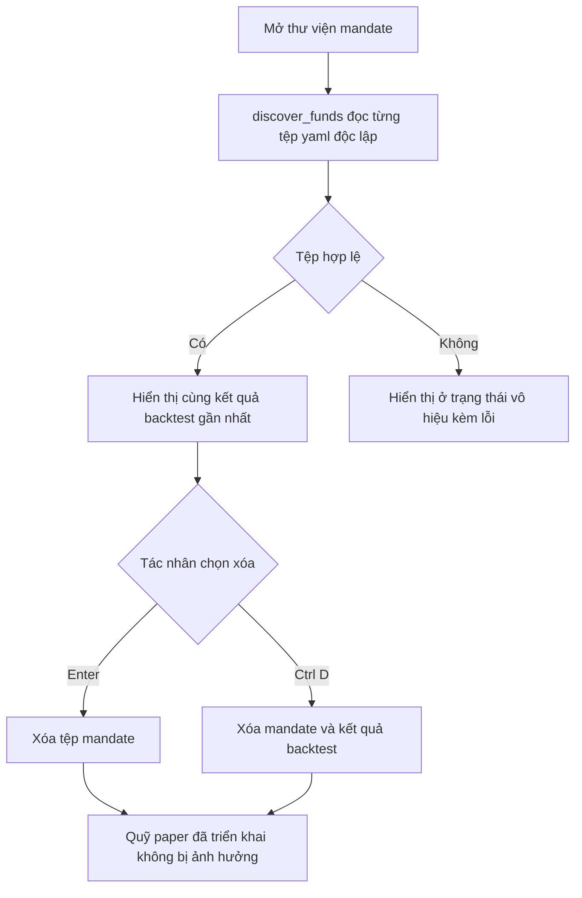

**Runtime Call-Stack Sequence Diagram:**

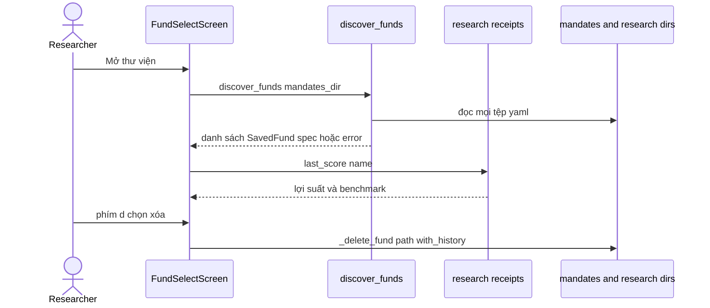

**Acceptance Criteria (BDD / Gherkin):**

```gherkin
Scenario 1: Happy Path
  Given thư mục mandates/ có hai tệp hợp lệ
  When Tác nhân mở thư viện
  Then hệ thống liệt kê cả hai theo thứ tự tên tệp
  And mỗi mandate hiển thị kết quả backtest gần nhất nếu có

Scenario 2: Edge Case - tệp không hợp lệ
  Given một tệp yaml vi phạm lược đồ
  When hệ thống gọi discover_funds
  Then hệ thống giữ tệp đó trong danh sách với trường error
  And hệ thống vô hiệu hóa việc chọn tệp đó mà không ngắt ứng dụng

Scenario 3: Delete Rule - giữ quỹ đã triển khai
  Given một paper fund được triển khai từ mandate "alpha-one"
  When Tác nhân xóa mandate "alpha-one"
  Then thư mục paper/alpha-one/ vẫn nguyên vẹn
  And lý do là quỹ giữ bản chụp riêng của mandate
```

---

### EP-ALPHA - Analyst và Tín hiệu

Mục tiêu nghiệp vụ: mọi analyst, dù là persona LLM hay mô hình định lượng, thực hiện cùng một hợp đồng `AlphaModel.predict` và trả `Signal` trong khoảng -1 đến +1 kèm luận điểm. Hệ thống phải bảo đảm tính point-in-time, khả năng kiểm toán prompt và khả năng tái sử dụng kết quả.

#### US-ALPHA-01 - Phát tín hiệu từ LLM persona

**User Story:**
Với tư cách là Nhà nghiên cứu (P-02), tôi muốn mỗi LLM persona (Buffett, Munger, Graham, Lynch, Druckenmiller) đánh giá một mã tại một ngày và trả độ tin cậy kèm luận điểm, để quỹ có quan điểm định tính có thể kiểm toán.

**Source Code Traceability:**
- `hedge_fund/signals/llm_agent.py` - `LLMAgent.predict`, `_parse`, `_to_signal`, `_abstain`
- `hedge_fund/signals/{buffett,munger,graham,lynch,druckenmiller}.py` - `get_system_prompt`, `investment_approach`, `horizon_days`
- `hedge_fund/features/snapshot.py` - `build_snapshot`, `InsufficientData`
- `hedge_fund/llm/client.py` - `make_llm`, `extract_json`, `LLMCallError`
- `hedge_fund/llm/contract.py` - `build_jev_request`, `normalize_jev_response`
- `hedge_fund/llm/watch.py` - `ThesisStream` (hiển thị luận điểm khi đang sinh)

**Automated Test Traceability:**
- `hedge_fund/signals/test_llm_agents.py` - `test_value_folding`, `test_malformed_json_abstains`, `test_llm_error_abstains`, `test_insufficient_data_abstains`, `test_data_layer_error_propagates`, `test_llm_personas_share_the_contract`, `test_registry_names_match_keys`, `test_extract_json_*`
- `hedge_fund/llm/test_contract.py` - `test_mapping_and_existing_agent_parser`, `test_invalid_response_envelopes_raise_contract_error`
- `hedge_fund/llm/test_watch.py` - `TestOrder`, `TestChunking`, `TestEscapes`

**UI Interaction Wireframe (Mẫu B, bảng theo dõi analyst):**

```text
┌────────────────────────────────────────────────────────────────────────┐
│  STORY: US-ALPHA-01 - ANALYST BOARD                 [Status: Running ●]│
│  Ticker: AAPL | Session: 2026-10-30            Model: claude-opus-5-5  │
├────────────────────────────────────────────────────────────────────────┤
│  ANALYST VIEWS                                                         │
│  Analyst         Signal     Confidence   Value    Thesis (streaming)   │
│  buffett         bullish    70       +0.70    Durable franchise, hig...│
│  graham          neutral    55       +0.00    Margin of safety absen...│
│  druckenmiller   bearish    40       -0.40    Liquidity turning agai...│
│  lynch           abstain    -        +0.00    abstained: LLM call fa...│
├────────────────────────────────────────────────────────────────────────┤
│  value = dấu x confidence / 100; abstain loại khỏi phép pha trộn       │
└────────────────────────────────────────────────────────────────────────┘
```

**Business Logic & Decision Flowchart:**

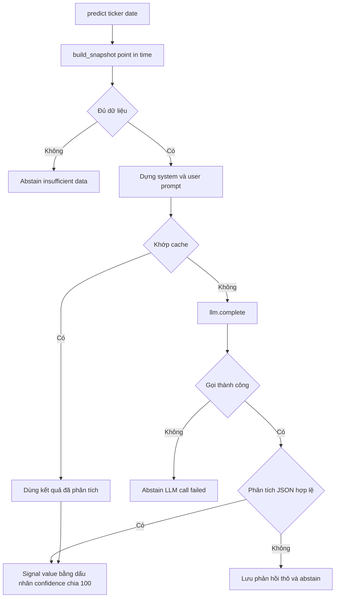

**Runtime Call-Stack Sequence Diagram:**

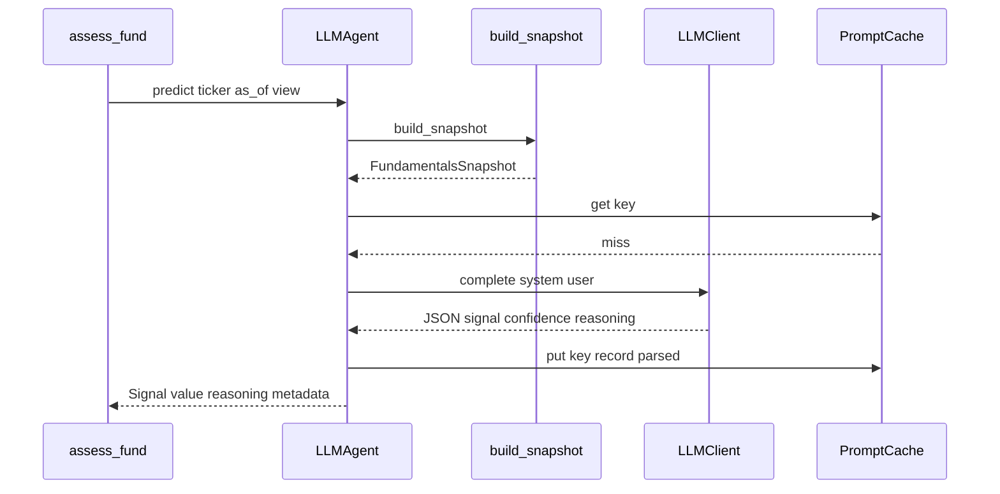

**Acceptance Criteria (BDD / Gherkin):**

```gherkin
Scenario 1: Happy Path
  Given phản hồi LLM {"signal": "bullish", "confidence": 80, "reasoning": "..."}
  When hệ thống gọi predict cho mã AAPL
  Then Signal.value bằng +0.8
  And metadata.abstained bằng false và metadata.prompt_key được gắn

Scenario 2: Validation Failure - JSON không hợp lệ
  Given phản hồi LLM không chứa JSON phân tích được
  When hệ thống gọi predict
  Then Signal.value bằng 0.0 và metadata.abstained bằng true
  And phản hồi thô được lưu vào cache kèm parse_error

Scenario 3: Failure Contract - lỗi gọi LLM
  Given llm.complete ném ngoại lệ
  When hệ thống gọi predict
  Then hệ thống trả Signal abstain với lý do "LLM call failed"

Scenario 4: Failure Contract - lỗi tầng dữ liệu
  Given data client ném FDClientError khi dựng snapshot
  When hệ thống gọi predict
  Then ngoại lệ được lan truyền
  And hệ thống không chuyển lỗi hạ tầng thành quan điểm trung lập

Scenario 5: Edge Case - dữ liệu không đủ
  Given mã không có chỉ số tài chính trước ngày đánh giá
  When hệ thống gọi predict
  Then hệ thống trả Signal abstain với lý do "insufficient data"
```

---

#### US-ALPHA-02 - Phát tín hiệu PEAD từ bất ngờ lợi nhuận

**User Story:**
Với tư cách là Nhà nghiên cứu (P-02), tôi muốn mô hình PEAD tạo quan điểm mua sau khi lợi nhuận vượt dự báo và bán sau khi hụt dự báo, để quỹ có một nguồn tín hiệu định lượng không phụ thuộc LLM.

**Source Code Traceability:**
- `hedge_fund/signals/pead.py` - `PEADModel.predict`, `_qualifying_events`, `_parse_date`
- `hedge_fund/signals/base.py` - `QuantModel`
- `hedge_fund/data/client.py` - `get_earnings_history`

**Automated Test Traceability:**
- `hedge_fund/signals/test_signals.py` - `TestPEADPredict`: `test_beat_fires_long`, `test_miss_fires_short`, `test_meet_is_neutral`, `test_no_earnings_is_neutral`, `test_stale_event_is_neutral`, `test_point_in_time_ignores_future_filings`, `test_freshness_window_bridges_weekend`, `test_45_day_retrospective_filter`, `test_dedup_prefers_8k`, `test_dedup_earliest_8k_wins`, `test_10q_only_period_is_neutral`, `test_10q_fallback_when_announcement_only_false`

**UI Interaction Wireframe (Mẫu C):**

```text
┌────────────────────────────────────────────────────────────────────────┐
│  STORY: US-ALPHA-02 - PEAD EVENT VIEW                                  │
├────────────────────────────────────────────────────────────────────────┤
│  Model: pead | approach: long_short | horizon: 60 sessions             │
├────────────────────────────────────────────────────────────────────────┤
│  Ticker  Report period  Filed       Source  EPS surprise  Signal       │
│  AAPL    2026-06-30     2026-07-30  8-K     BEAT          +1.0         │
│  MSFT    2026-06-30     2026-07-29  8-K     MISS          -1.0         │
│  NVDA    2026-07-31     2026-08-27  10-Q    BEAT          0.0 (bỏ qua) │
│  JPM     2026-03-31     2026-04-12  8-K     BEAT          0.0 (quá hạn)│
├────────────────────────────────────────────────────────────────────────┤
│  [i] Cửa sổ hiệu lực mặc định: 4 ngày kể từ ngày nộp hồ sơ             │
└────────────────────────────────────────────────────────────────────────┘
```

**Business Logic & Decision Flowchart:**

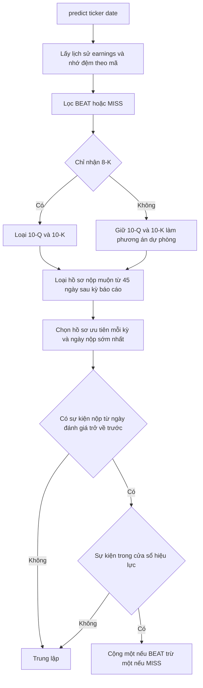

**Runtime Call-Stack Sequence Diagram:**

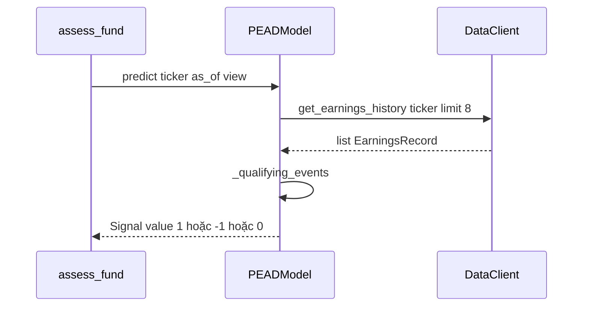

**Acceptance Criteria (BDD / Gherkin):**

```gherkin
Scenario 1: Happy Path - BEAT
  Given hồ sơ 8-K nộp 1 ngày trước ngày đánh giá với eps_surprise "BEAT"
  When hệ thống gọi predict
  Then Signal.value bằng +1.0
  And Signal.reasoning nêu kỳ báo cáo, ngày nộp và loại hồ sơ

Scenario 2: Happy Path - MISS
  Given hồ sơ 8-K trong cửa sổ hiệu lực với eps_surprise "MISS"
  When hệ thống gọi predict
  Then Signal.value bằng -1.0

Scenario 3: Edge Case - sự kiện quá hạn
  Given hồ sơ BEAT nộp trước ngày đánh giá nhiều hơn signal_window_days
  When hệ thống gọi predict
  Then Signal.value bằng 0.0

Scenario 4: Edge Case - point-in-time
  Given hồ sơ có ngày nộp sau ngày đánh giá
  When hệ thống gọi predict
  Then hệ thống bỏ qua hồ sơ đó và trả Signal.value 0.0

Scenario 5: Edge Case - chỉ có 10-Q
  Given kỳ báo cáo chỉ có hồ sơ 10-Q và announcement_only bằng true
  When hệ thống gọi predict
  Then Signal.value bằng 0.0
```

---

#### US-ALPHA-03 - Tái sử dụng quyết định LLM từ prompt cache

**User Story:**
Với tư cách là Nhà nghiên cứu (P-02), tôi muốn hệ thống lưu prompt và phản hồi của mọi quyết định LLM và không gọi lại khi dữ liệu không đổi, để giảm chi phí backtest và có bằng chứng kiểm toán chính xác.

**Source Code Traceability:**
- `hedge_fund/llm/cache.py` - `PromptCache.get/put`, `prompt_key`
- `hedge_fund/signals/llm_agent.py` - `LLMAgent.predict` (khóa cache, bản ghi, `cached`)
- `hedge_fund/llm/client.py` - `JevLLM.cache_key`
- `hedge_fund/features/intraday.py` - `build_intraday_context` (phân nhóm để thanh yên tĩnh dùng chung prompt)

**Automated Test Traceability:**
- `hedge_fund/signals/test_llm_agents.py` - `test_cache_hit_skips_llm_call`, `test_new_as_of_same_data_hits_cache`, `test_new_filing_forces_new_llm_call`, `test_prompt_and_response_persisted`, `test_failed_parse_still_persists_response`, `test_quiet_bars_share_one_prompt_and_a_headline_changes_it`
- `hedge_fund/features/test_intraday.py` - `test_two_quiet_bars_render_the_same_block`
- `hedge_fund/features/test_snapshot.py` - `test_content_hash_stable_and_sensitive`, `test_same_data_different_as_of_same_render_and_hash`

**UI Interaction Wireframe (Mẫu B):**

```text
┌────────────────────────────────────────────────────────────────────────┐
│  STORY: US-ALPHA-03 - PROMPT CACHE TELEMETRY        [Status: Active ●] │
│  Scope: backtest run                              Cache dir: cache/llm │
├────────────────────────────────────────────────────────────────────────┤
│  SUMMARY CARDS                                                         │
│  ┌─────────────────┐  ┌─────────────────┐  ┌─────────────────┐         │
│  │ LLM CALLS       │  │ CACHE HITS      │  │ ABSTAINED       │         │
│  │ 36              │  │ 412             │  │ 2               │         │
│  │ billed          │  │ cost 0 USD      │  │ call or parse   │         │
│  └─────────────────┘  └─────────────────┘  └─────────────────┘         │
├────────────────────────────────────────────────────────────────────────┤
│  Khóa cache = SHA-256 của agent, model, system prompt, user prompt     │
└────────────────────────────────────────────────────────────────────────┘
```

**Business Logic & Decision Flowchart:**

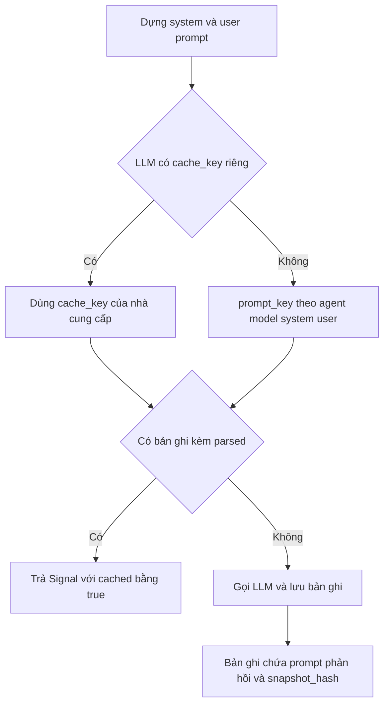

**Runtime Call-Stack Sequence Diagram:**

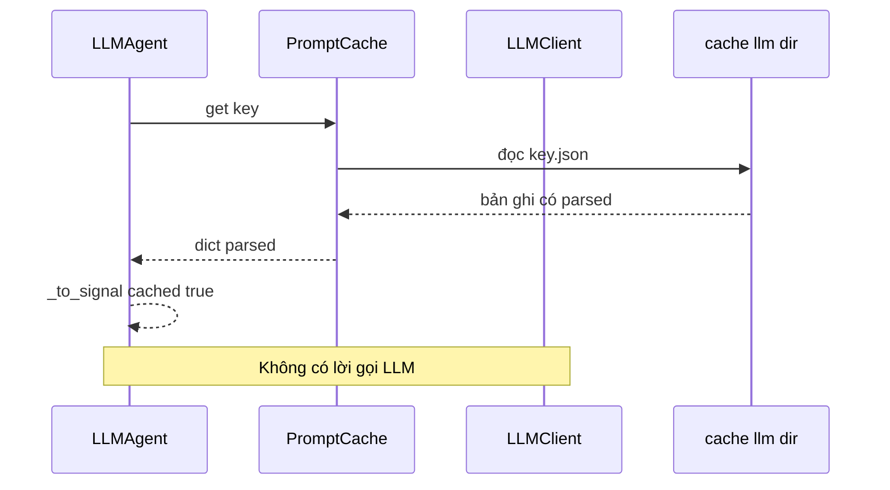

**Acceptance Criteria (BDD / Gherkin):**

```gherkin
Scenario 1: Happy Path - trúng cache
  Given đã có bản ghi cache với "parsed" cho cùng agent, model và prompt
  When hệ thống gọi predict lần thứ hai
  Then hệ thống không gọi llm.complete
  And metadata.cached bằng true

Scenario 2: Edge Case - ngày đánh giá mới, dữ liệu không đổi
  Given snapshot có cùng nội dung nhưng as_of khác
  When hệ thống gọi predict
  Then prompt giống nhau và hệ thống dùng lại bản ghi cache

Scenario 3: Edge Case - hồ sơ mới
  Given một hồ sơ tài chính mới làm đổi nội dung snapshot
  When hệ thống gọi predict
  Then khóa cache đổi và hệ thống gọi LLM

Scenario 4: Failure Contract - bản ghi hỏng
  Given tệp cache không phải JSON hợp lệ
  When PromptCache.get đọc tệp
  Then hệ thống coi là không có bản ghi và ghi đè khi gọi lại
```

---

#### US-ALPHA-04 - Che danh tính công ty trong backtest (blind)

**User Story:**
Với tư cách là Nhà nghiên cứu (P-02), tôi muốn prompt của LLM persona không chứa mã cổ phiếu, ngành, ngày lịch và giá trị đô la trong backtest, để kết quả không bị cộng điểm nhờ ký ức của LLM về diễn biến thực của công ty.

**Source Code Traceability:**
- `hedge_fund/run.py` - `_backtest` (`Fund(spec, blind=True)`)
- `hedge_fund/fund/spec.py` - `Fund.__init__` (tham số `blind`)
- `hedge_fund/signals/llm_agent.py` - `LLMAgent.__init__` (`blind`, `breakpoints`), `build_snapshot`
- `hedge_fund/features/snapshot.py` - `FundamentalsSnapshot.render(blind=True)`
- `hedge_fund/features/breakpoints.py` - `load_breakpoints`, `shared_breakpoints`, `MEBreakpoints`
- `hedge_fund/features/intraday.py` - `IntradayContext.render(blind=True)`

**Automated Test Traceability:**
- `hedge_fund/signals/test_llm_agents.py` - `test_blind_agent_prompt_withholds_ticker_and_dates`, `test_agents_are_not_blind_unless_asked`
- `hedge_fund/features/test_snapshot.py` - `test_blind_render_withholds_ticker_dates_and_dollars`, `test_blind_size_is_a_percentile_only_when_breakpoints_are_given`, `test_blind_size_below_the_fifth_percentile_and_missing_cap`, `test_blind_index_dashes_without_a_positive_base_and_keeps_sign`, `test_blind_render_is_opt_in`
- `hedge_fund/features/test_breakpoints.py` - `test_load_fetches_once_then_reads_the_cache`, `test_load_keeps_a_stale_cache_when_the_fetch_fails`, `test_load_raises_with_no_cache_and_no_fetch`
- `hedge_fund/features/test_intraday.py` - `test_blind_render_keeps_bands_and_surprise_and_drops_names_and_clocks`

**UI Interaction Wireframe (Mẫu A, đầu ra prompt):**

```text
┌────────────────────────────────────────────────────────────────────────┐
│  STORY: US-ALPHA-04 - BLIND PROMPT PREVIEW                [Mode: blind]│
├────────────────────────────────────────────────────────────────────────┤
│  EPIC CONTEXT: EP-ALPHA | STEP: Render snapshot                        │
├────────────────────────────────────────────────────────────────────────┤
│  LIVE (blind = false)         BACKTEST (blind = true)                  │
│  Ticker: AAPL                 Ticker: [withheld]                       │
│  Industry: Consumer Elec      Industry: [withheld]                     │
│  As of: 2026-10-30            As of: [withheld]                        │
│  Market cap: 3.2T USD         Size: percentile 99                      │
│  Revenue: 391B USD            Revenue index: 1.00 (cơ sở)              │
├────────────────────────────────────────────────────────────────────────┤
│  [!] Business Validation Notice: không có bảng breakpoint và không có  │
│      bản nhớ đệm thì hệ thống ném ngoại lệ.                            │
└────────────────────────────────────────────────────────────────────────┘
```

**Business Logic & Decision Flowchart:**

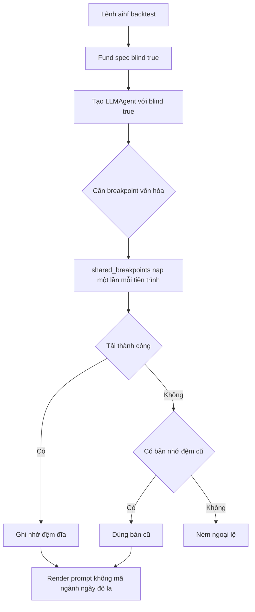

**Runtime Call-Stack Sequence Diagram:**

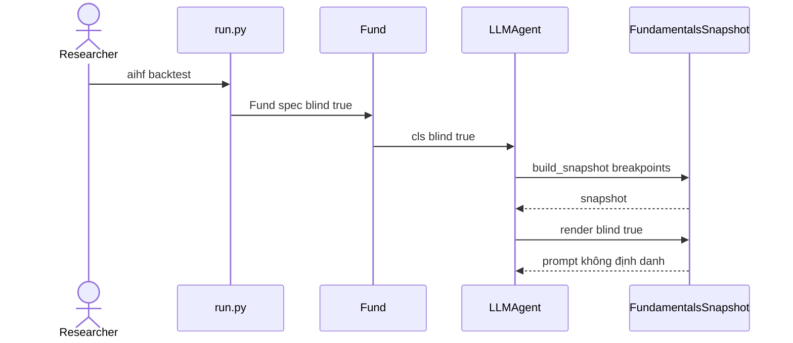

**Acceptance Criteria (BDD / Gherkin):**

```gherkin
Scenario 1: Happy Path
  Given quỹ được tạo với blind bằng true
  When LLMAgent render prompt cho một mã
  Then prompt không chứa mã cổ phiếu, ngành, ngày lịch và giá trị đô la
  And quy mô công ty được biểu thị bằng phân vị vốn hóa

Scenario 2: Edge Case - chạy trực tiếp
  Given agent được tạo mà không đặt blind
  When LLMAgent render prompt
  Then prompt chứa mã cổ phiếu và ngày đánh giá

Scenario 3: Failure Contract - thiếu breakpoint
  Given không có bản nhớ đệm breakpoint và việc tải thất bại
  When agent blind dựng snapshot
  Then hệ thống ném ngoại lệ thay vì bỏ qua thông tin quy mô

Scenario 4: Edge Case - tải thất bại nhưng có bản nhớ đệm cũ
  Given bản nhớ đệm breakpoint đã cũ và việc tải thất bại
  When hệ thống nạp breakpoint
  Then hệ thống giữ bản nhớ đệm cũ
```

---

### EP-PORT - Danh mục và Rủi ro

Mục tiêu nghiệp vụ: quan điểm của analyst chỉ là đầu vào. Danh mục mục tiêu, giới hạn rủi ro và lệnh được tính bằng số học tất định, mọi giới hạn kích hoạt đều được ghi nhận, và analyst không thể vượt giới hạn.

#### US-PORT-01 - Pha trộn tín hiệu thành sleeve của strategy

**User Story:**
Với tư cách là Nhà nghiên cứu (P-02), tôi muốn các tín hiệu của analyst trong một strategy được pha trộn theo trọng số và quyền bán khống thành tỷ trọng mục tiêu, để mỗi strategy tạo một sleeve nhất quán với chế độ của nó.

**Source Code Traceability:**
- `hedge_fund/portfolio/construction.py` - `blend_signals`, `BlendResult`, `FlatReason`, `WEIGHT_TOLERANCE`
- `hedge_fund/pipeline/stages.py` - `assess_fund` (gọi `blend_signals` theo từng strategy)
- `hedge_fund/signals/__init__.py` - `get_investment_approach`

**Automated Test Traceability:**
- `hedge_fund/portfolio/test_construction.py` - `test_weighted_mean_with_unequal_weights`, `test_abstain_excluded_from_denominator`, `test_non_abstained_zero_dilutes`, `test_weights_sum_to_gross_target`, `test_dollar_neutral_sleeve_sums_to_zero`, `test_dollar_neutral_all_positive_views_go_flat`, `test_all_abstain_yields_flat_book`, `test_mixed_opinions_respect_analyst_permissions`, `test_long_only_bearishness_never_strengthens_short`, `test_neutral_missing_sides_are_explained`, `test_asymmetric_neutral_scores_allocate_half_to_each_side`, `test_invalid_signal_is_rejected`, `test_invalid_model_weight_is_rejected`

**UI Interaction Wireframe (Mẫu C, báo cáo sleeve):**

```text
┌────────────────────────────────────────────────────────────────────────┐
│  STORY: US-PORT-01 - STRATEGY SLEEVE REPORT                            │
├────────────────────────────────────────────────────────────────────────┤
│  Strategy: fundamental-ls | mode: dollar_neutral | gross target: 1.00  │
├────────────────────────────────────────────────────────────────────────┤
│  Ticker  Conviction  Eligible score  Sleeve weight  Note               │
│  AAPL    +0.62       +0.62           +0.40                             │
│  MSFT    +0.35       +0.35           +0.23                             │
│  XOM     -0.50       -0.30          -0.30          short: Druckenmiller│
│  KO      -0.20        0.00            0.00          long-only không bán│
├────────────────────────────────────────────────────────────────────────┤
│  Tổng long: +0.63   Tổng short: -0.30   flat_reason: không có          │
└────────────────────────────────────────────────────────────────────────┘
```

**Business Logic & Decision Flowchart:**

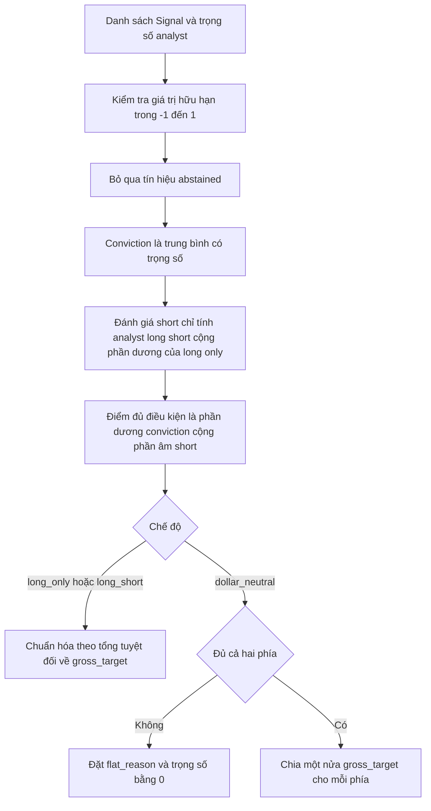

**Runtime Call-Stack Sequence Diagram:**

```mermaid
sequenceDiagram
    participant ST as assess_fund
    participant BL as blend_signals
    ST->>BL: signals model_weights gross_target mode approaches
    BL->>BL: kiểm tra đầu vào
    BL->>BL: tính conviction và short assessment
    BL->>BL: tính điểm đủ điều kiện
    BL-->>ST: BlendResult weights convictions flat_reason
```

**Acceptance Criteria (BDD / Gherkin):**

```gherkin
Scenario 1: Happy Path - trung bình có trọng số
  Given hai analyst với trọng số 2 và 1 cho tín hiệu +0.9 và -0.3 trên cùng mã
  When hệ thống gọi blend_signals
  Then conviction của mã bằng +0.5

Scenario 2: Edge Case - abstain bị loại khỏi mẫu số
  Given một analyst abstain và một analyst có tín hiệu +0.6
  When hệ thống gọi blend_signals
  Then conviction bằng +0.6
  And tín hiệu trung lập không abstain vẫn tính vào mẫu số

Scenario 3: Business Rule - long-only không tạo bằng chứng short
  Given strategy long_short chỉ có analyst long-only phát tín hiệu âm
  When hệ thống gọi blend_signals
  Then không có trọng số âm được tạo ra

Scenario 4: Edge Case - dollar-neutral thiếu một phía
  Given mọi tín hiệu đều dương trong strategy dollar_neutral
  When hệ thống gọi blend_signals
  Then flat_reason bằng "missing_short_side" và mọi trọng số bằng 0

Scenario 5: Validation Failure - tín hiệu ngoài khoảng
  Given một Signal có value bằng 1.5
  When hệ thống gọi blend_signals
  Then hệ thống ném ValueError
```

---

#### US-PORT-02 - Bù trừ sleeve và áp giới hạn rủi ro của quỹ

**User Story:**
Với tư cách là Nhà vận hành quỹ (P-01), tôi muốn các sleeve được cộng theo tỷ trọng vốn thành một sổ mục tiêu rồi bị giới hạn bởi trần vị thế, dải net và trần gross, để không analyst nào đẩy quỹ vượt giới hạn trong mandate.

**Source Code Traceability:**
- `hedge_fund/pipeline/stages.py` - `assess_fund` (bù trừ, `final_contribution`)
- `hedge_fund/risk/limits.py` - `apply_limits`, `_scale_proportionally`, `RiskLimits`, `ClampEvent`

**Automated Test Traceability:**
- `hedge_fund/risk/test_limits.py` - `test_position_clamp_records_event`, `test_gross_clamp_scales_all_and_records_one_event`, `test_position_then_gross_never_reviolates`, `test_within_limits_passes_through_untouched`, `test_shorts_clamped_by_absolute_value`, `test_clamped_exposure_not_redistributed`, `test_proportional_position_cap_preserves_neutrality`, `test_net_clamp_scales_only_the_heavier_side`, `test_net_clamp_mirrors_for_a_short_heavy_book`, `test_net_then_gross_compose_and_never_reviolate`, `test_nonfinite_weights_fail_before_risk_adjustment`
- `hedge_fund/pipeline/test_stages.py` - `test_netting_math_two_strategies_unequal_slices`, `test_slices_normalize`, `test_neutral_fund_scaling_preserves_sleeves_with_overlap`

**UI Interaction Wireframe (Mẫu B, bảng giới hạn):**

```text
┌────────────────────────────────────────────────────────────────────────┐
│  STORY: US-PORT-02 - MASTER RISK BOARD              [Status: Clamped ●]│
│  Fund: example-fund | Session: 2026-10-30                              │
├────────────────────────────────────────────────────────────────────────┤
│  LIMIT SUMMARY                                                         │
│  ┌─────────────────┐  ┌─────────────────┐  ┌─────────────────┐         │
│  │ POSITION CAP    │  │ NET BAND        │  │ GROSS CAP       │         │
│  │ 25% per name    │  │ not set         │  │ 1.00x           │         │
│  │ 1 clamp         │  │ 0 clamp         │  │ 1 clamp         │         │
│  └─────────────────┘  └─────────────────┘  └─────────────────┘         │
├────────────────────────────────────────────────────────────────────────┤
│  Ticker  Netted   Final    Limit fired                                 │
│  AAPL    +0.40    +0.25    max_position_pct (before 0.40, after 0.25)  │
│  BOOK    gross 1.35 -> 1.00  max_gross_exposure (scale 0.74)           │
├────────────────────────────────────────────────────────────────────────┤
│  Phần bị cắt giữ ở dạng tiền mặt, không phân bổ lại                    │
└────────────────────────────────────────────────────────────────────────┘
```

**Business Logic & Decision Flowchart:**

```mermaid
flowchart TD
    A[Sleeve theo từng strategy] --> B[Nhân tỷ trọng vốn đã chuẩn hóa]
    B --> C[Cộng thành sổ mục tiêu netted]
    C --> D{Có strategy dollar_neutral}
    D -->|Có| E[Co đồng nhất mọi trọng số theo một hệ số]
    D -->|Không| F[Cắt từng mã theo max_position_pct]
    F --> G{Net vượt max_net_exposure}
    G -->|Có| H[Co phía nặng hơn về dải net]
    G -->|Không| I{Gross vượt max_gross_exposure}
    H --> I
    I -->|Có| J[Co mọi trọng số theo tỷ lệ]
    I -->|Không| K[Giữ nguyên]
    E --> L[Ghi ClampEvent cho mỗi giới hạn kích hoạt]
    J --> L
    K --> L
```

**Runtime Call-Stack Sequence Diagram:**

```mermaid
sequenceDiagram
    participant AS as assess_fund
    participant RK as apply_limits
    participant VT as validate_targets
    AS->>AS: nhân slice và cộng netted
    AS->>RK: netted risk preserve_proportions
    RK-->>AS: RiskResult weights clamps scale_factor
    AS->>AS: tính final_contribution mỗi strategy
    AS->>VT: validate_targets spec strategies weights
    VT-->>AS: hợp lệ hoặc ValueError
```

**Acceptance Criteria (BDD / Gherkin):**

```gherkin
Scenario 1: Happy Path - nằm trong giới hạn
  Given trọng số netted đều trong trần vị thế và trần gross
  When hệ thống gọi apply_limits
  Then trọng số giữ nguyên và danh sách clamp rỗng

Scenario 2: Business Rule - trần vị thế
  Given max_position_pct bằng 0.25 và trọng số AAPL bằng +0.40
  When hệ thống gọi apply_limits
  Then trọng số AAPL bằng +0.25
  And ClampEvent ghi limit "max_position_pct", before 0.40, after 0.25

Scenario 3: Business Rule - vị thế short
  Given trọng số TSLA bằng -0.40 và max_position_pct bằng 0.25
  When hệ thống gọi apply_limits
  Then trọng số TSLA bằng -0.25

Scenario 4: Business Rule - phần cắt không phân bổ lại
  Given một vị thế bị cắt bởi trần vị thế
  When hệ thống gọi apply_limits
  Then trọng số các mã khác không tăng

Scenario 5: Validation Failure - trọng số không hữu hạn
  Given một trọng số mục tiêu là NaN
  When hệ thống gọi apply_limits
  Then hệ thống ném ValueError trước khi điều chỉnh
```

---

#### US-PORT-03 - Kiểm tra mục tiêu trước khi gửi lệnh

**User Story:**
Với tư cách là Kiểm toán viên (P-06), tôi muốn hệ thống tự tính lại bằng chứng short, trọng số strategy và tổng đóng góp từ tín hiệu đã ghi, để không mục tiêu nào vi phạm mandate được gửi tới broker.

**Source Code Traceability:**
- `hedge_fund/portfolio/validation.py` - `validate_targets`
- `hedge_fund/pipeline/stages.py` - `assess_fund` và `execute_decision` (gọi `validate_targets` ở cả hai giai đoạn)

**Automated Test Traceability:**
- Không có tệp kiểm thử chuyên biệt `[OPEN]`; được thực thi gián tiếp trong `hedge_fund/pipeline/test_stages.py` (`test_full_cycle_record_is_consistent`, `test_all_modes_execute_and_preserve_complete_records`, `test_clipping_attribution_preserves_exactly_offset_contr*`) và `hedge_fund/pipeline/test_timing.py` (`test_invalid_projected_orders_fail_before_submission`)

**UI Interaction Wireframe (Mẫu A, thông báo lỗi CLI):**

```text
┌────────────────────────────────────────────────────────────────────────┐
│  STORY: US-PORT-03 - TARGET VALIDATION                    [CLI: stderr]│
├────────────────────────────────────────────────────────────────────────┤
│  EPIC CONTEXT: EP-PORT | STEP: Validate before orders                  │
│  Progress: [●] Blend --- [●] Net --- [●] Risk --- [○] Orders           │
├────────────────────────────────────────────────────────────────────────┤
│  example-fund, AAPL: strategy contributions do not sum to final weight │
│                                                                        │
│  [!] Business Validation Notice: quỹ bị halt nếu lỗi xảy ra trong tick;│
│      không có lệnh nào được gửi tới broker.                            │
├────────────────────────────────────────────────────────────────────────┤
│  Kiểm tra: slice, eligible score, gross, dollar-neutral, tổng đóng góp │
└────────────────────────────────────────────────────────────────────────┘
```

**Business Logic & Decision Flowchart:**

```mermaid
flowchart TD
    A[Nhận spec strategies final_weights] --> B{Tên strategy khớp mandate}
    B -->|Không| X[Ném ValueError]
    B -->|Có| C[Kiểm tra slice bằng trọng số chuẩn hóa]
    C --> D[Tính lại blend_signals từ tín hiệu đã ghi]
    D --> E{Eligible score khớp}
    E -->|Không| X
    E -->|Có| F[Kiểm tra long only không âm và không short thiếu bằng chứng]
    F --> G[Kiểm tra gross và dollar neutral]
    G --> H{Tổng đóng góp bằng trọng số cuối}
    H -->|Không| X
    H -->|Có| I{Trong max_position_pct và max_gross_exposure}
    I -->|Không| X
    I -->|Có| J[Hợp lệ]
```

**Runtime Call-Stack Sequence Diagram:**

```mermaid
sequenceDiagram
    participant EX as execute_decision
    participant VT as validate_targets
    participant BL as blend_signals
    EX->>VT: spec strategies final_weights
    VT->>BL: tín hiệu đã ghi của từng strategy
    BL-->>VT: eligible_scores và flat_reason
    VT->>VT: so khớp điểm, dấu, gross, tổng đóng góp
    VT-->>EX: None hoặc ValueError
```

**Acceptance Criteria (BDD / Gherkin):**

```gherkin
Scenario 1: Happy Path
  Given bản ghi strategy khớp mandate và tổng đóng góp bằng trọng số cuối
  When hệ thống gọi validate_targets
  Then hệ thống không ném ngoại lệ

Scenario 2: Validation Failure - short thiếu bằng chứng
  Given một trọng số âm trong khi điểm đủ điều kiện của mã không âm
  When hệ thống gọi validate_targets
  Then hệ thống ném ValueError "has no eligible short evidence"

Scenario 3: Validation Failure - không dollar-neutral
  Given strategy dollar_neutral có tổng trọng số khác 0
  When hệ thống gọi validate_targets
  Then hệ thống ném ValueError "is not dollar-neutral"

Scenario 4: Validation Failure - vượt trần vị thế
  Given trọng số cuối của một mã lớn hơn max_position_pct
  When hệ thống gọi validate_targets
  Then hệ thống ném ValueError "final weight exceeds max_position_pct"
```

---

#### US-PORT-04 - Sinh lệnh chênh lệch từ trọng số mục tiêu

**User Story:**
Với tư cách là Nhà vận hành quỹ (P-01), tôi muốn hệ thống đổi trọng số mục tiêu thành lệnh mua bán theo số cổ phiếu nguyên, có dải không giao dịch và trần theo khối lượng, để quỹ không trả chi phí cho thay đổi nhỏ và không vượt khả năng thanh khoản.

**Source Code Traceability:**
- `hedge_fund/pipeline/execution.py` - `build_orders`
- `hedge_fund/pipeline/stages.py` - `execute_decision`, `liquidity`, `history_start`
- `hedge_fund/brokers/costs.py` - `TradingCosts` (`min_trade_pct`, `fill_price`)
- `hedge_fund/brokers/sim.py` - `SimBroker.place_order`

**Automated Test Traceability:**
- `hedge_fund/pipeline/test_execution.py` - `test_floor_sizing_never_overshoots`, `test_delta_against_existing_position`, `test_held_name_missing_from_targets_is_closed`, `test_subshare_delta_emits_nothing`, `test_sells_before_buys_alphabetical`, `test_short_target_sells_past_zero`, `test_max_shares_caps_buys_and_sells_and_drops_subshare_caps`, `test_no_trade_band_holds_small_adds_but_never_a_trim_close_or_flip`, `test_band_applies_before_the_volume_cap`, `test_liquidity_rides_on_the_order`
- `hedge_fund/brokers/test_costs.py`, `hedge_fund/brokers/test_sim.py`

**UI Interaction Wireframe (Mẫu C):**

```text
┌────────────────────────────────────────────────────────────────────────┐
│  STORY: US-PORT-04 - ORDER BLOTTER                                     │
├────────────────────────────────────────────────────────────────────────┤
│  Execution: 2026-11-02 close | Equity before: 100,000.00 | Fills: 3    │
├────────────────────────────────────────────────────────────────────────┤
│  Side  Ticker  Qty   Mark     Fill     Cost    Note                    │
│  sell  MSFT    40    410.00   409.79   8.60    close                   │
│  buy   AAPL    120   225.00   225.11   13.42                           │
│  buy   KO      0     62.00    -        -       dưới dải 0.5% equity    │
├────────────────────────────────────────────────────────────────────────┤
│  Trading cost: 22.02 = spread + impact + commission                    │
│  [i] Lệnh tăng dưới min_trade_pct chờ chu kỳ sau; lệnh giảm luôn khớp  │
└────────────────────────────────────────────────────────────────────────┘
```

**Business Logic & Decision Flowchart:**

```mermaid
flowchart TD
    A[Trọng số mục tiêu và vị thế hiện tại] --> B[Số cổ phiếu mục tiêu bằng phần nguyên của weight nhân equity chia mark]
    B --> C[Delta bằng mục tiêu trừ hiện tại]
    C --> D{Lệnh tăng vị thế nhỏ hơn min_notional}
    D -->|Có| E[Bỏ qua chờ chu kỳ sau]
    D -->|Không| F{Có max_adv_pct}
    F -->|Có| G[Giới hạn delta theo ADV 20 phiên]
    F -->|Không| H[Giữ delta]
    G --> I{Delta khác 0}
    H --> I
    I -->|Không| E
    I -->|Có| J[Tạo Order kèm adv và volatility]
    J --> K[Sắp xếp bán trước mua sau theo thứ tự chữ cái]
```

**Runtime Call-Stack Sequence Diagram:**

```mermaid
sequenceDiagram
    participant EX as execute_decision
    participant LQ as liquidity
    participant BO as build_orders
    participant BR as Broker
    EX->>LQ: tickers as_of data_client
    LQ-->>EX: adv và volatility mỗi mã
    EX->>BO: targets held marks equity max_shares min_notional
    BO-->>EX: danh sách Order
    EX->>BR: place_order order
    BR-->>EX: Fill
```

**Acceptance Criteria (BDD / Gherkin):**

```gherkin
Scenario 1: Happy Path - định cỡ làm tròn xuống
  Given equity 100000, trọng số 0.25 và giá 33.3
  When hệ thống gọi build_orders
  Then số cổ phiếu mục tiêu bằng 750
  And phần lẻ dưới một cổ phiếu ở lại tiền mặt

Scenario 2: Business Rule - đóng vị thế vắng mặt trong mục tiêu
  Given quỹ đang giữ mã không có trong trọng số mục tiêu
  When hệ thống gọi build_orders
  Then hệ thống tạo lệnh bán toàn bộ mã đó

Scenario 3: Business Rule - bán trước mua sau
  Given mục tiêu cần cả lệnh bán và lệnh mua
  When hệ thống gọi build_orders
  Then mọi lệnh bán đứng trước lệnh mua và mỗi nhóm theo thứ tự chữ cái

Scenario 4: Edge Case - dải không giao dịch
  Given lệnh tăng vị thế có giá trị nhỏ hơn min_trade_pct nhân equity
  When hệ thống gọi build_orders
  Then hệ thống không tạo lệnh đó
  And lệnh giảm hoặc đóng vị thế luôn được tạo

Scenario 5: Edge Case - trần khối lượng
  Given max_adv_pct tương ứng 100 cổ phiếu và delta cần 300 cổ phiếu
  When hệ thống gọi build_orders với max_shares
  Then số lượng lệnh bằng 100
  And ClampEvent "max_adv_pct" được ghi trong CycleRecord
```

---

#### US-PORT-05 - Dừng lỗ theo mức sụt giảm NAV

**User Story:**
Với tư cách là Nhà vận hành quỹ (P-01), tôi muốn quỹ bán toàn bộ vị thế về tiền mặt khi NAV giảm quá ngưỡng so với đỉnh, để giới hạn tổn thất mà không phụ thuộc quyết định của analyst.

**Source Code Traceability:**
- `hedge_fund/pipeline/session.py` - `advance` (tính drawdown và peak), `FundState.peak_nav`, `next_state`
- `hedge_fund/pipeline/stages.py` - `stop_out_decision`
- `hedge_fund/pipeline/models.py` - `DecisionRecord.is_stopped_out`
- `hedge_fund/risk/limits.py` - `RiskLimits.max_drawdown_pct`

**Automated Test Traceability:**
- `hedge_fund/pipeline/test_session.py` - `test_peak_nav*`
- `hedge_fund/backtesting/test_fund.py` - `test_a_stopped_out_backtest_keeps_marking_to_the_end`
- `hedge_fund/tui/test_report.py` - `test_a_stop_out_reads_as_one_in_the_row_and_the_overview`

**UI Interaction Wireframe (Mẫu B):**

```text
┌────────────────────────────────────────────────────────────────────────┐
│  STORY: US-PORT-05 - DRAWDOWN STOP-OUT              [Status: STOPPED ●]│
│  Fund: example-fund | Limit: 20% from peak                             │
├────────────────────────────────────────────────────────────────────────┤
│  SUMMARY CARDS                                                         │
│  ┌─────────────────┐  ┌─────────────────┐  ┌─────────────────┐         │
│  │ PEAK NAV        │  │ CURRENT NAV     │  │ DRAWDOWN        │         │
│  │ 112,400.00      │  │ 89,100.00       │  │ 20.7%           │         │
│  │ 2026-09-14      │  │ 2026-10-30      │  │ limit hit       │         │
│  └─────────────────┘  └─────────────────┘  └─────────────────┘         │
├────────────────────────────────────────────────────────────────────────┤
│  [!] Bán toàn bộ tại phiên kế tiếp; không hỏi analyst; giữ tiền mặt    │
└────────────────────────────────────────────────────────────────────────┘
```

**Business Logic & Decision Flowchart:**

```mermaid
flowchart TD
    A[advance tại phiên T] --> B[Tính NAV từ sổ broker và giá]
    B --> C[Drawdown bằng một trừ NAV chia peak_nav]
    C --> D{Có max_drawdown_pct và drawdown đạt ngưỡng}
    D -->|Không| E[Đánh giá bình thường nếu là phiên rebalance]
    D -->|Có| F{Quỹ còn vị thế}
    F -->|Không| G[Không có quyết định]
    F -->|Có| H[stop_out_decision đặt mọi mục tiêu bằng 0]
    H --> I[Ghi ClampEvent max_drawdown_pct]
    I --> J[Phiên kế tiếp thực thi bán toàn bộ không làm mới quan điểm]
```

**Runtime Call-Stack Sequence Diagram:**

```mermaid
sequenceDiagram
    participant AD as advance
    participant ST as stop_out_decision
    participant EX as execute_decision
    participant BR as Broker
    AD->>AD: drawdown so với peak_nav
    AD->>ST: spec session universe marks positions drawdown
    ST-->>AD: DecisionRecord mọi mục tiêu bằng 0
    Note over AD,EX: Phiên kế tiếp
    AD->>EX: pending decision
    EX->>BR: lệnh bán toàn bộ
```

**Acceptance Criteria (BDD / Gherkin):**

```gherkin
Scenario 1: Happy Path - kích hoạt dừng lỗ
  Given max_drawdown_pct bằng 0.20 và NAV thấp hơn peak từ 20% trở lên
  When hệ thống gọi advance
  Then DecisionRecord có final_weights bằng 0 cho mọi vị thế đang giữ
  And is_stopped_out bằng true

Scenario 2: Business Rule - không hỏi analyst
  Given quỹ ở trạng thái dừng lỗ
  When hệ thống thực thi quyết định ở phiên kế tiếp
  Then hệ thống không làm mới quan điểm của analyst

Scenario 3: Edge Case - đã hết vị thế
  Given drawdown đạt ngưỡng và quỹ không còn vị thế
  When hệ thống gọi advance
  Then hệ thống không tạo quyết định

Scenario 4: Business Rule - peak theo dõi liên tục
  Given NAV các phiên trước cao hơn NAV hiện tại
  When hệ thống gọi next_state
  Then peak_nav bằng NAV cao nhất đã ghi
```

---

### EP-BT - Backtesting

Mục tiêu nghiệp vụ: backtest là vòng lặp `advance` trên lịch sử, dùng đúng đường mã của quỹ giấy. Kết quả phải tái lập được, dữ liệu không rò rỉ tương lai, và hồ sơ đầy đủ đến từng luận điểm, lệnh và lần khớp.

#### US-BT-01 - Chạy backtest từ dòng lệnh

**User Story:**
Với tư cách là Nhà nghiên cứu (P-02), tôi muốn chạy backtest một mandate trên một universe và khoảng thời gian, để nhận kết quả JSON đầy đủ và bảng tóm tắt so với benchmark.

**Source Code Traceability:**
- `hedge_fund/run.py` - `main`, `_parser`, `_backtest`
- `hedge_fund/backtesting/fund.py` - `backtest_fund`, `build_schedule`, `replay_grid`, `rebalance_grid`, `performance_metrics`
- `hedge_fund/data/sessions.py` - `session_closes`, `completed_through`
- `hedge_fund/brokers/sim.py` - `SimBroker`
- `hedge_fund/scorecard/__init__.py` - `score`

**Automated Test Traceability:**
- `hedge_fund/test_run.py` - `test_backtest_prints_json_and_files_a_research_copy`, `test_backtest_defaults_end_to_the_latest_completed_session`, `test_cli_rejects_invalid_configuration_before_clients`
- `hedge_fund/backtesting/test_fund.py` - `test_grid_daily_is_identity`, `test_grid_weekly_takes_first_trading_day_of_each_iso_week`, `test_grid_monthly_splits_where_weekly_does_not`, `test_grid_first_day_is_always_a_rebalance`, `test_happy_path_hand_computed`, `test_metrics_report_what_the_fills_cost`, `test_positions_carry_across_cycles_not_restart`, `test_records_are_hash_chained`, `test_deterministic_json_round_trip`, `test_missing_benchmark_raises`, `test_backtest_enforces_each_mode_with_mixed_analysts`

**UI Interaction Wireframe (Mẫu A, đầu ra CLI):**

```text
┌────────────────────────────────────────────────────────────────────────┐
│  STORY: US-BT-01 - BACKTEST COMMAND                     [stdout = JSON]│
├────────────────────────────────────────────────────────────────────────┤
│  EPIC CONTEXT: EP-BT | STEP: Replay and summarize                      │
│  Progress: [●] Load --- [●] Replay --- [●] Save --- [○] Score          │
├────────────────────────────────────────────────────────────────────────┤
│  $ aihf backtest example.yaml --universe AAPL,MSFT --start 2025-04-01  │
│                                                                        │
│  example-fund 2025-04-01 -> 2026-10-30 · 396 sessions · 18 rebalances  │
│   · 54 orders · cost 41 bps · return +9.1% vs SPY +6.7% · sharpe 0.84  │
│   · max drawdown 7.2%                                                  │
│  saved to ~/.hedge-fund/research/example-fund-2025-04-01-...json       │
├────────────────────────────────────────────────────────────────────────┤
│  Giá trị mẫu minh họa; stdout chỉ chứa JSON FundBacktestResult         │
└────────────────────────────────────────────────────────────────────────┘
```

**Business Logic & Decision Flowchart:**

```mermaid
flowchart TD
    A[aihf backtest mandate --universe] --> B[Chuẩn hóa universe và nạp mandate]
    B --> C{Hợp lệ}
    C -->|Không| D[parser.error thoát mã 2]
    C -->|Có| E[end mặc định là phiên hoàn tất gần nhất]
    E --> F[start mặc định lùi BACKTEST_WEEKS tuần từ end]
    F --> G[session_closes của benchmark làm lưới giao dịch]
    G --> H{Có phiên nào}
    H -->|Không| I[Ném ValueError no bars]
    H -->|Có| J[Lặp advance với FundState trong bộ nhớ và SimBroker]
    J --> K[Tính chỉ số hiệu suất]
    K --> L[In JSON ra stdout và lưu bản sao vào research]
```

**Runtime Call-Stack Sequence Diagram:**

```mermaid
sequenceDiagram
    actor OP as Researcher
    participant CLI as run.py
    participant BT as backtest_fund
    participant AD as advance
    participant RS as save_result
    OP->>CLI: aihf backtest mandate --universe AAPL,MSFT
    CLI->>BT: Fund blind true start end CachedDataClient universe
    loop mỗi phiên của benchmark
        BT->>AD: fund state session broker data universe clock
        AD-->>BT: SessionRecord
    end
    BT-->>CLI: FundBacktestResult
    CLI->>RS: save_result result
    CLI-->>OP: JSON trên stdout và tóm tắt trên stderr
```

**Acceptance Criteria (BDD / Gherkin):**

```gherkin
Scenario 1: Happy Path
  Given mandate hợp lệ, universe "AAPL,MSFT" và cửa sổ có dữ liệu benchmark
  When Tác nhân chạy aihf backtest
  Then stdout chứa JSON FundBacktestResult với schema_version 2
  And một bản sao được lưu trong research/

Scenario 2: Business Rule - lưới giao dịch từ benchmark
  Given benchmark có giá cho các ngày giao dịch trong cửa sổ
  When hệ thống dựng lưới phiên
  Then ngày lễ và tuần rút gọn không xuất hiện trong lưới

Scenario 3: Business Rule - chuỗi băm
  Given backtest hoàn tất
  When hệ thống kiểm tra các SessionRecord liên tiếp
  Then prev_hash của mỗi bản ghi bằng hash của bản ghi liền trước

Scenario 4: Validation Failure - không có dữ liệu benchmark
  Given benchmark không có giá trong cửa sổ
  When hệ thống gọi backtest_fund
  Then hệ thống ném ValueError "cannot build the trading grid"
  And hệ thống không trả kết quả rỗng

Scenario 5: Validation Failure - mandate sai
  Given mandate không hợp lệ
  When Tác nhân chạy aihf backtest
  Then hệ thống thoát mã 2 trước khi tạo client dữ liệu
```

---

#### US-BT-02 - Theo dõi backtest trên bảng TUI

**User Story:**
Với tư cách là Nhà nghiên cứu (P-02), tôi muốn chọn mandate, mã và khoảng thời gian trên TUI rồi theo dõi đường NAV so với benchmark và các lệnh khớp theo thời gian thực, để đánh giá chiến lược mà không rời terminal.

**Source Code Traceability:**
- `hedge_fund/tui/backtest.py` - `BacktestScreen` (các pane chọn mandate, chọn ngày, chạy), `on_cycle`, `on_valuation`
- `hedge_fund/tui/shared.py` - `render_area_chart`, `BACKTEST_WEEKS`
- `hedge_fund/tui/report.py` - báo cáo kết quả
- `hedge_fund/backtesting/fund.py` - `backtest_fund(on_cycle, on_valuation)`
- `hedge_fund/tui/home.py` - `demand_run_keys`

**Automated Test Traceability:**
- `hedge_fund/tui/test_backtest.py` - `test_backtest_daily_board_matches_final_metrics_and_uses_fill_dates`
- `hedge_fund/tui/test_paper.py` - `test_all_modes_can_be_backtested_and_paper_traded`

**UI Interaction Wireframe (Mẫu B):**

```text
┌────────────────────────────────────────────────────────────────────────┐
│  STORY: US-BT-02 - BACKTEST BOARD                   [Status: Running ●]│
│  Mandate: example-fund | Universe: AAPL, MSFT       Progress: 212 / 396│
├────────────────────────────────────────────────────────────────────────┤
│  KPI SUMMARY                                                           │
│  ┌─────────────────┐  ┌─────────────────┐  ┌─────────────────┐         │
│  │ FUND RETURN     │  │ BENCHMARK SPY   │  │ REBALANCES      │         │
│  │ +6.2%           │  │ +4.9%           │  │ 11 of 18        │         │
│  └─────────────────┘  └─────────────────┘  └─────────────────┘         │
├────────────────────────────────────────────────────────────────────────┤
│  NAV (area chart)                                                      │
│   110k ┤                          ╭──────                              │
│   105k ┤              ╭───────────╯                                    │
│   100k ┼──────────────╯                                                │
│        2025-04     2025-09     2026-02                                 │
├────────────────────────────────────────────────────────────────────────┤
│  Tape: 2025-09-02 buy AAPL 120 @ 225.11 -> 120 shares                  │
└────────────────────────────────────────────────────────────────────────┘
```

**Business Logic & Decision Flowchart:**

```mermaid
flowchart TD
    A[Mở Backtesting] --> B[Kiểm tra khóa dữ liệu và khóa LLM]
    B --> C{Đủ khóa}
    C -->|Không| D[Hiển thị yêu cầu nhập khóa còn thiếu]
    C -->|Có| E[Chọn mandate hợp lệ]
    E --> F[Nhập mã và ngày bắt đầu kết thúc]
    F --> G{Ngày hợp lệ}
    G -->|Không| H[Thông báo lỗi và giữ ở bước nhập]
    G -->|Có| I[Làm nóng cache dữ liệu]
    I --> J[Chạy backtest_fund trên luồng nền]
    J --> K[Cập nhật đường NAV và băng lệnh theo callback]
    K --> L[Hiển thị tóm tắt và scorecard]
```

**Runtime Call-Stack Sequence Diagram:**

```mermaid
sequenceDiagram
    actor OP as Researcher
    participant UI as BacktestScreen
    participant WK as worker thread
    participant BT as backtest_fund
    OP->>UI: Xác nhận mã và khoảng ngày
    UI->>WK: khởi chạy luồng nền
    WK->>BT: backtest_fund on_cycle on_valuation
    BT-->>UI: on_valuation i n DailyValuation
    BT-->>UI: on_cycle i n CycleRecord
    BT-->>WK: FundBacktestResult
    WK-->>UI: kết quả cuối
```

**Acceptance Criteria (BDD / Gherkin):**

```gherkin
Scenario 1: Happy Path
  Given khóa dữ liệu và khóa LLM đã có trong môi trường
  When Tác nhân xác nhận mã và khoảng ngày hợp lệ
  Then bảng hiển thị NAV của quỹ và benchmark cập nhật sau mỗi phiên
  And chỉ số cuối trên bảng bằng chỉ số trong kết quả

Scenario 2: Business Rule - ngày khớp lệnh
  Given một chu kỳ rebalance được thực thi ở phiên T+1
  When băng lệnh hiển thị lần khớp
  Then ngày hiển thị là ngày thực thi

Scenario 3: Edge Case - rời màn hình khi đang chạy
  Given backtest đang chạy
  When Tác nhân nhấn phím quay lại
  Then hệ thống từ chối hành động quay lại cho đến khi chạy xong

Scenario 4: Failure Contract - thiếu khóa
  Given FINANCIAL_DATASETS_API_KEY chưa đặt
  When Tác nhân bắt đầu chạy
  Then hệ thống mở hộp thoại nhập khóa trước khi làm nóng cache
```

---

#### US-BT-03 - Lưu và xem lại kết quả backtest

**User Story:**
Với tư cách là Nhà nghiên cứu (P-02), tôi muốn mỗi kết quả backtest được lưu thành tệp và hiển thị lại theo mandate, để so sánh các lần chạy và điền sẵn mã đã dùng.

**Source Code Traceability:**
- `hedge_fund/backtesting/research.py` - `save_result`, `summarize`, `receipts`, `last_universe`, `last_score`
- `hedge_fund/paths.py` - `RESEARCH_DIR`
- `hedge_fund/tui/funds.py` - `_slot_card`, `_fund_detail`, `_stat_list`

**Automated Test Traceability:**
- `hedge_fund/backtesting/test_research.py` - `test_research_history_is_matched_on_the_fund_field_not_the_filename_prefix`
- `hedge_fund/tui/test_funds.py` - `test_latest_backtest_sets_headline_regardless_of_version`
- `hedge_fund/test_run.py` - `test_backtest_prints_json_and_files_a_research_copy`

**UI Interaction Wireframe (Mẫu C):**

```text
┌────────────────────────────────────────────────────────────────────────┐
│  STORY: US-BT-03 - BACKTEST HISTORY                                    │
├────────────────────────────────────────────────────────────────────────┤
│  Mandate: example-fund | Saved results: 3 (mới nhất trước)             │
├────────────────────────────────────────────────────────────────────────┤
│  Window                  Universe      Total    vs SPY   Sharpe  Max DD│
│  2025-04-01..2026-10-30  AAPL, MSFT    +9.1%    +2.4%    0.84    7.2%  │
│  2025-01-02..2025-12-31  AAPL, NVDA    +5.0%    -1.1%    0.52    9.8%  │
│  2024-06-03..2025-05-30  AAPL          +3.3%    +0.2%    0.31    6.0%  │
├────────────────────────────────────────────────────────────────────────┤
│  [i] Kết quả dùng một lần; không làm đầu vào cho lần chạy khác         │
└────────────────────────────────────────────────────────────────────────┘
```

**Business Logic & Decision Flowchart:**

```mermaid
flowchart TD
    A[FundBacktestResult] --> B[Tạo thư mục research nếu chưa có]
    B --> C[Ghi fund start end stamp json]
    C --> D[Tác nhân mở thư viện mandate]
    D --> E[receipts glob tên mandate sao]
    E --> F{Trường fund trong tệp bằng tên mandate}
    F -->|Không| G[Loại tệp vì chỉ trùng tiền tố]
    F -->|Có| H[summarize đọc metrics]
    H --> I{Tệp đọc được và có metrics}
    I -->|Không| G
    I -->|Có| J[Hiển thị theo thời gian sửa đổi mới nhất]
```

**Runtime Call-Stack Sequence Diagram:**

```mermaid
sequenceDiagram
    participant BT as backtest caller
    participant RS as research module
    participant FS as research dir
    participant UI as FundSelectScreen
    BT->>RS: save_result result
    RS->>FS: write json
    UI->>RS: receipts name
    RS->>FS: glob name sao json
    RS->>RS: summarize và so khớp trường fund
    RS-->>UI: danh sách đường dẫn mới nhất trước
```

**Acceptance Criteria (BDD / Gherkin):**

```gherkin
Scenario 1: Happy Path
  Given một backtest của mandate "alpha" vừa hoàn tất
  When hệ thống gọi save_result
  Then tệp research/alpha-<start>-<end>-<stamp>.json được ghi

Scenario 2: Business Rule - khớp theo trường fund
  Given hai mandate "alpha" và "alpha-2" có tệp kết quả cùng tiền tố
  When hệ thống gọi receipts("alpha")
  Then danh sách chỉ chứa tệp có trường fund bằng "alpha"

Scenario 3: Edge Case - tệp hỏng
  Given một tệp kết quả không phải JSON hợp lệ
  When hệ thống gọi summarize
  Then hệ thống trả None và bỏ qua tệp
```

---

### EP-PAPER - Paper Trading

Mục tiêu nghiệp vụ: một mandate được triển khai lên universe cố định, tiến hành đúng một phiên mỗi lần gọi, có thể gọi lặp an toàn, tự dừng khi có lỗi, và có thể chạy nền không giám sát.

#### US-PAPER-01 - Triển khai paper fund

**User Story:**
Với tư cách là Nhà vận hành quỹ (P-01), tôi muốn triển khai một mandate lên một universe thành quỹ giấy có thư mục, sổ broker và ledger riêng, để bắt đầu theo dõi NAV thực tế bằng vốn giả định.

**Source Code Traceability:**
- `hedge_fund/paper/deployed.py` - `deploy`, `validate_fund_name`, `load_deployed`, `list_deployed`, `DeployedFund`
- `hedge_fund/brokers/paper.py` - `PaperBroker.create`
- `hedge_fund/paper/ledger.py` - `Ledger.init`
- `hedge_fund/run.py` - `_paper` (hành động `create`)
- `hedge_fund/tui/builder.py` - chế độ paper

**Automated Test Traceability:**
- `hedge_fund/paper/test_tick.py` - `test_deploy_lays_out_the_fund_directory`, `test_deploy_rejects_unsafe_names`, `test_load_deployed_reports_the_path_on_bad_files`
- `hedge_fund/brokers/test_paper.py` - `test_create_refuses_to_overwrite_and_open_requires_a_book`
- `hedge_fund/test_run.py` - `test_paper_flow_create_tick_status_halt_resume`
- `hedge_fund/tui/test_builder.py` - `test_builder_paper_mode_builds_a_live_fund_and_refuses_taken_names`

**UI Interaction Wireframe (Mẫu A):**

```text
┌────────────────────────────────────────────────────────────────────────┐
│  STORY: US-PAPER-01 - DEPLOY PAPER FUND                    [Cancel] [X]│
├────────────────────────────────────────────────────────────────────────┤
│  EPIC CONTEXT: EP-PAPER | STEP: What does it trade?                    │
│  Progress: [●] Name ─ [●] Desk ─ [●] Cadence ─ [●] Tickers ─ [○] Live  │
├────────────────────────────────────────────────────────────────────────┤
│  * Name                       * Tickers                                │
│  ┌──────────────────────┐     ┌────────────────────────────────────┐   │
│  │ alpha                │     │ AAPL, MSFT, NVDA                   │   │
│  └──────────────────────┘     └────────────────────────────────────┘   │
│                                                                        │
│  Mandate: example-fund | Capital: $100,000 | weekly                    │
│  Output: ~/.hedge-fund/paper/alpha/                                    │
│  [!] Business Validation Notice: tên chỉ gồm chữ, số, '.', '_', '-'.   │
├────────────────────────────────────────────────────────────────────────┤
│  [ < Back ]                                         [ Deploy > ]       │
└────────────────────────────────────────────────────────────────────────┘
```

**Business Logic & Decision Flowchart:**

```mermaid
flowchart TD
    A[deploy name spec universe] --> B{Tên hợp lệ theo regex và không phải dấu chấm}
    B -->|Không| C[ValueError invalid fund name]
    B -->|Có| D[normalize_universe]
    D --> E{Universe rỗng}
    E -->|Có| F[ValueError universe is empty]
    E -->|Không| G{Thư mục paper tên đã tồn tại}
    G -->|Có| H[FileExistsError]
    G -->|Không| I[Ghi fund.yaml bản chụp mandate]
    I --> J[Tạo broker.json với vốn của mandate]
    J --> K[Ledger.init tạo ledger và control.json halted false]
```

**Runtime Call-Stack Sequence Diagram:**

```mermaid
sequenceDiagram
    actor OP as Operator
    participant CLI as run.py
    participant DP as deploy
    participant PB as PaperBroker
    participant LG as Ledger
    OP->>CLI: aihf paper create alpha --mandate m.yaml --universe AAPL,MSFT
    CLI->>DP: deploy name spec universe root
    DP->>DP: ghi fund.yaml
    DP->>PB: create broker.json cash costs
    DP->>LG: init
    LG-->>DP: ledger và control.json
    DP-->>CLI: thư mục quỹ
```

**Acceptance Criteria (BDD / Gherkin):**

```gherkin
Scenario 1: Happy Path
  Given tên "alpha" hợp lệ, mandate hợp lệ và universe "AAPL,MSFT"
  When Tác nhân triển khai quỹ
  Then thư mục paper/alpha/ chứa fund.yaml, broker.json, ledger/ và control.json
  And broker.json có cash bằng vốn của mandate

Scenario 2: Validation Failure - tên không an toàn
  Given tên chứa dấu phân tách đường dẫn hoặc bắt đầu bằng dấu chấm
  When Tác nhân triển khai quỹ
  Then hệ thống từ chối với ValueError nêu quy tắc đặt tên

Scenario 3: Validation Failure - tên đã tồn tại
  Given thư mục paper/alpha/ đã tồn tại
  When Tác nhân triển khai quỹ
  Then hệ thống ném FileExistsError và không ghi đè dữ liệu cũ

Scenario 4: Business Rule - bản chụp mandate
  Given quỹ đã triển khai từ mandate "example-fund"
  When tệp mandate gốc bị sửa sau đó
  Then fund.yaml của quỹ giữ nguyên các quy tắc tại thời điểm triển khai
```

---

#### US-PAPER-02 - Chạy một phiên (tick)

**User Story:**
Với tư cách là Bộ lập lịch (P-05), tôi muốn lệnh `aihf paper tick` tiến hành đúng một phiên chưa ghi và có thể gọi lặp an toàn, để cron chạy sau mỗi phiên đóng cửa mà không bỏ sót hoặc nhân đôi phiên.

**Source Code Traceability:**
- `hedge_fund/paper/tick.py` - `tick`, `next_session`, `following_session`, `assessment_dates`, `_run`, `NothingDue`
- `hedge_fund/pipeline/session.py` - `advance`, `next_state`
- `hedge_fund/paper/ledger.py` - `replay`, `append`
- `hedge_fund/run.py` - `_paper` (hành động `tick`), `_tick_summary`

**Automated Test Traceability:**
- `hedge_fund/paper/test_tick.py` - `test_next_session_is_latest_completed_for_a_fresh_fund_and_the_next_one_after`, `test_ticks_advance_one_session_each_and_match_the_backtest`, `test_explicit_session_is_idempotent_and_must_be_the_next_one`, `test_failure_inside_advance_halts_the_fund_and_a_resume_clears_it`, `test_broker_drift_between_ticks_is_caught_and_halts`, `test_next_session_of_a_minute_fund_is_the_latest_bar_passed_and_asks_nothing_of_the_market`
- `hedge_fund/pipeline/test_session.py` - `test_step_by_step_advance_matches_the_backtest_exactly`, `test_decision_at_t_executes_at_t_plus_one_across_two_advances`, `test_out_of_order_and_repeated_sessions_are_refused`
- `hedge_fund/test_run.py` - `test_paper_flow_create_tick_status_halt_resume`

**UI Interaction Wireframe (Mẫu A, đầu ra CLI):**

```text
┌────────────────────────────────────────────────────────────────────────┐
│  STORY: US-PAPER-02 - ADVANCE ONE SESSION                 [CLI: stderr]│
├────────────────────────────────────────────────────────────────────────┤
│  EPIC CONTEXT: EP-PAPER | STEP: tick                                   │
│  Progress: [●] Replay --- [●] Advance --- [●] Append --- [○] Next      │
├────────────────────────────────────────────────────────────────────────┤
│  $ aihf paper tick alpha                                               │
│                                                                        │
│  alpha · session 2026-10-30 · NAV $100,412.50 · executed 3 orders from │
│  2026-10-29 · decided on 6 signals, 1 clamps; executes next close      │
├────────────────────────────────────────────────────────────────────────┤
│  $ aihf paper tick alpha                                               │
│  alpha: no completed SPY session after 2026-10-30; next 2026-11-02     │
├────────────────────────────────────────────────────────────────────────┤
│  exit code: 0 lần đầu; 1 khi NothingDue                                │
└────────────────────────────────────────────────────────────────────────┘
```

**Business Logic & Decision Flowchart:**

```mermaid
flowchart TD
    A[tick directory] --> B{--session đã có trong ledger}
    B -->|Có| C[Trả bản ghi đã lưu]
    B -->|Không| D[Ledger.replay xác minh chuỗi]
    D --> E{Quỹ bị halt}
    E -->|Có| F[Ném FundHalted]
    E -->|Không| G[next_session]
    G --> H{Có phiên đến hạn}
    H -->|Không| I[Ném NothingDue kèm thời điểm kế tiếp]
    H -->|Có| J{--session khác phiên đến hạn}
    J -->|Có| K[Ném ValueError]
    J -->|Không| L[advance trên PaperBroker]
    L --> M{Lỗi trong advance}
    M -->|Có| N[Ghi sự kiện tick_failed và halt quỹ rồi ném lại lỗi]
    M -->|Không| O[Ledger.append và ghi sự kiện tick]
```

**Runtime Call-Stack Sequence Diagram:**

```mermaid
sequenceDiagram
    actor SC as Scheduler
    participant CLI as run.py
    participant TK as tick
    participant LG as Ledger
    participant AD as advance
    participant BR as PaperBroker
    SC->>CLI: aihf paper tick alpha
    CLI->>TK: tick directory data_client
    TK->>LG: replay capital
    LG-->>TK: FundState
    TK->>TK: next_session
    TK->>AD: fund state session broker data universe
    AD->>BR: reconcile positions cash
    AD-->>TK: SessionRecord
    TK->>LG: append record
    TK-->>CLI: SessionRecord
    CLI-->>SC: JSON trên stdout
```

**Acceptance Criteria (BDD / Gherkin):**

```gherkin
Scenario 1: Happy Path - phiên kế tiếp
  Given quỹ daily đã ghi phiên đến 2026-10-28 và 2026-10-29 đã hoàn tất
  When Tác nhân gọi tick
  Then hệ thống ghi phiên 2026-10-29 vào ledger
  And bản ghi được nối với hash của phiên 2026-10-28

Scenario 2: Business Rule - không bỏ sót phiên
  Given quỹ vắng mặt 3 phiên
  When Tác nhân gọi tick nhiều lần
  Then mỗi lần gọi ghi đúng một phiên theo thứ tự từ cũ đến mới

Scenario 3: Edge Case - gọi lặp
  Given phiên 2026-10-29 đã có trong ledger
  When Tác nhân gọi tick với --session 2026-10-29
  Then hệ thống trả bản ghi đã lưu mà không thay đổi ledger

Scenario 4: Validation Failure - chưa có phiên đến hạn
  Given mọi phiên hoàn tất đã được ghi
  When Tác nhân gọi tick
  Then hệ thống ném NothingDue và CLI thoát mã 1

Scenario 5: Failure Contract - lỗi trong advance
  Given advance ném ngoại lệ trong lúc khớp lệnh
  When tick bắt ngoại lệ
  Then hệ thống ghi sự kiện tick_failed và halt quỹ với lý do
  And ngoại lệ được ném lại cho người gọi

Scenario 6: Failure Contract - sổ broker lệch ledger
  Given broker.json bị thay đổi giữa hai tick
  When Tác nhân gọi tick
  Then hệ thống ném BookMismatch, halt quỹ và không gửi lệnh
```

---

#### US-PAPER-03 - Chạy lại phiên gần nhất (redo)

**User Story:**
Với tư cách là Nhà vận hành quỹ (P-01), tôi muốn chạy lại phiên gần nhất để analyst đánh giá lại tại cùng giá đóng cửa, để thay thế bản ghi mà không làm mất bản ghi cũ.

**Source Code Traceability:**
- `hedge_fund/paper/tick.py` - `redo`, `RecordedClock`
- `hedge_fund/paper/ledger.py` - `Ledger.rewind`, `SUPERSEDED_SUBDIR`
- `hedge_fund/brokers/paper.py` - `PaperBroker.restore`
- `hedge_fund/run.py` - cờ `--again`

**Automated Test Traceability:**
- `hedge_fund/paper/test_tick.py` - `test_redo_runs_the_latest_session_again_and_replaces_its_record`, `test_redo_refuses_a_halted_fund_and_leaves_it_untouched`
- `hedge_fund/paper/test_runner.py` - `test_redo_runs_a_bar_again_at_the_prices_it_saw`

**UI Interaction Wireframe (Mẫu A, hộp thoại xác nhận):**

```text
┌────────────────────────────────────────────────────────────────────────┐
│  STORY: US-PAPER-03 - RUN LATEST SESSION AGAIN                [Esc] [X]│
├────────────────────────────────────────────────────────────────────────┤
│  EPIC CONTEXT: EP-PAPER | STEP: Approval                               │
├────────────────────────────────────────────────────────────────────────┤
│  Run alpha?                                                            │
│                                                                        │
│  Không có phiên nào đến hạn. Phiên gần nhất 2026-10-30 có thể chạy lại:│
│   - Bản ghi cũ chuyển sang ledger/superseded/                          │
│   - Sổ broker được khôi phục về trạng thái trước phiên                 │
│   - Analyst được hỏi lại tại cùng giá đóng cửa                         │
├────────────────────────────────────────────────────────────────────────┤
│  [ esc: cancel ]                                   [ enter: run again ]│
└────────────────────────────────────────────────────────────────────────┘
```

**Business Logic & Decision Flowchart:**

```mermaid
flowchart TD
    A[redo directory] --> B[Ledger.replay xác minh toàn bộ chuỗi]
    B --> C{Quỹ bị halt}
    C -->|Có| D[Ném FundHalted và giữ nguyên]
    C -->|Không| E{Đã có phiên}
    E -->|Không| F[Ném NothingDue]
    E -->|Có| G[Tính trạng thái ngay trước phiên cuối]
    G --> H[Ledger.rewind chuyển bản ghi sang superseded]
    H --> I[PaperBroker.restore về sổ trước phiên]
    I --> J[Ghi sự kiện redo]
    J --> K{Quỹ phút}
    K -->|Có| L[RecordedClock dùng giá đã ghi]
    K -->|Không| M[Dùng đồng hồ ngày]
    L --> N[Chạy lại phiên qua _run]
    M --> N
```

**Runtime Call-Stack Sequence Diagram:**

```mermaid
sequenceDiagram
    actor OP as Operator
    participant RD as redo
    participant LG as Ledger
    participant PB as PaperBroker
    participant RN as _run
    OP->>RD: redo directory data_client
    RD->>LG: replay và replay before last
    RD->>LG: rewind
    LG-->>RD: bản ghi bị thay
    RD->>PB: restore cash positions
    RD->>LG: log_event redo
    RD->>RN: chạy lại phiên
    RN-->>OP: SessionRecord mới
```

**Acceptance Criteria (BDD / Gherkin):**

```gherkin
Scenario 1: Happy Path
  Given ledger có phiên cuối 2026-10-30
  When Tác nhân chạy lại phiên gần nhất
  Then bản ghi cũ nằm trong ledger/superseded/ với hậu tố hash
  And một bản ghi mới cho 2026-10-30 nối vào chuỗi

Scenario 2: Business Rule - khôi phục sổ broker
  Given phiên cuối đã khớp lệnh
  When hệ thống chạy lại phiên
  Then broker.json được khôi phục về cash và vị thế trước phiên đó

Scenario 3: Validation Failure - quỹ bị halt
  Given quỹ đang halt
  When Tác nhân chạy lại phiên
  Then hệ thống ném FundHalted
  And ledger và broker.json không thay đổi

Scenario 4: Edge Case - chưa có phiên nào
  Given ledger rỗng
  When Tác nhân chạy lại phiên
  Then hệ thống ném NothingDue
```

---

#### US-PAPER-04 - Chạy runner nền không giám sát

**User Story:**
Với tư cách là Nhà vận hành quỹ (P-01), tôi muốn một tiến trình runner tự chờ và tiến hành phiên khi đến hạn, để quỹ vận hành liên tục mà không cần cron.

**Source Code Traceability:**
- `hedge_fund/paper/runner.py` - `run`, `_run_days`, `_run_bars`, `serve`, `is_running`, `stop_runner`, `spawn_runner`, `_next_look`, `_wait_for`
- `hedge_fund/pipeline/clock.py` - `LiveClock`
- `hedge_fund/tui/paper.py` - phím `space` (bật hoặc tắt runner)
- `hedge_fund/run.py` - `paper run`, `paper stop`

**Automated Test Traceability:**
- `hedge_fund/paper/test_runner.py` - `test_a_daily_fund_is_run_unattended_too_catching_up_after_each_midnight`, `test_a_day_of_bars_decides_fills_and_checkpoints`, `test_a_late_start_skips_to_the_current_bar_and_logs_the_gap`, `test_an_evening_start_does_not_mark_the_close_at_tonights_print`, `test_a_day_the_benchmark_has_not_printed_is_skipped_once_and_quietly`, `test_a_failed_bar_halts_the_fund_like_a_failed_tick`, `test_serve_holds_a_pid_file_and_stops_on_sigterm`
- `hedge_fund/tui/test_paper.py` - `test_paper_screen_space_starts_and_stops_a_runner_at_any_cadence`

**UI Interaction Wireframe (Mẫu B):**

```text
┌────────────────────────────────────────────────────────────────────────┐
│  STORY: US-PAPER-04 - RUNNER STATUS                 [Status: Running ●]│
│  Fund: alpha | Cadence: every 5m, 09:30-16:00 ET     pid: 48213        │
├────────────────────────────────────────────────────────────────────────┤
│  RUNNER CARDS                                                          │
│  ┌─────────────────┐  ┌─────────────────┐  ┌─────────────────┐         │
│  │ LAST BAR        │  │ NEXT BAR        │  │ GAPS TODAY      │         │
│  │ 10:05:00        │  │ 10:10:00        │  │ 1               │         │
│  └─────────────────┘  └─────────────────┘  └─────────────────┘         │
├────────────────────────────────────────────────────────────────────────┤
│  Events: gap 09:35:00 -> 09:45:00 (2 bars skipped)                     │
│  Keys: [space] start/stop runner   [s] sessions   [h] halt             │
└────────────────────────────────────────────────────────────────────────┘
```

**Business Logic & Decision Flowchart:**

```mermaid
flowchart TD
    A[serve directory] --> B{Đã có runner với pid sống}
    B -->|Có| C[Ném RuntimeError already running]
    B -->|Không| D[Ghi runner.pid và đăng ký SIGTERM SIGINT]
    D --> E{Nhịp của quỹ}
    E -->|daily weekly monthly| F[Chạy mọi phiên đến hạn rồi ngủ đến sau nửa đêm New York]
    E -->|minute| G[Chờ ranh giới thanh kế tiếp]
    G --> H{Đến muộn hơn ngưỡng cho phép}
    H -->|Có| I[Bỏ thanh và chờ thanh kế tiếp]
    H -->|Không| J{Benchmark đã có giá hôm nay}
    J -->|Không| K[Ghi sự kiện gap và bỏ thanh]
    J -->|Có| L[Chạy thanh qua _run và ghi gap nếu bỏ lỡ thanh]
    F --> M{Quỹ bị halt hoặc lỗi}
    L --> M
    M -->|Có| N[Ném FundHalted và dừng]
    M -->|Không| O[Lặp đến khi nhận tín hiệu dừng]
```

**Runtime Call-Stack Sequence Diagram:**

```mermaid
sequenceDiagram
    actor OP as Operator
    participant UI as PaperScreen
    participant SR as spawn_runner
    participant PR as aihf paper run
    participant LP as run loop
    OP->>UI: phím space
    UI->>SR: spawn_runner directory
    SR->>PR: Popen start_new_session
    PR->>LP: serve ghi runner.pid
    loop khi chưa có tín hiệu dừng
        LP->>LP: next_session và _run
    end
    OP->>UI: phím space
    UI->>PR: SIGTERM qua stop_runner
```

**Acceptance Criteria (BDD / Gherkin):**

```gherkin
Scenario 1: Happy Path - quỹ ngày
  Given quỹ daily thiếu 2 phiên hoàn tất
  When runner khởi động
  Then runner ghi lần lượt 2 phiên từ cũ đến mới
  And runner chờ đến sau nửa đêm New York kế tiếp

Scenario 2: Edge Case - khởi động muộn với quỹ phút
  Given thanh hiện tại không phải thanh kế sau thanh đã ghi
  When runner khởi động
  Then runner ghi sự kiện gap kèm số thanh bị bỏ
  And runner không bù thanh bằng giá mà quỹ chưa từng thấy

Scenario 3: Edge Case - thị trường đóng cửa
  Given benchmark chưa có giá trong ngày
  When runner đến ranh giới thanh
  Then runner ghi gap một lần cho ngày đó và không halt quỹ

Scenario 4: Failure Contract - lỗi trong thanh
  Given advance ném ngoại lệ ở một thanh
  When runner xử lý thanh đó
  Then quỹ bị halt giống một tick lỗi

Scenario 5: Business Rule - một runner mỗi quỹ
  Given đã có runner chạy cho quỹ "alpha"
  When Tác nhân chạy aihf paper run alpha lần nữa
  Then hệ thống từ chối với "already running" và CLI thoát mã 1

Scenario 6: Business Rule - dừng có kiểm soát
  Given runner đang giữa một thanh
  When runner nhận SIGTERM
  Then runner dừng sau khi thanh hiện tại hoàn tất và xóa runner.pid
```

---

#### US-PAPER-05 - Dừng khẩn cấp và tiếp tục giao dịch (kill switch)

**User Story:**
Với tư cách là Nhà vận hành quỹ (P-01), tôi muốn đặt và xóa cờ halt cho một quỹ, để mọi tick, runner và TUI từ chối giao dịch khi cần dừng ngay lập tức.

**Source Code Traceability:**
- `hedge_fund/paper/ledger.py` - `halt`, `resume`, `halted`, `_write_control`, `CONTROL_FILE`
- `hedge_fund/pipeline/session.py` - `advance` (kiểm tra `state.halted` trước tiên), `FundHalted`
- `hedge_fund/run.py` - `paper halt --reason`, `paper resume`
- `hedge_fund/tui/paper.py` - phím `h`, `r`; `hedge_fund/tui/paper_view.py` - `APP_HALT`

**Automated Test Traceability:**
- `hedge_fund/paper/test_ledger.py` - `test_kill_switch_round_trips_and_logs`
- `hedge_fund/pipeline/test_session.py` - `test_halted_fund_refuses_before_touching_broker_or_data`
- `hedge_fund/paper/test_tick.py` - `test_failure_inside_advance_halts_the_fund_and_a_resume_clears_it`
- `hedge_fund/tui/test_paper.py` - `test_paper_screen_works_the_kill_switch_and_sessions_reads_the_ledger`
- `hedge_fund/test_run.py` - `test_paper_flow_create_tick_status_halt_resume`

**UI Interaction Wireframe (Mẫu C, danh sách quỹ):**

```text
┌────────────────────────────────────────────────────────────────────────┐
│  STORY: US-PAPER-05 - FUND LIST AND KILL SWITCH                        │
├────────────────────────────────────────────────────────────────────────┤
│  Keys: [Enter] run  [space] runner  [s] sessions  [h] halt  [r] resume │
├────────────────────────────────────────────────────────────────────────┤
│  Fund     Mandate        NAV         Return   State                    │
│  alpha    example-fund   100,412.50  +0.41%   running                  │
│  beta     deep-value     98,100.00   -1.90%   HALTED: halted in the app│
│  gamma    inflections    -           -        not started              │
├────────────────────────────────────────────────────────────────────────┤
│  [!] beta bị halt: tick và runner từ chối giao dịch cho đến khi resume │
└────────────────────────────────────────────────────────────────────────┘
```

**Business Logic & Decision Flowchart:**

```mermaid
flowchart TD
    A[Tác nhân halt kèm lý do] --> B[Ghi control.json halted true reason since]
    B --> C[Ghi sự kiện halt]
    C --> D[Mọi tick và runner gọi replay]
    D --> E[replay đọc halted vào FundState]
    E --> F[advance kiểm tra halted trước mọi truy cập broker và dữ liệu]
    F --> G[Ném FundHalted]
    H[Tác nhân resume] --> I[Ghi control.json halted false]
    I --> J[Ghi sự kiện resume]
```

**Runtime Call-Stack Sequence Diagram:**

```mermaid
sequenceDiagram
    actor OP as Operator
    participant CLI as run.py
    participant LG as Ledger
    participant FS as control.json
    OP->>CLI: aihf paper halt alpha --reason text
    CLI->>LG: halt reason
    LG->>FS: write_atomic halted true
    LG->>LG: log_event halt
    OP->>CLI: aihf paper tick alpha
    CLI-->>OP: FundHalted thoát mã 1
```

**Acceptance Criteria (BDD / Gherkin):**

```gherkin
Scenario 1: Happy Path - halt
  Given quỹ "alpha" đang hoạt động
  When Tác nhân chạy aihf paper halt alpha --reason "review"
  Then control.json có halted true và reason "review"
  And events.jsonl có sự kiện "halt"

Scenario 2: Business Rule - từ chối trước khi chạm broker
  Given quỹ đang halt
  When hệ thống gọi advance
  Then hệ thống ném FundHalted
  And hệ thống không đọc sổ broker và không gọi dữ liệu

Scenario 3: Business Rule - tự halt khi lỗi
  Given một tick thất bại do ngoại lệ
  When hệ thống xử lý lỗi
  Then quỹ ở trạng thái halt với lý do "tick <phiên> failed"
  And lần gọi cron kế tiếp không giao dịch trên sổ lỗi

Scenario 4: Happy Path - resume
  Given quỹ đang halt
  When Tác nhân chạy aihf paper resume alpha
  Then control.json có halted false
  And tick kế tiếp được phép chạy

Scenario 5: Validation Failure - thiếu lý do
  Given Tác nhân chạy aihf paper halt alpha không có --reason
  When CLI phân tích tham số
  Then CLI báo lỗi tham số bắt buộc và thoát mã 2
```

---

#### US-PAPER-06 - Xem trạng thái quỹ và lịch sử phiên

**User Story:**
Với tư cách là Nhà vận hành quỹ (P-01), tôi muốn xem NAV, phiên gần nhất, quyết định chờ thực thi, sổ vị thế và lịch sử từng phiên, để hiểu quỹ sẽ làm gì ở phiên kế tiếp và đã làm gì ở các phiên trước.

**Source Code Traceability:**
- `hedge_fund/run.py` - `_status_line`, `_tick_summary`, `paper status`, `paper list`
- `hedge_fund/tui/paper.py` - `PaperScreen`, `SessionsScreen`, `SessionReportScreen`
- `hedge_fund/tui/paper_view.py` - `PaperSnapshot`, `paper_slot`, `paper_detail`, `live_rows`, `today_rows`, `next_run_rows`
- `hedge_fund/tui/report.py` - `session_row`, `weights_line`, `cost_line`
- `hedge_fund/paper/ledger.py` - `sessions`, `days`, `read`, `latest`

**Automated Test Traceability:**
- `hedge_fund/tui/test_paper.py` - `test_paper_screen_shows_live_prints_when_they_arrive`, `test_session_report_separates_the_executed_cycle_from_the_new_decision`, `test_sessions_screen_groups_a_minute_funds_bars_by_day`
- `hedge_fund/tui/test_paper_view.py` - `test_live_rows_value_the_book_at_the_latest_prints`, `test_minute_fund_rows_are_pure`
- `hedge_fund/tui/test_report.py` - `test_portfolio_report_explains_rounding_scaling_and_flat_strategies`, `test_orders_report_shows_the_fill_beside_the_mark_and_what_it_cost`, `test_cost_line_reads_as_bps_of_what_was_traded`
- `hedge_fund/test_run.py` - `test_paper_flow_create_tick_status_halt_resume`

**UI Interaction Wireframe (Mẫu C):**

```text
┌────────────────────────────────────────────────────────────────────────┐
│  STORY: US-PAPER-06 - SESSION HISTORY                                  │
├────────────────────────────────────────────────────────────────────────┤
│  Fund: alpha | Sessions: 4 | NAV 100,412.50 (+0.41%)                   │
├────────────────────────────────────────────────────────────────────────┤
│  Session     NAV         Rebalance  Executed        Decision           │
│  2026-10-26  100,000.00  yes        -               6 signals, 0 clamps│
│  2026-10-27  100,120.40  no         3 orders        -                  │
│  2026-10-28  100,298.10  no         -               -                  │
│  2026-10-29  100,412.50  no         -               -                  │
├────────────────────────────────────────────────────────────────────────┤
│  Pending decision, executes next close: AAPL +25.00%  MSFT +20.00%     │
│  [Enter] open session report            [Esc] back                     │
└────────────────────────────────────────────────────────────────────────┘
```

**Business Logic & Decision Flowchart:**

```mermaid
flowchart TD
    A[Mở quỹ] --> B[PaperSnapshot đọc fund.yaml và Ledger]
    B --> C{replay chuỗi thành công}
    C -->|Không| D[Chế độ chỉ hiển thị kèm lỗi]
    C -->|Có| E[Tính NAV và lợi suất so với vốn]
    E --> F{Còn quyết định chờ}
    F -->|Có| G[Hiển thị trọng số sẽ thực thi ở phiên kế tiếp]
    F -->|Không| H[Không có quyết định chờ]
    G --> I[Định giá lại sổ theo giá mới nhất nếu có]
    H --> I
    I --> J[Mở báo cáo phiên tách phần đã thực thi và phần quyết định mới]
```

**Runtime Call-Stack Sequence Diagram:**

```mermaid
sequenceDiagram
    actor OP as Operator
    participant UI as PaperScreen
    participant PS as PaperSnapshot
    participant LG as Ledger
    participant FD as FDClient
    OP->>UI: Mở màn Paper trading
    UI->>PS: PaperSnapshot directory
    PS->>LG: replay và records
    LG-->>PS: FundState và SessionRecord
    UI->>FD: get_snapshot các mã sau mỗi 30 giây
    FD-->>UI: giá mới nhất
    UI-->>OP: NAV trực tiếp và quyết định chờ
```

**Acceptance Criteria (BDD / Gherkin):**

```gherkin
Scenario 1: Happy Path
  Given quỹ có 4 phiên trong ledger
  When Tác nhân chạy aihf paper status alpha
  Then dòng trạng thái nêu số phiên, phiên cuối, NAV và lợi suất so với vốn
  And quyết định chờ liệt kê trọng số theo mã

Scenario 2: Edge Case - quỹ chưa chạy
  Given ledger rỗng
  When Tác nhân chạy aihf paper list
  Then dòng của quỹ hiển thị "not started" và vốn ban đầu

Scenario 3: Edge Case - ledger bị sửa
  Given một bản ghi bị chỉnh sửa sau khi ghi
  When TUI tạo PaperSnapshot
  Then quỹ ở chế độ chỉ hiển thị kèm lỗi chuỗi
  And hệ thống không cho phép chạy phiên

Scenario 4: Business Rule - báo cáo phiên
  Given một phiên vừa thực thi quyết định cũ và tạo quyết định mới
  When Tác nhân mở báo cáo phiên
  Then báo cáo tách phần "đã thực thi" khỏi phần "quyết định mới"
```

---

#### US-PAPER-07 - Phê duyệt trước khi chạy phiên trên TUI

**User Story:**
Với tư cách là Nhà vận hành quỹ (P-01), tôi muốn xem chính xác quyết định sắp được thực thi và phiên sắp chạy trước khi xác nhận, để không có giao dịch nào xảy ra khi chưa được phê duyệt.

**Source Code Traceability:**
- `hedge_fund/tui/paper.py` - `RunConfirmScreen`, `RunSessionScreen`, `_resolve_next_session`
- `hedge_fund/tui/paper_view.py` - `next_run_rows`, `today_rows`
- `hedge_fund/paper/tick.py` - `next_session`, `assessment_dates`, `tick`
- `hedge_fund/tui/home.py` - `demand_run_keys`

**Automated Test Traceability:**
- `hedge_fund/tui/test_paper.py` - `test_paper_screen_runs_through_the_approval_step`, `test_paper_screen_enter_on_a_minute_fund_opens_the_same_approval_step`
- `hedge_fund/tui/test_paper_view.py` - `test_run_plan_says_exactly_what_the_run_will_do`, `test_run_plan_on_a_bar_names_the_print_and_how_late_it_is_taken`
- `hedge_fund/tui/test_builder.py` - `test_builder_paper_mode_run_its_first_session_opens_the_approval_step`

**UI Interaction Wireframe (Mẫu A):**

```text
┌────────────────────────────────────────────────────────────────────────┐
│  STORY: US-PAPER-07 - APPROVE SESSION RUN                 [Esc: cancel]│
├────────────────────────────────────────────────────────────────────────┤
│  EPIC CONTEXT: EP-PAPER | STEP: Approval                               │
│  Progress: [●] Resolve --- [●] Review plan --- [○] Run --- [○] Report  │
├────────────────────────────────────────────────────────────────────────┤
│  Run alpha?                                                            │
│                                                                        │
│  Session to record: 2026-10-30 close                                   │
│  Decision to execute (made 2026-10-29):                                │
│     AAPL +25.00%   MSFT +20.00%   cash 55.00%                          │
│  Analysts will be asked about: 2026-10-29, 2026-10-30                  │
│  [!] Chưa có gì chạm ledger hoặc broker cho đến khi xác nhận.          │
├────────────────────────────────────────────────────────────────────────┤
│  [ esc: cancel ]                                        [ enter: run ] │
└────────────────────────────────────────────────────────────────────────┘
```

**Business Logic & Decision Flowchart:**

```mermaid
flowchart TD
    A[Enter trên quỹ] --> B[Kiểm tra khóa dữ liệu và khóa LLM]
    B --> C{Đủ khóa}
    C -->|Không| D[Hiển thị hộp thoại nhập khóa]
    C -->|Có| E[RunConfirmScreen xác định phiên kế tiếp]
    E --> F{Có phiên đến hạn}
    F -->|Có| G[Hiển thị kế hoạch chạy và chờ xác nhận]
    F -->|Không| H{Có phiên gần nhất để chạy lại}
    H -->|Có| I[Đề nghị chạy lại phiên]
    H -->|Không| J[Thông báo chưa có gì để chạy]
    G --> K{Tác nhân xác nhận}
    I --> K
    K -->|Esc| L[Hủy và không thay đổi gì]
    K -->|Enter| M[Chạy tick hoặc redo và hiển thị bảng analyst]
```

**Runtime Call-Stack Sequence Diagram:**

```mermaid
sequenceDiagram
    actor OP as Operator
    participant PS as PaperScreen
    participant RC as RunConfirmScreen
    participant RS as RunSessionScreen
    participant TK as tick or redo
    OP->>PS: Enter trên quỹ
    PS->>RC: push_screen directory
    RC->>RC: resolve next session
    RC-->>OP: kế hoạch chạy
    OP->>RC: Enter
    RC-->>PS: run hoặc redo
    PS->>RS: push_screen
    RS->>TK: tick hoặc redo
    TK-->>RS: SessionRecord
```

**Acceptance Criteria (BDD / Gherkin):**

```gherkin
Scenario 1: Happy Path
  Given quỹ có phiên đến hạn
  When Tác nhân nhấn Enter trên quỹ
  Then hệ thống hiển thị phiên sẽ ghi và quyết định sẽ thực thi
  And ledger và broker.json không đổi cho đến khi Tác nhân xác nhận

Scenario 2: Edge Case - hủy
  Given hộp thoại phê duyệt đang mở
  When Tác nhân nhấn Esc
  Then hệ thống không chạy phiên và không ghi gì

Scenario 3: Edge Case - không có phiên đến hạn
  Given mọi phiên hoàn tất đã được ghi
  When Tác nhân nhấn Enter trên quỹ
  Then hệ thống đề nghị chạy lại phiên gần nhất

Scenario 4: Business Rule - quỹ phút
  Given quỹ có nhịp minute
  When Tác nhân nhấn Enter
  Then hộp thoại nêu thanh sẽ ghi, giá in tại thời điểm hiện tại và độ trễ của thanh
```

---

### EP-LEDGER - Sổ cái và Toàn vẹn

Mục tiêu nghiệp vụ: sổ cái là bản ghi gốc của quỹ giấy. Trạng thái quỹ không lưu riêng mà luôn được dựng lại bằng cách gấp các bản ghi, do đó không có dữ liệu để lệch; mọi chỉnh sửa, đứt chuỗi hoặc lệch sổ broker phải bị phát hiện và từ chối.

#### US-LEDGER-01 - Ghi nối bản ghi phiên vào chuỗi băm

**User Story:**
Với tư cách là Kiểm toán viên (P-06), tôi muốn mỗi bản ghi phiên mang hash của bản ghi liền trước và chỉ được nối vào cuối chuỗi, để lịch sử NAV là hồ sơ không thể ghi đè hoặc chèn ngầm.

**Source Code Traceability:**
- `hedge_fund/paper/ledger.py` - `Ledger.append`, `path`, `sessions`, `days`, `latest`, `LedgerError`
- `hedge_fund/pipeline/session.py` - `SessionRecord.compute_hash`
- `hedge_fund/paths.py` - `write_atomic`

**Automated Test Traceability:**
- `hedge_fund/paper/test_ledger.py` - `test_append_then_replay_rebuilds_the_state`, `test_append_refuses_duplicates_gaps_and_bad_hashes`, `test_bars_live_in_a_directory_per_day_and_list_in_chain_order`
- `hedge_fund/pipeline/test_clock.py` - `test_records_written_before_print_times_existed_still_verify`
- `hedge_fund/backtesting/test_fund.py` - `test_records_are_hash_chained`

**UI Interaction Wireframe (Mẫu C, cây thư mục sổ cái):**

```text
┌────────────────────────────────────────────────────────────────────────┐
│  STORY: US-LEDGER-01 - LEDGER CHAIN VIEW                               │
├────────────────────────────────────────────────────────────────────────┤
│  Fund: alpha | Path: ~/.hedge-fund/paper/alpha/ledger/                 │
├────────────────────────────────────────────────────────────────────────┤
│  Session      File                  prev_hash     hash                 │
│  2026-10-27   2026-10-27.json       (genesis)     a41f09...            │
│  2026-10-28   2026-10-28.json       a41f09...     7c2e11...            │
│  2026-10-29   2026-10-29.json       7c2e11...     e90b3d...            │
├────────────────────────────────────────────────────────────────────────┤
│  Quỹ phút: ledger/2026-10-29/100500.json và checkpoint.json mỗi ngày   │
└────────────────────────────────────────────────────────────────────────┘
```

**Business Logic & Decision Flowchart:**

```mermaid
flowchart TD
    A[append record] --> B{Tệp phiên đã tồn tại}
    B -->|Có| X[LedgerError already recorded]
    B -->|Không| C{Phiên sau phiên cuối đã ghi}
    C -->|Không| X
    C -->|Có| D{prev_hash bằng hash của bản ghi cuối}
    D -->|Không| X
    D -->|Có| E{hash bằng compute_hash}
    E -->|Không| X
    E -->|Có| F[Ghi nguyên tử qua tệp tạm và os.replace]
```

**Runtime Call-Stack Sequence Diagram:**

```mermaid
sequenceDiagram
    participant TK as _run
    participant LG as Ledger
    participant SR as SessionRecord
    participant FS as ledger dir
    TK->>LG: append record
    LG->>LG: latest
    LG->>SR: compute_hash
    SR-->>LG: sha256
    LG->>FS: write_atomic path json
    LG-->>TK: đường dẫn bản ghi
```

**Acceptance Criteria (BDD / Gherkin):**

```gherkin
Scenario 1: Happy Path
  Given ledger có bản ghi cuối với hash H1
  When hệ thống nối bản ghi mới có prev_hash H1 và hash đúng
  Then hệ thống ghi bản ghi vào tệp theo phiên

Scenario 2: Validation Failure - phiên trùng
  Given phiên 2026-10-28 đã có trong ledger
  When hệ thống nối lại phiên 2026-10-28
  Then hệ thống ném LedgerError "already recorded"

Scenario 3: Validation Failure - phiên không nằm sau phiên cuối
  Given phiên cuối là 2026-10-29
  When hệ thống nối phiên 2026-10-28
  Then hệ thống ném LedgerError "not after the last recorded session"

Scenario 4: Validation Failure - đứt chuỗi hoặc hash sai
  Given bản ghi mới có prev_hash khác hash của bản ghi cuối
  When hệ thống nối bản ghi
  Then hệ thống ném LedgerError "does not chain"
```

---

#### US-LEDGER-02 - Phát hiện chỉnh sửa khi replay và dùng checkpoint

**User Story:**
Với tư cách là Kiểm toán viên (P-06), tôi muốn replay xác minh từng liên kết và từ chối sổ đã bị chỉnh sửa hoặc thiếu bản ghi, để mọi quyết định giao dịch dựa trên trạng thái đã xác minh.

**Source Code Traceability:**
- `hedge_fund/paper/ledger.py` - `replay`, `_trusted_checkpoint`, `checkpoint`, `checkpoint_path`, `rewind`
- `hedge_fund/pipeline/session.py` - `next_state`, `FundState`

**Automated Test Traceability:**
- `hedge_fund/paper/test_ledger.py` - `test_replay_detects_an_edited_record`, `test_replay_detects_a_missing_link`, `test_checkpoint_shortcuts_replay_and_is_ignored_once_the_chain_moves_under_it`
- `hedge_fund/paper/test_runner.py` - `test_a_day_of_bars_decides_fills_and_checkpoints`

**UI Interaction Wireframe (Mẫu A, đầu ra CLI):**

```text
┌────────────────────────────────────────────────────────────────────────┐
│  STORY: US-LEDGER-02 - VERIFY CHAIN                       [CLI: stderr]│
├────────────────────────────────────────────────────────────────────────┤
│  EPIC CONTEXT: EP-LEDGER | STEP: Replay                                │
│  Progress: [●] Read --- [●] Verify links --- [●] Fold --- [○] State    │
├────────────────────────────────────────────────────────────────────────┤
│  $ aihf paper status alpha                                             │
│  alpha: session 2026-10-28 has been altered since it was written       │
│                                                                        │
│  [!] Business Validation Notice: replay dừng tại bản ghi bị sửa; quỹ ở │
│      chế độ chỉ hiển thị; tick không được phép.                        │
├────────────────────────────────────────────────────────────────────────┤
│  Checkpoint chỉ là bộ nhớ đệm của chuỗi; chuỗi là nguồn sự thật        │
└────────────────────────────────────────────────────────────────────────┘
```

**Business Logic & Decision Flowchart:**

```mermaid
flowchart TD
    A[replay capital] --> B{full bằng true}
    B -->|Không| C[Tìm checkpoint tin cậy mới nhất]
    B -->|Có| D[Bắt đầu từ trạng thái ban đầu]
    C --> E{Phiên cuối của checkpoint còn trên chuỗi với hash đã nhớ}
    E -->|Có| F[Bắt đầu từ checkpoint]
    E -->|Không| D
    F --> G[Với mỗi bản ghi kế tiếp]
    D --> G
    G --> H{Tên tệp bằng phiên trong bản ghi}
    H -->|Không| X[LedgerError]
    H -->|Có| I{prev_hash bằng hash trạng thái}
    I -->|Không| X
    I -->|Có| J{hash bằng compute_hash}
    J -->|Không| X
    J -->|Có| K[next_state]
```

**Runtime Call-Stack Sequence Diagram:**

```mermaid
sequenceDiagram
    participant CL as caller
    participant LG as Ledger
    participant NS as next_state
    CL->>LG: replay capital
    LG->>LG: _trusted_checkpoint
    loop mỗi bản ghi sau checkpoint
        LG->>LG: đối chiếu tên tệp prev_hash và hash
        LG->>NS: state record
        NS-->>LG: FundState mới
    end
    LG-->>CL: FundState kèm halted từ control.json
```

**Acceptance Criteria (BDD / Gherkin):**

```gherkin
Scenario 1: Happy Path
  Given ledger gồm ba bản ghi nối đúng chuỗi
  When hệ thống gọi replay
  Then FundState có positions, cash và last_session của bản ghi cuối
  And pending bằng quyết định của bản ghi cuối

Scenario 2: Validation Failure - bản ghi bị sửa
  Given nội dung một bản ghi đổi mà hash giữ nguyên
  When hệ thống gọi replay
  Then hệ thống ném LedgerError "has been altered since it was written"

Scenario 3: Validation Failure - mất bản ghi giữa chuỗi
  Given một tệp phiên giữa chuỗi bị xóa
  When hệ thống gọi replay
  Then hệ thống ném LedgerError "chain broken"

Scenario 4: Edge Case - checkpoint không còn đáng tin
  Given chuỗi đã thay đổi so với hash mà checkpoint ghi nhớ
  When hệ thống gọi replay
  Then hệ thống bỏ qua checkpoint và gấp chuỗi từ đầu mà không báo lỗi
```

---

#### US-LEDGER-03 - Đối soát sổ broker với sổ ledger trước mỗi phiên

**User Story:**
Với tư cách là Nhà vận hành quỹ (P-01), tôi muốn sổ broker được đối soát với trạng thái do ledger suy ra trước khi giao dịch, để sai lệch giữa hai sổ bị nêu ra thay vì bị sửa ngầm.

**Source Code Traceability:**
- `hedge_fund/pipeline/session.py` - `reconcile`, `BookMismatch`, `_CASH_TOLERANCE`, `advance`
- `hedge_fund/brokers/paper.py` - `PaperBroker` (sổ tách biệt trong `broker.json`)

**Automated Test Traceability:**
- `hedge_fund/pipeline/test_session.py` - `test_book_mismatch_raises_before_any_order_or_analyst_call`, `test_a_book_that_agrees_reconciles_even_with_positions`
- `hedge_fund/paper/test_tick.py` - `test_broker_drift_between_ticks_is_caught_and_halts`

**UI Interaction Wireframe (Mẫu A, đầu ra CLI):**

```text
┌────────────────────────────────────────────────────────────────────────┐
│  STORY: US-LEDGER-03 - BOOK RECONCILIATION                [CLI: stderr]│
├────────────────────────────────────────────────────────────────────────┤
│  EPIC CONTEXT: EP-LEDGER | STEP: Reconcile                             │
│  Progress: [●] Replay --- [●] Compare --- [○] Execute --- [○] Mark     │
├────────────────────────────────────────────────────────────────────────┤
│  alpha: broker and ledger disagree — AAPL: broker +120 vs ledger +100; │
│  cash: broker 41,200.10 vs ledger 43,150.00                            │
│                                                                        │
│  [!] Business Validation Notice: không sửa tự động; quỹ bị halt; không │
│      có analyst nào được hỏi và không có lệnh nào được gửi.            │
├────────────────────────────────────────────────────────────────────────┤
│  Dung sai tiền mặt: 0.01                                               │
└────────────────────────────────────────────────────────────────────────┘
```

**Business Logic & Decision Flowchart:**

```mermaid
flowchart TD
    A[advance bắt đầu phiên] --> B[Đọc vị thế khác 0 từ broker]
    B --> C[Lấy vị thế khác 0 từ FundState]
    C --> D{Số cổ phiếu từng mã khớp}
    D -->|Không| E[Ghi vấn đề theo mã]
    D -->|Có| F{Cash khớp trong dung sai 0.01}
    E --> F
    F -->|Không| G[Ghi vấn đề cash]
    F -->|Có| H{Có vấn đề nào}
    G --> H
    H -->|Có| I[Ném BookMismatch liệt kê mọi lệch]
    H -->|Không| J[Tiếp tục thực thi quyết định chờ]
```

**Runtime Call-Stack Sequence Diagram:**

```mermaid
sequenceDiagram
    participant AD as advance
    participant RC as reconcile
    participant BR as PaperBroker
    AD->>RC: state broker name
    RC->>BR: positions và cash
    BR-->>RC: sổ broker
    RC->>RC: so sánh với state
    RC-->>AD: None hoặc BookMismatch
```

**Acceptance Criteria (BDD / Gherkin):**

```gherkin
Scenario 1: Happy Path
  Given broker và ledger cùng giữ AAPL +100 và cash 43150.00
  When hệ thống gọi reconcile
  Then hệ thống không ném ngoại lệ

Scenario 2: Validation Failure - lệch vị thế
  Given broker giữ AAPL +120 trong khi ledger suy ra +100
  When hệ thống gọi advance
  Then hệ thống ném BookMismatch nêu "AAPL: broker +120 vs ledger +100"
  And hệ thống không gọi analyst và không gửi lệnh

Scenario 3: Validation Failure - lệch tiền mặt
  Given cash của broker khác cash của ledger hơn 0.01
  When hệ thống gọi reconcile
  Then hệ thống ném BookMismatch nêu cả hai giá trị cash

Scenario 4: Business Rule - sai lệch làm halt quỹ
  Given BookMismatch xảy ra trong một tick
  When tick bắt ngoại lệ
  Then quỹ bị halt cho đến khi Tác nhân resume
```

---

### EP-SCORE - Scorecard

Mục tiêu nghiệp vụ: mỗi analyst được chấm điểm theo kết quả thực tế ở chân trời mà chính analyst khai báo, và lãi lỗ của quỹ được quy kết cho từng strategy; phần không quy kết được phải được báo cáo, không giấu.

#### US-SCORE-01 - Chấm điểm analyst theo chân trời tín hiệu

**User Story:**
Với tư cách là Nhà nghiên cứu (P-02), tôi muốn chấm điểm từng analyst bằng tỷ lệ đúng, slugging và IC tại chân trời mà analyst khai báo, để biết kỹ năng nào là thật và kỹ năng nào là nhiễu.

**Source Code Traceability:**
- `hedge_fund/scorecard/analysts.py` - `score_analysts`, `_score`, `_spearman`, `_average_ranks`
- `hedge_fund/scorecard/models.py` - `AnalystScore`, `Scorecard`
- `hedge_fund/scorecard/__init__.py` - `score`
- `hedge_fund/tui/scorecard_view.py` - `analyst_table`
- `hedge_fund/run.py` - `paper scorecard`

**Automated Test Traceability:**
- `hedge_fund/scorecard/test_scorecard.py` - `test_always_right_and_always_wrong`, `test_a_view_is_graded_at_its_own_horizon_and_pending_before_it`, `test_a_view_with_no_horizon_is_graded_at_the_one_its_model_declares_today`, `test_persona_in_two_strategies_counts_once`, `test_last_decision_is_excluded`, `test_abstained_and_neutral_views`, `test_hit_rate_is_benchmark_relative_and_flat_is_not_a_hit`, `test_slugging`, `test_constant_views_have_no_ic_but_still_a_hit_rate`, `test_average_ranks_and_spearman`, `test_ic_series_mean_std_and_t_stat`, `test_minute_fund_grades_at_the_next_days_last_bar_never_the_daily_close`
- `hedge_fund/tui/test_scorecard_view.py` - `test_analyst_table_shows_rates_with_their_counts`, `test_empty_scorecard_says_why`

**UI Interaction Wireframe (Mẫu C):**

```text
┌────────────────────────────────────────────────────────────────────────┐
│  STORY: US-SCORE-01 - ANALYST SCORECARD                                │
├────────────────────────────────────────────────────────────────────────┤
│  Fund: alpha | 2026-01-05 .. 2026-10-30 | Benchmark: SPY               │
├────────────────────────────────────────────────────────────────────────┤
│  Analyst   Horizon  Views  Hit rate  Slugging  IC mean  t-stat  Pending│
│  buffett   252      40     55% (n=38)  1.4       +0.06    1.2     12   │
│  graham    252      40     50% (n=36)  0.9       +0.01    0.2     12   │
│  pead      60       18     61% (n=18)  1.1       +0.09    1.7     4    │
├────────────────────────────────────────────────────────────────────────┤
│  [i] Mỗi tỷ lệ kèm số mẫu; "-" nghĩa là chưa có gì để đo               │
└────────────────────────────────────────────────────────────────────────┘
```

**Business Logic & Decision Flowchart:**

```mermaid
flowchart TD
    A[Danh sách SessionRecord] --> B[Chỉ lấy decision trên bản ghi phiên không lấy refreshed assessment]
    B --> C[Với mỗi view lấy horizon của tín hiệu hoặc của mô hình khai báo hiện tại]
    C --> D{Ledger đã tới horizon}
    D -->|Không| E[Đếm là pending]
    D -->|Có| F{View abstain}
    F -->|Có| G[Đếm n_abstained]
    F -->|Không| H[Lấy lợi suất tương lai và lợi suất vượt benchmark]
    H --> I[Hit khi dấu view khớp dấu lợi suất vượt trội]
    H --> J[IC mỗi ngày là Spearman giữa conviction và lợi suất thô]
    I --> K[Tổng hợp hit rate slugging IC mean std t-stat]
    J --> K
```

**Runtime Call-Stack Sequence Diagram:**

```mermaid
sequenceDiagram
    actor OP as Researcher
    participant CLI as run.py
    participant LG as Ledger
    participant SC as score
    participant SA as score_analysts
    OP->>CLI: aihf paper scorecard alpha
    CLI->>LG: records
    LG-->>CLI: list SessionRecord
    CLI->>SC: score records
    SC->>SA: score_analysts records
    SA-->>SC: list AnalystScore
    SC-->>CLI: Scorecard
    CLI-->>OP: JSON trên stdout và bảng trên stderr
```

**Acceptance Criteria (BDD / Gherkin):**

```gherkin
Scenario 1: Happy Path - luôn đúng
  Given analyst luôn dự đoán đúng hướng lợi suất vượt benchmark tại chân trời
  When hệ thống gọi score_analysts
  Then hit_rate bằng 1.0

Scenario 2: Business Rule - chân trời riêng
  Given quan điểm có horizon_days bằng 252 và ledger mới có 100 phiên
  When hệ thống chấm điểm
  Then quan điểm được đếm là pending và không được chấm

Scenario 3: Business Rule - lợi suất vượt benchmark
  Given lợi suất của mã bằng đúng lợi suất benchmark
  When hệ thống chấm điểm
  Then quan điểm đó không được tính là hit

Scenario 4: Edge Case - quan điểm không đủ phân tán
  Given mọi conviction trong một ngày bằng nhau
  When hệ thống tính IC
  Then ic_mean bằng None nhưng hit_rate vẫn được tính

Scenario 5: Business Rule - persona ở hai strategy
  Given cùng một persona được xếp vào hai strategy
  When hệ thống chấm điểm
  Then mỗi quan điểm của persona được đếm một lần
```

---

#### US-SCORE-02 - Quy kết lãi lỗ cho từng strategy

**User Story:**
Với tư cách là Nhà nghiên cứu (P-02), tôi muốn biết strategy nào tạo ra lãi lỗ giữa các lần thực thi và phần nào không quy kết được, để phân bổ vốn có cơ sở.

**Source Code Traceability:**
- `hedge_fund/scorecard/strategies.py` - `score_strategies`, `fund_pnl`, `trading_cost`, `_compound`, `_max_drawdown`
- `hedge_fund/scorecard/models.py` - `StrategyScore`, `Scorecard.unattributed`
- `hedge_fund/tui/scorecard_view.py` - `strategy_table`

**Automated Test Traceability:**
- `hedge_fund/scorecard/test_scorecard.py` - `test_strategy_attribution_by_hand`, `test_unfilled_target_is_priced_from_the_next_decision_on_a_daily*`
- `hedge_fund/tui/test_scorecard_view.py` - `test_strategy_table_reports_the_unattributed_gap`

**UI Interaction Wireframe (Mẫu C):**

```text
┌────────────────────────────────────────────────────────────────────────┐
│  STORY: US-SCORE-02 - STRATEGY ATTRIBUTION                             │
├────────────────────────────────────────────────────────────────────────┤
│  Fund P&L: +1,840.20 | Trading cost: 96.40 | Unattributed: -37.10      │
├────────────────────────────────────────────────────────────────────────┤
│  Strategy         Periods  P&L        Return   Win rate  Share  Max DD │
│  deep-value       9        +1,120.60  +1.9%    56%       61%    2.1%   │
│  earnings-drift   9        +756.70    +1.3%    44%       41%    3.4%   │
├────────────────────────────────────────────────────────────────────────┤
│  [i] Phần dư gồm làm tròn cổ phiếu nguyên, tiền mặt và chi phí         │
└────────────────────────────────────────────────────────────────────────┘
```

**Business Logic & Decision Flowchart:**

```mermaid
flowchart TD
    A[Danh sách SessionRecord] --> B[Lấy các bản ghi có executed]
    B --> C[Xét từng cặp thực thi liên tiếp]
    C --> D[Với mỗi strategy lấy final_contribution]
    D --> E{Có giá của mã ở cả hai đầu kỳ}
    E -->|Không| F[Mã không đóng góp]
    E -->|Có| G[Lợi suất kỳ bằng tổng tỷ trọng nhân biến động giá]
    G --> H[P&L bằng lợi suất kỳ nhân equity trước khớp]
    F --> I[Tổng hợp compounded return win rate share drawdown]
    H --> I
    I --> J[unattributed bằng fund_pnl trừ tổng P&L strategy]
```

**Runtime Call-Stack Sequence Diagram:**

```mermaid
sequenceDiagram
    participant SC as score
    participant SS as score_strategies
    participant RC as SessionRecord
    SC->>SS: records
    loop mỗi cặp thực thi liên tiếp
        SS->>RC: price_at ticker cho hai bản ghi
        RC-->>SS: giá hoặc None
    end
    SS-->>SC: list StrategyScore
    SC->>SC: tính unattributed
```

**Acceptance Criteria (BDD / Gherkin):**

```gherkin
Scenario 1: Happy Path
  Given hai lần thực thi liên tiếp và final_contribution của strategy A là 0.30 cho AAPL
  When AAPL tăng 10% giữa hai kỳ và equity trước khớp là 100000
  Then P&L của strategy A bằng 3000 và return_pct bằng 0.03

Scenario 2: Edge Case - thiếu giá
  Given một mã không có giá ở một đầu kỳ
  When hệ thống quy kết
  Then mã đó không đóng góp vào P&L của kỳ

Scenario 3: Business Rule - báo cáo phần dư
  Given tổng P&L strategy khác P&L quỹ
  When hệ thống dựng Scorecard
  Then trường unattributed bằng fund_pnl trừ tổng P&L strategy

Scenario 4: Edge Case - quỹ không có lãi lỗ
  Given fund_pnl bằng 0
  When hệ thống tính share_of_pnl
  Then share_of_pnl bằng None
```

---

### EP-DATA - Dữ liệu Thị trường

Mục tiêu nghiệp vụ: dữ liệu phải đúng thời điểm (không rò rỉ tương lai), lỗi hạ tầng không được che bằng "không có dữ liệu", và kết quả hoàn tất được nhớ đệm để giảm chi phí.

#### US-DATA-01 - Truy xuất dữ liệu point-in-time từ Financial Datasets

**User Story:**
Với tư cách là Nhà nghiên cứu (P-02), tôi muốn truy xuất giá, chỉ số tài chính, tin tức, giao dịch nội bộ và lợi nhuận theo đúng thời điểm công bố, để backtest không dùng thông tin chưa công khai và lỗi hạ tầng không bị hiểu nhầm là "không có tín hiệu".

**Source Code Traceability:**
- `hedge_fund/data/client.py` - `FDClient`, `_get`, `_request`, `FDClientError`
- `hedge_fund/data/protocol.py` - `DataClient`
- `hedge_fund/data/models.py` - `Price`, `PriceSnapshot`, `FinancialMetrics`, `CompanyNews`, `InsiderTrade`, `CompanyFacts`, `Earnings`, `EarningsRecord`
- `hedge_fund/data/sessions.py` - `completed_through`, `session_closes`
- `hedge_fund/data/bars.py` - lưới thanh theo giờ New York

**Automated Test Traceability:**
- `hedge_fund/data/test_client.py` - `test_prices`, `test_snapshot`, `test_financial_metrics`, `test_earnings`, `test_news`, `test_insider_trades`, `test_company_facts`, `test_earnings_history`
- `hedge_fund/data/test_client_contract.py` - `test_http_500_raises`, `test_http_401_raises`, `test_network_error_raises`, `test_404_means_no_data_not_failure`, `test_429_retries_then_raises_when_exhausted`, `test_429_then_success_recovers`, `test_financial_metrics_filters_on_filing_date`, `test_follows_next_page_url_to_the_end`, `test_mid_walk_404_keeps_accumulated_rows`, `test_mid_walk_500_still_fails_loud`, `test_snapshot_404_means_unknown_ticker`
- `hedge_fund/data/test_bars.py` - `test_dst_switch_day_is_an_ordinary_grid`, `test_grid_is_anchored_at_the_open_and_always_closes_at_the_end`

**UI Interaction Wireframe (Mẫu A, đầu ra lỗi):**

```text
┌────────────────────────────────────────────────────────────────────────┐
│  STORY: US-DATA-01 - FAIL-LOUD DATA ACCESS                [CLI: stderr]│
├────────────────────────────────────────────────────────────────────────┤
│  EPIC CONTEXT: EP-DATA | STEP: Request                                 │
│  Progress: [●] Request ─ [●] Retry on 429 ─ [○] Parse ─ [○] Return     │
├────────────────────────────────────────────────────────────────────────┤
│  FDClientError: GET /prices/ returned 401: {"error": "invalid api key"}│
│                                                                        │
│  [!] Business Validation Notice: lỗi xác thực, mạng, máy chủ ném ngoại │
│      lệ; chỉ HTTP 404 được hiểu là không có dữ liệu.                   │
├────────────────────────────────────────────────────────────────────────┤
│  Thử lại 429 sau 5, 15, 30 giây; hết lượt thì ném FDClientError(429)   │
└────────────────────────────────────────────────────────────────────────┘
```

**Business Logic & Decision Flowchart:**

```mermaid
flowchart TD
    A[Yêu cầu GET] --> B{Lỗi mạng}
    B -->|Có| X[Ném FDClientError]
    B -->|Không| C{Mã 429}
    C -->|Có và còn lượt| D[Chờ 5 15 hoặc 30 giây rồi thử lại]
    D --> A
    C -->|Có và hết lượt| X
    C -->|Không| E{Mã 404}
    E -->|Có| F[Trả None nghĩa là không có dữ liệu]
    E -->|Không| G{Mã 400 trở lên}
    G -->|Có| X
    G -->|Không| H[Đọc khóa phản hồi]
    H --> I{Còn next_page_url}
    I -->|Có| J[Yêu cầu URL tiếp theo nguyên văn]
    J --> A
    I -->|Không| K[Trả toàn bộ dòng]
```

**Runtime Call-Stack Sequence Diagram:**

```mermaid
sequenceDiagram
    participant AG as Analyst
    participant FC as FDClient
    participant API as Financial Datasets
    AG->>FC: get_financial_metrics ticker end_date
    FC->>API: GET financial-metrics filing_date_lte end_date
    API-->>FC: 429
    FC->>FC: chờ 5 giây
    FC->>API: GET lần hai
    API-->>FC: 200 kèm next_page_url
    FC->>API: GET next_page_url
    API-->>FC: 200
    FC-->>AG: list FinancialMetrics
```

**Acceptance Criteria (BDD / Gherkin):**

```gherkin
Scenario 1: Happy Path - phân trang
  Given phản hồi đầu có next_page_url
  When hệ thống gọi get_financial_metrics
  Then hệ thống yêu cầu tiếp URL đó nguyên văn và nối mọi dòng

Scenario 2: Business Rule - point-in-time
  Given end_date bằng 2026-03-01
  When hệ thống gọi get_financial_metrics
  Then yêu cầu dùng tham số filing_date_lte bằng 2026-03-01
  And kỳ báo cáo chưa nộp hồ sơ không xuất hiện

Scenario 3: Business Rule - 404 là không có dữ liệu
  Given API trả HTTP 404 cho mã không tồn tại
  When hệ thống gọi get_snapshot
  Then hệ thống trả None

Scenario 4: Failure Contract - lỗi máy chủ
  Given API trả HTTP 500
  When hệ thống gọi bất kỳ phương thức nào
  Then hệ thống ném FDClientError với status_code 500

Scenario 5: Failure Contract - hết lượt thử lại
  Given API trả 429 sau cả ba lần chờ
  When hệ thống gọi phương thức
  Then hệ thống ném FDClientError với status_code 429
```

---

#### US-DATA-02 - Nhớ đệm phản hồi dữ liệu trên đĩa

**User Story:**
Với tư cách là Nhà nghiên cứu (P-02), tôi muốn phản hồi API đã hoàn tất được lưu trên đĩa và dùng lại, để backtest lặp lại không tốn thêm lượt gọi API.

**Source Code Traceability:**
- `hedge_fund/data/cached.py` - `CachedDataClient`, `_fresh`, `_cached_list`, `_cached_item`, `_cached_scalar`, `SAME_DAY_TTL`
- `hedge_fund/paths.py` - `CACHE_DIR`

**Automated Test Traceability:**
- `hedge_fund/data/test_cached.py` - `test_cache_hit_skips_wrapped_client`, `test_different_params_different_entries`, `test_refresh_busts_cache`, `test_none_item_is_cached`, `test_snapshot_is_never_cached`, `test_daily_price_entries_without_fetch_metadata_are_refreshed`, `test_answers_about_an_unfinished_day_are_reused_for_ten_minutes`, `test_incomplete_daily_price_cache_is_refreshed_after_date_ends`

**UI Interaction Wireframe (Mẫu B):**

```text
┌────────────────────────────────────────────────────────────────────────┐
│  STORY: US-DATA-02 - DATA CACHE POLICY               [Status: Active ●]│
│  Cache dir: ~/.hedge-fund/cache/data              Same-day TTL: 600 s  │
├────────────────────────────────────────────────────────────────────────┤
│  SUMMARY CARDS                                                         │
│  ┌─────────────────┐  ┌─────────────────┐  ┌─────────────────┐         │
│  │ DAILY BARS      │  │ INTRADAY        │  │ QUOTES          │         │
│  │ final after the │  │ reuse 10 min    │  │ never cached    │         │
│  │ day has ended   │  │ then refetch    │  │                 │         │
│  └─────────────────┘  └─────────────────┘  └─────────────────┘         │
├────────────────────────────────────────────────────────────────────────┤
│  Key = SHA-256 của phương thức và tham số (24 ký tự đầu)               │
└────────────────────────────────────────────────────────────────────────┘
```

**Business Logic & Decision Flowchart:**

```mermaid
flowchart TD
    A[Yêu cầu dữ liệu] --> B{refresh bằng true}
    B -->|Có| H[Gọi API và ghi lại]
    B -->|Không| C{Có bản ghi đọc được}
    C -->|Không| H
    C -->|Có| D{Có fetched_at}
    D -->|Không| E{Là giá ngày}
    E -->|Có| H
    E -->|Không| G[Dùng bản ghi]
    D -->|Có| F{Truy vấn không có end_date}
    F -->|Có| I{Client ở chế độ live}
    I -->|Không| G
    I -->|Có| J{Cũ hơn 600 giây}
    F -->|Không| K{Lấy sau khi ngày end_date đã kết thúc ở New York}
    K -->|Có| G
    K -->|Không| L{Là giá ngày}
    L -->|Có| H
    L -->|Không| J
    J -->|Có| H
    J -->|Không| G
```

**Runtime Call-Stack Sequence Diagram:**

```mermaid
sequenceDiagram
    participant CL as caller
    participant CC as CachedDataClient
    participant FS as cache dir
    participant FD as FDClient
    CL->>CC: get_prices ticker start end
    CC->>FS: đọc key.json
    FS-->>CC: bản ghi hoặc không có
    CC->>CC: _fresh
    CC->>FD: get_prices khi cần
    FD-->>CC: list Price
    CC->>FS: ghi data và fetched_at
    CC-->>CL: list Price
```

**Acceptance Criteria (BDD / Gherkin):**

```gherkin
Scenario 1: Happy Path - trúng cache
  Given phản hồi giá ngày cho một khoảng đã kết thúc được lưu
  When hệ thống gọi lại cùng tham số
  Then client bên dưới không được gọi

Scenario 2: Business Rule - ngày chưa kết thúc
  Given bản ghi giá ngày được lấy trước khi ngày end_date kết thúc
  When hệ thống gọi lại sau khi ngày đó kết thúc
  Then hệ thống lấy lại từ API

Scenario 3: Business Rule - báo giá không nhớ đệm
  Given bất kỳ lời gọi get_snapshot
  When hệ thống phục vụ
  Then hệ thống luôn gọi client bên dưới

Scenario 4: Edge Case - kết quả None
  Given API trả None cho một mục đơn
  When hệ thống nhớ đệm
  Then hệ thống lưu None và lần gọi sau không gọi API

Scenario 5: Failure Contract - lỗi không được nhớ đệm
  Given client bên dưới ném FDClientError
  When hệ thống gọi
  Then ngoại lệ được lan truyền và không có bản ghi nào được ghi
```

---

### EP-CFG - Khóa API và Mô hình

Mục tiêu nghiệp vụ: khóa được yêu cầu đúng lúc, trước khi tốn thời gian chạy; biến môi trường luôn thắng tệp; một danh sách mô hình duy nhất quyết định bộ chọn và máy khách.

#### US-CFG-01 - Nhập và lưu khóa API

**User Story:**
Với tư cách là Nhà vận hành quỹ (P-01), tôi muốn được yêu cầu nhập khóa còn thiếu trước khi chạy và khóa được lưu an toàn, để lần chạy sau không phải cấu hình lại và khóa không lộ ra màn hình.

**Source Code Traceability:**
- `hedge_fund/tui/keys.py` - `apply_credentials`, `save_credential`, `missing_key`, `masked`, `_quote`
- `hedge_fund/tui/home.py` - `KeyPromptScreen`, `demand_run_keys`, `HomeScreen.action_set_key`
- `hedge_fund/paths.py` - `ENV_PATH`
- `hedge_fund/llm/client.py` - `_require_key`

**Automated Test Traceability:**
- `hedge_fund/tui/test_home.py` - `test_picker_and_masked_key_save_or_cancel`, `test_missing_key_gate_save_resumes_and_cancel_does_not`, `test_credential_precedence`
- `hedge_fund/llm/test_client.py` - `test_missing_key_names_the_variable`, `test_kimi_accepts_moonshot_key`

**UI Interaction Wireframe (Mẫu A):**

```text
┌────────────────────────────────────────────────────────────────────────┐
│  STORY: US-CFG-01 - ENTER API KEY                          [Esc] cancel│
├────────────────────────────────────────────────────────────────────────┤
│  EPIC CONTEXT: EP-CFG | STEP: Missing key                              │
├────────────────────────────────────────────────────────────────────────┤
│  Anthropic key needed to run (ANTHROPIC_API_KEY)                       │
│                                                                        │
│  * API key                                                             │
│  ┌──────────────────────────────────────────────────────────┐          │
│  │ sk-ant••••••••Xy3q                                       │          │
│  └──────────────────────────────────────────────────────────┘          │
│                                                                        │
│  Saved to: ~/.hedge-fund/.env (quyền 0600)                             │
│  [!] Business Validation Notice: biến export trong shell luôn được ưu  │
│      tiên hơn tệp .env.                                                │
├────────────────────────────────────────────────────────────────────────┤
│  [ Esc: cancel ]                                        [ Enter: save ]│
└────────────────────────────────────────────────────────────────────────┘
```

**Business Logic & Decision Flowchart:**

```mermaid
flowchart TD
    A[Tác nhân chạy backtest hoặc phiên] --> B{Có FINANCIAL_DATASETS_API_KEY}
    B -->|Không| C[Mở KeyPromptScreen cho khóa dữ liệu]
    B -->|Có| D[Xác định nhà cung cấp của mô hình đã chọn]
    D --> E{Thiếu khóa nhà cung cấp}
    E -->|Có| F[Mở KeyPromptScreen cho khóa LLM]
    E -->|Không| G[Cho phép chạy]
    C --> H[Tác nhân lưu khóa]
    F --> H
    H --> I[save_credential sửa đúng một dòng và chmod 0600]
    I --> J[Xuất khóa vào môi trường và chạy lại cổng kiểm tra]
```

**Runtime Call-Stack Sequence Diagram:**

```mermaid
sequenceDiagram
    actor OP as Operator
    participant UI as HomeScreen or run screen
    participant DK as demand_run_keys
    participant KP as KeyPromptScreen
    participant KS as save_credential
    OP->>UI: Bắt đầu chạy
    UI->>DK: app resume
    DK->>KP: push_screen provider env_var
    OP->>KP: nhập khóa và Enter
    KP->>KS: save_credential env_var value
    KS-->>KP: ENV_PATH
    KP-->>DK: saved true
    DK-->>UI: resume
```

**Acceptance Criteria (BDD / Gherkin):**

```gherkin
Scenario 1: Happy Path - lưu khóa mới
  Given ANTHROPIC_API_KEY chưa có trong môi trường
  When Tác nhân nhập khóa và lưu
  Then hệ thống ghi một dòng ANTHROPIC_API_KEY vào ~/.hedge-fund/.env
  And quyền tệp là đọc-ghi cho chủ sở hữu
  And lần chạy hiện tại tiếp tục

Scenario 2: Business Rule - sửa đúng một dòng
  Given .env có các khóa và chú thích khác
  When hệ thống lưu một khóa
  Then chỉ dòng của khóa đó thay đổi và các dòng còn lại giữ nguyên từng byte

Scenario 3: Business Rule - môi trường thắng tệp
  Given biến được export trong shell và .env chứa giá trị khác
  When ứng dụng khởi động
  Then giá trị trong shell được dùng

Scenario 4: Edge Case - hủy
  Given hộp thoại nhập khóa đang mở
  When Tác nhân nhấn Esc
  Then hệ thống không lưu khóa và không tiếp tục lần chạy

Scenario 5: Business Rule - hiển thị che
  Given khóa dài hơn 12 ký tự
  When hệ thống hiển thị khóa
  Then chỉ 6 ký tự đầu và 4 ký tự cuối được hiện, phần giữa che bằng dấu chấm
```

---

#### US-CFG-02 - Chọn mô hình LLM cho các analyst

**User Story:**
Với tư cách là Nhà nghiên cứu (P-02), tôi muốn chọn mô hình LLM từ danh sách nhà cung cấp được hỗ trợ, để thay đổi chất lượng và chi phí của các analyst mà không sửa mandate.

**Source Code Traceability:**
- `hedge_fund/tui/home.py` - `ModelPickerScreen`, `HomeScreen._set_model`
- `hedge_fund/llm/registry.py` - `load_api_models`, `provider_for`, `env_var_for`, `is_supported`
- `hedge_fund/llm/api_models.json`
- `hedge_fund/llm/client.py` - `make_llm`, `DEFAULT_MODEL`
- `hedge_fund/run.py` - cờ `--model` (ghi `HEDGE_FUND_LLM_MODEL`)

**Automated Test Traceability:**
- `hedge_fund/llm/test_client.py` - `test_every_supported_provider_constructs`, `test_registry_and_clients_agree`, `test_unlisted_model_falls_back_to_anthropic`, `test_provider_for_reads_the_registry`
- `hedge_fund/tui/test_home.py` - `test_picker_and_masked_key_save_or_cancel`

**UI Interaction Wireframe (Mẫu C):**

```text
┌────────────────────────────────────────────────────────────────────────┐
│  STORY: US-CFG-02 - MODEL PICKER                                       │
├────────────────────────────────────────────────────────────────────────┤
│  Current: Opus 5.5 (claude-opus-5-5)        Keys: [Enter] select [Esc] │
├────────────────────────────────────────────────────────────────────────┤
│  Model                 Id                   Provider    Key            │
│  Opus 5.5              claude-opus-5-5      Anthropic   set            │
│  GPT-6 Sol             gpt-6-sol            OpenAI      missing        │
│  Jev                   jev-1.13.0           TypeSafe    missing        │
│  Grok 4.7              grok-4.7             xAI         missing        │
│  Kimi K3               kimi-k3              Kimi        missing        │
├────────────────────────────────────────────────────────────────────────┤
│  [i] Nhà cung cấp chưa có máy khách hiển thị nhưng không chọn được     │
└────────────────────────────────────────────────────────────────────────┘
```

**Business Logic & Decision Flowchart:**

```mermaid
flowchart TD
    A[Chọn mô hình] --> B[Ghi HEDGE_FUND_LLM_MODEL]
    B --> C[make_llm model]
    C --> D{Mô hình có trong registry}
    D -->|Không| E[Mặc định nhà cung cấp Anthropic]
    D -->|Có| F[Lấy nhà cung cấp từ registry]
    E --> G{Nhà cung cấp được hỗ trợ}
    F --> G
    G -->|Không| H[Ném ValueError No v2 client]
    G -->|Có| I{Có khóa nhà cung cấp}
    I -->|Không| J[Ném lỗi nêu tên biến môi trường]
    I -->|Có| K{Nhà cung cấp là TypeSafe}
    K -->|Có| L[JevLLM không phát token]
    K -->|Không| M[ChatLLM bọc mô hình langchain]
```

**Runtime Call-Stack Sequence Diagram:**

```mermaid
sequenceDiagram
    actor OP as Researcher
    participant HS as HomeScreen
    participant MP as ModelPickerScreen
    participant ENV as os.environ
    participant MK as make_llm
    OP->>HS: phím m
    HS->>MP: push_screen model_id
    OP->>MP: chọn mô hình
    MP-->>HS: model_id
    HS->>ENV: HEDGE_FUND_LLM_MODEL bằng model_id
    Note over HS,MK: LLMAgent gọi make_llm khi được dựng
    MK->>ENV: đọc HEDGE_FUND_LLM_MODEL
```

**Acceptance Criteria (BDD / Gherkin):**

```gherkin
Scenario 1: Happy Path
  Given Tác nhân chọn "gpt-6-sol" trên bộ chọn
  When hệ thống dựng LLM cho analyst
  Then make_llm dùng nhà cung cấp OpenAI và biến OPENAI_API_KEY

Scenario 2: Business Rule - mô hình ngoài danh sách
  Given HEDGE_FUND_LLM_MODEL là một id không có trong registry
  When hệ thống gọi make_llm
  Then hệ thống dùng Anthropic làm nhà cung cấp mặc định

Scenario 3: Validation Failure - thiếu khóa
  Given nhà cung cấp của mô hình đã chọn chưa có khóa
  When hệ thống gọi make_llm
  Then hệ thống ném lỗi nêu tên biến môi trường cần đặt

Scenario 4: Business Rule - cờ dòng lệnh thắng
  Given biến HEDGE_FUND_LLM_MODEL đã đặt và CLI nhận --model "claude-fable-5-1"
  When CLI khởi động
  Then mô hình được dùng là "claude-fable-5-1"
```

---

## 8. NON-FUNCTIONAL REQUIREMENTS (NFRs) AS TECHNICAL STORIES

Ứng dụng là công cụ terminal đơn tác nhân; các hạng mục dành cho máy chủ HTTP (JWT, CORS, rate-limit phía máy chủ, circuit breaker, health endpoint) được ghi nhận là `[UNKNOWN]` hoặc không áp dụng.

### 8.1 Security & Compliance

| ID | Technical Story | Bằng chứng | Trạng thái |
|---|---|---|---|
| TS-SEC-01 | Với tư cách là Nhà vận hành quỹ, tôi muốn khóa API được lưu với quyền 0600 và được che khi hiển thị, để khóa không bị đọc bởi tài khoản khác hoặc lộ trên màn hình. | `tui/keys.py: save_credential` (`chmod 0600`), `masked` | `[OK]` |
| TS-SEC-02 | Với tư cách là Nhà vận hành quỹ, tôi muốn biến môi trường luôn thắng tệp `.env`, để khóa cấp CI hoặc shell không bị ghi đè. | `tui/keys.py: apply_credentials` (`override=False`), `test_credential_precedence` | `[OK]` |
| TS-SEC-03 | Với tư cách là Kiểm toán viên, tôi muốn chẩn đoán lỗi của nhà cung cấp TypeSafe thay khóa bằng `[REDACTED]` và không theo chuyển hướng, để khóa không bị lộ trong nhật ký hoặc cache. | `llm/client.py: JevLLM._redact`, `allow_redirects=False`, `test_client.py` | `[OK]` |
| TS-SEC-04 | Với tư cách là Nhà vận hành quỹ, tôi muốn tên quỹ chỉ gồm ký tự an toàn, để tên không thoát ra khỏi thư mục dữ liệu. | `paper/deployed.py: validate_fund_name`, `test_deploy_rejects_unsafe_names` | `[OK]` |
| TS-SEC-05 | Với tư cách là Kiểm toán viên, tôi muốn mọi bản ghi phiên mang phiên bản mã, hash mandate và mô hình LLM, để truy được điều kiện sinh ra mỗi quyết định. | `pipeline/session.py: code_version`, `mandate_hash`, `_llm_model` | `[OK]` |
| TS-SEC-06 | Với tư cách là Kiểm toán viên, tôi muốn sự kiện tick, lỗi, halt, resume, redo, gap và checkpoint được ghi vào `events.jsonl`, để có nhật ký kiểm toán vận hành. | `paper/ledger.py: log_event` | `[OK]` |
| TS-SEC-07 | Xác thực tác nhân, phân quyền theo vai trò, JWT, CORS và giới hạn tốc độ phía máy chủ | Không có máy chủ hay tài khoản | `[UNKNOWN]` |
| TS-SEC-08 | Tuyên bố miễn trừ: mục đích giáo dục, không có lời khuyên đầu tư, không giao dịch thật | `README.md` (Disclaimer), `VISION.md` | `[OK]` |

### 8.2 Performance & Scalability

| ID | Technical Story | Bằng chứng | Trạng thái |
|---|---|---|---|
| TS-PERF-01 | Với tư cách là Nhà nghiên cứu, tôi muốn phản hồi API hoàn tất và quyết định LLM được nhớ đệm trên đĩa, để backtest lặp lại không tốn thêm lượt gọi. | `data/cached.py`, `llm/cache.py` | `[OK]` |
| TS-PERF-02 | Với tư cách là Nhà vận hành quỹ, tôi muốn các báo giá của quỹ phút được lấy song song (tối đa 8 luồng), để một thanh không vượt quá thời lượng của nó. | `pipeline/clock.py: LiveClock.observe` (`ThreadPoolExecutor`) | `[OK]` |
| TS-PERF-03 | Với tư cách là Nhà vận hành quỹ, tôi muốn replay của quỹ phút bắt đầu từ checkpoint cuối ngày, để quỹ ghi hàng trăm bản ghi mỗi ngày vẫn khởi động nhanh. | `paper/ledger.py: checkpoint`, `_trusted_checkpoint` | `[OK]` |
| TS-PERF-04 | Với tư cách là Nhà nghiên cứu, tôi muốn lịch sử giá được lấy một lần theo cửa sổ 30 ngày và dùng chung cho giá đánh dấu và thanh khoản, để giảm số lần gọi. | `pipeline/stages.py: history_start`, `_mark_prices`, `liquidity` | `[OK]` |
| TS-PERF-05 | Giới hạn thời gian: dữ liệu 30 giây, LLM 60 giây, `max_tokens` 4096 | `data/client.py`, `llm/client.py: make_llm` | `[OK]` |
| TS-PERF-06 | Mục tiêu thông lượng, độ trễ phiên và dung lượng tối đa của universe | Không có số liệu | `[UNKNOWN]` / `[OPEN]` |
| TS-PERF-07 | Hạn chế mở rộng: tiến trình đơn, dữ liệu trên tệp, một runner mỗi quỹ; `[ASSUMPTION]` không hỗ trợ nhiều máy | `paper/runner.py` | `[OK]` |

### 8.3 Resilience & Reliability

| ID | Technical Story | Bằng chứng | Trạng thái |
|---|---|---|---|
| TS-RES-01 | Với tư cách là Bộ lập lịch, tôi muốn lỗi trong một tick làm quỹ halt, để cron không lặp lại trên sổ đã hỏng. | `paper/tick.py: _run` | `[OK]` |
| TS-RES-02 | Với tư cách là Nhà vận hành quỹ, tôi muốn ghi tệp nguyên tử (tệp tạm rồi `os.replace`), để sự cố giữa chừng không để lại tệp bị cắt. | `paths.py: write_atomic` | `[OK]` |
| TS-RES-03 | Với tư cách là Nhà nghiên cứu, tôi muốn thử lại 429 theo 5, 15, 30 giây và thử lại có giới hạn cho TypeSafe, để lỗi tạm thời không làm hỏng lần chạy. | `data/client.py`, `llm/client.py: JevLLM` | `[OK]` |
| TS-RES-04 | Với tư cách là Nhà nghiên cứu, tôi muốn lỗi hạ tầng dữ liệu được ném ra thay vì trả rỗng, để backtest không nhầm thiếu dữ liệu với không có tín hiệu. | `data/client.py: FDClientError`, `data/test_client_contract.py` | `[OK]` |
| TS-RES-05 | Với tư cách là Nhà vận hành quỹ, tôi muốn lỗi gọi hoặc phân tích LLM biến thành abstain, để một phản hồi hỏng không làm sập cả phiên. | `signals/llm_agent.py: predict` | `[OK]` |
| TS-RES-06 | Với tư cách là Nhà vận hành quỹ, tôi muốn runner ghi khoảng trống (gap) thay vì bù thanh bằng giá chưa từng thấy, để sổ không chứa giá bịa. | `paper/runner.py: _run_bars` | `[OK]` |
| TS-RES-07 | Với tư cách là Nhà vận hành quỹ, tôi muốn tick idempotent và phiên không bao giờ bị bỏ qua, để lập lịch lặp lại không gây trùng hay thiếu phiên. | `paper/tick.py: tick` | `[OK]` |
| TS-RES-08 | Circuit breaker, health endpoint, heartbeat, thông báo khi lỗi | Chưa có; heartbeat và thông báo là kế hoạch | `[SPEC]` ROADMAP |
| TS-RES-09 | Giao dịch cơ sở dữ liệu | Không áp dụng; tương đương là ghi nguyên tử và chuỗi băm | `[OK]` |

---

## 9. DEFINITION OF READY (DoR) & DEFINITION OF DONE (DoD)

### 9.1 Definition of Ready (DoR)

Một Story đủ điều kiện đưa vào Sprint khi thỏa toàn bộ điều kiện sau:

| STT | Tiêu chí | Cách kiểm tra |
|---|---|---|
| 1 | Story có đủ khuôn "Với tư cách là - tôi muốn - để" với Persona thuộc Mục 2.1 | Rà soát tài liệu |
| 2 | Tiêu chuẩn nghiệm thu viết bằng Gherkin, tối thiểu một kịch bản Happy Path và một kịch bản lỗi hoặc biên | Rà soát tài liệu |
| 3 | Truy vết mã nguồn xác định tệp và hàm bị tác động | Rà soát tài liệu |
| 4 | Wireframe ASCII thuộc Mẫu A, B hoặc C khi có tương tác TUI hoặc CLI | Rà soát tài liệu |
| 5 | Hợp đồng dữ liệu (Mục 5) và hợp đồng dịch vụ (Mục 6) bị ảnh hưởng đã được cập nhật | Rà soát tài liệu |
| 6 | Phụ thuộc ngoại vi (khóa API, nhà cung cấp) được nêu và có phương án kiểm thử không cần mạng | Rà soát tài liệu |
| 7 | Mọi điểm `[OPEN]` liên quan đã có quyết định của Product Owner | Họp Refinement |

### 9.2 Definition of Done (DoD)

| STT | Tiêu chí | Bằng chứng trong kho mã |
|---|---|---|
| 1 | Mã được hợp nhất qua Pull Request nhỏ và tập trung | `README.md`, mục "How to Contribute" |
| 2 | Bộ kiểm thử đạt: `poetry run pytest hedge_fund/` | `Makefile: test` |
| 3 | Kiểm thử mới cho mọi quy tắc nghiệp vụ mới; kiểm thử dùng test double cho dữ liệu và LLM | `hedge_fund/**/test_*.py` (40 tệp, 447 hàm kiểm thử) |
| 4 | Định dạng theo `black` (độ dài dòng 420) và `isort` (profile black) | `pyproject.toml` |
| 5 | Mô hình có thay đổi tuần tự hóa giữ nguyên hash của bản ghi cũ (trường mới tùy chọn, loại khỏi JSON khi rỗng) | `models.py`, `fund/spec.py`, `risk/limits.py`, `brokers/models.py` |
| 6 | Analyst mới khai báo `investment_approach` và `horizon_days` trên chính lớp đăng ký | `signals/__init__.py` |
| 7 | Tài liệu cập nhật: `docs/AGILE_SRS.md`, `ROADMAP.md` khi trạng thái hạng mục đổi | Rà soát PR |
| 8 | Mã Mermaid trong tài liệu qua kiểm tra cú pháp (Phụ lục C) | Phụ lục C |
| 9 | CI tự động | `[UNKNOWN]`: kho chỉ có mẫu issue trong `.github/`, không có workflow |

---

## PHỤ LỤC A. MA TRẬN TRUY VẾT EPIC - STORY - MODULE

| Epic | Story | Module chính | Kiểm thử chính |
|---|---|---|---|
| EP-FUND | US-FUND-01 | `tui/builder.py`, `fund/storage.py` | `tui/test_builder.py` |
| EP-FUND | US-FUND-02 | `fund/spec.py` | `fund/test_spec.py`, `test_run.py` |
| EP-FUND | US-FUND-03 | `tui/funds.py`, `fund/storage.py` | `tui/test_funds.py` |
| EP-ALPHA | US-ALPHA-01 | `signals/llm_agent.py`, `llm/` | `signals/test_llm_agents.py`, `llm/test_contract.py` |
| EP-ALPHA | US-ALPHA-02 | `signals/pead.py` | `signals/test_signals.py` |
| EP-ALPHA | US-ALPHA-03 | `llm/cache.py` | `signals/test_llm_agents.py` |
| EP-ALPHA | US-ALPHA-04 | `features/snapshot.py`, `features/breakpoints.py` | `features/test_snapshot.py`, `features/test_breakpoints.py` |
| EP-PORT | US-PORT-01 | `portfolio/construction.py` | `portfolio/test_construction.py` |
| EP-PORT | US-PORT-02 | `risk/limits.py`, `pipeline/stages.py` | `risk/test_limits.py`, `pipeline/test_stages.py` |
| EP-PORT | US-PORT-03 | `portfolio/validation.py` | Gián tiếp `[OPEN]` |
| EP-PORT | US-PORT-04 | `pipeline/execution.py` | `pipeline/test_execution.py` |
| EP-PORT | US-PORT-05 | `pipeline/session.py`, `pipeline/stages.py` | `pipeline/test_session.py` |
| EP-BT | US-BT-01 | `backtesting/fund.py`, `run.py` | `backtesting/test_fund.py`, `test_run.py` |
| EP-BT | US-BT-02 | `tui/backtest.py` | `tui/test_backtest.py` |
| EP-BT | US-BT-03 | `backtesting/research.py` | `backtesting/test_research.py` |
| EP-PAPER | US-PAPER-01 | `paper/deployed.py` | `paper/test_tick.py` |
| EP-PAPER | US-PAPER-02 | `paper/tick.py` | `paper/test_tick.py` |
| EP-PAPER | US-PAPER-03 | `paper/tick.py` | `paper/test_tick.py` |
| EP-PAPER | US-PAPER-04 | `paper/runner.py` | `paper/test_runner.py` |
| EP-PAPER | US-PAPER-05 | `paper/ledger.py` | `paper/test_ledger.py` |
| EP-PAPER | US-PAPER-06 | `tui/paper.py`, `tui/paper_view.py` | `tui/test_paper.py`, `tui/test_paper_view.py` |
| EP-PAPER | US-PAPER-07 | `tui/paper.py` | `tui/test_paper.py` |
| EP-LEDGER | US-LEDGER-01 | `paper/ledger.py` | `paper/test_ledger.py` |
| EP-LEDGER | US-LEDGER-02 | `paper/ledger.py` | `paper/test_ledger.py` |
| EP-LEDGER | US-LEDGER-03 | `pipeline/session.py` | `pipeline/test_session.py` |
| EP-SCORE | US-SCORE-01 | `scorecard/analysts.py` | `scorecard/test_scorecard.py` |
| EP-SCORE | US-SCORE-02 | `scorecard/strategies.py` | `scorecard/test_scorecard.py` |
| EP-DATA | US-DATA-01 | `data/client.py` | `data/test_client_contract.py` |
| EP-DATA | US-DATA-02 | `data/cached.py` | `data/test_cached.py` |
| EP-CFG | US-CFG-01 | `tui/keys.py`, `tui/home.py` | `tui/test_home.py` |
| EP-CFG | US-CFG-02 | `llm/registry.py`, `tui/home.py` | `llm/test_client.py` |

---

## PHỤ LỤC B. KHOẢNG TRỐNG VÀ CÂU HỎI MỞ

| ID | Nội dung | Nhãn | Tác động |
|---|---|---|---|
| OPEN-01 | Không có kiểm thử chuyên biệt cho `validate_targets` (US-PORT-03) | `[OPEN]` | Bổ sung `portfolio/test_validation.py` |
| OPEN-02 | Không có workflow CI trong `.github/` | `[UNKNOWN]` | DoD mục 9 chưa tự động |
| OPEN-03 | `hedge_fund/validation` (CPCV, PBO) chỉ có docstring | `[SPEC]` | Epic kiểm định thuộc R4 |
| OPEN-04 | Không có mục tiêu số cho hiệu năng và dung lượng universe | `[OPEN]` | Product Owner xác định SLO |
| OPEN-05 | Broker thật chưa có; giao thức `Broker` buộc khớp trọn lệnh và không có `equity()` | `[SPEC]` | Cần Story khi triển khai R5 |
| OPEN-06 | Runner dùng `os.kill(pid, 0)`, tín hiệu SIGTERM và `start_new_session` (hành vi POSIX) | `[ASSUMPTION]` | Hỗ trợ nền tảng Windows chưa xác nhận |
| OPEN-07 | `ROADMAP.md` nêu web dashboard "vẫn chạy trên engine v1"; mã v1 không có trong kho | `[UNKNOWN]` | Phạm vi giao diện web chưa rõ |
| OPEN-08 | Giá trị trong wireframe là dữ liệu minh họa, không trích từ lần chạy thực | `[ASSUMPTION]` | Chỉ có giá trị minh họa cấu trúc màn hình |

---

## PHỤ LỤC C. QUY TRÌNH XÁC MINH CÚ PHÁP

| Bước | Lệnh | Mục đích |
|---|---|---|
| 1 | `MERMAID_JS=<đường dẫn mermaid.min.js> node scripts/validate-mermaid.mjs docs/AGILE_SRS.md` | Kiểm tra mọi khối `mermaid` bằng trình phân tích Mermaid chính thức (Playwright Chromium) |
| 2 | `python3 scripts/check_mockups.py docs/AGILE_SRS.md` | Kiểm tra chiều rộng khung ASCII bằng 74 ký tự |

Kết quả lần xác minh gần nhất được ghi ở cuối Phụ lục này.

### Kết quả xác minh gần nhất (2026-11-02)

| Hạng mục | Kết quả |
|---|---|
| Khối Mermaid (Mermaid 10.9.1, `mermaid.parse`) | 67/67 hợp lệ |
| Wireframe ASCII (khung 74 ký tự) | 31/31 hợp lệ, 0 dòng lỗi |
| Tệp nguồn được trích dẫn trong tài liệu | Toàn bộ tồn tại trong kho mã |
| Hàm kiểm thử pytest được trích dẫn theo tên | Toàn bộ tồn tại (kiểm tra bằng tìm `def <tên>(`) |
| Bộ kiểm thử pytest của dự án | Không chạy trong lần biên soạn này; tài liệu không thay đổi mã nguồn |
