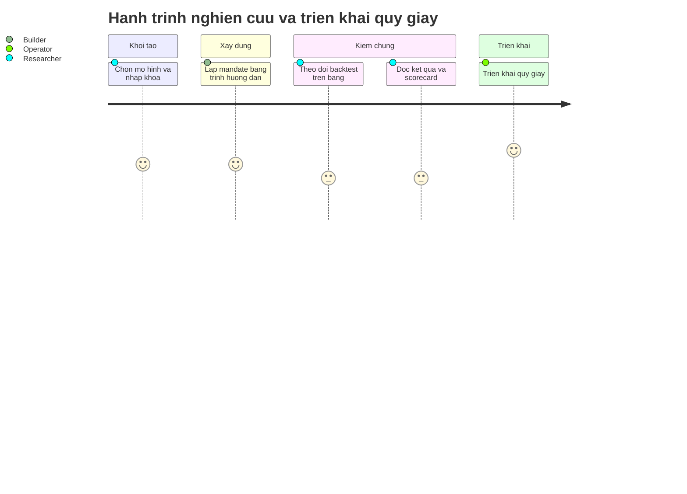
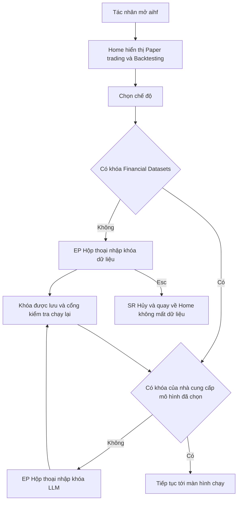
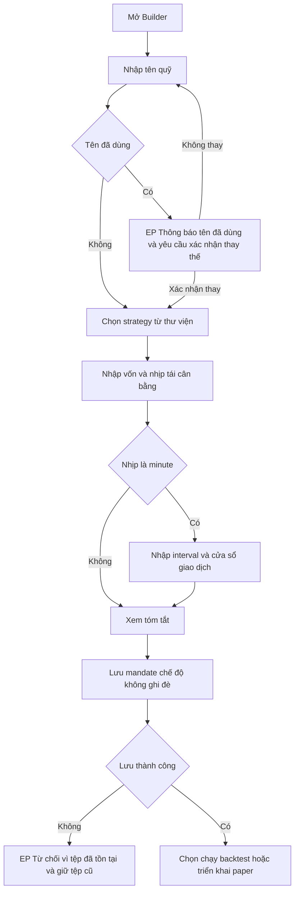
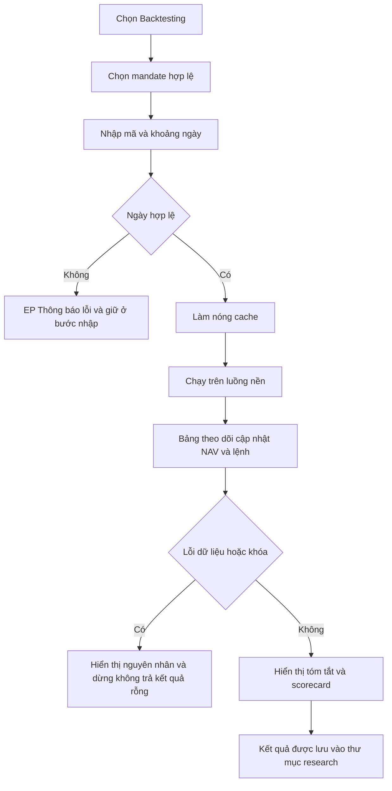
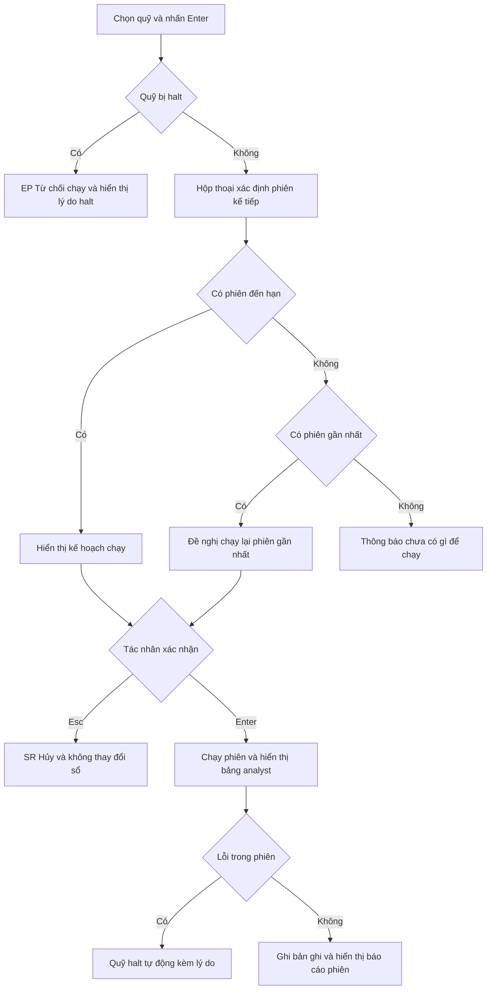
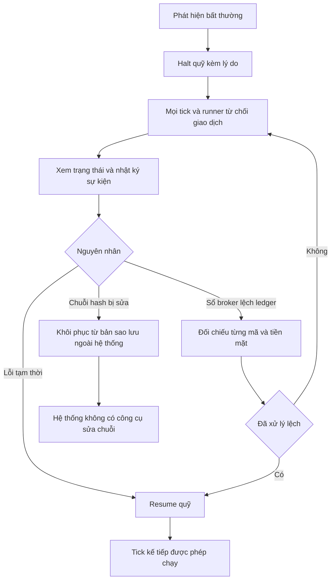
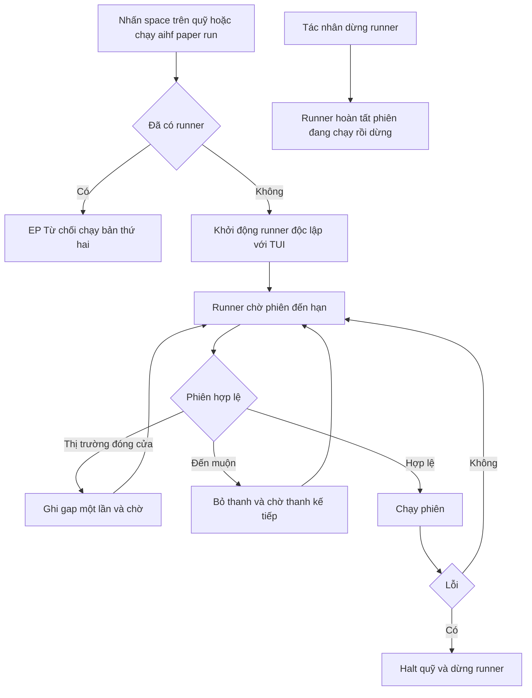

# USER REQUIREMENTS DOCUMENT (URD) - AI HEDGE FUND (aihf)

Tài liệu yêu cầu tác nhân (User Requirements Document), biên soạn theo ISO 9241-210:2019 (Human-centred design for interactive systems) và tiêu chí khả dụng ISO 9241-11.

## Kiểm soát tài liệu

| Thuộc tính | Giá trị |
|---|---|
| Sản phẩm | `aihf` 2.6.4 - quỹ đầu tư do AI vận hành, giao diện dòng lệnh và giao diện terminal (TUI) |
| Tài liệu nguồn | `docs/AGILE_SRS.md` (SRS Agile), `.are/summary.md`, mã nguồn `hedge_fund/` |
| Kỹ năng áp dụng | `.claude/skills/ba-wf-urd-generator/SKILL.md` |
| Ngày biên soạn | 2026-11-02 |
| Quan hệ với SRS | URD mô tả nhu cầu và hành vi theo góc nhìn tác nhân; SRS mô tả đặc tả hệ thống. Mã `UR-*` tham chiếu chéo tới `US-*` của SRS |

### Nhãn trạng thái bằng chứng

| Nhãn | Ý nghĩa |
|---|---|
| `[OK]` | Có trong mã nguồn, có truy vết tệp và hàm |
| `[SPEC]` | Nêu trong tài liệu dự án (VISION.md, ROADMAP.md), chưa có trong mã |
| `[PROPOSED]` | Đề xuất của tài liệu này, chưa có trong mã hoặc chưa được đo |
| `[ASSUMPTION]` | Giả định cần xác nhận |
| `[UNKNOWN]` | Không có bằng chứng trong mã nguồn |
| `[OPEN]` | Câu hỏi mở dành cho Product Owner |

### Quyết định rẽ nhánh hệ thống (Decision Matrix)

Kết quả phân tích `docs/AGILE_SRS.md` và cấu trúc mã nguồn:

| Dấu hiệu | Bằng chứng | Kết luận |
|---|---|---|
| Không có thư viện frontend web hoặc di động, không có HTML template | `pyproject.toml`: phụ thuộc gồm `textual`, `rich`, không có framework web | Không thuộc Nhánh 1 theo nghĩa web hoặc di động |
| Có công cụ dòng lệnh với tệp đầu ra JSON thuần | `hedge_fund/run.py` (`aihf backtest`, `aihf paper ...`), SRS Mục 6.1 | Nhánh 2 (Headless/CLI) áp dụng cho các lệnh |
| Có giao diện terminal tương tác với bảng theo dõi, danh sách, trình hướng dẫn nhiều bước | `hedge_fund/tui/*` (Textual): `HomeScreen`, `PaperScreen`, `BacktestScreen`, `BuilderScreen`, `FundSelectScreen` | Nhánh 1 áp dụng cho các màn hình TUI |
| Không có HTTP server, hàng đợi, webhook | SRS Mục 6.4 | Không dùng Data & Action Interaction Matrix cho API |

**Phân loại: hệ thống lai (Hybrid) - CLI/Headless cộng TUI.**

| Phạm vi | Nhánh | Artifact sử dụng ở Mục 6 |
|---|---|---|
| Lệnh `aihf backtest ...`, `aihf paper ...` | Nhánh 2 | Pattern B1: Terminal CLI Interaction Box |
| Màn hình TUI (Home, Paper, Backtest, Builder, Funds) | Nhánh 1 | Pattern A1 (trình hướng dẫn), A2 (bảng theo dõi), A3 (lưới dữ liệu), vẽ dưới dạng ASCII Low-Fi Wireframe |
| Giao tiếp tích hợp qua API HTTP | Không áp dụng | Không dùng Pattern B2; không tạo mockup web hoặc di động |

Ghi chú sai lệch so với kỹ năng: kỹ năng định nghĩa hai nhánh loại trừ nhau. Hệ thống có cả hai bề mặt tương tác nên tài liệu áp dụng đồng thời hai nhánh theo từng bề mặt. Mọi wireframe vẽ màn hình terminal, không vẽ giao diện web hoặc ứng dụng di động.

---

## 1. GIỚI THIỆU & NGUYÊN TẮC HCD

### 1.1 Mục đích tài liệu

| Hạng mục | Nội dung |
|---|---|
| Xác định nhu cầu tác nhân | Ghi nhận mục tiêu, nhiệm vụ, bối cảnh sử dụng và trở ngại quy trình của các tác nhân vận hành, nghiên cứu, xây dựng quỹ, kiểm toán và lập lịch |
| Tiêu chí khả dụng | Thiết lập tiêu chí hiệu quả, hiệu suất và mức hài lòng theo ISO 9241-11 (Mục 7), kèm phương pháp đánh giá (Mục 8) |
| Truy vết | Mỗi yêu cầu `UR-[MODULE]-[STT]` truy xuất về vai trò tác nhân, lệnh CLI hoặc màn hình TUI, và `US-*` tương ứng trong `docs/AGILE_SRS.md` |
| Phạm vi | Chức năng đang có trong mã (`[OK]`) là phạm vi yêu cầu. Nội dung kế hoạch được gắn `[SPEC]` hoặc `[PROPOSED]` |
| Giới hạn pháp lý | Dự án phục vụ mục đích giáo dục; không đưa ra lời khuyên đầu tư và không thực hiện giao dịch thật (`README.md`) |

### 1.2 Tuyên bố lấy con người làm trung tâm

Bốn hoạt động HCD của ISO 9241-210 được ánh xạ vào sản phẩm như sau:

| Hoạt động ISO 9241-210 | Cách sản phẩm đáp ứng | Bằng chứng |
|---|---|---|
| Hiểu và xác định bối cảnh sử dụng | Hai bề mặt tương tác (CLI, TUI) phục vụ tác nhân vận hành và tác nhân tự động | `run.py`, `tui/app.py` |
| Xác định yêu cầu của tác nhân | Mandate ở dạng dữ liệu; quy tắc kiểm tra báo lỗi theo đường dẫn tệp và tên trường | `fund/spec.py: load_spec` |
| Tạo giải pháp thiết kế | Bước phê duyệt trước khi chạy; kill switch; ledger băm chuỗi | `tui/paper.py: RunConfirmScreen`, `paper/ledger.py` |
| Đánh giá thiết kế theo yêu cầu | Bộ kiểm thử giao diện Textual và CLI | `tui/test_*.py`, `test_run.py` |

Nguyên tắc giảm tải nhận thức (Cognitive load) áp dụng cho toàn bộ yêu cầu:

| Mã | Nguyên tắc | Cơ chế đã có trong mã |
|---|---|---|
| HCD-01 | Một điểm vào cho mỗi mục tiêu | Màn hình Home chỉ có hai lựa chọn: Paper trading, Backtesting (`tui/home.py`) |
| HCD-02 | Yêu cầu thông tin đúng thời điểm | Cổng khóa API chạy trước khi tốn thời gian làm nóng cache (`demand_run_keys`) |
| HCD-03 | Ngăn chặn sai sót trước hậu quả | Bước phê duyệt trước khi ghi ledger hoặc gửi lệnh; từ chối ghi đè tên mandate |
| HCD-04 | Giá trị mặc định có căn cứ | Ô mã giao dịch điền sẵn từ lần backtest trước; khoảng ngày mặc định 78 tuần |
| HCD-05 | Phục hồi sau lỗi | Quỹ tự halt khi tick lỗi; `redo` thay thế phiên mà không xóa bản ghi cũ |
| HCD-06 | Khả năng truy vết quyết định | Mọi tín hiệu kèm luận điểm; báo cáo phiên tách phần đã thực thi và quyết định mới |
| HCD-07 | Đầu ra máy đọc được tách khỏi thông điệp cho tác nhân | stdout chỉ chứa JSON; trạng thái ghi ra stderr |

### 1.3 Thuật ngữ & Khái niệm tác nhân (User Glossary)

| Thuật ngữ | Giải thích theo ngữ cảnh tác nhân | Nguồn |
|---|---|---|
| Mandate | Bản mô tả "bàn giao dịch": strategy, analyst, rủi ro, vốn, nhịp tái cân bằng; không chứa mã cổ phiếu | `fund/spec.py` |
| Universe | Danh sách mã cổ phiếu mà quỹ giao dịch; chỉ định khi backtest hoặc triển khai | `fund/spec.py: normalize_universe` |
| Backtest | Phát lại mandate trên dữ liệu lịch sử | `backtesting/fund.py` |
| Paper fund (quỹ giấy) | Mandate đã triển khai, chạy trên phiên thị trường thật bằng vốn giả định | `paper/deployed.py` |
| Phiên (Session) | Một ngày giao dịch hoàn tất, hoặc một thanh thời gian đối với quỹ phút | `pipeline/session.py` |
| Tick | Hành động tiến hành đúng một phiên chưa ghi | `paper/tick.py` |
| Runner | Tiến trình nền tự tiến hành phiên khi đến hạn | `paper/runner.py` |
| Analyst | Mô hình tạo quan điểm: persona LLM hoặc mô hình định lượng | `signals/` |
| Tín hiệu (Signal) | Quan điểm từ -1 (giảm) đến +1 (tăng) kèm luận điểm | `models.py` |
| Abstain | Analyst không đưa ra quan điểm do thiếu dữ liệu hoặc lỗi | `signals/llm_agent.py` |
| Quyết định chờ | Mục tiêu đã tính tại phiên T, thực thi ở phiên kế tiếp | `pipeline/session.py` |
| NAV | Giá trị tài sản ròng của quỹ: tiền mặt cộng giá trị vị thế | `pipeline/session.py` |
| Sổ cái (Ledger) | Chuỗi bản ghi phiên, mỗi bản ghi mang hash của bản ghi trước | `paper/ledger.py` |
| Kill switch (halt) | Cờ chặn mọi giao dịch của quỹ cho đến khi resume | `paper/ledger.py` |
| Clamp | Một giới hạn rủi ro đã kích hoạt và được ghi nhận | `risk/limits.py` |
| Blind | Chế độ che mã, ngành và ngày trong prompt khi backtest | `signals/llm_agent.py` |
| Scorecard | Bảng chấm điểm analyst và quy kết lãi lỗ theo strategy | `scorecard/` |

---

## 2. BỐI CẢNH SỬ DỤNG (CONTEXT OF USE ANALYSIS)

### 2.1 Đặc điểm tác nhân

Hệ thống không có tài khoản hay phân quyền theo vai trò (`[UNKNOWN]` trong mã). Tác nhân được xác định theo điểm vào và nhiệm vụ.

| Mã | Tác nhân | Trình độ | Thói quen và tần suất sử dụng | Điểm vào |
|---|---|---|---|---|
| AC-01 | Tác nhân vận hành quỹ | Trung bình: quen terminal, hiểu khái niệm NAV, vị thế | Chạy phiên sau mỗi phiên đóng cửa (quỹ ngày) hoặc để runner chạy liên tục; kiểm tra trạng thái hằng ngày | TUI Paper trading, `aihf paper ...` |
| AC-02 | Tác nhân nghiên cứu | Cao: hiểu hiệu suất điều chỉnh rủi ro, rò rỉ dữ liệu tương lai | Chạy backtest theo đợt khi thử mandate mới; đọc scorecard sau mỗi đợt | TUI Backtesting, `aihf backtest` |
| AC-03 | Tác nhân xây dựng quỹ | Trung bình | Lắp ráp mandate khi bắt đầu thử chiến lược; ít khi sửa lại | TUI Builder, tệp YAML |
| AC-04 | Tác nhân kiểm toán | Trung bình | Kiểm tra định kỳ tính toàn vẹn sổ cái và lý do quyết định `[ASSUMPTION]` | `aihf paper status/scorecard`, TUI Sessions |
| AC-05 | Bộ lập lịch (tác nhân hệ thống) | Không áp dụng | Gọi `aihf paper tick` mỗi ngày làm việc sau phiên đóng cửa | cron |
| AC-06 | Tác nhân đóng góp mô hình | Cao: lập trình Python | Thêm analyst, strategy, nguồn dữ liệu theo giao thức | `AlphaModel`, `DataClient`, `Broker` |

Ràng buộc chung về tác nhân:

| Ràng buộc | Nội dung | Nhãn |
|---|---|---|
| Ngôn ngữ giao diện | Toàn bộ văn bản giao diện bằng tiếng Anh | `[OK]` |
| Kiến thức nền | Tác nhân cần hiểu khái niệm quỹ đầu tư, backtest, NAV, vị thế long và short | `[ASSUMPTION]` |
| Quyền truy cập | Không phân quyền; mọi tác nhân trên cùng tài khoản hệ điều hành có quyền như nhau | `[OK]` |

### 2.2 Môi trường vận hành

| Hạng mục | Mô tả | Bằng chứng |
|---|---|---|
| Thiết bị | Máy tính cá nhân có terminal; cài bằng `pipx install aihf` | `README.md` |
| Nền tảng | Python `^3.11`; hành vi tiến trình nền theo POSIX (`os.kill`, `SIGTERM`, `start_new_session`) | `pyproject.toml`, `paper/runner.py` |
| Giao diện hiển thị | Terminal hỗ trợ Textual và Rich; kích thước tối thiểu `[UNKNOWN]` | `tui/app.py` |
| Đầu vào | Bàn phím; phím tắt hiển thị ở thanh chân trang | `tui/*: BINDINGS` |
| Mạng | Cần Internet tới Financial Datasets và nhà cung cấp LLM; có bộ nhớ đệm đĩa cho dữ liệu hoàn tất và quyết định LLM | `data/cached.py`, `llm/cache.py` |
| Lưu trữ | `~/.hedge-fund/` (mandates, paper, research, cache, `.env`) | `paths.py` |
| Múi giờ | `America/New_York` cho phiên và cửa sổ giao dịch | `data/sessions.py` |
| Áp lực thời gian | Quỹ phút: một thanh phải hoàn tất trước ranh giới thanh kế tiếp; quỹ ngày: không có hạn thời gian cứng | `paper/runner.py` |
| Chi phí cho mỗi lần chạy | Mỗi quyết định LLM tốn lượt gọi API; lần chạy lại cùng dữ liệu không tốn lượt gọi | `llm/cache.py` |
| Tiến trình nền | Runner độc lập với TUI, sống sau khi đóng ứng dụng; nhật ký ở `runner.log` | `paper/runner.py: spawn_runner` |

### 2.3 Nhiệm vụ cốt lõi

| Mã | Nhiệm vụ | Tác nhân | Tần suất | Mức quan trọng | Bề mặt |
|---|---|---|---|---|---|
| T-01 | Thiết lập khóa API và chọn mô hình LLM | AC-01, AC-02, AC-03 | Một lần, sau đó hiếm khi đổi | Cao | TUI |
| T-02 | Xây dựng và lưu mandate | AC-03 | Hiếm (khi tạo quỹ mới) | Cao | TUI, YAML |
| T-03 | Chạy backtest và đọc kết quả | AC-02 | Theo đợt nghiên cứu | Cao | TUI, CLI |
| T-04 | Triển khai quỹ giấy | AC-01 | Hiếm | Cao | TUI, CLI |
| T-05 | Tiến hành một phiên và phê duyệt trước khi chạy | AC-01, AC-05 | Mỗi phiên giao dịch (theo nhịp quỹ) | Rất cao | TUI, CLI |
| T-06 | Chạy runner nền | AC-01 | Khi cần vận hành liên tục | Cao | TUI, CLI |
| T-07 | Dừng khẩn cấp và tiếp tục giao dịch | AC-01 | Hiếm, khẩn cấp | Rất cao | TUI, CLI |
| T-08 | Theo dõi trạng thái quỹ và đọc báo cáo phiên | AC-01, AC-04 | Hằng ngày | Cao | TUI, CLI |
| T-09 | Đọc scorecard analyst và strategy | AC-02, AC-04 | Sau mỗi đợt nghiên cứu hoặc định kỳ | Trung bình | CLI, TUI |
| T-10 | Xác minh toàn vẹn sổ cái và xử lý lệch sổ | AC-04, AC-01 | Khi có lỗi hoặc kiểm toán | Cao | CLI |
| T-11 | Chạy lại phiên gần nhất (redo) | AC-01 | Hiếm | Trung bình | TUI, CLI |
| T-12 | Quản lý thư viện mandate (xem, xóa) | AC-02, AC-03 | Hiếm | Thấp | TUI |

---

## 3. CHÂN DUNG TÁC NHÂN (ACTOR PERSONAS & EMPATHY MAPS)

Chân dung được suy ra từ điểm vào, kiểm tra nghiệp vụ (guard) và đối tượng sử dụng trong mã; không dùng tên riêng giả định. Empathy Map diễn đạt bằng yêu cầu thông tin, nhận định và hành vi khách quan.

### 3.1 AC-01 - Tác nhân vận hành quỹ

| Thuộc tính | Nội dung |
|---|---|
| Mục tiêu chính | Chạy quỹ giấy theo từng phiên thị trường thật, giữ hồ sơ NAV liên tục và dừng giao dịch khi có bất thường |
| Trở ngại quy trình | Khó xác định quỹ sẽ giao dịch gì ở phiên kế tiếp; rủi ro chạy trên sổ lệch; quỹ phút cần xử lý hàng trăm bản ghi mỗi ngày |
| Nhiệm vụ | T-01, T-04, T-05, T-06, T-07, T-08, T-11 |
| Guard liên quan | `FundHalted`, `BookMismatch`, `NothingDue`, `validate_fund_name`, pid file của runner |

| Thành phần | Nội dung |
|---|---|
| Says (thông tin cần nêu) | Cần biết phiên sắp chạy, quyết định sẽ thực thi và có chi phí nào phát sinh |
| Thinks (nhận định) | Sổ broker và ledger phải khớp trước khi giao dịch; quyết định chưa được phê duyệt không được ghi |
| Does (hành vi) | Chọn quỹ, xem kế hoạch chạy, xác nhận hoặc hủy, kiểm tra NAV, bật hoặc tắt runner, halt khi có sự cố |
| Feels (mức thuận lợi) | Cao khi có bước phê duyệt và thông báo lỗi nêu nguyên nhân; Thấp khi quỹ bị halt mà không biết lý do |

### 3.2 AC-02 - Tác nhân nghiên cứu

| Thuộc tính | Nội dung |
|---|---|
| Mục tiêu chính | Kiểm chứng mandate trên lịch sử, so với benchmark, và phân biệt kỹ năng thật với nhiễu |
| Trở ngại quy trình | Rò rỉ dữ liệu tương lai; ký ức LLM về công ty làm sai lệch kết quả; chi phí gọi LLM lặp lại |
| Nhiệm vụ | T-01, T-03, T-09, T-12 |
| Guard liên quan | Chế độ blind; dữ liệu theo `filing_date`; lỗi hạ tầng dữ liệu ném ngoại lệ |

| Thành phần | Nội dung |
|---|---|
| Says | Cần tổng lợi suất, lợi suất vượt benchmark, Sharpe, mức sụt giảm tối đa, chi phí giao dịch |
| Thinks | Kết quả chỉ có giá trị khi dữ liệu đúng thời điểm và prompt không lộ danh tính công ty |
| Does | Chọn mandate, nhập mã và khoảng ngày, theo dõi đường NAV, đọc scorecard, so sánh các lần chạy |
| Feels | Cao khi bảng theo dõi khớp số liệu cuối; Thấp khi lỗi khóa API xuất hiện sau nhiều phút làm nóng cache |

### 3.3 AC-04 - Tác nhân kiểm toán

| Thuộc tính | Nội dung |
|---|---|
| Mục tiêu chính | Xác minh sổ cái không bị sửa và truy ra lý do của từng quyết định |
| Trở ngại quy trình | Không thể tin sổ nếu bản ghi có thể bị sửa ngầm; cần đối chiếu luận điểm, lệnh và lần khớp |
| Nhiệm vụ | T-08, T-09, T-10 |
| Guard liên quan | Chuỗi hash, `LedgerError`, thư mục `superseded/`, `events.jsonl` |

| Thành phần | Nội dung |
|---|---|
| Says | Cần bản ghi nêu phiên bản mã, hash mandate và mô hình LLM của từng phiên |
| Thinks | Chuỗi hash hợp lệ là điều kiện tiên quyết để tin trạng thái; checkpoint chỉ là bộ nhớ đệm |
| Does | Chạy `status`, `scorecard`, đọc báo cáo phiên, đối chiếu sự kiện halt, redo, gap |
| Feels | Cao khi lỗi nêu đúng phiên bị sửa; Thấp khi thông báo lỗi chung chung |

### 3.4 AC-06 - Tác nhân đóng góp mô hình

| Thuộc tính | Nội dung |
|---|---|
| Mục tiêu chính | Thêm analyst, strategy hoặc nguồn dữ liệu mà không sửa lõi engine |
| Trở ngại quy trình | Cần hợp đồng giao diện rõ ràng, quy tắc point-in-time và kiểm thử mẫu |
| Nhiệm vụ | Ngoài danh mục nhiệm vụ vận hành; yêu cầu thuộc Mục 6.9 (`UR-EXT`) |
| Guard liên quan | `investment_approach`, `horizon_days` khai báo trên chính lớp; `ALPHA_MODEL_REGISTRY` |

| Thành phần | Nội dung |
|---|---|
| Says | Cần giao thức `AlphaModel.predict`, `DataClient`, `Broker` được tài liệu hóa trong docstring |
| Thinks | Mô hình chỉ được dùng thông tin tại hoặc trước ngày đánh giá |
| Does | Cài lớp mới, đăng ký vào registry, viết kiểm thử với test double |
| Feels | Cao khi engine chạy mô hình mới không cần thay đổi khác |

### 3.5 AC-03 và AC-05 (tóm tắt)

| Tác nhân | Mô tả ngắn | Yêu cầu chính |
|---|---|---|
| AC-03 Tác nhân xây dựng quỹ | Dùng trình hướng dẫn hoặc YAML để lắp mandate | Báo lỗi theo trường; không ghi đè mandate đã có |
| AC-05 Bộ lập lịch | Tác nhân hệ thống gọi `tick`; không có giao diện | Gọi lặp an toàn; "chưa có phiên" và lỗi cùng thoát mã 1, thông báo trên stderr phân biệt hai trường hợp `[OPEN]` |

---

## 4. BẢN ĐỒ HÀNH TRÌNH TRẢI NGHIỆM (USER JOURNEY MAPS)

Cột "Mức thuận lợi" dùng thang Thấp / Trung bình / Cao và phản ánh mức hỗ trợ của thiết kế hiện có trong mã; các mức này là đánh giá phân tích, không phải kết quả đo từ tác nhân thật `[ASSUMPTION]`.

### 4.1 Hành trình J-01: nghiên cứu và triển khai quỹ giấy (AC-02, AC-03, AC-01)

| Giai đoạn | Điểm chạm (Touchpoint) | Hành vi của tác nhân | Mức thuận lợi | Trở ngại quy trình | Yêu cầu liên quan |
|---|---|---|---|---|---|
| Khởi tạo | `aihf` (Home), phím `k`, phím `m` | Chọn mô hình, nhập khóa còn thiếu | Cao | Khóa nhà cung cấp phải khớp mô hình đã chọn | UR-CFG-01, UR-CFG-02 |
| Xây dựng | Builder (TUI), tệp YAML | Đặt tên, chọn strategy, vốn, nhịp | Cao | Tên trùng; cấu hình sai chỉ lộ khi lưu | UR-FUND-01, UR-FUND-02 |
| Kiểm chứng | Backtest (TUI hoặc `aihf backtest`) | Nhập mã, khoảng ngày; theo dõi NAV so với benchmark | Trung bình | Thời gian chờ làm nóng cache và gọi LLM; lỗi khóa lộ muộn nếu bỏ qua cổng | UR-BT-01, UR-BT-02, UR-BT-03 |
| Đánh giá | Scorecard (CLI, TUI) | Đọc hit rate, IC, quy kết lãi lỗ | Trung bình | Mẫu nhỏ làm tỷ lệ kém tin cậy | UR-SCORE-01, UR-SCORE-02 |
| Triển khai | `aihf paper create`, Builder (chế độ paper) | Gắn mandate vào universe | Cao | Tên quỹ không hợp lệ | UR-PAPER-01 |

### 4.2 Hành trình J-02: vận hành hằng ngày (AC-01, AC-05)

| Giai đoạn | Điểm chạm | Hành vi của tác nhân | Mức thuận lợi | Trở ngại quy trình | Yêu cầu liên quan |
|---|---|---|---|---|---|
| Kiểm tra | Danh sách quỹ (TUI), `aihf paper status` | Xem NAV, quyết định chờ, trạng thái halt | Cao | Cần phân biệt quỹ đang chạy, đã halt, chưa bắt đầu | UR-PAPER-04 |
| Phê duyệt | Hộp thoại phê duyệt (TUI) | Xem kế hoạch chạy rồi xác nhận | Cao | Phải biết rõ quyết định nào được thực thi | UR-PAPER-03 |
| Tiến hành | `aihf paper tick`, cron | Chạy đúng một phiên | Cao | Gọi khi chưa có phiên đến hạn | UR-PAPER-02 |
| Giám sát | Runner, `runner.log`, sự kiện gap | Theo dõi tiến trình nền | Trung bình | Khoảng trống (gap) của quỹ phút | UR-PAPER-05 |
| Xử lý sự cố | Thông báo halt, `aihf paper halt/resume` | Dừng, tìm nguyên nhân, tiếp tục | Trung bình | Phải đọc nhật ký sự kiện để biết lý do | UR-PAPER-06, UR-LEDGER-02 |
| Phục hồi | Redo | Chạy lại phiên gần nhất | Trung bình | Bản ghi cũ phải được giữ | UR-PAPER-07 |

### 4.3 Hành trình J-03: kiểm toán (AC-04)

| Giai đoạn | Điểm chạm | Hành vi của tác nhân | Mức thuận lợi | Trở ngại quy trình | Yêu cầu liên quan |
|---|---|---|---|---|---|
| Xác minh | `aihf paper status`, replay | Kiểm tra chuỗi hash | Cao | Lỗi phải nêu đúng phiên bị sửa | UR-LEDGER-01 |
| Đối soát | Thông báo `BookMismatch` | Đối chiếu sổ broker với sổ ledger | Trung bình | Không có công cụ sửa tự động | UR-LEDGER-02 |
| Truy vết quyết định | Báo cáo phiên (TUI) | Đọc luận điểm, lệnh, chi phí | Cao | Cần tách phần đã thực thi khỏi quyết định mới | UR-PAPER-04 |

### 4.4 Sơ đồ hành trình J-01



---

## 5. SƠ ĐỒ LUỒNG CÔNG VIỆC CỦA TÁC NHÂN (TASK FLOWS)

Mỗi sơ đồ nêu cơ chế ngăn chặn sai sót (Error Prevention, ký hiệu EP) và tự phục hồi (Self-recovery, ký hiệu SR).

### 5.1 TF-01: thiết lập khóa và chạy lần đầu (T-01)



### 5.2 TF-02: xây dựng mandate (T-02)



### 5.3 TF-03: backtest (T-03)



### 5.4 TF-04: tiến hành một phiên có phê duyệt (T-05, T-11)



### 5.5 TF-05: dừng khẩn cấp và phục hồi (T-07, T-10)



Ghi chú: nhánh "Khôi phục từ bản sao lưu ngoài hệ thống" và "Hệ thống không có công cụ sửa chuỗi" phản ánh thiết kế hiện có; mã không cung cấp lệnh sửa chuỗi hay đồng bộ lại sổ broker `[UNKNOWN]`.

### 5.6 TF-06: vận hành nền với runner (T-06)



---

## 6. ĐẶC TẢ CHI TIẾT YÊU CẦU TÁC NHÂN

Quy ước:

| Hạng mục | Nội dung |
|---|---|
| Mã yêu cầu | `UR-[MODULE]-[STT]` |
| Artifact | Lệnh CLI dùng Pattern B1 (Terminal CLI Interaction Box). Màn hình TUI dùng Pattern A1, A2 hoặc A3 (Low-Fi ASCII Wireframe). Không có Pattern B2 vì hệ thống không có API HTTP |
| Dữ liệu trong khung | Giá trị minh họa cấu trúc màn hình, không trích từ lần chạy thật `[ASSUMPTION]` |
| Mẫu câu yêu cầu | Tác nhân hoặc Hệ thống, động từ hành động, đối tượng, điều kiện |
| Truy vết | Lệnh CLI hoặc màn hình TUI, tệp mã nguồn, và `US-*` tương ứng trong `docs/AGILE_SRS.md` |

### 6.1 Module UR-CFG - Khóa API và mô hình

#### UR-CFG-01 - Nhập khóa API còn thiếu trước khi chạy

| Thuộc tính | Nội dung |
|---|---|
| Tác nhân | AC-01, AC-02, AC-03 |
| Điểm kích hoạt | Tác nhân bắt đầu một lần chạy backtest hoặc phiên paper, hoặc nhấn `k` trên Home |
| Truy vết | TUI `KeyPromptScreen` (`tui/home.py`), `demand_run_keys`; `tui/keys.py: save_credential` |
| SRS | US-CFG-01 |
| Yêu cầu nghiệp vụ | Hệ thống kiểm tra khóa dữ liệu rồi khóa của nhà cung cấp mô hình đã chọn trước khi làm nóng cache. Hệ thống che khóa khi hiển thị và lưu vào `~/.hedge-fund/.env` với quyền chỉ chủ sở hữu. Hệ thống ưu tiên biến môi trường đã export hơn tệp `.env` |

```text
┌────────────────────────────────────────────────────────────────────────┐
│  API KEY NEEDED                                            [Esc] cancel│
├────────────────────────────────────────────────────────────────────────┤
│  STEP INDICATOR:                                                       │
│  (1) Data key ─── [2] Model key ─── (3) Run                            │
│      [Completed]      [Active]         [Upcoming]                      │
├────────────────────────────────────────────────────────────────────────┤
│  SECTION: Anthropic key for the selected model (ANTHROPIC_API_KEY)     │
│                                                                        │
│  * API key                                                             │
│  ┌──────────────────────────────────────────────────────────┐          │
│  │ sk-ant••••••••Xy3q                                       │          │
│  └──────────────────────────────────────────────────────────┘          │
│                                                                        │
│  [!] Validation Warning: biến export trong shell luôn thắng tệp .env.  │
│  Saved to: ~/.hedge-fund/.env (0600)                                   │
├────────────────────────────────────────────────────────────────────────┤
│  [ Esc: cancel ]                                      [ Enter: save > ]│
└────────────────────────────────────────────────────────────────────────┘
```

**Optimal Flow**

1. Tác nhân khởi động một lần chạy khi chưa có khóa dữ liệu.
2. Hệ thống mở hộp thoại cho `FINANCIAL_DATASETS_API_KEY`.
3. Tác nhân nhập khóa và nhấn Enter; hệ thống lưu và chạy lại cổng kiểm tra.
4. Hệ thống mở hộp thoại tiếp theo nếu còn thiếu khóa LLM, rồi tiếp tục lần chạy.

**Exception / Alternative Flow**

| Tình huống | Hành vi của hệ thống |
|---|---|
| Tác nhân nhấn Esc | Hệ thống không lưu khóa và không tiếp tục lần chạy |
| Khóa đã có trong môi trường | Hệ thống bỏ qua hộp thoại |
| Giá trị có khoảng trắng hoặc ký tự đặc biệt | Hệ thống đặt giá trị trong dấu nháy khi ghi tệp |
| Tệp `.env` có khóa và chú thích khác | Hệ thống chỉ sửa đúng dòng của khóa đó |

**Quy tắc công thái học & chống sai sót**

- Yêu cầu khóa tại cổng đầu tiên thay vì trong luồng nền (HCD-02).
- Che khóa: 6 ký tự đầu, 4 ký tự cuối, phần giữa thay bằng dấu chấm.
- Phím thoát nhất quán: Esc hủy ở mọi hộp thoại.

#### UR-CFG-02 - Chọn mô hình LLM

| Thuộc tính | Nội dung |
|---|---|
| Tác nhân | AC-01, AC-02 |
| Điểm kích hoạt | Nhấn `m` trên Home; hoặc cờ `--model` trên CLI |
| Truy vết | TUI `ModelPickerScreen` (`tui/home.py`); `llm/registry.py: load_api_models`; `run.py: --model` |
| SRS | US-CFG-02 |
| Yêu cầu nghiệp vụ | Hệ thống hiển thị danh sách mô hình từ một tệp registry duy nhất và ghi lựa chọn vào `HEDGE_FUND_LLM_MODEL`. Hệ thống ưu tiên cờ `--model` hơn biến môi trường. Hệ thống chấp nhận mã mô hình ngoài registry và dùng nhà cung cấp Anthropic mặc định |

```text
┌────────────────────────────────────────────────────────────────────────┐
│  MODEL PICKER                                              [Esc] cancel│
├────────────────────────────────────────────────────────────────────────┤
│  Current: Opus 5.5 (claude-opus-5-5)                                   │
├────────────────────────────────────────────────────────────────────────┤
│  Model                 Id                   Provider                   │
│  Opus 5.5              claude-opus-5-5      Anthropic                  │
│  GPT-6 Sol             gpt-6-sol            OpenAI                     │
│  Jev                   jev-1.13.0           TypeSafe                   │
│  Grok 4.7              grok-4.7             xAI                        │
│  Kimi K3               kimi-k3              Kimi                       │
├────────────────────────────────────────────────────────────────────────┤
│  Registry: 9 models                  [Enter] select     [Esc] cancel   │
└────────────────────────────────────────────────────────────────────────┘
```

**Optimal Flow:** Tác nhân nhấn `m`, chọn một dòng, nhấn Enter; dòng trạng thái trên Home hiển thị tên mô hình và mã.

**Exception / Alternative Flow**

| Tình huống | Hành vi của hệ thống |
|---|---|
| Nhà cung cấp chưa có máy khách | Hệ thống hiển thị dòng nhưng không cho chọn |
| Thiếu khóa nhà cung cấp | Hệ thống yêu cầu nhập khóa tại cổng ở UR-CFG-01 |
| Tác nhân đặt mã mô hình ngoài danh sách | Hệ thống dùng mã đó qua nhà cung cấp Anthropic |

**Quy tắc công thái học & chống sai sót:** dòng trạng thái luôn hiển thị mô hình đang dùng để tác nhân biết lần chạy dùng mô hình nào.

### 6.2 Module UR-FUND - Mandate

#### UR-FUND-01 - Xây dựng mandate bằng trình hướng dẫn

| Thuộc tính | Nội dung |
|---|---|
| Tác nhân | AC-03 |
| Điểm kích hoạt | Tác nhân chọn tạo quỹ mới trong chế độ Paper trading hoặc Backtesting |
| Truy vết | TUI `BuilderScreen` (`tui/builder.py`); `fund/spec.py: custom_strategy`; `fund/storage.py: save_spec` |
| SRS | US-FUND-01 |
| Yêu cầu nghiệp vụ | Hệ thống dẫn tác nhân qua các bước tên, strategy, nhân sự analyst, vốn, nhịp tái cân bằng, interval và cửa sổ (chỉ quỹ phút), mã giao dịch (chỉ chế độ paper). Hệ thống từ chối tên đã thuộc mandate hoặc quỹ giấy và từ chối ghi đè tệp có sẵn |

```text
┌────────────────────────────────────────────────────────────────────────┐
│  BUILD A FUND                                           [Esc] back  [X]│
├────────────────────────────────────────────────────────────────────────┤
│  STEP INDICATOR:                                                       │
│  (1) Name ── (2) Strategies ── [3] Capital ── (4) Cadence ── (5) Done  │
│   [Completed]   [Completed]    [Active]        [Upcoming]    [Upcoming]│
├────────────────────────────────────────────────────────────────────────┤
│  SECTION: 3. Starting capital and cadence                              │
│                                                                        │
│  * Name your fund               * Starting capital ($)                 │
│  ┌──────────────────────────┐   ┌────────────────────────────────┐     │
│  │ alpha-one                │   │ 100000                         │     │
│  └──────────────────────────┘   └────────────────────────────────┘     │
│                                                                        │
│  * Rebalance cadence                                                   │
│  (•) weekly   ( ) daily   ( ) monthly   ( ) minute                     │
│                                                                        │
│  [!] Validation Warning: tên đã tồn tại sẽ bị từ chối khi lưu.         │
├────────────────────────────────────────────────────────────────────────┤
│  [ < Back ]                                       [ Enter: Continue > ]│
└────────────────────────────────────────────────────────────────────────┘
```

**Optimal Flow**

1. Tác nhân nhập tên chưa dùng.
2. Tác nhân chọn strategy từ thư viện; phím `a` chọn hoặc bỏ chọn tất cả analyst.
3. Tác nhân nhập vốn và chọn nhịp.
4. Hệ thống hiển thị tóm tắt, lưu mandate và đề nghị chạy backtest hoặc triển khai.

**Exception / Alternative Flow**

| Tình huống | Hành vi của hệ thống |
|---|---|
| Tên đã dùng | Hệ thống yêu cầu xác nhận thay thế; chỉ xóa bản cũ ở bước cuối |
| Tệp trùng tên xuất hiện giữa lúc kiểm tra và lúc lưu | Hệ thống từ chối ghi và giữ nguyên tệp cũ |
| Nhịp `minute` | Hệ thống bổ sung bước interval và cửa sổ giao dịch, kèm cảnh báo về tốc độ |
| Tác nhân quay lại bước trước | Hệ thống không nhân đôi lựa chọn |

**Quy tắc công thái học & chống sai sót:** chế độ pha trộn được suy ra từ hồ sơ analyst nên tác nhân không phải nhập; Enter tiếp tục, Esc quay lại; ô mã giao dịch điền sẵn từ quỹ giấy tạo gần nhất.

#### UR-FUND-02 - Kiểm tra mandate YAML

| Thuộc tính | Nội dung |
|---|---|
| Tác nhân | AC-02, AC-03 |
| Điểm kích hoạt | Tác nhân chạy `aihf backtest <mandate>` hoặc `aihf paper create --mandate <mandate>` |
| Truy vết | CLI `aihf backtest`, `aihf paper create`; `fund/spec.py: load_spec`; `run.py: _universe` |
| SRS | US-FUND-02 |
| Yêu cầu nghiệp vụ | Hệ thống từ chối mandate sai trước khi tạo client dữ liệu và nêu đường dẫn tệp cùng tên trường. Hệ thống từ chối khóa lạ, thiếu `schema_version`, interval trên nhịp không phải minute và tên strategy trùng |

```text
┌────────────────────────────────────────────────────────────────────────┐
│  TERMINAL CLI INTERACTION: aihf backtest (mandate không hợp lệ)        │
├────────────────────────────────────────────────────────────────────────┤
│  $ aihf backtest ~/.hedge-fund/mandates/bad.yaml --universe AAPL       │
│  usage: aihf backtest [-h] --universe UNIVERSE mandate                 │
│  aihf backtest: error: bad.yaml: risk.max_position_pct: Input should be│
│  greater than 0                                                        │
├────────────────────────────────────────────────────────────────────────┤
│  Exit code: 2        Không có lời gọi API nào được thực hiện           │
└────────────────────────────────────────────────────────────────────────┘
```

**Optimal Flow:** mandate hợp lệ; hệ thống tiếp tục tạo client dữ liệu và chạy.

**Exception / Alternative Flow**

| Tình huống | Hành vi của hệ thống |
|---|---|
| Thiếu `schema_version` | Hệ thống nêu "older format" và không sửa tệp |
| Universe rỗng | Hệ thống từ chối với "universe is empty" |
| Tệp không phải ánh xạ YAML | Hệ thống nêu "must be a YAML mapping" |

**Quy tắc công thái học & chống sai sót:** lỗi nêu đường dẫn và tên trường để tác nhân sửa đúng chỗ; mã thoát 2 cho lỗi tham số.

#### UR-FUND-03 - Quản lý thư viện mandate

| Thuộc tính | Nội dung |
|---|---|
| Tác nhân | AC-02, AC-03 |
| Điểm kích hoạt | Tác nhân mở danh sách mandate trong Backtesting; nhấn `d` để xóa |
| Truy vết | TUI `FundSelectScreen`, `ConfirmDeleteScreen`, `ConfirmWipeScreen` (`tui/funds.py`); `fund/storage.py: discover_funds` |
| SRS | US-FUND-03 |
| Yêu cầu nghiệp vụ | Hệ thống liệt kê mọi mandate kể cả tệp lỗi (vô hiệu hóa, kèm lỗi). Hệ thống cho phép xóa mandate, hoặc xóa mandate cùng lịch sử backtest, và giữ nguyên quỹ giấy đã triển khai từ mandate đó |

```text
┌────────────────────────────────────────────────────────────────────────┐
│  MANDATE LIBRARY                                             [Esc] back│
├────────────────────────────────────────────────────────────────────────┤
│  Mandate          Strategies          Last backtest        State       │
│  example-fund     deep-value, drift   +4.1% vs SPY +2.3%   valid       │
│  alpha-one        deep-value          none                 valid       │
│  broken-fund      -                   -                    INVALID     │
├────────────────────────────────────────────────────────────────────────┤
│  Selected: example-fund            [ d: delete ]  [ Enter: open ]      │
├────────────────────────────────────────────────────────────────────────┤
│  Delete: Enter = mandate only | Ctrl+D = mandate + history | Esc = keep│
└────────────────────────────────────────────────────────────────────────┘
```

**Optimal Flow:** Tác nhân chọn mandate hợp lệ, hệ thống mở bước chọn mã và khoảng ngày.

**Exception / Alternative Flow**

| Tình huống | Hành vi của hệ thống |
|---|---|
| Mandate lỗi | Hệ thống hiển thị lý do lỗi, không cho chọn, không ngắt ứng dụng |
| Xóa mandate | Hệ thống yêu cầu xác nhận và nêu số tệp bị xóa |
| Quỹ giấy đã triển khai từ mandate | Hệ thống giữ nguyên thư mục quỹ vì quỹ có bản chụp riêng |

**Quy tắc công thái học & chống sai sót:** hành động xóa có hai mức rõ ràng; Esc luôn là lựa chọn giữ lại.

### 6.3 Module UR-ALPHA - Quan điểm của analyst

#### UR-ALPHA-01 - Theo dõi quan điểm analyst trong lúc chạy

| Thuộc tính | Nội dung |
|---|---|
| Tác nhân | AC-01, AC-02 |
| Điểm kích hoạt | Phiên đang chạy trên TUI (backtest hoặc paper) |
| Truy vết | TUI `RunSessionScreen` (`tui/paper.py`), `BacktestScreen` (`tui/backtest.py`); `llm/watch.py: ThesisStream`; `signals/llm_agent.py` |
| SRS | US-ALPHA-01, US-ALPHA-03, US-ALPHA-04 |
| Yêu cầu nghiệp vụ | Hệ thống hiển thị hướng, độ tin cậy và luận điểm của từng analyst khi luận điểm đang được sinh. Hệ thống ghi nhận analyst lỗi là abstain kèm lý do. Hệ thống tái sử dụng quyết định đã lưu khi dữ liệu không đổi. Hệ thống che mã, ngành và ngày lịch trong prompt khi backtest |

```text
┌────────────────────────────────────────────────────────────────────────┐
│  ANALYST BOARD - alpha                              [Status: Running ●]│
│  Ticker: AAPL | Session: 2026-10-30              Model: claude-opus-5-5│
├────────────────────────────────────────────────────────────────────────┤
│  VIEWS                                                                 │
│  Analyst         Signal     Conf   Value    Thesis (streaming)         │
│  buffett         bullish    70     +0.70    Durable franchise, hig...  │
│  graham          neutral    55     +0.00    Margin of safety absen...  │
│  druckenmiller   bearish    40     -0.40    Liquidity turning agai...  │
│  lynch           abstain    -      +0.00    abstained: LLM call fa...  │
├────────────────────────────────────────────────────────────────────────┤
│  [OK] 3 views formed | [WARN] lynch: LLM call failed, abstained        │
└────────────────────────────────────────────────────────────────────────┘
```

**Optimal Flow:** hệ thống thu thập quan điểm của từng analyst theo từng mã, hiển thị luận điểm khi đang sinh, rồi chuyển sang bước tính danh mục.

**Exception / Alternative Flow**

| Tình huống | Hành vi của hệ thống |
|---|---|
| Phản hồi LLM không phân tích được | Hệ thống ghi abstain và lưu phản hồi thô làm dấu vết gỡ lỗi |
| Lỗi hạ tầng dữ liệu | Hệ thống dừng lần chạy và nêu lỗi; không biến thành quan điểm trung lập |
| Thiếu dữ liệu cơ bản của mã | Hệ thống ghi abstain "insufficient data" |

**Quy tắc công thái học & chống sai sót:** dấu hiệu abstain hiển thị tường minh; luận điểm hiển thị dần để tác nhân không chờ màn hình trống.

### 6.4 Module UR-BT - Backtesting

#### UR-BT-01 - Chạy backtest từ dòng lệnh

| Thuộc tính | Nội dung |
|---|---|
| Tác nhân | AC-02 |
| Điểm kích hoạt | Tác nhân cần kết quả JSON để lưu hoặc xử lý tiếp |
| Truy vết | CLI `aihf backtest <mandate> --universe ... [--start] [--end] [--out] [--model]`; `run.py: _backtest`; `backtesting/fund.py: backtest_fund` |
| SRS | US-BT-01, US-ALPHA-04 |
| Yêu cầu nghiệp vụ | Hệ thống ghi JSON kết quả đầy đủ ra stdout và ghi tóm tắt cùng bảng scorecard ra stderr. Hệ thống lưu một bản sao vào `~/.hedge-fund/research/`. Hệ thống mặc định `--end` là phiên hoàn tất gần nhất và `--start` lùi 78 tuần. Hệ thống chạy ở chế độ blind |

```text
┌────────────────────────────────────────────────────────────────────────┐
│  TERMINAL CLI INTERACTION: aihf backtest                               │
├────────────────────────────────────────────────────────────────────────┤
│  $ aihf backtest example.yaml --universe AAPL,MSFT --start 2025-04-01  │
│  > example-fund: backtesting 2025-04-01 → 2026-10-30 (weekly vs SPY)…  │
│  example-fund 2025-04-01 → 2026-10-30 · 396 sessions · 18 rebalances   │
│   · 54 orders · return +9.1% vs SPY +6.7% · sharpe 0.84                │
│   · max drawdown 7.2%                                                  │
│  ┌──────────────────────────────────────────────────────────────────┐  │
│  │ stdout : JSON FundBacktestResult (schema_version 2)              │  │
│  │ saved  : ~/.hedge-fund/research/example-fund-2025-04-01-....json │  │
│  └──────────────────────────────────────────────────────────────────┘  │
├────────────────────────────────────────────────────────────────────────┤
│  Exit code: 0 | tóm tắt trên stderr, JSON thuần trên stdout            │
└────────────────────────────────────────────────────────────────────────┘
```

**Optimal Flow:** Tác nhân chạy lệnh; hệ thống hiển thị trạng thái, in JSON, lưu bản sao, in tóm tắt và bảng scorecard.

**Exception / Alternative Flow**

| Tình huống | Hành vi của hệ thống |
|---|---|
| Benchmark không có giá trong cửa sổ | Hệ thống ném lỗi "cannot build the trading grid" và không trả kết quả rỗng |
| Thiếu khóa API | Hệ thống nêu tên biến môi trường cần đặt |
| Thông tin mandate sai | Hệ thống thoát mã 2 (UR-FUND-02) |

**Quy tắc công thái học & chống sai sót:** stdout chỉ chứa JSON để chuyển tiếp sang công cụ khác; `--out` ghi thêm ra tệp; khoảng ngày mặc định tránh nhập tay.

#### UR-BT-02 - Theo dõi backtest trên bảng TUI

| Thuộc tính | Nội dung |
|---|---|
| Tác nhân | AC-02 |
| Điểm kích hoạt | Tác nhân chọn Backtesting trên Home |
| Truy vết | TUI `BacktestScreen` (`tui/backtest.py`); `tui/shared.py: render_area_chart`; `backtesting/fund.py: on_cycle, on_valuation` |
| SRS | US-BT-02 |
| Yêu cầu nghiệp vụ | Hệ thống hiển thị đường NAV của quỹ so với benchmark và băng lệnh khớp theo từng phiên. Hệ thống ngăn tác nhân thoát màn hình khi backtest đang chạy. Hệ thống hiển thị ngày khớp lệnh là ngày thực thi |

```text
┌────────────────────────────────────────────────────────────────────────┐
│  BACKTEST BOARD - example-fund                      [Status: Running ●]│
│  Universe: AAPL, MSFT                               Progress: 212 / 396│
├────────────────────────────────────────────────────────────────────────┤
│  KEY METRICS SUMMARY                                                   │
│  ┌───────────────────┐  ┌───────────────────┐  ┌───────────────────┐   │
│  │ FUND RETURN       │  │ BENCHMARK SPY     │  │ REBALANCES        │   │
│  │ +6.2%             │  │ +4.9%             │  │ 11 of 18          │   │
│  └───────────────────┘  └───────────────────┘  └───────────────────┘   │
├────────────────────────────────────────────────────────────────────────┤
│  NAV vs benchmark                                                      │
│   110k ┤                          ╭──────                              │
│   105k ┤              ╭───────────╯                                    │
│   100k ┼──────────────╯                                                │
│        2025-04     2025-09     2026-02                                 │
├────────────────────────────────────────────────────────────────────────┤
│  [OK] 2025-09-02 buy AAPL 120 @ 225.11 -> 120 shares                   │
└────────────────────────────────────────────────────────────────────────┘
```

**Optimal Flow**

1. Tác nhân chọn mandate hợp lệ.
2. Tác nhân nhập mã giao dịch (điền sẵn từ lần trước), ngày bắt đầu và ngày kết thúc rồi nhấn Enter.
3. Hệ thống kiểm tra khóa, làm nóng cache, chạy trên luồng nền và cập nhật bảng.
4. Hệ thống hiển thị tóm tắt, scorecard và lưu kết quả.

**Exception / Alternative Flow**

| Tình huống | Hành vi của hệ thống |
|---|---|
| Ngày không hợp lệ | Hệ thống hiển thị thông báo lỗi và giữ ở bước nhập |
| Chưa có mandate | Hệ thống thông báo cần xây dựng mandate trước |
| Tác nhân nhấn Esc khi đang chạy | Hệ thống từ chối hành động quay lại |

**Quy tắc công thái học & chống sai sót:** số liệu cuối trên bảng bằng số liệu trong kết quả; giá trị mặc định cho mã và ngày giảm số lần nhập.

#### UR-BT-03 - Xem lại kết quả backtest đã lưu

| Thuộc tính | Nội dung |
|---|---|
| Tác nhân | AC-02 |
| Điểm kích hoạt | Tác nhân mở thư viện mandate |
| Truy vết | TUI `FundSelectScreen` (`tui/funds.py`); `backtesting/research.py: receipts, summarize, last_score` |
| SRS | US-BT-03 |
| Yêu cầu nghiệp vụ | Hệ thống hiển thị kết quả backtest gần nhất của từng mandate. Hệ thống khớp tệp kết quả theo trường `fund` trong tệp, không theo tiền tố tên tệp. Hệ thống bỏ qua tệp không đọc được |

```text
┌────────────────────────────────────────────────────────────────────────┐
│  BACKTEST HISTORY - example-fund                             [Esc] back│
├────────────────────────────────────────────────────────────────────────┤
│  Window                  Universe      Total    vs SPY   Sharpe  Max DD│
│  2025-04-01..2026-10-30  AAPL, MSFT    +9.1%    +2.4%    0.84    7.2%  │
│  2025-01-02..2025-12-31  AAPL, NVDA    +5.0%    -1.1%    0.52    9.8%  │
│  2024-06-03..2025-05-30  AAPL          +3.3%    +0.2%    0.31    6.0%  │
├────────────────────────────────────────────────────────────────────────┤
│  Saved results: 3 (newest first)                                       │
│  [i] Kết quả chỉ để tham khảo; không là đầu vào của lần chạy khác      │
└────────────────────────────────────────────────────────────────────────┘
```

**Optimal Flow:** hệ thống liệt kê kết quả theo thời gian sửa đổi mới nhất trước và hiển thị chỉ số chính.

**Exception / Alternative Flow:** tệp hỏng hoặc không có `metrics` bị bỏ qua; mandate có tên là tiền tố của mandate khác không lẫn kết quả.

**Quy tắc công thái học & chống sai sót:** mỗi hàng có đủ cửa sổ, universe và chỉ số để so sánh mà không mở tệp.

### 6.5 Module UR-SCORE - Chấm điểm

#### UR-SCORE-01 - Đọc điểm analyst theo chân trời tín hiệu

| Thuộc tính | Nội dung |
|---|---|
| Tác nhân | AC-02, AC-04 |
| Điểm kích hoạt | Sau backtest hoặc khi cần đánh giá quỹ giấy |
| Truy vết | CLI `aihf paper scorecard <name>`; kết thúc `aihf backtest`; `scorecard/analysts.py`; `tui/scorecard_view.py: analyst_table` |
| SRS | US-SCORE-01 |
| Yêu cầu nghiệp vụ | Hệ thống chấm mỗi analyst tại chân trời mà analyst khai báo, nêu tỷ lệ đúng, slugging, IC kèm số mẫu. Hệ thống đếm quan điểm chưa tới chân trời là pending. Hệ thống tính tỷ lệ đúng theo lợi suất vượt benchmark |

```text
┌────────────────────────────────────────────────────────────────────────┐
│  TERMINAL CLI INTERACTION: aihf paper scorecard alpha                  │
├────────────────────────────────────────────────────────────────────────┤
│  $ aihf paper scorecard alpha                                          │
│  Analyst   Horizon  Views  Hit rate  Slugging  IC mean  t-stat  Pending│
│  buffett   252      40     55% (n=38)  1.4       +0.06    1.2     12   │
│  graham    252      40     50% (n=36)  0.9       +0.01    0.2     12   │
│  pead      60       18     61% (n=18)  1.1       +0.09    1.7     4    │
├────────────────────────────────────────────────────────────────────────┤
│  [i] stdout: JSON | stderr: bảng trên | "-" = chưa có gì để đo         │
└────────────────────────────────────────────────────────────────────────┘
```

**Optimal Flow:** hệ thống in JSON ra stdout và bảng ra stderr.

**Exception / Alternative Flow:** ledger rỗng khiến hệ thống thông báo quỹ chưa ghi phiên nào; quan điểm hằng số khiến IC là `None` nhưng tỷ lệ đúng vẫn tính.

**Quy tắc công thái học & chống sai sót:** mỗi tỷ lệ đi kèm số mẫu để tránh đọc nhiễu thành kỹ năng.

#### UR-SCORE-02 - Đọc quy kết lãi lỗ theo strategy

| Thuộc tính | Nội dung |
|---|---|
| Tác nhân | AC-02, AC-04 |
| Điểm kích hoạt | Cùng lệnh scorecard |
| Truy vết | `scorecard/strategies.py`; `tui/scorecard_view.py: strategy_table` |
| SRS | US-SCORE-02 |
| Yêu cầu nghiệp vụ | Hệ thống nêu lãi lỗ, lợi suất, tỷ lệ kỳ thắng, tỷ trọng và mức sụt giảm tối đa của từng strategy. Hệ thống báo cáo phần lãi lỗ không quy kết được, không ẩn |

```text
┌────────────────────────────────────────────────────────────────────────┐
│  STRATEGY ATTRIBUTION - alpha                                [Esc] back│
├────────────────────────────────────────────────────────────────────────┤
│  Fund P&L: +1,840.20 | Trading cost: 96.40 | Unattributed: -37.10      │
├────────────────────────────────────────────────────────────────────────┤
│  Strategy         Periods  P&L        Return   Win rate  Share  Max DD │
│  deep-value       9        +1,120.60  +1.9%    56%       61%    2.1%   │
│  earnings-drift   9        +756.70    +1.3%    44%       41%    3.4%   │
├────────────────────────────────────────────────────────────────────────┤
│  Showing 2 strategies                                                  │
│  [i] Phần chưa quy kết gồm làm tròn cổ phiếu nguyên, tiền mặt, chi phí │
└────────────────────────────────────────────────────────────────────────┘
```

**Optimal Flow:** hệ thống hiển thị bảng strategy cùng dòng tổng.

**Exception / Alternative Flow:** quỹ không có lãi lỗ khiến tỷ trọng là `None`; mã thiếu giá ở một đầu kỳ không đóng góp.

**Quy tắc công thái học & chống sai sót:** dòng "Unattributed" luôn hiển thị để tổng các hàng khớp với lãi lỗ quỹ.

### 6.6 Module UR-PAPER - Quỹ giấy

#### UR-PAPER-01 - Triển khai quỹ giấy

| Thuộc tính | Nội dung |
|---|---|
| Tác nhân | AC-01 |
| Điểm kích hoạt | Tác nhân sẵn sàng theo dõi mandate bằng vốn giả định |
| Truy vết | CLI `aihf paper create <name> --mandate <file> --universe <tickers>`; TUI `BuilderScreen` (chế độ paper); `paper/deployed.py: deploy` |
| SRS | US-PAPER-01 |
| Yêu cầu nghiệp vụ | Hệ thống tạo thư mục quỹ gồm bản chụp mandate, sổ broker với vốn của mandate, ledger rỗng và cờ halt tắt. Hệ thống từ chối tên chứa ký tự không an toàn hoặc tên đã tồn tại. Hệ thống gợi ý bước kế tiếp sau khi triển khai |

```text
┌────────────────────────────────────────────────────────────────────────┐
│  TERMINAL CLI INTERACTION: aihf paper create                           │
├────────────────────────────────────────────────────────────────────────┤
│  $ aihf paper create alpha --mandate example.yaml --universe AAPL,MSFT │
│  alpha deployed at ~/.hedge-fund/paper/alpha · mandate example-fund    │
│   · AAPL, MSFT · $100,000 · weekly                                     │
│  next: `aihf paper tick alpha` to run one session, `aihf paper run     │
│  alpha` to leave it running, `aihf paper status alpha` any time        │
├────────────────────────────────────────────────────────────────────────┤
│  $ aihf paper create ../x --mandate example.yaml --universe AAPL       │
│  error: invalid fund name '../x': use letters, digits, '.', '_'...     │
├────────────────────────────────────────────────────────────────────────┤
│  Exit code: 0 khi thành công | 2 khi tên hoặc mandate không hợp lệ     │
└────────────────────────────────────────────────────────────────────────┘
```

**Optimal Flow:** tên hợp lệ, mandate hợp lệ, universe không rỗng; hệ thống tạo quỹ và in bước kế tiếp.

**Exception / Alternative Flow:** thư mục quỹ đã tồn tại khiến hệ thống từ chối và giữ nguyên dữ liệu; mandate sửa sau khi triển khai không đổi quy tắc của quỹ.

**Quy tắc công thái học & chống sai sót:** quy tắc đặt tên nêu trong thông báo lỗi; hệ thống không bao giờ ghi đè quỹ có sẵn.

#### UR-PAPER-02 - Tiến hành một phiên bằng lệnh `tick`

| Thuộc tính | Nội dung |
|---|---|
| Tác nhân | AC-05, AC-01 |
| Điểm kích hoạt | Một phiên đã hoàn tất; cron gọi sau phiên đóng cửa |
| Truy vết | CLI `aihf paper tick <name> [--session] [--again]`; `paper/tick.py: tick`; `run.py: _tick_summary` |
| SRS | US-PAPER-02 |
| Yêu cầu nghiệp vụ | Hệ thống tiến hành đúng phiên chưa ghi cũ nhất và ghi một bản ghi vào ledger. Hệ thống trả bản ghi đã lưu khi `--session` chỉ phiên đã có. Hệ thống ném `NothingDue` khi không có phiên đến hạn và halt quỹ khi phiên lỗi |

```text
┌────────────────────────────────────────────────────────────────────────┐
│  TERMINAL CLI INTERACTION: aihf paper tick                             │
├────────────────────────────────────────────────────────────────────────┤
│  $ aihf paper tick alpha                                               │
│  > alpha: advancing one session over AAPL, MSFT…                       │
│  alpha · session 2026-10-30 · NAV $100,412.50 · executed 3 orders from │
│  2026-10-29 · decided on 6 signals, 1 clamps; executes next close      │
├────────────────────────────────────────────────────────────────────────┤
│  $ aihf paper tick alpha                                               │
│  alpha: no completed SPY session after 2026-10-30; next 2026-11-02     │
├────────────────────────────────────────────────────────────────────────┤
│  Exit code: 0 | 1 khi NothingDue, FundHalted hoặc LedgerError          │
└────────────────────────────────────────────────────────────────────────┘
```

**Optimal Flow:** hệ thống in JSON bản ghi ra stdout và tóm tắt một dòng ra stderr.

**Exception / Alternative Flow**

| Tình huống | Hành vi của hệ thống |
|---|---|
| Không có phiên đến hạn | Hệ thống nêu thời điểm phiên kế tiếp và thoát mã 1 |
| Quỹ vắng nhiều phiên | Mỗi lần gọi ghi đúng một phiên, từ cũ đến mới |
| `--session` khác phiên đến hạn | Hệ thống từ chối |
| Lỗi trong phiên | Hệ thống ghi sự kiện, halt quỹ và ném lại lỗi |

**Quy tắc công thái học & chống sai sót:** gọi lặp an toàn; thông báo "next ..." giúp tác nhân biết thời điểm gọi tiếp; halt tự động ngăn cron lặp lại trên sổ lỗi.

#### UR-PAPER-03 - Phê duyệt trước khi chạy phiên trên TUI

| Thuộc tính | Nội dung |
|---|---|
| Tác nhân | AC-01 |
| Điểm kích hoạt | Tác nhân nhấn Enter trên một quỹ |
| Truy vết | TUI `RunConfirmScreen`, `RunSessionScreen` (`tui/paper.py`); `tui/paper_view.py: next_run_rows` |
| SRS | US-PAPER-07 |
| Yêu cầu nghiệp vụ | Hệ thống hiển thị phiên sẽ ghi, quyết định sẽ thực thi, ngày hỏi lại analyst trước khi chạy. Hệ thống không thay đổi ledger hoặc sổ broker cho đến khi tác nhân xác nhận. Hệ thống đề nghị chạy lại phiên gần nhất khi không có phiên đến hạn |

```text
┌────────────────────────────────────────────────────────────────────────┐
│  RUN alpha?                                                [Esc] cancel│
├────────────────────────────────────────────────────────────────────────┤
│  STEP INDICATOR:                                                       │
│  (1) Resolve ─── [2] Review plan ─── (3) Run ─── (4) Report            │
│     [Completed]     [Active]          [Upcoming]  [Upcoming]           │
├────────────────────────────────────────────────────────────────────────┤
│  SECTION: 2. Review plan                                               │
│                                                                        │
│  Session to record: 2026-10-30 close                                   │
│  Decision to execute (made 2026-10-29):                                │
│    AAPL +25.00%   MSFT +20.00%   cash 55.00%                           │
│  Analysts will be asked about: 2026-10-29, 2026-10-30                  │
│                                                                        │
│  [!] Validation Warning: chưa có gì chạm ledger hoặc broker.           │
├────────────────────────────────────────────────────────────────────────┤
│  [ Esc: cancel ]                                      [ Enter: run > ] │
└────────────────────────────────────────────────────────────────────────┘
```

**Optimal Flow:** Tác nhân nhấn Enter hai lần (mở hộp thoại, xác nhận); hệ thống chạy phiên, hiển thị bảng analyst và báo cáo phiên.

**Exception / Alternative Flow**

| Tình huống | Hành vi của hệ thống |
|---|---|
| Esc | Hệ thống hủy và không ghi gì |
| Không có phiên đến hạn | Hệ thống đề nghị chạy lại phiên gần nhất |
| Quỹ phút | Hệ thống nêu thanh sẽ ghi, giá in tại thời điểm hiện tại và độ trễ của thanh |
| Thiếu khóa | Hệ thống mở hộp thoại khóa (UR-CFG-01) |

**Quy tắc công thái học & chống sai sót:** bước phê duyệt là rào chắn duy nhất giữa phím Enter và thay đổi sổ; Enter cho hành động chính, Esc cho hủy.

#### UR-PAPER-04 - Theo dõi trạng thái quỹ và lịch sử phiên

| Thuộc tính | Nội dung |
|---|---|
| Tác nhân | AC-01, AC-04 |
| Điểm kích hoạt | Tác nhân mở Paper trading; hoặc chạy `aihf paper status/list` |
| Truy vết | TUI `PaperScreen`, `SessionsScreen`, `SessionReportScreen`; CLI `aihf paper status`, `aihf paper list`; `tui/paper_view.py: PaperSnapshot` |
| SRS | US-PAPER-06 |
| Yêu cầu nghiệp vụ | Hệ thống hiển thị NAV, lợi suất so với vốn, phiên cuối, quyết định chờ, sổ vị thế và trạng thái halt hoặc runner của từng quỹ. Hệ thống làm mới báo giá mỗi 30 giây. Hệ thống đưa quỹ có ledger lỗi vào chế độ chỉ hiển thị kèm lỗi |

```text
┌────────────────────────────────────────────────────────────────────────┐
│  PAPER TRADING                                    [Live: Connected ●]  │
│  Refresh: 30 s                                      Last sync: 14:42:10│
├────────────────────────────────────────────────────────────────────────┤
│  Keys: [Enter] run  [space] runner  [s] sessions  [h] halt  [r] resume │
├────────────────────────────────────────────────────────────────────────┤
│  Fund     Mandate        NAV         Return   State                    │
│  alpha    example-fund   100,412.50  +0.41%   running                  │
│  beta     deep-value     98,100.00   -1.90%   HALTED: halted in the app│
│  gamma    inflections    -           -        not started              │
├────────────────────────────────────────────────────────────────────────┤
│  Showing 1 - 3 of 3 funds                  [d] delete     [Esc] back   │
│  [!] beta bị halt: tick và runner từ chối giao dịch cho đến khi resume │
└────────────────────────────────────────────────────────────────────────┘
```

**Optimal Flow:** Tác nhân đọc danh sách, chọn quỹ để xem chi tiết hoặc nhấn `s` để xem lịch sử phiên; Enter trên một phiên mở báo cáo, tách phần đã thực thi khỏi quyết định mới.

**Exception / Alternative Flow**

| Tình huống | Hành vi của hệ thống |
|---|---|
| Ledger chưa có phiên | Hệ thống hiển thị "not started" và vốn ban đầu |
| Bản ghi bị sửa hoặc đứt chuỗi | Hệ thống hiển thị lỗi và không cho chạy phiên |
| Quỹ phút | Hệ thống nhóm các thanh theo ngày |
| Báo giá không lấy được | `[UNKNOWN]` hành vi hiển thị cụ thể cần xác nhận trong `tui/paper_view.py` |

**Quy tắc công thái học & chống sai sót:** phím tắt hiển thị ở thanh chân trang; trạng thái halt hiển thị ngay trên hàng của quỹ; xóa quỹ yêu cầu xác nhận.

#### UR-PAPER-05 - Chạy runner nền

| Thuộc tính | Nội dung |
|---|---|
| Tác nhân | AC-01 |
| Điểm kích hoạt | Tác nhân nhấn `space` trên quỹ; hoặc chạy `aihf paper run <name>` |
| Truy vết | TUI `PaperScreen` (phím `space`); CLI `aihf paper run`, `aihf paper stop`; `paper/runner.py: serve, run, spawn_runner, stop_runner` |
| SRS | US-PAPER-04 |
| Yêu cầu nghiệp vụ | Hệ thống tiến hành các phiên đến hạn theo nhịp quỹ: sau nửa đêm New York với quỹ ngày, tại mỗi ranh giới thanh với quỹ phút. Hệ thống chỉ cho phép một runner mỗi quỹ. Hệ thống ghi sự kiện gap thay vì bù thanh bằng giá chưa từng thấy. Hệ thống dừng sau phiên đang chạy khi nhận SIGTERM hoặc Ctrl-C |

```text
┌────────────────────────────────────────────────────────────────────────┐
│  RUNNER STATUS - alpha                              [Status: Running ●]│
│  Cadence: every 5m, 09:30-16:00 ET                          pid: 48213 │
├────────────────────────────────────────────────────────────────────────┤
│  RUNNER CARDS                                                          │
│  ┌───────────────────┐  ┌───────────────────┐  ┌───────────────────┐   │
│  │ LAST BAR          │  │ NEXT BAR          │  │ GAPS TODAY        │   │
│  │ 10:05:00          │  │ 10:10:00          │  │ 1                 │   │
│  └───────────────────┘  └───────────────────┘  └───────────────────┘   │
├────────────────────────────────────────────────────────────────────────┤
│  EVENTS                                                                │
│  [OK]   10:05:00 bar recorded · NAV 100,398.20                         │
│  [WARN] gap 09:35:00 → 09:45:00 (2 bars skipped)                       │
├────────────────────────────────────────────────────────────────────────┤
│  [space] stop runner                    log: paper/alpha/runner.log    │
└────────────────────────────────────────────────────────────────────────┘
```

**Optimal Flow:** Tác nhân bật runner; runner độc lập với TUI và tiếp tục sau khi đóng ứng dụng; Tác nhân đọc `runner.log` hoặc sự kiện để giám sát.

**Exception / Alternative Flow**

| Tình huống | Hành vi của hệ thống |
|---|---|
| Đã có runner | Hệ thống từ chối với "already running", CLI thoát mã 1 |
| Thị trường đóng cửa | Hệ thống ghi gap một lần cho ngày đó, không halt |
| Khởi động muộn | Hệ thống bỏ thanh đã qua và ghi gap |
| Lỗi trong phiên | Hệ thống halt quỹ và dừng runner |

**Quy tắc công thái học & chống sai sót:** `space` đổi trạng thái bật hoặc tắt nhất quán; dừng có kiểm soát để không bỏ dở phiên.

#### UR-PAPER-06 - Dừng khẩn cấp và tiếp tục giao dịch

| Thuộc tính | Nội dung |
|---|---|
| Tác nhân | AC-01 |
| Điểm kích hoạt | Tác nhân phát hiện bất thường; hoặc phiên lỗi |
| Truy vết | CLI `aihf paper halt <name> --reason`, `aihf paper resume <name>`; TUI phím `h`, `r`; `paper/ledger.py: halt, resume` |
| SRS | US-PAPER-05 |
| Yêu cầu nghiệp vụ | Hệ thống ghi cờ halt kèm lý do và thời điểm, ghi sự kiện vào nhật ký, và từ chối mọi tick, runner trước khi truy cập broker hoặc dữ liệu. Hệ thống yêu cầu lý do khi halt bằng CLI |

```text
┌────────────────────────────────────────────────────────────────────────┐
│  TERMINAL CLI INTERACTION: aihf paper halt / resume                    │
├────────────────────────────────────────────────────────────────────────┤
│  $ aihf paper halt alpha --reason "review earnings gap"                │
│  alpha halted: review earnings gap                                     │
│  $ aihf paper tick alpha                                               │
│  alpha is halted: review earnings gap                                  │
│  $ aihf paper resume alpha                                             │
│  alpha resumed                                                         │
├────────────────────────────────────────────────────────────────────────┤
│  Exit code: 0 | tick khi halt thoát mã 1                               │
└────────────────────────────────────────────────────────────────────────┘
```

**Optimal Flow:** Tác nhân halt, xử lý nguyên nhân, resume; tick kế tiếp chạy được.

**Exception / Alternative Flow:** thiếu `--reason` khiến CLI báo lỗi tham số, thoát mã 2; halt tự động khi phiên lỗi mang lý do "tick <phiên> failed: <lỗi>".

**Quy tắc công thái học & chống sai sót:** lý do bắt buộc để nhật ký có ý nghĩa; halt chặn từ tầng engine nên mọi bề mặt (CLI, TUI, cron) đều chịu cùng một quy tắc.

#### UR-PAPER-07 - Chạy lại phiên gần nhất

| Thuộc tính | Nội dung |
|---|---|
| Tác nhân | AC-01 |
| Điểm kích hoạt | Phiên đã chạy nhưng cần analyst đánh giá lại tại cùng giá đóng cửa |
| Truy vết | CLI `aihf paper tick <name> --again`; TUI hộp thoại phê duyệt (đề nghị redo); `paper/tick.py: redo`; `paper/ledger.py: rewind` |
| SRS | US-PAPER-03 |
| Yêu cầu nghiệp vụ | Hệ thống chuyển bản ghi cũ sang `ledger/superseded/` kèm hậu tố hash, khôi phục sổ broker về trạng thái trước phiên, rồi chạy lại. Hệ thống từ chối redo khi quỹ bị halt hoặc chưa có phiên |

```text
┌────────────────────────────────────────────────────────────────────────┐
│  TERMINAL CLI INTERACTION: aihf paper tick --again                     │
├────────────────────────────────────────────────────────────────────────┤
│  $ aihf paper tick alpha --again                                       │
│  > alpha: running the latest session again over AAPL, MSFT…            │
│  alpha · session 2026-10-30 · NAV $100,433.10 · executed 3 orders from │
│  2026-10-29                                                            │
├────────────────────────────────────────────────────────────────────────┤
│  Bản ghi cũ: ledger/superseded/2026-10-30.<hash12>.json                │
│  Sự kiện "redo" được ghi vào events.jsonl                              │
└────────────────────────────────────────────────────────────────────────┘
```

**Optimal Flow:** hệ thống thay bản ghi và ghi sự kiện `redo`.

**Exception / Alternative Flow:** quỹ halt hoặc ledger rỗng khiến hệ thống từ chối và giữ nguyên dữ liệu; quỹ phút chạy lại bằng giá đã ghi vì không thể in giá hai lần.

**Quy tắc công thái học & chống sai sót:** redo là sự kiện, không phải xóa; bản ghi cũ vẫn đọc được.

### 6.7 Module UR-LEDGER - Toàn vẹn sổ cái

#### UR-LEDGER-01 - Phát hiện sổ cái bị chỉnh sửa

| Thuộc tính | Nội dung |
|---|---|
| Tác nhân | AC-04 |
| Điểm kích hoạt | Mọi lệnh đọc trạng thái quỹ (`status`, `tick`, `run`) |
| Truy vết | CLI `aihf paper status`; `paper/ledger.py: replay, append`; `pipeline/session.py: SessionRecord.compute_hash` |
| SRS | US-LEDGER-01, US-LEDGER-02 |
| Yêu cầu nghiệp vụ | Hệ thống xác minh từng liên kết hash khi replay và từ chối sổ có bản ghi bị sửa, thiếu hoặc sai thứ tự. Hệ thống nêu phiên vi phạm. Hệ thống dùng checkpoint của quỹ phút như bộ nhớ đệm và bỏ qua checkpoint không còn khớp chuỗi |

```text
┌────────────────────────────────────────────────────────────────────────┐
│  TERMINAL CLI INTERACTION: aihf paper status                           │
├────────────────────────────────────────────────────────────────────────┤
│  $ aihf paper status alpha                                             │
│  alpha: session 2026-10-28 has been altered since it was written       │
├────────────────────────────────────────────────────────────────────────┤
│  Nguyên nhân có thể: chỉnh sửa tay tệp bản ghi | thiếu tệp giữa chuỗi  │
│  [!] Hệ thống không cung cấp lệnh sửa chuỗi                            │
├────────────────────────────────────────────────────────────────────────┤
│  Exit code: 1                                                          │
└────────────────────────────────────────────────────────────────────────┘
```

**Optimal Flow:** chuỗi hợp lệ; hệ thống in dòng trạng thái và sổ vị thế.

**Exception / Alternative Flow:** bản ghi bị sửa dẫn tới lỗi "altered"; tệp thiếu dẫn tới "chain broken"; phiên trùng hoặc không nằm sau phiên cuối bị từ chối khi ghi.

**Quy tắc công thái học & chống sai sót:** thông báo lỗi nêu đúng phiên để tác nhân khoanh vùng; quỹ ở chế độ chỉ hiển thị thay vì giao dịch trên sổ chưa tin cậy.

#### UR-LEDGER-02 - Đối soát sổ broker và sổ ledger

| Thuộc tính | Nội dung |
|---|---|
| Tác nhân | AC-01, AC-04 |
| Điểm kích hoạt | Đầu mỗi phiên |
| Truy vết | `pipeline/session.py: reconcile, BookMismatch`; `brokers/paper.py` |
| SRS | US-LEDGER-03 |
| Yêu cầu nghiệp vụ | Hệ thống so sánh vị thế và tiền mặt (dung sai 0,01) của broker với trạng thái ledger, liệt kê mọi chênh lệch và dừng trước khi hỏi analyst hoặc gửi lệnh. Hệ thống halt quỹ khi chênh lệch xuất hiện trong tick |

```text
┌────────────────────────────────────────────────────────────────────────┐
│  TERMINAL CLI INTERACTION: aihf paper tick (sổ lệch)                   │
├────────────────────────────────────────────────────────────────────────┤
│  $ aihf paper tick alpha                                               │
│  alpha: broker and ledger disagree — AAPL: broker +120 vs ledger +100; │
│  cash: broker 41,200.10 vs ledger 43,150.00                            │
├────────────────────────────────────────────────────────────────────────┤
│  Fund state: HALTED     No analyst called     No order sent            │
│  [i] Hệ thống không sửa tự động; tác nhân đối chiếu rồi resume         │
└────────────────────────────────────────────────────────────────────────┘
```

**Optimal Flow:** hai sổ khớp; phiên tiếp tục.

**Exception / Alternative Flow:** lệch vị thế hoặc tiền mặt khiến hệ thống ném `BookMismatch`; cả hai loại lệch được liệt kê cùng lúc.

**Quy tắc công thái học & chống sai sót:** hệ thống từ chối sửa ngầm vì hai sổ khác nhau cho thấy nguồn sự thật có vấn đề.

### 6.8 Module UR-DATA - Dữ liệu thị trường

#### UR-DATA-01 - Nhận thông báo lỗi dữ liệu rõ nghĩa

| Thuộc tính | Nội dung |
|---|---|
| Tác nhân | AC-02, AC-01 |
| Điểm kích hoạt | Lỗi xác thực, mạng, giới hạn tốc độ hoặc máy chủ từ Financial Datasets |
| Truy vết | `data/client.py: FDClient, FDClientError`; `data/cached.py: CachedDataClient` |
| SRS | US-DATA-01, US-DATA-02 |
| Yêu cầu nghiệp vụ | Hệ thống thử lại HTTP 429 sau 5, 15 và 30 giây rồi báo lỗi. Hệ thống ném `FDClientError` cho lỗi mạng và mã từ 400 trở lên, ngoại trừ 404 được hiểu là không có dữ liệu. Hệ thống dùng bộ nhớ đệm đĩa cho dữ liệu của ngày đã kết thúc và không bao giờ nhớ đệm báo giá |

```text
┌────────────────────────────────────────────────────────────────────────┐
│  TERMINAL CLI INTERACTION: lỗi dữ liệu                                 │
├────────────────────────────────────────────────────────────────────────┤
│  $ aihf backtest example.yaml --universe AAPL                          │
│  FDClientError: GET /prices/ returned 401: invalid api key             │
├────────────────────────────────────────────────────────────────────────┤
│  Quy tắc: 401, 500, lỗi mạng → dừng | 404 → không có dữ liệu           │
│           429 → thử lại 5s, 15s, 30s rồi dừng                          │
│  [!] Backtest không trả kết quả rỗng khi hạ tầng dữ liệu lỗi           │
└────────────────────────────────────────────────────────────────────────┘
```

**Optimal Flow:** dữ liệu lấy được; kết quả hoàn tất được lưu cache dùng cho lần chạy sau.

**Exception / Alternative Flow:** trang kết quả bị 404 giữa chừng khiến hệ thống giữ các dòng đã nhận; lỗi 500 giữa chừng vẫn dừng.

**Quy tắc công thái học & chống sai sót:** lỗi hạ tầng không bị hiểu thành "không có tín hiệu", để tác nhân không rút kết luận sai từ backtest.

### 6.9 Module UR-EXT - Mở rộng mô hình (AC-06)

#### UR-EXT-01 - Thêm analyst, nguồn dữ liệu hoặc broker theo giao thức

| Thuộc tính | Nội dung |
|---|---|
| Tác nhân | AC-06 |
| Điểm kích hoạt | Tác nhân cần mô hình hoặc nguồn dữ liệu mới |
| Truy vết | `signals/base.py: AlphaModel`; `signals/__init__.py: ALPHA_MODEL_REGISTRY`; `data/protocol.py: DataClient`; `brokers/protocol.py: Broker` |
| SRS | SRS Mục 6.3, DoD mục 6 |
| Nhánh | Headless (giao thức Python); không có mockup. Tương tác mô tả bằng ma trận dưới đây |
| Yêu cầu nghiệp vụ | Hệ thống nhận analyst mới khi lớp đăng ký khai báo `investment_approach` và `horizon_days` trên chính lớp đó. Hệ thống chạy mô hình mới mà không cần thay đổi khác của engine. Hệ thống chỉ cho phép mô hình dùng thông tin tại hoặc trước ngày đánh giá |

| Tác nhân cung cấp | Hệ thống phản hồi | Ngoại lệ |
|---|---|---|
| Lớp `AlphaModel` có `name`, `predict`, `investment_approach`, `horizon_days` | Strategy tham chiếu được mô hình theo tên; mandate được kiểm tra khi nạp | Thiếu khai báo hồ sơ: mandate bị từ chối với thông báo nêu analyst |
| Lớp `DataClient` đủ chín phương thức | Pipeline dùng được ở mọi chỗ yêu cầu `DataClient` | Lỗi hạ tầng phải ném ngoại lệ; rỗng nghĩa là không có dữ liệu |
| Lớp `Broker` với `positions`, `cash`, `place_order` | Engine đối soát và gửi lệnh | Lệnh phải khớp trọn hoặc ném ngoại lệ `[SPEC]`: chưa có broker thật |

**Quy tắc công thái học & chống sai sót:** bộ kiểm thử dùng test double cho dữ liệu và LLM nên mô hình mới kiểm thử được mà không gọi mạng.

---

## 7. TIÊU CHÍ KHẢ DỤNG & CÔNG THÁI HỌC (ISO 9241-11)

Ngưỡng mục tiêu dưới đây là `[PROPOSED]`: mã nguồn chưa có phép đo khả dụng nào. Số bước thao tác và cơ chế hỗ trợ lấy từ mã (`[OK]`).

### 7.1 Tính hiệu quả (Effectiveness)

| Mã | Nhiệm vụ | Tiêu chí | Ngưỡng mục tiêu | Cách đo | Bảo đảm trong mã |
|---|---|---|---|---|---|
| EF-01 | T-01 Thiết lập khóa | Tác nhân lưu được khóa và tiếp tục lần chạy | Tỷ lệ hoàn thành > 95% | Kiểm thử khả dụng (UT-01) | Cổng khóa và hộp thoại lưu (`demand_run_keys`) |
| EF-02 | T-02 Xây mandate | Mandate hợp lệ được lưu mà không phải sửa tay | Tỷ lệ hoàn thành > 95% | UT-02 | Suy ra chế độ từ hồ sơ analyst; từ chối ghi đè |
| EF-03 | T-03 Backtest | Tác nhân nhận kết quả và đọc đúng tổng lợi suất vượt benchmark | Tỷ lệ hoàn thành > 95%; đọc đúng chỉ số chính 100% | UT-03 | Số liệu bảng khớp kết quả cuối (`test_backtest_daily_board_matches_final_metrics_and_uses_fill_dates`) |
| EF-04 | T-05 Chạy phiên | Phiên được ghi đúng một lần | Tỷ lệ hoàn thành > 95%; 0 phiên bị trùng hoặc bỏ sót | UT-05 | Tick idempotent; không bỏ sót phiên |
| EF-05 | T-07 Halt | Tác nhân dừng được giao dịch của quỹ | 100% | UT-07 | Kiểm tra halt trước mọi truy cập broker (`test_halted_fund_refuses_before_touching_broker_or_data`) |
| EF-06 | T-10 Xử lý lệch sổ | Tác nhân xác định được mã và số lượng lệch | 100% | UT-10 | Thông báo `BookMismatch` liệt kê từng mã và tiền mặt |

### 7.2 Tính hiệu suất (Efficiency)

| Mã | Nhiệm vụ | Số bước thao tác hiện có | Ngưỡng thời gian mục tiêu `[PROPOSED]` | Bằng chứng |
|---|---|---|---|---|
| EE-01 | Triển khai quỹ (CLI) | 1 lệnh | Dưới 30 giây từ lúc nhập lệnh | `aihf paper create` |
| EE-02 | Chạy một phiên (CLI) | 1 lệnh | Thời gian phụ thuộc số mã và số lượt gọi LLM; lần chạy lại cùng dữ liệu không gọi LLM | `aihf paper tick`; `llm/cache.py` |
| EE-03 | Chạy một phiên (TUI) | 2 lần Enter sau khi chọn quỹ | Dưới 10 giây tới khi hộp thoại phê duyệt hiển thị | `RunConfirmScreen` |
| EE-04 | Halt quỹ (TUI) | 1 phím `h` | Tức thời | `PaperScreen` |
| EE-05 | Halt quỹ (CLI) | 1 lệnh kèm `--reason` | Tức thời | `aihf paper halt` |
| EE-06 | Bật runner (TUI) | 1 phím `space` | Tiến trình khởi động dưới 5 giây | `spawn_runner` |
| EE-07 | Chạy backtest lặp lại (TUI) | Mã và ngày điền sẵn; Enter ở từng ô | Không nhập lại dữ liệu | `last_universe`, `BACKTEST_WEEKS` |
| EE-08 | Cập nhật báo giá danh sách quỹ | Tự động mỗi 30 giây | Đúng chu kỳ 30 giây | `LIVE_REFRESH` |
| EE-09 | Tải dữ liệu lặp lại | Bộ nhớ đệm đĩa | 0 lượt gọi API cho dữ liệu của ngày đã kết thúc | `data/cached.py` |

### 7.3 Mức hài lòng và khả năng tiếp cận (Satisfaction & Accessibility)

| Mã | Tiêu chí | Hiện trạng trong mã | Ngưỡng mục tiêu `[PROPOSED]` |
|---|---|---|---|
| SA-01 | Mức hài lòng tổng thể (thang SUS) | Chưa có khảo sát | Điểm SUS từ 68 trở lên |
| SA-02 | Vận hành hoàn toàn bằng bàn phím | Mọi màn hình dùng phím tắt, hiển thị ở chân trang `[OK]` | 100% nhiệm vụ làm được bằng bàn phím |
| SA-03 | Trạng thái không chỉ truyền đạt bằng màu | Có nhãn văn bản như `HALTED`, `running`, `not started` `[OK]`; bảng màu ở `tui/palette.py` | Mọi trạng thái có nhãn văn bản |
| SA-04 | Hỗ trợ trình đọc màn hình | `[UNKNOWN]` | Cần đánh giá với công cụ hỗ trợ của terminal |
| SA-05 | Tương phản màu và kích thước terminal tối thiểu | `[UNKNOWN]` | Cần xác định |
| SA-06 | Ngôn ngữ giao diện | Chỉ tiếng Anh `[OK]` | `[OPEN]` có cần bản địa hóa |
| SA-07 | Trải nghiệm nhà phát triển (CLI/JSON) | stdout là JSON thuần; trạng thái ra stderr; `schema_version` trên mọi bản ghi; mã thoát 0, 1, 2 `[OK]` | Tài liệu hóa mã thoát và lược đồ JSON |

### 7.4 Khả năng học hỏi (Learnability)

| Mã | Tiêu chí | Cơ chế đã có | Ngưỡng mục tiêu `[PROPOSED]` |
|---|---|---|---|
| LE-01 | Tác nhân mới hoàn thành backtest đầu tiên mà không cần tài liệu ngoài | Home có hai lựa chọn; mandate mẫu `example.yaml` được sao chép sẵn; giá trị mặc định cho ngày và mã | Hoàn thành trong lần thử đầu, không quá 10 phút |
| LE-02 | Gợi ý bước kế tiếp | Lệnh `paper create` in lệnh `tick`, `run`, `status` | 100% lệnh thay đổi trạng thái nêu bước kế tiếp |
| LE-03 | Nhận biết phím tắt | Thanh chân trang liệt kê phím tắt theo màn hình | Mọi hành động chính có phím hiển thị |
| LE-04 | Thông báo lỗi có thể hành động | Lỗi nêu đường dẫn tệp, tên trường, tên biến môi trường, tên phiên | 100% lỗi nêu đối tượng vi phạm |
| LE-05 | Tài liệu hướng dẫn | README mô tả cài đặt và hai chế độ; docstring đầu `run.py` mô tả mọi lệnh | `[OPEN]` có cần trợ giúp `--help` chi tiết hơn |

---

## 8. PHƯƠNG PHÁP ĐÁNH GIÁ TRẢI NGHIỆM (USABILITY EVALUATION)

### 8.1 Phương pháp

| Hạng mục | Nội dung `[PROPOSED]` |
|---|---|
| Hình thức | Kiểm thử khả dụng có điều phối, phương pháp nói to suy nghĩ (think-aloud), ghi màn hình terminal |
| Mẫu | Tối thiểu 5 tác nhân cho mỗi nhóm AC-01, AC-02, AC-04; AC-06 đánh giá bằng đánh giá chuyên gia (heuristic evaluation) |
| Môi trường | Terminal tiêu chuẩn, dữ liệu mẫu và test double cho nhà cung cấp LLM để loại chi phí và độ trễ mạng |
| Số liệu thu thập | Tỷ lệ hoàn thành, thời gian hoàn thành, số lỗi thao tác, số lần mở tài liệu, điểm SUS sau phiên |
| Kiểm thử tự động bổ trợ | Bộ kiểm thử Textual và CLI hiện có (`tui/test_*.py`, `test_run.py`) bảo vệ các hành vi nêu ở bảng dưới |
| Tần suất | Mỗi lần thay đổi lớn ở màn hình TUI hoặc đầu ra CLI |

### 8.2 Kịch bản kiểm thử khả dụng

| Mã | Nhiệm vụ kiểm thử | Tác nhân | Yêu cầu | Tiêu chí đạt (Pass) | Tiêu chí không đạt (Fail) |
|---|---|---|---|---|---|
| UT-01 | Bắt đầu một backtest khi chưa có khóa nào | AC-02 | UR-CFG-01 | Tác nhân lưu khóa dữ liệu và khóa LLM qua hộp thoại, lần chạy tiếp tục; khóa hiển thị ở dạng che | Tác nhân phải sửa tệp `.env` thủ công; khóa hiển thị đầy đủ |
| UT-02 | Xây một mandate mới với hai strategy và lưu | AC-03 | UR-FUND-01 | Tệp mandate hợp lệ được tạo; tác nhân không nhập chế độ pha trộn | Mandate không hợp lệ hoặc ghi đè mandate cũ |
| UT-03 | Chạy backtest và nêu tổng lợi suất so với benchmark | AC-02 | UR-BT-01, UR-BT-02 | Giá trị nêu khớp với kết quả cuối; hoàn thành không cần trợ giúp | Giá trị sai hoặc tác nhân không tìm được kết quả |
| UT-04 | Triển khai quỹ giấy từ mandate đã có | AC-01 | UR-PAPER-01 | Quỹ tạo thành công; tác nhân nêu được bước kế tiếp | Tác nhân không biết cách chạy phiên đầu tiên |
| UT-05 | Tiến hành một phiên trên TUI và phê duyệt | AC-01 | UR-PAPER-03 | Tác nhân nêu đúng quyết định sắp thực thi trước khi xác nhận; phiên được ghi một lần | Tác nhân xác nhận mà không biết nội dung quyết định |
| UT-06 | Gọi `tick` hai lần liên tiếp | AC-05 | UR-PAPER-02 | Lần hai báo chưa có phiên đến hạn và không ghi thêm bản ghi | Ledger có bản ghi trùng |
| UT-07 | Halt quỹ khi giả lập sự cố và xác nhận không còn giao dịch | AC-01 | UR-PAPER-06 | Tác nhân halt trong dưới 1 phút; tick kế tiếp bị từ chối kèm lý do | Tick vẫn thực thi lệnh |
| UT-08 | Bật rồi tắt runner trên TUI | AC-01 | UR-PAPER-05 | Trạng thái runner hiển thị đúng ở cả hai chiều | Trạng thái hiển thị sai hoặc có hai runner |
| UT-09 | Đọc scorecard và nêu analyst có tỷ lệ đúng cao nhất cùng số mẫu | AC-02 | UR-SCORE-01 | Tác nhân nêu đúng analyst và số mẫu | Tác nhân bỏ qua số mẫu khi kết luận |
| UT-10 | Xử lý thông báo lệch sổ broker và ledger | AC-04 | UR-LEDGER-02 | Tác nhân nêu đúng mã và số lượng lệch, hiểu rằng hệ thống không tự sửa | Tác nhân cho rằng hệ thống đã sửa |
| UT-11 | Xác định phiên bị sửa trong chuỗi từ thông báo lỗi | AC-04 | UR-LEDGER-01 | Tác nhân nêu đúng phiên vi phạm | Tác nhân không xác định được phiên |
| UT-12 | Chạy lại phiên gần nhất và tìm bản ghi cũ | AC-01 | UR-PAPER-07 | Tác nhân tìm thấy bản ghi cũ trong `ledger/superseded/` | Tác nhân cho rằng bản ghi cũ đã bị xóa |
| UT-13 | Thêm một analyst thử nghiệm theo giao thức và chạy được trong backtest | AC-06 | UR-EXT-01 | Mô hình chạy mà không sửa lõi engine | Cần sửa nhiều tệp ngoài lớp mô hình |

### 8.3 Ma trận truy vết yêu cầu - nhiệm vụ - kiểm thử

| Nhiệm vụ | Yêu cầu | Kiểm thử khả dụng | Kiểm thử tự động hiện có |
|---|---|---|---|
| T-01 | UR-CFG-01, UR-CFG-02 | UT-01 | `tui/test_home.py`, `llm/test_client.py` |
| T-02, T-12 | UR-FUND-01, UR-FUND-02, UR-FUND-03 | UT-02 | `tui/test_builder.py`, `fund/test_spec.py`, `tui/test_funds.py` |
| T-03 | UR-BT-01, UR-BT-02, UR-BT-03, UR-ALPHA-01, UR-DATA-01 | UT-03 | `backtesting/test_fund.py`, `tui/test_backtest.py`, `data/test_client_contract.py` |
| T-04 | UR-PAPER-01 | UT-04 | `paper/test_tick.py`, `test_run.py` |
| T-05, T-11 | UR-PAPER-02, UR-PAPER-03, UR-PAPER-07 | UT-05, UT-06, UT-12 | `paper/test_tick.py`, `tui/test_paper.py` |
| T-06 | UR-PAPER-05 | UT-08 | `paper/test_runner.py` |
| T-07 | UR-PAPER-06 | UT-07 | `paper/test_ledger.py`, `pipeline/test_session.py` |
| T-08 | UR-PAPER-04 | UT-05 | `tui/test_paper_view.py`, `tui/test_report.py` |
| T-09 | UR-SCORE-01, UR-SCORE-02 | UT-09 | `scorecard/test_scorecard.py` |
| T-10 | UR-LEDGER-01, UR-LEDGER-02 | UT-10, UT-11 | `paper/test_ledger.py`, `pipeline/test_session.py` |
| Ngoài danh mục | UR-EXT-01 | UT-13 | `signals/test_llm_agents.py`, `fund/test_strategy_library.py` |

---

## PHỤ LỤC. KHOẢNG TRỐNG VÀ CÂU HỎI MỞ

| ID | Nội dung | Nhãn |
|---|---|---|
| OPEN-U01 | Không có phép đo khả dụng nào trong kho mã; mọi ngưỡng ở Mục 7 là đề xuất | `[PROPOSED]` |
| OPEN-U02 | Hỗ trợ trình đọc màn hình, tương phản màu và kích thước terminal tối thiểu chưa xác định | `[UNKNOWN]` |
| OPEN-U03 | Hệ thống không cung cấp lệnh sửa chuỗi ledger hoặc đồng bộ lại sổ broker; quy trình phục hồi dựa vào bản sao lưu ngoài hệ thống | `[UNKNOWN]` |
| OPEN-U04 | Mã thoát 1 dùng chung cho "chưa có phiên" và lỗi; cần quyết định có tách mã hay không | `[OPEN]` |
| OPEN-U05 | Hành vi hiển thị khi báo giá trực tiếp không lấy được trên danh sách quỹ | `[UNKNOWN]` |
| OPEN-U06 | Hỗ trợ Windows cho runner nền (cơ chế POSIX) | `[ASSUMPTION]` |
| OPEN-U07 | Giá trị trong wireframe là minh họa cấu trúc, không trích từ lần chạy thật | `[ASSUMPTION]` |
| OPEN-U08 | Ma trận hành trình dùng đánh giá phân tích, chưa có dữ liệu từ tác nhân thật | `[ASSUMPTION]` |

---

## PHỤ LỤC. QUY TRÌNH XÁC MINH CÚ PHÁP

| Bước | Lệnh | Mục đích |
|---|---|---|
| 1 | `MERMAID_JS=<đường dẫn mermaid.min.js> node scripts/validate-mermaid.mjs docs/URD.md` | Kiểm tra mọi khối `mermaid` |
| 2 | `python3 scripts/check_mockups.py docs/URD.md` | Kiểm tra khung ASCII rộng 74 ký tự |
