# SOFTWARE REQUIREMENTS SPECIFICATION - AI HEDGE FUND (aihf)

Tài liệu đặc tả yêu cầu phần mềm theo ISO/IEC/IEEE 29148:2018 (Systems and software engineering - Life cycle processes - Requirements engineering), biên soạn bằng reverse-engineering từ mã nguồn.

## Kiểm soát tài liệu

| Thuộc tính | Giá trị |
|---|---|
| Sản phẩm | `aihf` 2.6.4 (`pyproject.toml`) |
| Tệp đầu ra | `docs/WF_SRS.md` (kỹ năng mặc định `docs/SRS.md`; đường dẫn theo yêu cầu biên soạn) |
| Kỹ năng áp dụng | `.claude/skills/ba-wf-srs-generator/SKILL.md` |
| Dữ liệu quét | `.are/summary.md`, `.are/GENERATION-PLAN.md` (agents-reverse-engineer 1.2.21, lệnh `discover`; phiên bản này không có lệnh `scan`) |
| Tài liệu liên quan | `docs/AGILE_SRS.md` (SRS Agile, theo User Story), `docs/URD.md` (yêu cầu tác nhân) |
| Ngày biên soạn | 2026-11-02 |

### Nhãn trạng thái bằng chứng

| Nhãn | Ý nghĩa |
|---|---|
| `[OK]` | Có trong mã nguồn, có truy vết tệp và hàm |
| `[SPEC]` | Nêu trong tài liệu dự án (VISION.md, ROADMAP.md), chưa có trong mã |
| `[PROPOSED]` | Đề xuất của tài liệu này |
| `[ASSUMPTION]` | Giả định cần xác nhận |
| `[UNKNOWN]` | Không có bằng chứng trong mã nguồn |
| `[OPEN]` | Câu hỏi mở dành cho Product Owner |

### Chuyển đổi khuôn mẫu cho ứng dụng terminal

Ứng dụng là công cụ CLI và TUI (Textual) chạy cục bộ. Không có HTTP route, controller, ORM, migration, RBAC hay hàng đợi. Các mục của khuôn mẫu được chuyển đổi như sau:

| Khái niệm khuôn mẫu | Tương đương trong `aihf` |
|---|---|
| Controller / Handler | Hàm CLI trong `run.py`, màn hình Textual trong `tui/`, hàm miền trong `pipeline/`, `paper/` |
| Entity / Table | Mô hình Pydantic và tệp JSON hoặc YAML trong `~/.hedge-fund/` |
| HTTP Status | Mã thoát tiến trình (0, 1, 2) và lớp ngoại lệ; ghi "N/A" cho HTTP |
| Queue / Webhook | Không có; tương đương là tiến trình runner và cron |
| Mã lỗi | Mã `ERR-*` do tài liệu này đặt cho từng ngoại lệ; mã không tồn tại trong mã nguồn `[PROPOSED]` |

---

## 1. INTRODUCTION

### 1.1 Purpose

| Hạng mục | Nội dung |
|---|---|
| Mục đích | Đặc tả kỹ thuật các yêu cầu chức năng và phi chức năng của `aihf` đang có trong mã nguồn, làm cơ sở cho thiết kế, kiểm thử, bảo trì và mở rộng |
| Đối tượng tiếp nhận | Kỹ sư phần mềm, kỹ sư kiểm thử, Product Owner, tác nhân đóng góp mô hình |
| Cách đọc | Mục 1-8 mô tả ngữ cảnh; Mục 9.1 là yêu cầu chức năng `FR-*` theo module; Mục 9.2 là yêu cầu phi chức năng `NFR-*` |

### 1.2 Scope

| Hạng mục | Nội dung |
|---|---|
| Tên sản phẩm | AI Hedge Fund (`aihf`) |
| Mục tiêu thiết kế | Vận hành một quỹ đầu tư như thực thể bền vững: mandate, analyst (LLM và định lượng), strategy, quản trị rủi ro, thực thi, sổ cái. Backtest và quỹ giấy dùng chung một đường thực thi `advance` |
| Trong phạm vi `[OK]` | Backtest; quỹ giấy (daily, weekly, monthly, minute); mô hình chi phí giao dịch; ledger băm chuỗi; kill switch; scorecard; CLI; TUI |
| Ngoài phạm vi `[SPEC]` | Broker thật; Ollama; cổng kiểm định CPCV/PBO; allocator động; scheduler theo lịch thị trường; web dashboard |
| Ranh giới hệ thống | Tiến trình `aihf` và thư mục `~/.hedge-fund/`. Dịch vụ ngoài: Financial Datasets API, các nhà cung cấp LLM. Hệ thống không thực hiện giao dịch thật |
| Giới hạn pháp lý | Dự án phục vụ mục đích giáo dục, không cung cấp lời khuyên đầu tư (`README.md`) |

### 1.3 Product Overview

| Hạng mục | Nội dung |
|---|---|
| Vị trí trong ngữ cảnh | Công cụ cá nhân chạy trên máy của tác nhân; không có thành phần máy chủ do dự án vận hành |
| Ba chế độ cùng một động cơ | BACKTEST = đồng hồ lịch sử + SimBroker + trạng thái trong bộ nhớ; PAPER = đồng hồ thực + PaperBroker + trạng thái từ ledger; LIVE = đồng hồ thực + broker thật `[SPEC]` |
| Đơn vị công việc | `advance`: đối soát sổ, thực thi quyết định chờ, định giá sổ, đánh giá quyết định mới, ghi bản ghi |
| Quy tắc thời gian | Quyết định tại phiên T được thực thi ở phiên kế tiếp; không bao giờ cùng một giá đóng cửa |
| Hai bề mặt tương tác | CLI (`aihf backtest`, `aihf paper ...`, JSON trên stdout) và TUI Textual (`aihf` không tham số) |

### 1.4 Definitions, Acronyms, and Abbreviations

| Thuật ngữ | Định nghĩa | Nguồn trong mã |
|---|---|---|
| ADV | Khối lượng giao dịch trung bình 20 phiên, tính bằng cổ phiếu | `pipeline/stages.py: liquidity` |
| AlphaModel | Giao diện của mọi analyst; `predict` trả `Signal` | `signals/base.py` |
| Bar (thanh) | Phiên của quỹ phút, khóa `YYYY-MM-DDTHH:MM:SS` giờ New York | `data/bars.py` |
| Benchmark | Mã tham chiếu hiệu suất và nguồn lưới phiên, mặc định `SPY` | `fund/spec.py` |
| Blind | Chế độ che mã, ngành, ngày, giá trị đô la trong prompt | `signals/llm_agent.py` |
| Clamp | Sự kiện một giới hạn rủi ro kích hoạt | `risk/limits.py: ClampEvent` |
| Cycle | Bản ghi một lần thực thi quyết định | `pipeline/models.py: CycleRecord` |
| Decision | Bản ghi một lần đánh giá, chưa có lệnh | `pipeline/models.py: DecisionRecord` |
| Dollar-neutral | Chế độ sleeve có tổng trọng số bằng 0, nửa gross mỗi phía | `portfolio/construction.py` |
| Fund (Mandate) | Cấu hình quỹ không chứa mã cổ phiếu | `fund/spec.py: FundSpec` |
| Gross / Net | Tổng giá trị tuyệt đối / tổng đại số của các trọng số | `risk/limits.py` |
| Halt | Trạng thái kill switch bật | `paper/ledger.py` |
| Horizon | Số phiên mà scorecard dùng để chấm một quan điểm | `signals/base.py` |
| IC | Tương quan hạng Spearman giữa conviction và lợi suất tương lai | `scorecard/analysts.py` |
| Ledger | Chuỗi bản ghi phiên băm SHA-256 | `paper/ledger.py` |
| NAV | Tiền mặt cộng giá trị thị trường của vị thế | `pipeline/session.py` |
| PEAD | Post-Earnings Announcement Drift | `signals/pead.py` |
| Session | Ngày hoặc thanh mà quỹ tiến hành | `pipeline/session.py` |
| Signal | Quan điểm trong `[-1, 1]` kèm luận điểm | `models.py` |
| Sleeve | Danh mục mục tiêu của một strategy | `portfolio/construction.py` |
| Strategy | Tập analyst cộng chính sách pha trộn và tỷ trọng vốn | `fund/spec.py` |
| Tick | Hành động tiến hành đúng một phiên chưa ghi | `paper/tick.py` |
| TUI | Giao diện terminal Textual | `tui/` |
| Universe | Danh sách mã giao dịch của một lần chạy | `fund/spec.py` |

---

## 2. REFERENCES

| ID | Tài liệu | Vai trò |
|---|---|---|
| REF-01 | ISO/IEC/IEEE 29148:2018, Requirements engineering | Cấu trúc tài liệu |
| REF-02 | `README.md`, `VISION.md`, `ROADMAP.md` | Mục tiêu sản phẩm, trạng thái hạng mục |
| REF-03 | `pyproject.toml`, `poetry.lock` | Phụ thuộc và phiên bản |
| REF-04 | `docs/AGILE_SRS.md`, `docs/URD.md` | Tài liệu bổ trợ cùng kho mã |
| REF-05 | `.env.example` | Danh mục biến môi trường |
| REF-06 | Financial Datasets API (`https://financialdatasets.ai`) | Nguồn dữ liệu thị trường |
| REF-07 | Tài liệu nhà cung cấp LLM: Anthropic, OpenAI, DeepSeek, Google, xAI, Moonshot (Kimi), TypeSafe | Giao thức gọi mô hình |
| REF-08 | FIPS 180-4 (SHA-256) | Thuật toán băm của ledger |
| REF-09 | IANA Time Zone Database, `America/New_York` | Quy tắc múi giờ và DST |
| REF-10 | Textual, Rich, Pydantic v2, LangChain (các gói trong `pyproject.toml`) | Thư viện giao diện, mô hình dữ liệu, máy khách LLM |
| REF-11 | Almgren et al. (2005); Tóth, Bouchaud et al. (2011); Masters (2003); Bernard và Thomas | Cơ sở học thuật nêu trong docstring của `costs.py`, `pead.py` |

---

## 3. SPECIFIC SYSTEM CONSTRAINTS

### 3.1 Regulatory & Compliance Constraints

| ID | Ràng buộc | Bằng chứng |
|---|---|---|
| CON-REG-01 | Hệ thống không được thực hiện giao dịch thật và không được trình bày đầu ra như lời khuyên đầu tư | `README.md` (Disclaimer) |
| CON-REG-02 | Khóa API phải lưu trong tệp `.env` với quyền đọc-ghi chỉ cho chủ sở hữu (0600) | `tui/keys.py: save_credential` |
| CON-REG-03 | Biến môi trường đã export phải được ưu tiên hơn tệp `.env` | `tui/keys.py: apply_credentials` |
| CON-REG-04 | Chẩn đoán lỗi của nhà cung cấp TypeSafe phải thay khóa bằng `[REDACTED]` | `llm/client.py: JevLLM._redact` |
| CON-REG-05 | Hệ thống không thu thập dữ liệu cá nhân; tuân thủ bảo vệ dữ liệu cá nhân `[UNKNOWN]` | Không có mã xử lý PII |
| CON-REG-06 | Điều khoản sử dụng dữ liệu và mô hình thuộc nhà cung cấp tương ứng | `[ASSUMPTION]` |

### 3.2 Hardware and Environment Limitations

| ID | Ràng buộc | Nhãn |
|---|---|---|
| CON-ENV-01 | Máy tính cá nhân có terminal hỗ trợ Textual; yêu cầu CPU và bộ nhớ tối thiểu chưa được đặc tả | `[UNKNOWN]` |
| CON-ENV-02 | Kết nối Internet tới Financial Datasets và nhà cung cấp LLM khi chạy với dữ liệu chưa được nhớ đệm | `[OK]` |
| CON-ENV-03 | Dung lượng đĩa tăng theo số phiên: một tệp JSON cho mỗi phiên; quỹ phút ghi một tệp cho mỗi thanh | `paper/ledger.py` |
| CON-ENV-04 | Tiến trình nền dùng `os.kill`, `SIGTERM`, `start_new_session`; hỗ trợ Windows chưa xác nhận | `[ASSUMPTION]`, `paper/runner.py` |
| CON-ENV-05 | Mỗi quỹ có tối đa một runner, xác định bằng tệp `runner.pid` | `paper/runner.py: serve` |
| CON-ENV-06 | Thư mục dữ liệu `~/.hedge-fund/` phải ghi được | `paths.py` |
| CON-ENV-07 | Giờ hệ thống phải đúng để xác định "phiên hoàn tất" | `data/sessions.py: completed_through` |

### 3.3 Technology Stack Constraints

| ID | Hạng mục | Ràng buộc | Bằng chứng |
|---|---|---|---|
| CON-TEC-01 | Ngôn ngữ và runtime | Python `^3.11` | `pyproject.toml` |
| CON-TEC-02 | Quản lý gói | Poetry; script `aihf = hedge_fund.run:main` | `pyproject.toml` |
| CON-TEC-03 | Mô hình dữ liệu | Pydantic `^2.4.2` | `pyproject.toml` |
| CON-TEC-04 | Giao diện | Textual `^8.2.8`, Rich `^14.2.0` | `pyproject.toml` |
| CON-TEC-05 | Máy khách LLM | `langchain-anthropic` 0.3.5, `langchain-openai`, `langchain-deepseek`, `langchain-google-genai`, `langchain-xai`; TypeSafe qua `requests` | `pyproject.toml`, `llm/client.py` |
| CON-TEC-06 | Lưu trữ | Hệ thống tệp (JSON, YAML, JSONL); không có cơ sở dữ liệu, cache máy chủ hay message broker | `paths.py` |
| CON-TEC-07 | Định dạng | `black` (độ dài dòng 420), `isort` (profile black) | `pyproject.toml` |

---

## 4. SYSTEM ARCHITECTURE & HIGH LEVEL DESIGN (HLD)

### 4.1 High-Level Design Architecture

Lớp "API Gateway / Load Balancer" của khuôn mẫu tương ứng lớp khởi động và định tuyến tham số (`run.py: main`, `tui/keys.py: apply_credentials`). Hệ thống chạy trong một tiến trình, không có cân bằng tải.

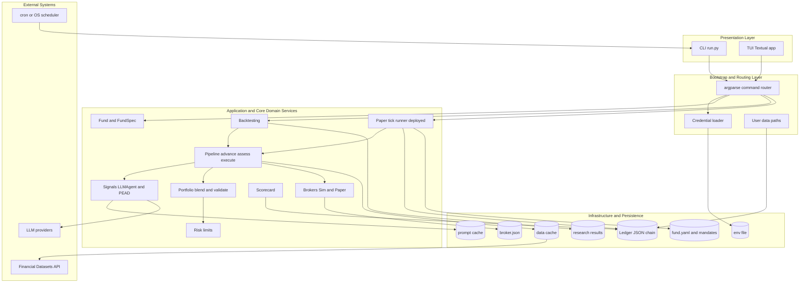

### 4.2 Integration Context

| ID | Hệ thống ngoài | Giao thức | Xác thực | Chính sách lỗi | Bằng chứng |
|---|---|---|---|---|---|
| INT-01 | Financial Datasets | HTTPS GET `/prices/`, `/prices/snapshot/`, `/financial-metrics/`, `/news/`, `/insider-trades/`, `/company/facts/`, `/earnings/` | Header `X-API-Key` | Thử lại HTTP 429 sau 5, 15, 30 giây; 404 là `None`; lỗi khác ném `FDClientError`; theo `next_page_url`; hết thời gian 30 giây | `data/client.py` |
| INT-02 | Anthropic, OpenAI, DeepSeek, Google, xAI, Kimi | Thư viện LangChain | Biến môi trường theo nhà cung cấp | Lỗi gọi chuyển thành abstain ở tầng analyst | `llm/client.py` |
| INT-03 | TypeSafe (Jev) | HTTPS POST `https://api.typesafe.ai/v1/systemone` | `Authorization: Bearer` | Thử lại một lần cho 429, 500, 502, 503, 504, 529; không theo chuyển hướng; hết thời gian 60 giây | `llm/client.py: JevLLM` |
| INT-04 | Bảng breakpoint vốn hóa | Tải tệp CSV, nhớ đệm đĩa | Không | Giữ bản cũ khi tải lỗi | `features/breakpoints.py` |
| INT-05 | cron / OS scheduler | Tiến trình gọi `aihf paper tick` | Không | Tick idempotent | `paper/tick.py` |

Webhook, hàng đợi thông điệp, BaaS: không có `[UNKNOWN]`.

---

## 5. USER CHARACTERISTICS & ROLES

Mã nguồn không có bảng User/Role, middleware hay Guard phân quyền. Mọi tác nhân trên cùng tài khoản hệ điều hành có quyền như nhau (`[UNKNOWN]` cho RBAC). Bảng dưới đây gán vai trò theo điểm vào và theo guard nghiệp vụ.

### 5.1 Vai trò tác nhân

| ID | Vai trò | Đặc điểm | Điểm vào |
|---|---|---|---|
| ACT-01 | Đơn vị vận hành quỹ | Triển khai, tiến hành phiên, halt, theo dõi | TUI Paper, `aihf paper ...` |
| ACT-02 | Nghiên cứu viên | Backtest, đọc scorecard | TUI Backtesting, `aihf backtest` |
| ACT-03 | Người xây dựng quỹ | Tạo và lưu mandate | TUI Builder, YAML |
| ACT-04 | Kiểm toán viên | Xác minh ledger, đọc quyết định | `aihf paper status/scorecard`, TUI Sessions |
| ACT-05 | Bộ lập lịch | Tác nhân hệ thống gọi `tick` | cron |
| ACT-06 | Nhà phát triển mô hình | Cài `AlphaModel`, `DataClient`, `Broker` | Mã Python |

### 5.2 Ma trận quyền theo guard nghiệp vụ

| Năng lực | ACT-01 | ACT-02 | ACT-03 | ACT-04 | ACT-05 | ACT-06 | Guard | Bằng chứng |
|---|---|---|---|---|---|---|---|---|
| Chạy backtest | - | X | - | - | - | - | Mandate hợp lệ, universe không rỗng, khóa API | `run.py: _backtest` |
| Lưu mandate | - | - | X | - | - | - | Mở tệp chế độ `x` | `fund/storage.py: save_spec` |
| Triển khai quỹ giấy | X | - | - | - | - | - | Tên hợp lệ, thư mục chưa tồn tại | `paper/deployed.py: deploy` |
| Tiến hành phiên | X | - | - | - | X | - | Không halt, có phiên đến hạn, hai sổ khớp | `paper/tick.py`, `pipeline/session.py` |
| Redo | X | - | - | - | - | - | Không halt, có phiên | `paper/tick.py: redo` |
| Halt / resume | X | - | - | - | - | - | Lý do bắt buộc khi halt qua CLI | `run.py`, `paper/ledger.py` |
| Chạy hoặc dừng runner | X | - | - | - | X | - | Một runner mỗi quỹ | `paper/runner.py` |
| Đọc ledger và scorecard | X | X | - | X | - | - | Chuỗi hash toàn vẹn | `paper/ledger.py: replay` |
| Đặt khóa API | X | X | X | - | - | - | Không | `tui/keys.py` |
| Cài mô hình mới | - | - | - | - | - | X | Khai báo hồ sơ trên chính lớp | `signals/__init__.py` |

Ký hiệu: `X` có năng lực; `-` không áp dụng.

---

## 6. OPERATIONAL SCENARIOS & USE CASE MODELING

### 6.1 Use Case Matrix

| UC ID | Tên | Tác nhân chính | Điều kiện trước | Điều kiện sau | FR liên quan |
|---|---|---|---|---|---|
| UC-01 | Thiết lập khóa API và mô hình | ACT-01, ACT-02, ACT-03 | Ứng dụng khởi động | Khóa có trong môi trường và tệp `.env`; mô hình được chọn | FR-CFG-001, FR-CFG-002 |
| UC-02 | Xây dựng mandate | ACT-03 | Tên chưa dùng | Tệp `mandates/<name>.yaml` hợp lệ | FR-FUND-001, FR-FUND-002 |
| UC-03 | Chạy backtest | ACT-02 | Mandate hợp lệ; có khóa; benchmark có giá | Kết quả JSON; bản sao trong `research/` | FR-BT-001, FR-BT-002, FR-BT-003 |
| UC-04 | Triển khai quỹ giấy | ACT-01 | Mandate hợp lệ; tên hợp lệ chưa dùng | Thư mục quỹ có `fund.yaml`, `broker.json`, `ledger/`, `control.json` | FR-PAPER-001 |
| UC-05 | Tiến hành một phiên | ACT-01, ACT-05 | Quỹ không halt; có phiên đến hạn | Bản ghi mới nối vào ledger; sổ broker cập nhật | FR-PAPER-002, FR-SES-001, FR-SES-002 |
| UC-06 | Phê duyệt và chạy phiên trên TUI | ACT-01 | Quỹ đã triển khai; có khóa | Phiên được ghi sau khi xác nhận | FR-PAPER-006, FR-PAPER-002 |
| UC-07 | Chạy lại phiên gần nhất | ACT-01 | Quỹ không halt; có ít nhất một phiên | Bản ghi cũ nằm trong `superseded/`; bản ghi mới thay thế | FR-PAPER-003 |
| UC-08 | Chạy runner nền | ACT-01 | Chưa có runner cho quỹ | Các phiên đến hạn được ghi tự động | FR-PAPER-004 |
| UC-09 | Dừng khẩn cấp và tiếp tục | ACT-01 | Quỹ tồn tại | `control.json` phản ánh trạng thái halt | FR-PAPER-005 |
| UC-10 | Theo dõi trạng thái quỹ | ACT-01, ACT-04 | Quỹ tồn tại | Hiển thị NAV, quyết định chờ, vị thế | FR-PAPER-007 |
| UC-11 | Xác minh toàn vẹn ledger | ACT-04 | Quỹ có bản ghi | Chuỗi hợp lệ hoặc lỗi nêu phiên vi phạm | FR-LDG-001, FR-LDG-002 |
| UC-12 | Đối soát sổ broker | ACT-01 | Đầu mỗi phiên | Hai sổ khớp hoặc quỹ bị halt | FR-LDG-003 |
| UC-13 | Đọc scorecard | ACT-02, ACT-04 | Ledger có quyết định và thực thi | Bảng điểm analyst và strategy | FR-SCORE-001, FR-SCORE-002 |
| UC-14 | Thêm analyst mới | ACT-06 | Lớp khai báo hồ sơ | Strategy tham chiếu được analyst theo tên | FR-ALPHA-001, FR-ALPHA-002 |

### 6.2 Sơ đồ tương tác tổng thể

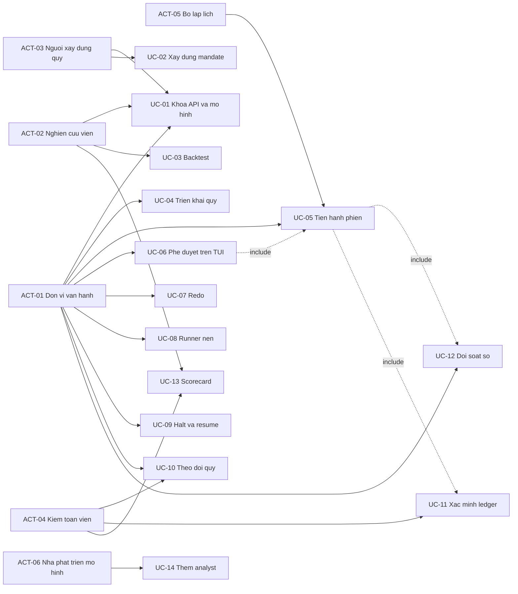

---

## 7. DATA REQUIREMENTS & LOGICAL DATABASE

Hệ thống không dùng cơ sở dữ liệu. "Bảng" là mô hình Pydantic được tuần tự hóa thành JSON hoặc YAML. PK và FK là khóa logic, được mã thực thi (tên tệp, hash, giá trị trường).

### 7.1 Entity-Relationship Diagram

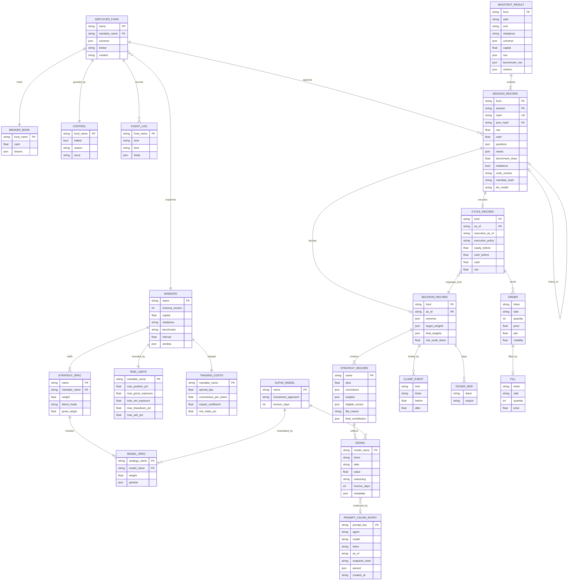

| Quan hệ | Loại | Cơ chế thực thi |
|---|---|---|
| MANDATE - STRATEGY_SPEC | 1-n | `FundSpec.strategies` (`min_length=1`, tên duy nhất) |
| STRATEGY_SPEC - ALPHA_MODEL | n-n qua MODEL_SPEC | `ModelSpec.name` thuộc `ALPHA_MODEL_REGISTRY` |
| DEPLOYED_FUND - MANDATE | n-1 (bản chụp) | `DeployedFund.spec` |
| DEPLOYED_FUND - SESSION_RECORD | 1-n | Thư mục `ledger/` |
| SESSION_RECORD - SESSION_RECORD | 1-1 tự tham chiếu | `prev_hash` bằng `hash` bản ghi trước |
| SESSION_RECORD - DECISION_RECORD, CYCLE_RECORD | 1-0..1 | Trường nhúng `decision`, `executed` |
| SIGNAL - PROMPT_CACHE_ENTRY | n-0..1 | `metadata.prompt_key` |

### 7.2 Data Dictionary

#### 7.2.1 MANDATE (`fund/spec.py: FundSpec`)

| Trường | Kiểu | Not Null | Ràng buộc | Mặc định |
|---|---|---|---|---|
| `schema_version` | int | Có | Giá trị 2; thiếu thì bị từ chối | - |
| `name` | string | Có | Tên tệp `<name>.yaml` | - |
| `strategies` | list | Có | Ít nhất 1; tên duy nhất | - |
| `risk` | RiskLimits | Có | Xem 7.2.3 | - |
| `costs` | TradingCosts | Không | Chỉ tuần tự hóa khi khác mặc định | `TradingCosts()` |
| `capital` | float | Không | `> 0` | 100000.0 |
| `rebalance` | enum | Không | `minute`, `daily`, `weekly`, `monthly` | `weekly` |
| `interval` | float | Không | `> 0`; chỉ với `minute`; tối thiểu 1 giây | 1.0 phút |
| `window` | TradingWindow | Không | Chỉ với `minute`; `04:00 <= start < end <= 20:00` ET | `09:30`-`16:00` |
| `benchmark` | string | Không | Chuyển chữ hoa | `SPY` |

Cấu hình `extra="forbid"` từ chối mọi khóa lạ.

#### 7.2.2 STRATEGY_SPEC, MODEL_SPEC, BLEND

| Trường | Kiểu | Ràng buộc |
|---|---|---|
| `StrategySpec.weight` | float | `> 0`, tỷ trọng vốn tương đối |
| `StrategySpec.models` | list[ModelSpec] | Ít nhất 1 |
| `ModelSpec.name` | string | Khai báo `investment_approach` và `horizon_days` trên chính lớp đăng ký |
| `ModelSpec.weight` | float | `> 0` |
| `BlendPolicy.mode` | enum | `long_only`, `long_short`, `dollar_neutral` |
| `BlendPolicy.gross_target` | float | `> 0`, mặc định 1.0 |

#### 7.2.3 RISK_LIMITS và TRADING_COSTS

| Trường | Kiểu | Ràng buộc | Mặc định |
|---|---|---|---|
| `max_position_pct` | float | `0 < x <= 1`, bắt buộc | - |
| `max_gross_exposure` | float | `> 0`, bắt buộc | - |
| `max_net_exposure` | float | `> 0`, tùy chọn | không đặt |
| `max_drawdown_pct` | float | `0 < x < 1`, tùy chọn | không đặt |
| `max_adv_pct` | float | `0 < x <= 1`, tùy chọn | không đặt |
| `spread_bps` | float | `>= 0` | 5.0 |
| `commission_per_share` | float | `>= 0` | 0.005 |
| `impact_coefficient` | float | `>= 0` | 1.0 |
| `min_trade_pct` | float | `0 <= x < 1` | 0.005 |

#### 7.2.4 SESSION_RECORD (`pipeline/session.py`)

| Trường | Kiểu | Not Null | Ràng buộc |
|---|---|---|---|
| `schema_version` | Literal[2] | Có | Cố định |
| `fund`, `session` | string | Có | `session` dạng `YYYY-MM-DD` hoặc `YYYY-MM-DDTHH:MM:SS`; duy nhất trong ledger |
| `nav`, `cash` | float | Có | `nav = cash + sum(shares x mark)` |
| `positions` | dict[str, int] | Có | Số cổ phiếu có dấu |
| `marks` | dict[str, float] | Có | Giá dùng định giá sổ |
| `benchmark`, `benchmark_close` | string, float | Có | Mã và giá đóng cửa benchmark |
| `rebalance` | bool | Có | Phiên có phải phiên tái cân bằng |
| `prev_hash` | string | Không | Null chỉ với bản ghi đầu; bằng `hash` bản ghi trước |
| `hash` | string | Có | SHA-256 của JSON bản ghi loại trừ `hash`; loại trừ `snapshot_times` khi null |
| `executed` | CycleRecord | Không | Quyết định chờ được thực thi tại phiên này |
| `decision` | DecisionRecord | Không | Quyết định mới, thực thi ở phiên kế tiếp |
| `code_version`, `mandate_hash` | string | Có | Phiên bản mã và SHA-256 mandate |
| `llm_model` | string | Không | Mô hình LLM nếu quỹ có LLM agent |
| `snapshot_times` | dict[str, str] | Không | Thời điểm in giá của quỹ phút |

#### 7.2.5 DECISION_RECORD, CYCLE_RECORD, SIGNAL, ORDER, FILL

| Thực thể.Trường | Kiểu | Ràng buộc |
|---|---|---|
| DecisionRecord.`target_weights` | dict | Sổ đã bù trừ, trước rủi ro |
| DecisionRecord.`final_weights` | dict | Sau rủi ro |
| DecisionRecord.`clamps` | list[ClampEvent] | `limit` thuộc năm giới hạn rủi ro |
| CycleRecord.`orders`, `fills` | list | Thứ tự bán trước, mua sau |
| CycleRecord.`execution_policy` | enum | `next_close`, `next_bar` |
| Signal.`value` | float | Trong `[-1, 1]` |
| Signal.`horizon_days` | int | `> 0`; không tuần tự hóa khi null |
| Order.`quantity` | int | `> 0` |
| Order.`side`, Fill.`side` | enum | `buy`, `sell` |

#### 7.2.6 Tệp trạng thái

| Đường dẫn | Nội dung | Điểm ghi |
|---|---|---|
| `~/.hedge-fund/mandates/<name>.yaml` | Mandate | `save_spec` (chế độ `x`) |
| `~/.hedge-fund/paper/<name>/fund.yaml` | `DeployedFund` | `deploy` |
| `.../broker.json` | `{cash, shares}` | Ghi nguyên tử sau mỗi lệnh khớp |
| `.../ledger/<session>.json` hoặc `<date>/<HHMMSS>.json` | `SessionRecord` | `Ledger.append` |
| `.../ledger/<date>/checkpoint.json` | `FundState` cuối ngày | `Ledger.checkpoint` |
| `.../ledger/superseded/` | Bản ghi bị thay | `Ledger.rewind` |
| `.../control.json` | `{halted, reason, since}` | `halt`, `resume` |
| `.../events.jsonl` | Một sự kiện JSON mỗi dòng | `Ledger.log_event` |
| `.../runner.pid`, `runner.log` | Tiến trình runner | `serve`, `spawn_runner` |
| `~/.hedge-fund/research/<fund>-<start>-<end>-<stamp>.json` | `FundBacktestResult` | `save_result` |
| `~/.hedge-fund/cache/data/<key>.json` | Phản hồi API | `CachedDataClient` |
| `~/.hedge-fund/cache/llm/<key>.json` | Prompt và phản hồi LLM | `PromptCache.put` |
| `~/.hedge-fund/.env` | Khóa API | `save_credential` |

#### 7.2.7 Bất biến dữ liệu

| ID | Bất biến | Bằng chứng |
|---|---|---|
| INV-01 | Quyết định tại T chỉ được thực thi ở phiên sau T | `pipeline/session.py` |
| INV-02 | Bản ghi trùng phiên, sai thứ tự, đứt chuỗi hoặc sai hash bị từ chối | `Ledger.append`, `Ledger.replay` |
| INV-03 | Sổ broker khớp trạng thái ledger đến 0,01 tiền mặt trước khi giao dịch | `reconcile` |
| INV-04 | Giới hạn rủi ro chỉ thu nhỏ vị thế | `risk/limits.py` |
| INV-05 | Tổng đóng góp strategy bằng trọng số cuối của mỗi mã | `portfolio/validation.py` |
| INV-06 | Trường mới của mô hình tuần tự hóa phải bị loại khỏi JSON khi rỗng để hash bản ghi cũ còn hợp lệ | `models.py`, `fund/spec.py`, `risk/limits.py`, `brokers/models.py` |

---

## 8. EXTERNAL INTERFACE REQUIREMENTS

### 8.1 User Interfaces

| ID | Nguyên tắc | Bằng chứng |
|---|---|---|
| UI-01 | Màn hình Home phải chỉ có hai lựa chọn: Paper trading và Backtesting | `tui/home.py` |
| UI-02 | Phím tắt của từng màn hình phải hiển thị ở thanh chân trang | `tui/*: BINDINGS`, `Footer` |
| UI-03 | Esc phải hủy hoặc quay lại ở mọi màn hình và hộp thoại | `tui/*` |
| UI-04 | Hành động chạy phiên phải đi qua bước phê duyệt trước khi ghi ledger hoặc broker | `tui/paper.py: RunConfirmScreen` |
| UI-05 | Hành động xóa phải yêu cầu xác nhận và nêu đối tượng bị xóa | `tui/funds.py` |
| UI-06 | Khóa API phải được che khi hiển thị | `tui/keys.py: masked` |
| UI-07 | Trạng thái quỹ phải có nhãn văn bản ngoài màu (`HALTED`, `running`, `not started`) | `tui/paper_view.py` |
| UI-08 | Màn hình đang chạy backtest không được cho phép thoát | `tui/backtest.py: check_action` |
| UI-09 | Ngôn ngữ giao diện là tiếng Anh; bản địa hóa `[OPEN]` | `tui/*` |
| UI-10 | Hỗ trợ trình đọc màn hình, tương phản màu | `[UNKNOWN]` | 

### 8.2 Software & API Interfaces

#### 8.2.1 Giao diện dòng lệnh

| Lệnh | Tham số | stdout | stderr | Mã thoát |
|---|---|---|---|---|
| `aihf` | `[--model]` | Không | TUI | 0 |
| `aihf backtest <mandate>` | `--universe` (bắt buộc), `--start`, `--end`, `--out`, `--model` | JSON `FundBacktestResult` | Tóm tắt, bảng scorecard | 0; 2 khi tham số sai |
| `aihf paper create <name>` | `--mandate`, `--universe` (bắt buộc) | Không | Xác nhận triển khai | 0; 2 |
| `aihf paper tick <name>` | `--session`, `--again` | JSON `SessionRecord` | Tóm tắt một dòng | 0; 1 khi `FundHalted`, `NothingDue`, `LedgerError` |
| `aihf paper run <name>` | Không | Không | Sự kiện, tóm tắt từng phiên | 0; 1 nếu đã có runner |
| `aihf paper stop <name>` | Không | Không | Xác nhận | 0 |
| `aihf paper status <name>` | Không | Dòng trạng thái, quyết định chờ, vị thế | Không | 0 |
| `aihf paper list` | Không | Một dòng mỗi quỹ | Không | 0 |
| `aihf paper scorecard <name>` | Không | JSON `Scorecard` | Bảng | 0 |
| `aihf paper halt <name>` | `--reason` (bắt buộc) | Không | Xác nhận | 0; 2 |
| `aihf paper resume <name>` | Không | Không | Xác nhận | 0 |

#### 8.2.2 Giao thức nội bộ

| Giao thức | Phương thức | Hợp đồng |
|---|---|---|
| `DataClient` (`data/protocol.py`) | `get_prices`, `get_snapshot`, `get_financial_metrics`, `get_news`, `get_insider_trades`, `get_company_facts`, `get_earnings`, `get_earnings_history`, `get_market_cap` | Rỗng hoặc `None` là không có dữ liệu; lỗi hạ tầng phải ném ngoại lệ; chỉ số tài chính theo `filing_date` |
| `Broker` (`brokers/protocol.py`) | `positions`, `cash`, `place_order` | Khớp trọn lệnh hoặc ném ngoại lệ; không có `equity()` |
| `LLMClient` (`llm/client.py`) | `model`, `complete(system, user)` | Ném ngoại lệ khi lỗi truyền tải; tùy chọn `cache_key` |
| `AlphaModel` (`signals/base.py`) | `name`, `predict(ticker, date, data_client)`, `investment_approach`, `horizon_days` | Chỉ dùng thông tin tại hoặc trước `date`; giá trị trong `[-1, 1]` |
| `Clock` (`pipeline/clock.py`) | `is_complete`, `previous`, `marks`, `session_date` | `marks` trả giá hữu hạn, dương hoặc ném ngoại lệ |

#### 8.2.3 Header, xác thực, DTO phản hồi

| Hạng mục | Nội dung |
|---|---|
| Header gọi Financial Datasets | `X-API-Key: <FINANCIAL_DATASETS_API_KEY>` |
| Header gọi TypeSafe | `Authorization: Bearer <TYPESAFE_API_KEY>` |
| Xác thực với nhà cung cấp LLM khác | Khóa theo biến môi trường của nhà cung cấp, qua thư viện LangChain |
| Phong bì phản hồi | Không có phong bì HTTP. Đầu ra thành công là một đối tượng JSON có `schema_version` |
| Lỗi | Ngoại lệ Python chuyển thành thông điệp stderr và mã thoát; cấu trúc lỗi dạng `<đường dẫn>: <trường>: <thông điệp>` cho cấu hình |
| Định dạng LLM persona | `{"signal": "bullish\|neutral\|bearish", "confidence": 0-100, "reasoning": string}` |

#### 8.2.4 Danh mục mã lỗi

Cột "HTTP" luôn là N/A. Cột "Thoát" là mã thoát tiến trình CLI. Cột "Rollback" nêu cơ chế khôi phục.

| Mã | Điều kiện kích hoạt | Ngoại lệ (nguồn) | Thoát | Rollback / Hành động xử lý |
|---|---|---|---|---|
| ERR-CFG-001 | Thiếu khóa API của nhà cung cấp | `ValueError` "`<ENV>` not found" (`llm/client.py: _require_key`) | 1 (traceback trên CLI); TUI chặn bằng cổng khóa | Không ghi gì |
| ERR-CFG-002 | Nhà cung cấp chưa có máy khách | `ValueError` "No v2 client for" (`make_llm`) | 1 | Không ghi gì |
| ERR-SPC-001 | Mandate sai cú pháp hoặc lược đồ | `ValueError` `<path>: <field>: <msg>` (`load_spec`) | 2 | Không sửa tệp |
| ERR-SPC-002 | Universe rỗng | `ValueError` "universe is empty" (`normalize_universe`) | 2 | Không ghi gì |
| ERR-FND-001 | Tên quỹ chứa ký tự không an toàn | `ValueError` (`validate_fund_name`) | 2 | Không tạo thư mục |
| ERR-FND-002 | Thư mục quỹ hoặc tệp mandate đã tồn tại | `FileExistsError` (`deploy`, `save_spec`) | 2 | Giữ nguyên dữ liệu cũ |
| ERR-FND-003 | Quỹ giấy không tồn tại | `parser.error` (`run.py: _fund_dir`) | 2 | Không ghi gì |
| ERR-DAT-001 | Lỗi mạng, HTTP 400 trở lên (trừ 404), hết lượt thử lại 429 | `FDClientError(status_code, path)` | 1 | Không ghi cache cho yêu cầu lỗi |
| ERR-DAT-002 | Benchmark không có giá trong cửa sổ | `ValueError` "cannot build the trading grid" | 1 | Không trả kết quả rỗng |
| ERR-DAT-003 | Thiếu giá đóng cửa đúng phiên | `ValueError` "missing close on" (`exact_marks`) | 1; tick halt quỹ | Ledger không nhận bản ghi |
| ERR-LLM-001 | Lỗi gọi LLM | `LLMCallError` hoặc ngoại lệ bất kỳ | Không ném ra; analyst trả Signal abstain | Lưu chẩn đoán khi có `diagnostic_record` |
| ERR-LLM-002 | Phản hồi LLM không phân tích được | `LLMParseError`, `ValueError` | Không ném ra; abstain | Lưu phản hồi thô kèm `parse_error` |
| ERR-PRT-001 | Signal ngoài `[-1, 1]`, trọng số hoặc gross không hợp lệ | `ValueError` (`blend_signals`) | 1; tick halt quỹ | Ledger không nhận bản ghi |
| ERR-PRT-002 | Mục tiêu vi phạm mandate | `ValueError` (`validate_targets`) | 1; tick halt quỹ | Không có lệnh nào được gửi |
| ERR-RSK-001 | Trọng số hoặc giới hạn không hữu hạn | `ValueError` (`apply_limits`) | 1; tick halt quỹ | Không có lệnh nào được gửi |
| ERR-EXE-001 | Phiên thực thi không sau phiên đánh giá, chưa hoàn tất, hoặc mandate đã đổi | `ValueError` (`execute_decision`) | 1; tick halt quỹ | Không có lệnh nào được gửi |
| ERR-EXE-002 | Equity trước khớp không hữu hạn hoặc không dương | `ValueError` | 1; tick halt quỹ | Không có lệnh nào được gửi |
| ERR-EXE-003 | Vị thế dự kiến vượt `max_position_pct` hoặc `max_gross_exposure` | `ValueError` | 1; tick halt quỹ | Không có lệnh nào được gửi |
| ERR-SES-001 | Quỹ đang halt | `FundHalted` (`advance`, `tick`, `run`) | 1 | Không truy cập broker và dữ liệu |
| ERR-SES-002 | Sổ broker lệch ledger | `BookMismatch` (`reconcile`) | 1; tick halt quỹ | Không sửa tự động; không gọi analyst, không gửi lệnh |
| ERR-SES-003 | Phiên không sau phiên cuối, hoặc chưa hoàn tất | `ValueError` (`advance`) | 1 | Không ghi gì |
| ERR-LDG-001 | Ledger trùng phiên, sai thứ tự, đứt chuỗi, hash sai hoặc không đọc được | `LedgerError` | 1 | Không ghi tệp; replay dừng |
| ERR-TCK-001 | Không có phiên đến hạn | `NothingDue` | 1 | Không ghi gì |
| ERR-RUN-001 | Đã có runner cho quỹ | `RuntimeError` "already running" (`serve`) | 1 | Không ghi `runner.pid` mới |

Quy tắc rollback chung: tệp được ghi nguyên tử (tệp tạm rồi `os.replace`); bản ghi ledger chỉ được nối sau khi `advance` thành công; `broker.json` được ghi sau mỗi lệnh khớp nên một lỗi giữa chừng để lại sổ broker lệch, được phát hiện ở tick kế tiếp bằng ERR-SES-002; tick lỗi tự halt quỹ (`paper/tick.py: _run`).

### 8.3 Communication Protocols

| ID | Hạng mục | Nội dung | Bằng chứng |
|---|---|---|---|
| COM-01 | Giao thức ra ngoài | HTTPS tới Financial Datasets và các nhà cung cấp LLM; mã hóa đường truyền do thư viện `requests` và LangChain thực hiện | `data/client.py`, `llm/client.py` |
| COM-02 | Cổng lắng nghe | Không có; hệ thống không mở cổng mạng | `[OK]` |
| COM-03 | Cấu hình TLS riêng | Không có; dùng mặc định thư viện | `[OK]` |
| COM-04 | Giao tiếp giữa TUI và runner | Tiến trình riêng; điều khiển bằng `runner.pid` và `SIGTERM`; dữ liệu qua tệp | `paper/runner.py` |
| COM-05 | Giao tiếp với cron | Tiến trình dòng lệnh; không có kênh hai chiều | `paper/tick.py` |

---

## 9. SYSTEM REQUIREMENTS

### 9.1 Functional Requirements

Quy ước: mỗi FR gồm Identifier, Title và Code Traceability, Mockup (khi có bề mặt CLI hoặc TUI), điều kiện trước và sau, bảng đầu vào, lưu đồ logic, sơ đồ tuần tự, xử lý lỗi theo Mục 8.2.4. Giá trị trong wireframe là minh họa `[ASSUMPTION]`. Yêu cầu dùng "phải" và "không được".

#### 9.1.1 Module CFG - Khóa API và mô hình

##### FR-CFG-001 - Nạp, kiểm tra và lưu khóa API

| Thuộc tính | Nội dung |
|---|---|
| Code Traceability | `hedge_fund/tui/keys.py`: `apply_credentials`, `save_credential`, `missing_key`, `masked`, `_quote`; `hedge_fund/tui/home.py`: `KeyPromptScreen`, `demand_run_keys` |
| Data Entities | `~/.hedge-fund/.env`; biến môi trường `FINANCIAL_DATASETS_API_KEY` và khóa nhà cung cấp |
| Yêu cầu | Hệ thống phải nạp `.env` ở thư mục làm việc rồi `.env` ở `~/.hedge-fund/` mà không ghi đè biến môi trường đã có. Hệ thống phải kiểm tra khóa dữ liệu rồi khóa của nhà cung cấp mô hình đã chọn trước khi bắt đầu lần chạy. Hệ thống phải sửa đúng một dòng khi lưu khóa, đặt quyền tệp 0600 và xuất khóa vào môi trường tiến trình. Hệ thống không được hiển thị khóa dài hơn 12 ký tự ở dạng đầy đủ |

```text
┌────────────────────────────────────────────────────────────────────────┐
│  API KEY NEEDED                                            [Esc] cancel│
├────────────────────────────────────────────────────────────────────────┤
│  STEP INDICATOR:                                                       │
│  (1) Data key ─── [2] Model key ─── (3) Run                            │
│      [Completed]      [Active]         [Upcoming]                      │
├────────────────────────────────────────────────────────────────────────┤
│  SECTION: 2. Anthropic key (ANTHROPIC_API_KEY)                         │
│                                                                        │
│  * API key                                                             │
│  ┌──────────────────────────────────────────────────────────┐          │
│  │ sk-ant••••••••Xy3q                                       │          │
│  └──────────────────────────────────────────────────────────┘          │
│                                                                        │
│  [!] Validation Warning: biến export trong shell thắng tệp .env.       │
├────────────────────────────────────────────────────────────────────────┤
│  [ Esc: cancel ]                                      [ Enter: save > ]│
└────────────────────────────────────────────────────────────────────────┘
```

- Điều kiện trước: lần chạy được kích hoạt từ TUI; khóa thiếu trong môi trường.
- Điều kiện sau: dòng khóa có trong `.env` (quyền 0600) và trong `os.environ`; lần chạy tiếp tục. Khi Esc, không có thay đổi và lần chạy không tiếp tục.

| Đầu vào | Kiểu | Bắt buộc | Ràng buộc |
|---|---|---|---|
| `env_var` | string | Có | Tên biến theo `PROVIDER_ENV_VARS` |
| `value` | string | Có | Không rỗng; có khoảng trắng, `#`, nháy hoặc `\` thì được đặt trong dấu nháy kép |

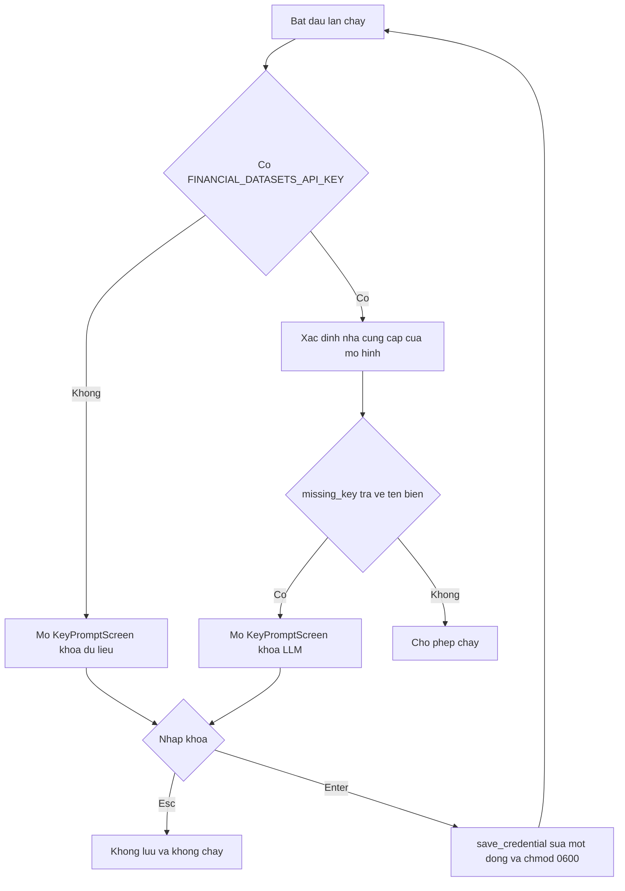

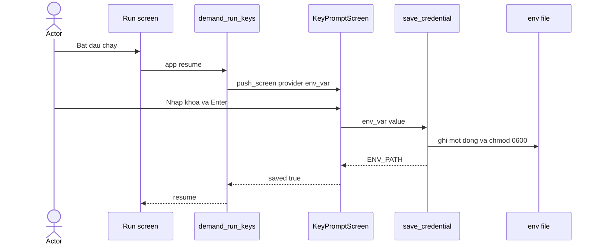

| Lỗi | Điều kiện | Xử lý |
|---|---|---|
| ERR-CFG-001 | Máy khách LLM được dựng khi vẫn thiếu khóa | `ValueError` nêu tên biến; trên TUI cổng khóa ngăn tình huống này |

##### FR-CFG-002 - Chọn mô hình LLM và dựng máy khách

| Thuộc tính | Nội dung |
|---|---|
| Code Traceability | `hedge_fund/tui/home.py`: `ModelPickerScreen`, `HomeScreen._set_model`; `hedge_fund/llm/registry.py`: `load_api_models`, `provider_for`, `env_var_for`, `is_supported`; `hedge_fund/llm/client.py`: `make_llm`, `DEFAULT_MODEL`; `hedge_fund/run.py`: `--model` |
| Data Entities | `hedge_fund/llm/api_models.json`; biến `HEDGE_FUND_LLM_MODEL` |
| Yêu cầu | Hệ thống phải đọc danh sách mô hình từ `api_models.json` và dùng danh sách dự phòng một phần tử khi tệp lỗi. Hệ thống phải ghi mô hình được chọn vào `HEDGE_FUND_LLM_MODEL`. Hệ thống phải ưu tiên cờ `--model` hơn biến môi trường, và biến môi trường hơn `DEFAULT_MODEL`. Hệ thống phải dùng nhà cung cấp Anthropic cho mã mô hình ngoài registry. Hệ thống không được cho chọn nhà cung cấp chưa có máy khách |

```text
┌────────────────────────────────────────────────────────────────────────┐
│  MODEL PICKER                                              [Esc] cancel│
├────────────────────────────────────────────────────────────────────────┤
│  Current: Opus 5.5 (claude-opus-5-5)                                   │
├────────────────────────────────────────────────────────────────────────┤
│  Model                 Id                   Provider                   │
│  Opus 5.5              claude-opus-5-5      Anthropic                  │
│  GPT-6 Sol             gpt-6-sol            OpenAI                     │
│  Jev                   jev-1.13.0           TypeSafe                   │
│  Kimi K3               kimi-k3              Kimi                       │
├────────────────────────────────────────────────────────────────────────┤
│  Registry: 9 models                 [Enter] select     [Esc] cancel    │
└────────────────────────────────────────────────────────────────────────┘
```

- Điều kiện trước: registry đọc được hoặc dùng dự phòng.
- Điều kiện sau: `HEDGE_FUND_LLM_MODEL` bằng mã đã chọn; dòng trạng thái Home hiển thị tên và mã mô hình.

| Đầu vào | Kiểu | Bắt buộc | Ràng buộc |
|---|---|---|---|
| `model` | string | Không | Mã mô hình; mặc định `claude-opus-5-5` |
| `timeout` | float | Không | Mặc định 60.0 giây |
| `max_tokens` | int | Không | Mặc định 4096 |
| `on_token` | callable | Không | Bật chế độ phát luồng |

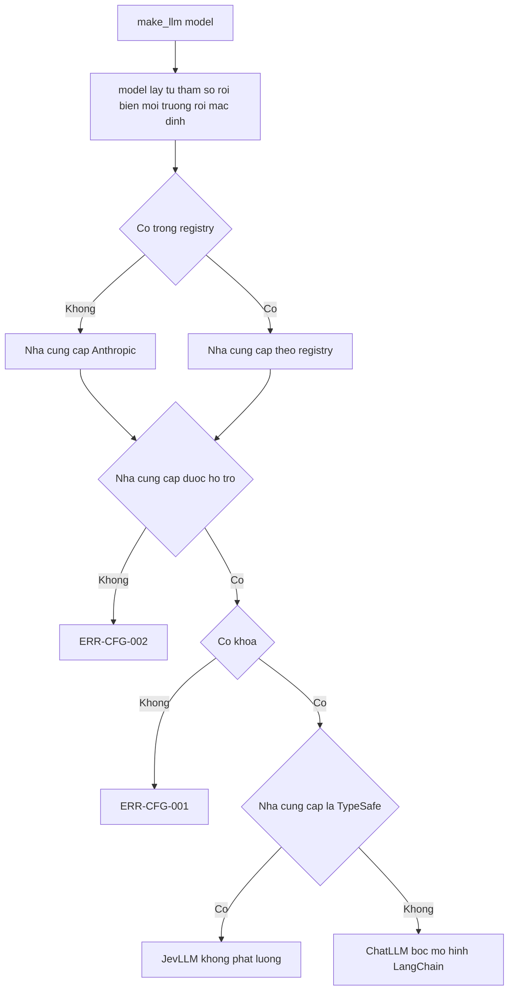

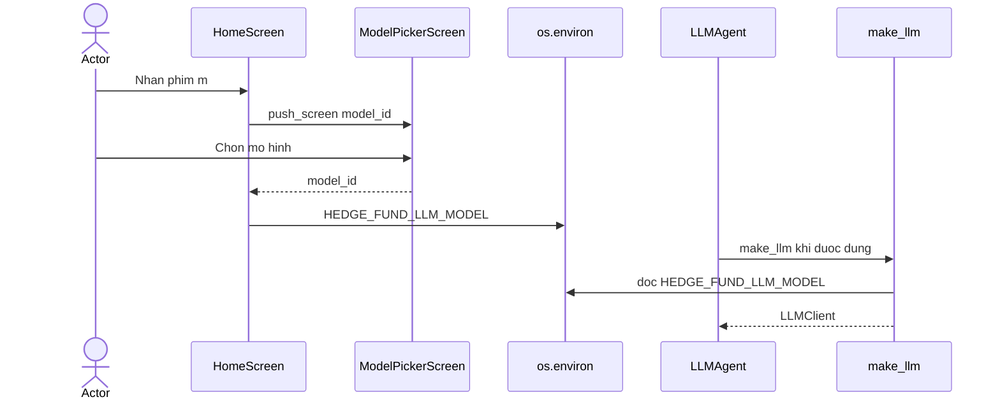

| Lỗi | Điều kiện | Xử lý |
|---|---|---|
| ERR-CFG-001 | Thiếu khóa nhà cung cấp | Nêu tên biến môi trường |
| ERR-CFG-002 | Nhà cung cấp ngoài `SUPPORTED_PROVIDERS` | `ValueError` liệt kê nhà cung cấp được hỗ trợ |

#### 9.1.2 Module FUND - Mandate

##### FR-FUND-001 - Nạp và kiểm tra mandate

| Thuộc tính | Nội dung |
|---|---|
| Code Traceability | `hedge_fund/fund/spec.py`: `load_spec`, `load_strategy`, `_read_yaml`, `_validation_message`, `FundSpec`, `StrategySpec`, `TradingWindow`, `normalize_universe`; `hedge_fund/run.py`: `_universe` |
| Data Entities | MANDATE, STRATEGY_SPEC, MODEL_SPEC, RISK_LIMITS, TRADING_COSTS (Mục 7.2) |
| Yêu cầu | Hệ thống phải từ chối mandate không đọc được, không phải ánh xạ YAML, thiếu `schema_version`, chứa khóa lạ, có tên strategy trùng, hoặc có `interval` hay `window` trên nhịp không phải `minute`. Hệ thống phải nêu đường dẫn tệp và tên trường trong thông báo. Hệ thống phải từ chối trước khi tạo client dữ liệu. Hệ thống không được sửa tệp mandate |

```text
┌────────────────────────────────────────────────────────────────────────┐
│  TERMINAL CLI INTERACTION: aihf backtest (mandate không hợp lệ)        │
├────────────────────────────────────────────────────────────────────────┤
│  $ aihf backtest ~/.hedge-fund/mandates/bad.yaml --universe AAPL       │
│  usage: aihf backtest [-h] --universe UNIVERSE mandate                 │
│  aihf backtest: error: bad.yaml: risk.max_position_pct: Input should be│
│  greater than 0                                                        │
├────────────────────────────────────────────────────────────────────────┤
│  Exit code: 2                                                          │
└────────────────────────────────────────────────────────────────────────┘
```

- Điều kiện trước: đường dẫn mandate được cung cấp.
- Điều kiện sau: trả `FundSpec` bất biến hợp lệ, hoặc `ValueError`; không có tác dụng phụ.

| Đầu vào | Kiểu | Bắt buộc | Ràng buộc |
|---|---|---|---|
| `path` | string | Có | Tệp YAML đọc được, nội dung là ánh xạ |
| `schema_version` | int | Có | Bằng 2 |
| `strategies` | list | Có | Ít nhất 1; tên duy nhất |
| `risk.max_position_pct` | float | Có | `0 < x <= 1` |
| `rebalance` | enum | Không | `minute`, `daily`, `weekly`, `monthly` |
| `interval` | float | Không | Chỉ với `minute`; từ 1 giây; không dài hơn cửa sổ giao dịch |

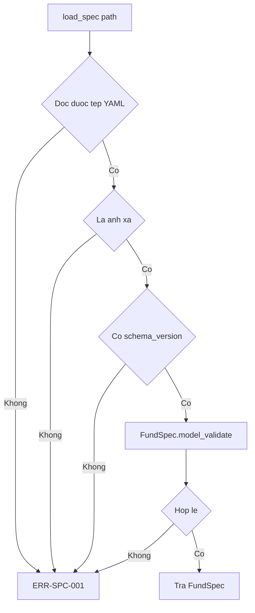

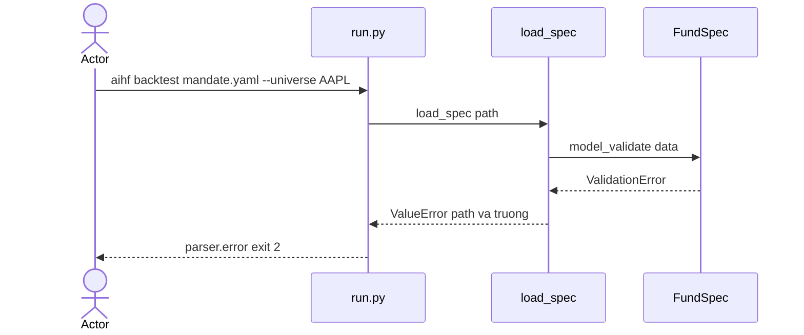

| Lỗi | Điều kiện | Xử lý |
|---|---|---|
| ERR-SPC-001 | Mandate không hợp lệ | `ValueError`; CLI thoát mã 2; tệp giữ nguyên |
| ERR-SPC-002 | Universe rỗng sau chuẩn hóa | `ValueError`; CLI thoát mã 2 |

##### FR-FUND-002 - Xây dựng, lưu và quản lý mandate trên TUI

| Thuộc tính | Nội dung |
|---|---|
| Code Traceability | `hedge_fund/tui/builder.py`: `BuilderScreen`; `hedge_fund/fund/spec.py`: `custom_strategy`; `hedge_fund/fund/storage.py`: `save_spec`, `discover_funds`, `SavedFund`; `hedge_fund/tui/funds.py`: `FundSelectScreen`, `ConfirmDeleteScreen`, `ConfirmWipeScreen`, `fund_name_taken`, `_delete_fund`, `wipe_fund` |
| Data Entities | `mandates/<name>.yaml`; `research/*.json`; `paper/<name>/` |
| Yêu cầu | Hệ thống phải dẫn tác nhân qua các bước tên, strategy, analyst, vốn, nhịp, interval và cửa sổ (quỹ phút), mã giao dịch (chế độ paper). Hệ thống phải suy ra chế độ pha trộn từ hồ sơ analyst. Hệ thống không được ghi đè tệp mandate có sẵn. Hệ thống phải liệt kê tệp mandate lỗi ở trạng thái vô hiệu kèm lỗi. Hệ thống không được xóa quỹ giấy khi xóa mandate nguồn |

```text
┌────────────────────────────────────────────────────────────────────────┐
│  BUILD A FUND                                           [Esc] back  [X]│
├────────────────────────────────────────────────────────────────────────┤
│  STEP INDICATOR:                                                       │
│  (1) Name ── (2) Strategies ── [3] Capital ── (4) Cadence ── (5) Done  │
│   [Completed]  [Completed]      [Active]       [Upcoming]    [Upcoming]│
├────────────────────────────────────────────────────────────────────────┤
│  SECTION: 3. Starting capital and cadence                              │
│                                                                        │
│  * Name your fund               * Starting capital ($)                 │
│  ┌──────────────────────────┐   ┌────────────────────────────────┐     │
│  │ alpha-one                │   │ 100000                         │     │
│  └──────────────────────────┘   └────────────────────────────────┘     │
│                                                                        │
│  * Rebalance cadence                                                   │
│  (•) weekly   ( ) daily   ( ) monthly   ( ) minute                     │
│                                                                        │
│  [!] Validation Warning: tên đã tồn tại sẽ bị từ chối khi lưu.         │
├────────────────────────────────────────────────────────────────────────┤
│  [ < Back ]                                       [ Enter: Continue > ]│
└────────────────────────────────────────────────────────────────────────┘
```

- Điều kiện trước: tên chưa thuộc `mandates/` hoặc `paper/`, hoặc tác nhân xác nhận thay thế.
- Điều kiện sau: `mandates/<name>.yaml` hợp lệ tồn tại; không có tệp nào bị ghi đè ngoài trường hợp thay thế đã xác nhận.

| Đầu vào | Kiểu | Bắt buộc | Ràng buộc |
|---|---|---|---|
| `name` | string | Có | Chưa thuộc mandate hoặc quỹ giấy |
| `strategies` | list | Có | Từ thư viện `hedge_fund/strategies/*.yaml` hoặc chọn analyst |
| `capital` | float | Có | `> 0` |
| `rebalance` | enum | Có | Như FR-FUND-001 |
| `interval`, `window` | float, TradingWindow | Chỉ quỹ phút | Như FR-FUND-001 |
| `universe` | string | Chỉ chế độ paper | Chuẩn hóa: chữ hoa, bỏ trùng, không rỗng |

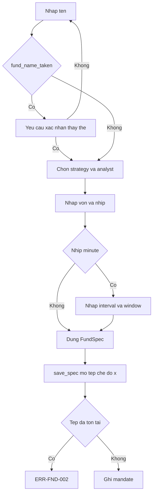

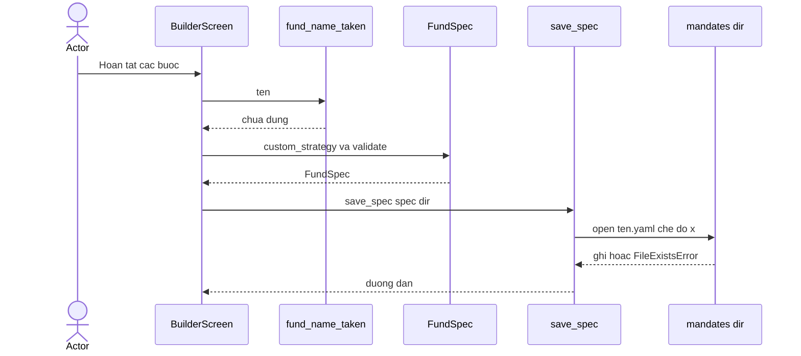

| Lỗi | Điều kiện | Xử lý |
|---|---|---|
| ERR-FND-002 | Tệp trùng tên xuất hiện giữa lúc kiểm tra và lúc lưu | `FileExistsError`; giữ nguyên tệp cũ |
| ERR-SPC-001 | Mandate dựng ra không hợp lệ | `ValueError`; không ghi tệp |

#### 9.1.3 Module DATA - Dữ liệu thị trường

##### FR-DATA-001 - Truy xuất dữ liệu point-in-time từ Financial Datasets

| Thuộc tính | Nội dung |
|---|---|
| Code Traceability | `hedge_fund/data/client.py`: `FDClient.get_prices`, `get_snapshot`, `get_financial_metrics`, `get_news`, `get_insider_trades`, `get_company_facts`, `get_earnings`, `get_earnings_history`, `get_market_cap`, `_get`, `_request`; `hedge_fund/data/protocol.py`: `DataClient`; `hedge_fund/data/sessions.py`: `completed_through`, `session_closes` |
| Data Entities | `Price`, `PriceSnapshot`, `FinancialMetrics`, `CompanyNews`, `InsiderTrade`, `CompanyFacts`, `Earnings`, `EarningsRecord` (`hedge_fund/data/models.py`, `extra="ignore"`) |
| Yêu cầu | Hệ thống phải lọc chỉ số tài chính theo `filing_date_lte` bằng ngày đánh giá. Hệ thống phải theo `next_page_url` đến hết và nối toàn bộ dòng. Hệ thống phải thử lại HTTP 429 sau 5, 15 và 30 giây rồi ném lỗi. Hệ thống phải coi HTTP 404 là không có dữ liệu và trả `None`. Hệ thống không được trả danh sách rỗng khi gặp lỗi mạng hoặc HTTP 400 trở lên. Hệ thống phải giới hạn `/news/` ở 10 dòng mỗi yêu cầu |

```text
┌────────────────────────────────────────────────────────────────────────┐
│  TERMINAL CLI INTERACTION: lỗi dữ liệu                                 │
├────────────────────────────────────────────────────────────────────────┤
│  $ aihf backtest example.yaml --universe AAPL                          │
│  FDClientError: GET /prices/ returned 401: invalid api key             │
├────────────────────────────────────────────────────────────────────────┤
│  401, 500, lỗi mạng → dừng | 404 → không có dữ liệu                    │
│  429 → thử lại 5s, 15s, 30s rồi dừng                                   │
│  [!] Backtest không trả kết quả rỗng khi hạ tầng dữ liệu lỗi           │
└────────────────────────────────────────────────────────────────────────┘
```

- Điều kiện trước: khóa `FINANCIAL_DATASETS_API_KEY` có trong môi trường.
- Điều kiện sau: danh sách mô hình dữ liệu (rỗng nghĩa là không có dữ liệu), hoặc `None`, hoặc `FDClientError`.

| Đầu vào | Kiểu | Bắt buộc | Ràng buộc |
|---|---|---|---|
| `ticker` | string | Có | Mã chữ hoa |
| `start_date`, `end_date` | string | Theo phương thức | `YYYY-MM-DD` |
| `interval`, `interval_multiplier` | string, int | Không | Mặc định `day`, 1 |
| `period` | string | Không | Mặc định `ttm` |
| `limit` | int | Không | Mặc định 10 hoặc 1000 tùy phương thức; news tối đa 10 mỗi trang |

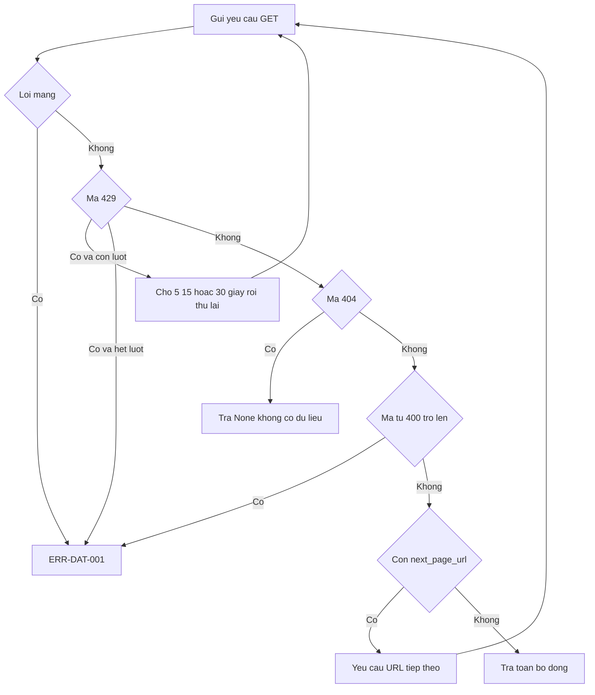

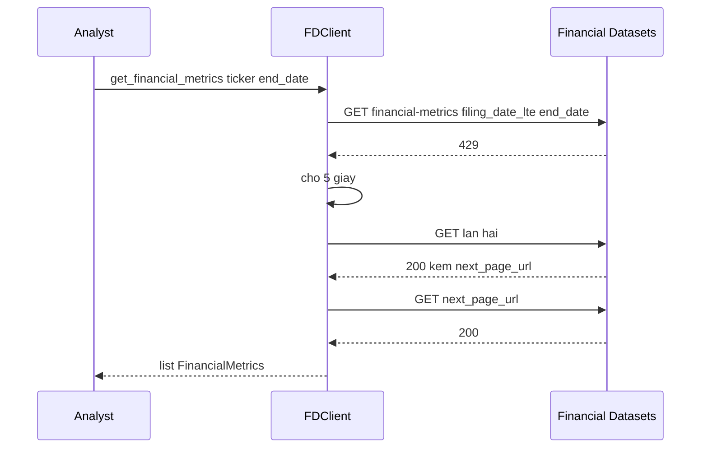

| Lỗi | Điều kiện | Xử lý |
|---|---|---|
| ERR-DAT-001 | Lỗi mạng, mã 400 trở lên (trừ 404), hết lượt thử lại | `FDClientError(status_code, path)`; không ghi cache |
| ERR-DAT-002 | Benchmark không có giá trong cửa sổ (`session_closes` rỗng) | `ValueError` ở tầng gọi |

##### FR-DATA-002 - Nhớ đệm phản hồi dữ liệu trên đĩa

| Thuộc tính | Nội dung |
|---|---|
| Code Traceability | `hedge_fund/data/cached.py`: `CachedDataClient`, `_fresh`, `_cached_list`, `_cached_item`, `_cached_scalar`, `SAME_DAY_TTL` |
| Data Entities | `~/.hedge-fund/cache/data/<key>.json` với `data` và `fetched_at` |
| Yêu cầu | Hệ thống phải dùng lại phản hồi về ngày đã kết thúc ở New York tại thời điểm lấy. Hệ thống không được dùng lại giá ngày của một ngày chưa kết thúc. Hệ thống phải dùng lại các phản hồi khác về ngày chưa kết thúc trong 600 giây. Hệ thống không được nhớ đệm báo giá. Hệ thống không được ghi cache cho yêu cầu lỗi. Hệ thống phải coi bản ghi hỏng là không có bản ghi |

```text
┌────────────────────────────────────────────────────────────────────────┐
│  DATA CACHE POLICY                                   [Status: Active ●]│
│  Cache dir: ~/.hedge-fund/cache/data                Same-day TTL: 600 s│
├────────────────────────────────────────────────────────────────────────┤
│  POLICY SUMMARY                                                        │
│  ┌───────────────────┐  ┌───────────────────┐  ┌───────────────────┐   │
│  │ DAILY BARS        │  │ INTRADAY AND NEWS │  │ QUOTES            │   │
│  │ final after the   │  │ reuse 10 min,     │  │ never cached      │   │
│  │ day has ended     │  │ then refetch      │  │                   │   │
│  └───────────────────┘  └───────────────────┘  └───────────────────┘   │
├────────────────────────────────────────────────────────────────────────┤
│  Key = SHA-256 của phương thức và tham số, 24 ký tự đầu                │
└────────────────────────────────────────────────────────────────────────┘
```

- Điều kiện trước: `CachedDataClient` bọc một `DataClient`.
- Điều kiện sau: phản hồi thành công có bản ghi cache; `refresh=True` ghi lại bản ghi.

| Đầu vào | Kiểu | Bắt buộc | Ràng buộc |
|---|---|---|---|
| `client` | DataClient | Có | Máy khách bên dưới |
| `cache_dir` | Path | Không | Mặc định `cache/data` |
| `refresh` | bool | Không | Bỏ qua bản ghi hiện có |
| `live` | bool | Không | Áp TTL 600 giây cho phản hồi không có ngày |

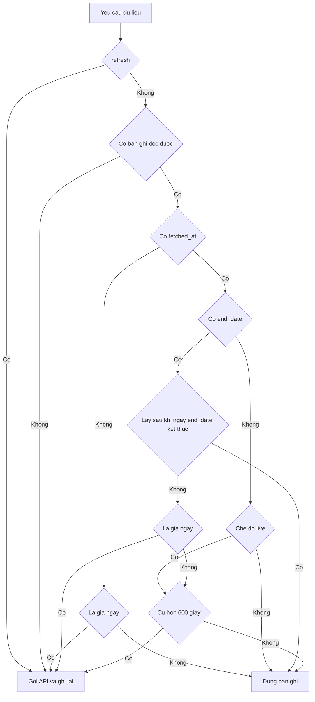

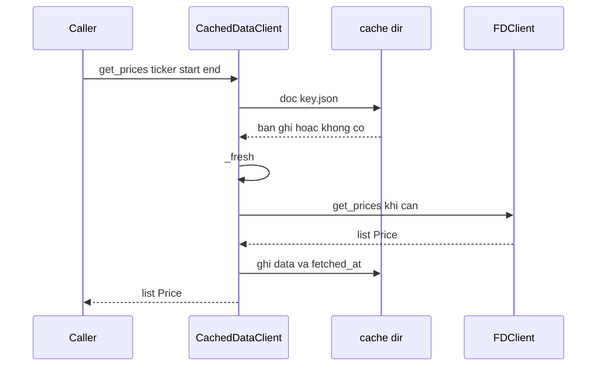

| Lỗi | Điều kiện | Xử lý |
|---|---|---|
| ERR-DAT-001 | Client bên dưới ném lỗi | Lan truyền; không ghi bản ghi |

#### 9.1.4 Module ALPHA - Analyst

##### FR-ALPHA-001 - Phát tín hiệu từ LLM persona và lưu dấu vết prompt

| Thuộc tính | Nội dung |
|---|---|
| Code Traceability | `hedge_fund/signals/llm_agent.py`: `LLMAgent.predict`, `_parse`, `_to_signal`, `_abstain`; `hedge_fund/signals/{buffett,munger,graham,lynch,druckenmiller}.py`; `hedge_fund/features/snapshot.py`: `build_snapshot`, `InsufficientData`; `hedge_fund/llm/cache.py`: `PromptCache`, `prompt_key`; `hedge_fund/llm/client.py`: `extract_json`; `hedge_fund/llm/contract.py`; `hedge_fund/llm/watch.py`: `ThesisStream` |
| Data Entities | `Signal`; `PROMPT_CACHE_ENTRY` (`cache/llm/<key>.json`) |
| Yêu cầu | Hệ thống phải dựng prompt từ snapshot point-in-time và tính `Signal.value` bằng dấu nhân độ tin cậy chia 100. Hệ thống phải dùng lại quyết định đã lưu khi khóa cache khớp và không gọi LLM. Hệ thống phải trả Signal abstain khi lỗi gọi LLM, phản hồi không phân tích được hoặc dữ liệu không đủ. Hệ thống không được chuyển lỗi tầng dữ liệu thành tín hiệu trung lập. Hệ thống phải lưu prompt và phản hồi thô của mọi lần gọi, kể cả lần phân tích lỗi. Với quỹ phút, hệ thống phải bổ sung khối bối cảnh trong ngày vào prompt |

```text
┌────────────────────────────────────────────────────────────────────────┐
│  ANALYST BOARD - alpha                              [Status: Running ●]│
│  Ticker: AAPL | Session: 2026-10-30              Model: claude-opus-5-5│
├────────────────────────────────────────────────────────────────────────┤
│  VIEWS                                                                 │
│  Analyst         Signal     Conf   Value    Thesis (streaming)         │
│  buffett         bullish    70     +0.70    Durable franchise, hig...  │
│  graham          neutral    55     +0.00    Margin of safety absen...  │
│  druckenmiller   bearish    40     -0.40    Liquidity turning agai...  │
│  lynch           abstain    -      +0.00    abstained: LLM call fa...  │
├────────────────────────────────────────────────────────────────────────┤
│  [OK]   3 views formed                                                 │
│  [WARN] lynch: LLM call failed, abstained                              │
└────────────────────────────────────────────────────────────────────────┘
```

- Điều kiện trước: `DataClient` khả dụng; máy khách LLM dựng được (FR-CFG-002).
- Điều kiện sau: một `Signal` với `value` trong `[-1, 1]`, `metadata.abstained` đúng/sai, `metadata.prompt_key`; bản ghi cache tồn tại sau lần gọi LLM.

| Đầu vào | Kiểu | Bắt buộc | Ràng buộc |
|---|---|---|---|
| `ticker` | string | Có | Mã chữ hoa |
| `date` | string | Có | `YYYY-MM-DD` hoặc khóa thanh; chỉ dùng thông tin tại hoặc trước |
| `data_client` | DataClient | Có | Thường là `PinnedQuotes` |
| `blind` | bool | Không | Xem FR-ALPHA-003 |
| Phản hồi LLM | JSON | Có | `signal` thuộc `bullish\|neutral\|bearish`; `confidence` trong `[0, 100]` |

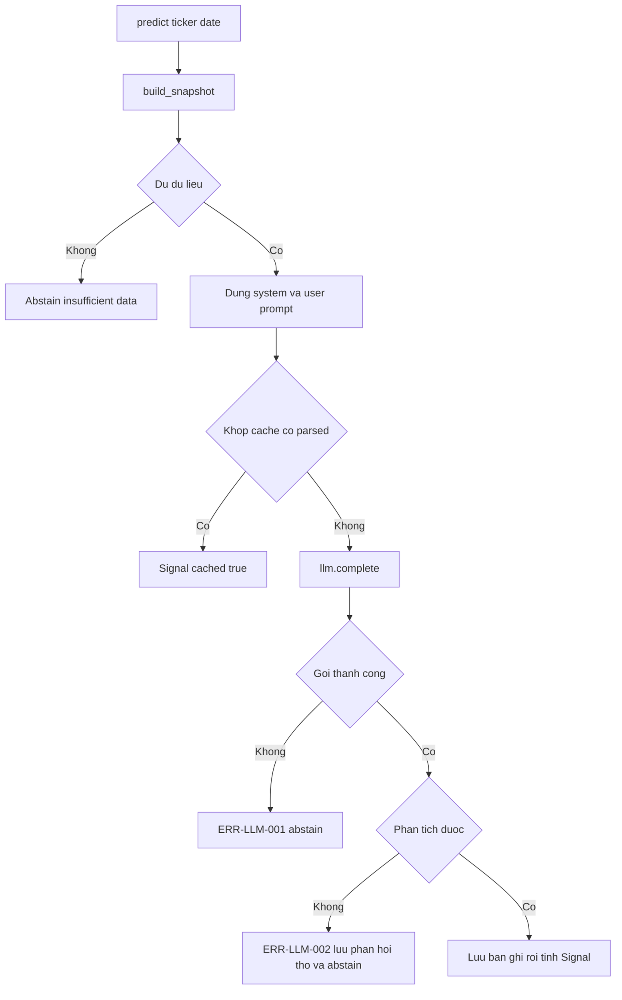

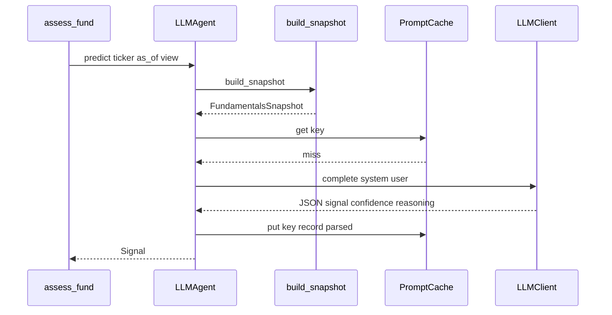

| Lỗi | Điều kiện | Xử lý |
|---|---|---|
| ERR-LLM-001 | `llm.complete` ném ngoại lệ | Signal abstain; lưu chẩn đoán nếu có |
| ERR-LLM-002 | JSON không hợp lệ, tín hiệu hoặc độ tin cậy ngoài miền | Signal abstain; lưu phản hồi thô |
| ERR-DAT-001 | Lỗi hạ tầng dữ liệu khi dựng snapshot | Lan truyền; phiên thất bại |

##### FR-ALPHA-002 - Phát tín hiệu PEAD

| Thuộc tính | Nội dung |
|---|---|
| Code Traceability | `hedge_fund/signals/pead.py`: `PEADModel.predict`, `_qualifying_events`, `_neutral`, `_parse_date`; `hedge_fund/signals/base.py`: `QuantModel` |
| Data Entities | `EarningsRecord`, `EarningsData`, `Signal` |
| Yêu cầu | Hệ thống phải trả +1,0 sau BEAT và -1,0 sau MISS của sự kiện nộp trong `signal_window_days` (mặc định 4 ngày) tính đến ngày đánh giá. Hệ thống phải chỉ nhận hồ sơ 8-K khi `announcement_only` bằng true. Hệ thống phải loại hồ sơ nộp từ 45 ngày sau kỳ báo cáo. Hệ thống không được dùng hồ sơ có ngày nộp sau ngày đánh giá. Hệ thống phải trả 0,0 khi không có sự kiện đủ điều kiện. Analyst khai báo `investment_approach = long_short` và `horizon_days = 60` |

```text
┌────────────────────────────────────────────────────────────────────────┐
│  PEAD EVENT VIEW                                                       │
├────────────────────────────────────────────────────────────────────────┤
│  Model: pead | approach: long_short | horizon: 60 sessions             │
├────────────────────────────────────────────────────────────────────────┤
│  Ticker  Report period  Filed       Source  EPS surprise  Signal       │
│  AAPL    2026-06-30     2026-07-30  8-K     BEAT          +1.0         │
│  MSFT    2026-06-30     2026-07-29  8-K     MISS          -1.0         │
│  NVDA    2026-07-31     2026-08-27  10-Q    BEAT          0.0          │
│  JPM     2026-03-31     2026-04-12  8-K     BEAT          0.0          │
├────────────────────────────────────────────────────────────────────────┤
│  [i] 10-Q bị bỏ qua khi announcement_only; JPM quá cửa sổ hiệu lực     │
└────────────────────────────────────────────────────────────────────────┘
```

- Điều kiện trước: `get_earnings_history` khả dụng.
- Điều kiện sau: `Signal.value` thuộc `{-1.0, 0.0, +1.0}`.

| Đầu vào | Kiểu | Bắt buộc | Ràng buộc |
|---|---|---|---|
| `earnings_limit` | int | Không | Mặc định 8 |
| `signal_window_days` | int | Không | Mặc định 4 |
| `announcement_only` | bool | Không | Mặc định true |
| `eps_surprise` | string | Có | `BEAT` hoặc `MISS` mới tạo tín hiệu; `MEET` là trung lập |

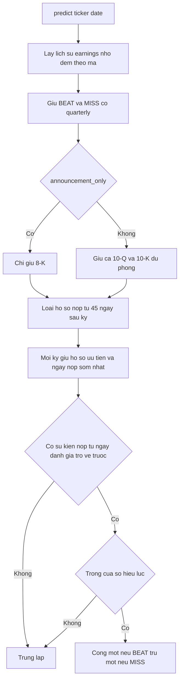

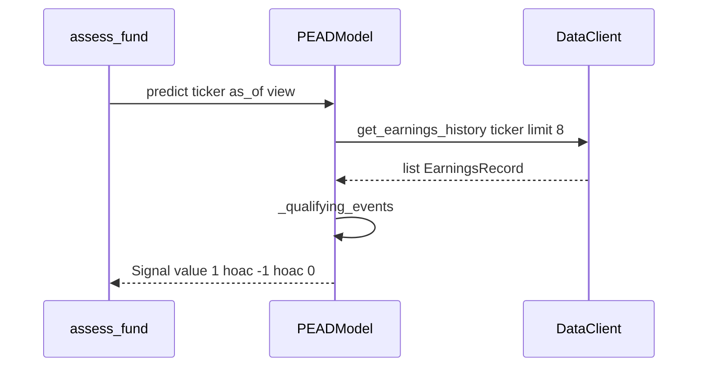

| Lỗi | Điều kiện | Xử lý |
|---|---|---|
| ERR-DAT-001 | Lỗi hạ tầng khi lấy lịch sử earnings | Lan truyền |

##### FR-ALPHA-003 - Che danh tính công ty trong backtest (blind)

| Thuộc tính | Nội dung |
|---|---|
| Code Traceability | `hedge_fund/run.py`: `_backtest` (`Fund(spec, blind=True)`); `hedge_fund/fund/spec.py`: `Fund.__init__`; `hedge_fund/signals/llm_agent.py`: `LLMAgent.__init__`, `build_snapshot`; `hedge_fund/features/snapshot.py`: `FundamentalsSnapshot.render`; `hedge_fund/features/breakpoints.py`: `load_breakpoints`, `shared_breakpoints`; `hedge_fund/features/intraday.py` |
| Data Entities | `MEBreakpoints` (bảng breakpoint vốn hóa nhớ đệm đĩa) |
| Yêu cầu | Hệ thống phải tạo LLM agent với `blind=True` trong mọi lần chạy `aihf backtest`. Hệ thống không được đưa mã cổ phiếu, ngành, ngày lịch và giá trị đô la vào prompt khi `blind` bằng true. Hệ thống phải biểu thị quy mô công ty bằng phân vị vốn hóa. Hệ thống phải ném ngoại lệ khi không có bảng breakpoint và không có bản nhớ đệm. Hệ thống phải giữ bản nhớ đệm cũ khi tải lại thất bại. Quỹ giấy không được chạy ở chế độ blind |

```text
┌────────────────────────────────────────────────────────────────────────┐
│  BLIND PROMPT PREVIEW                                     [Mode: blind]│
├────────────────────────────────────────────────────────────────────────┤
│  LIVE (blind = false)         BACKTEST (blind = true)                  │
│  Ticker: AAPL                 Ticker: [withheld]                       │
│  Industry: Consumer Elec      Industry: [withheld]                     │
│  As of: 2026-10-30            As of: [withheld]                        │
│  Market cap: 3.2T USD         Size: percentile 99                      │
├────────────────────────────────────────────────────────────────────────┤
│  [!] Validation Warning: thiếu breakpoint và cache thì ném ngoại lệ    │
└────────────────────────────────────────────────────────────────────────┘
```

- Điều kiện trước: lệnh `aihf backtest` hoặc `Fund(..., blind=True)`.
- Điều kiện sau: prompt không chứa định danh; các giá trị quy mô là phân vị.

| Đầu vào | Kiểu | Bắt buộc | Ràng buộc |
|---|---|---|---|
| `blind` | bool | Không | Mặc định false; true khi backtest |
| `breakpoints` | MEBreakpoints | Không | Nạp một lần mỗi tiến trình nếu không truyền |

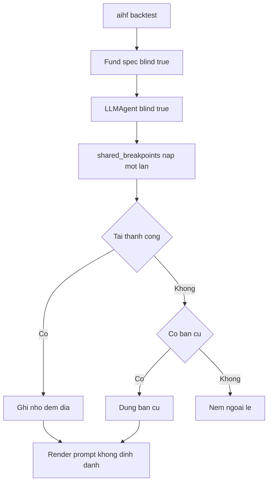

```mermaid
sequenceDiagram
    actor OP as Actor
    participant CLI as run.py
    participant FD as Fund
    participant AG as LLMAgent
    participant SN as FundamentalsSnapshot
    OP->>CLI: aihf backtest
    CLI->>FD: Fund spec blind true
    FD->>AG: cls blind true
    AG->>SN: build_snapshot breakpoints
    AG->>SN: render blind true
    SN-->>AG: prompt khong dinh danh
```

| Lỗi | Điều kiện | Xử lý |
|---|---|---|
| ERR-DAT-001 | Không tải được breakpoint và không có bản nhớ đệm | Ngoại lệ lan truyền; backtest dừng |

#### 9.1.5 Module PORT - Danh mục và rủi ro

##### FR-PORT-001 - Pha trộn tín hiệu thành sleeve

| Thuộc tính | Nội dung |
|---|---|
| Code Traceability | `hedge_fund/portfolio/construction.py`: `blend_signals`, `BlendResult`, `FlatReason`; `hedge_fund/pipeline/stages.py`: `assess_fund`; `hedge_fund/signals/__init__.py`: `get_investment_approach` |
| Data Entities | `Signal`, `STRATEGY_RECORD` (`convictions`, `eligible_scores`, `weights`, `flat_reason`) |
| Yêu cầu | Hệ thống phải tính conviction là trung bình có trọng số của các tín hiệu không abstain. Hệ thống phải loại tín hiệu abstain khỏi mẫu số, và tín hiệu trung lập vẫn thuộc mẫu số. Hệ thống phải chỉ tính vào bằng chứng bán khống các tín hiệu của analyst `long_short` và phần dương của tín hiệu analyst `long_only`. Hệ thống phải chuẩn hóa tổng giá trị tuyệt đối của điểm đủ điều kiện về `gross_target`. Ở chế độ `dollar_neutral`, hệ thống phải chia một nửa `gross_target` cho mỗi phía và đặt mọi trọng số bằng 0 kèm `flat_reason` khi thiếu một phía. Hệ thống phải ném lỗi khi tín hiệu ngoài `[-1, 1]` |

Giao diện: kết quả sleeve hiển thị trong báo cáo phiên (FR-PAPER-007); FR này không có màn hình riêng.

- Điều kiện trước: danh sách tín hiệu của một strategy; trọng số analyst `> 0`; hồ sơ `investment_approach` đầy đủ.
- Điều kiện sau: `BlendResult` với trọng số có tổng giá trị tuyệt đối bằng `gross_target` hoặc 0.

| Đầu vào | Kiểu | Bắt buộc | Ràng buộc |
|---|---|---|---|
| `signals` | list[Signal] | Có | `value` hữu hạn, trong `[-1, 1]` |
| `model_weights` | dict | Có | Mỗi giá trị hữu hạn và `> 0` |
| `gross_target` | float | Có | Hữu hạn, `> 0` |
| `mode` | enum | Có | `long_only`, `long_short`, `dollar_neutral` |
| `investment_approaches` | dict | Có | Mỗi analyst thuộc `long_only` hoặc `long_short` |

```mermaid
flowchart TD
    A[Danh sach Signal] --> B[Kiem tra huu han va trong -1 den 1]
    B --> C[Bo qua Signal abstained]
    C --> D[Conviction la trung binh co trong so]
    D --> E[Danh gia short chi tinh analyst long short va phan duong cua long only]
    E --> F[Diem du dieu kien la phan duong conviction cong phan am short]
    F --> G{Che do}
    G -->|long_only hoac long_short| H[Chuan hoa tong tuyet doi ve gross_target]
    G -->|dollar_neutral| I{Du ca hai phia}
    I -->|Khong| J[Dat flat_reason va trong so 0]
    I -->|Co| K[Moi phia nhan mot nua gross_target]
```

```mermaid
sequenceDiagram
    participant ST as assess_fund
    participant BL as blend_signals
    ST->>BL: signals model_weights gross_target mode approaches
    BL->>BL: kiem tra dau vao
    BL->>BL: tinh conviction va short assessment
    BL->>BL: tinh diem du dieu kien
    BL-->>ST: BlendResult
```

| Lỗi | Điều kiện | Xử lý |
|---|---|---|
| ERR-PRT-001 | Chế độ lạ, `gross_target` không hợp lệ, trọng số analyst không hợp lệ, tín hiệu ngoài miền, tổng không hữu hạn | `ValueError`; tick halt quỹ |

##### FR-PORT-002 - Bù trừ sleeve và áp giới hạn rủi ro

| Thuộc tính | Nội dung |
|---|---|
| Code Traceability | `hedge_fund/pipeline/stages.py`: `assess_fund`; `hedge_fund/risk/limits.py`: `apply_limits`, `_scale_proportionally`, `RiskLimits`, `ClampEvent`, `RiskResult` |
| Data Entities | `RISK_LIMITS`, `CLAMP_EVENT`, `DECISION_RECORD` (`target_weights`, `final_weights`, `risk_scale_factor`), `STRATEGY_RECORD.final_contribution` |
| Yêu cầu | Hệ thống phải cộng các sleeve theo tỷ trọng vốn đã chuẩn hóa thành sổ mục tiêu. Hệ thống phải cắt từng mã theo `max_position_pct` giữ nguyên dấu, rồi thu hẹp phía nặng hơn về dải `max_net_exposure` nếu đặt, rồi thu hẹp mọi trọng số theo `max_gross_exposure`. Khi có strategy `dollar_neutral`, hệ thống phải thu nhỏ mọi trọng số bằng một hệ số chung. Hệ thống không được phân bổ lại phần bị cắt cho mã khác. Hệ thống phải ghi `ClampEvent` cho mỗi giới hạn kích hoạt |

```text
┌────────────────────────────────────────────────────────────────────────┐
│  MASTER RISK BOARD                                  [Status: Clamped ●]│
│  Fund: example-fund | Session: 2026-10-30                              │
├────────────────────────────────────────────────────────────────────────┤
│  LIMIT SUMMARY                                                         │
│  ┌───────────────────┐  ┌───────────────────┐  ┌───────────────────┐   │
│  │ POSITION CAP      │  │ NET BAND          │  │ GROSS CAP         │   │
│  │ 25% per name      │  │ not set           │  │ 1.00x             │   │
│  │ 1 clamp           │  │ 0 clamp           │  │ 1 clamp           │   │
│  └───────────────────┘  └───────────────────┘  └───────────────────┘   │
├────────────────────────────────────────────────────────────────────────┤
│  Ticker  Netted   Final    Limit fired                                 │
│  AAPL    +0.40    +0.25    max_position_pct (before 0.40, after 0.25)  │
│  BOOK    gross 1.35 -> 1.00  max_gross_exposure                        │
├────────────────────────────────────────────────────────────────────────┤
│  [i] Phần bị cắt giữ ở dạng tiền mặt, không phân bổ lại                │
└────────────────────────────────────────────────────────────────────────┘
```

- Điều kiện trước: sleeve của mọi strategy đã tính; trọng số hữu hạn.
- Điều kiện sau: `final_weights` không vi phạm giới hạn; `final_contribution` của mỗi strategy cộng đúng bằng trọng số cuối của từng mã.

| Đầu vào | Kiểu | Bắt buộc | Ràng buộc |
|---|---|---|---|
| `weights` | dict[str, float] | Có | Hữu hạn; tổng giá trị tuyệt đối hữu hạn |
| `limits.max_position_pct` | float | Có | `0 < x <= 1` |
| `limits.max_gross_exposure` | float | Có | `> 0` |
| `limits.max_net_exposure` | float | Không | `> 0` |
| `preserve_proportions` | bool | Không | true khi có strategy `dollar_neutral` |

```mermaid
flowchart TD
    A[Sleeve moi strategy] --> B[Nhan slice da chuan hoa]
    B --> C[Cong thanh so muc tieu]
    C --> D{Co strategy dollar_neutral}
    D -->|Co| E[Thu nho moi trong so theo he so chung]
    D -->|Khong| F[Cat tung ma theo max_position_pct]
    F --> G{Net vuot max_net_exposure}
    G -->|Co| H[Thu hep phia nang hon]
    G -->|Khong| I{Gross vuot max_gross_exposure}
    H --> I
    I -->|Co| J[Thu hep moi trong so theo ty le]
    I -->|Khong| K[Giu nguyen]
    E --> L[Ghi ClampEvent]
    J --> L
    K --> L
```

```mermaid
sequenceDiagram
    participant AS as assess_fund
    participant RK as apply_limits
    participant VT as validate_targets
    AS->>AS: nhan slice va cong netted
    AS->>RK: netted risk preserve_proportions
    RK-->>AS: RiskResult weights clamps scale_factor
    AS->>AS: tinh final_contribution
    AS->>VT: spec strategies weights
    VT-->>AS: hop le hoac ValueError
```

| Lỗi | Điều kiện | Xử lý |
|---|---|---|
| ERR-RSK-001 | Trọng số hoặc giới hạn không hữu hạn, giới hạn không dương | `ValueError` trước khi điều chỉnh; tick halt quỹ |

##### FR-PORT-003 - Kiểm tra mục tiêu trước khi gửi lệnh

| Thuộc tính | Nội dung |
|---|---|
| Code Traceability | `hedge_fund/portfolio/validation.py`: `validate_targets`; gọi bởi `hedge_fund/pipeline/stages.py`: `assess_fund`, `execute_decision` |
| Data Entities | `STRATEGY_RECORD`, `FundSpec`, `final_weights` |
| Yêu cầu | Hệ thống phải tính lại bằng chứng bán khống từ tín hiệu đã ghi thay vì tin đầu ra định cỡ. Hệ thống phải từ chối khi tên strategy không khớp mandate, slice sai, điểm đủ điều kiện không khớp, trọng số âm của strategy `long_only` hoặc thiếu bằng chứng bán khống, strategy phẳng có trọng số khác 0, gross vượt `gross_target`, strategy `dollar_neutral` có tổng khác 0, tổng đóng góp khác trọng số cuối, trọng số vượt `max_position_pct`, hoặc gross quỹ vượt `max_gross_exposure`. Hệ thống phải hoàn tất mọi kiểm tra trước khi gửi bất kỳ lệnh nào |

Giao diện: không có màn hình riêng; lỗi hiển thị trên stderr hoặc trong thông báo halt.

- Điều kiện trước: bản ghi strategy và `final_weights` đã tính.
- Điều kiện sau: không có ngoại lệ; hoặc `ValueError` và không có lệnh nào được gửi.

| Đầu vào | Kiểu | Bắt buộc | Ràng buộc |
|---|---|---|---|
| `spec` | FundSpec | Có | Mandate gắn với quyết định |
| `strategies` | list[StrategyRecord] | Có | Một bản ghi mỗi strategy của mandate |
| `final_weights` | dict | Có | Hữu hạn |

```mermaid
flowchart TD
    A[spec strategies final_weights] --> B{Ten strategy khop mandate}
    B -->|Khong| X[ERR-PRT-002]
    B -->|Co| C[Kiem tra slice]
    C --> D[Tinh lai blend_signals tu tin hieu da ghi]
    D --> E{Eligible score khop}
    E -->|Khong| X
    E -->|Co| F[Kiem tra dau am long only va bang chung short]
    F --> G[Kiem tra gross va dollar neutral]
    G --> H{Tong dong gop bang trong so cuoi}
    H -->|Khong| X
    H -->|Co| I{Trong max_position_pct va max_gross_exposure}
    I -->|Khong| X
    I -->|Co| J[Hop le]
```

```mermaid
sequenceDiagram
    participant EX as execute_decision
    participant VT as validate_targets
    participant BL as blend_signals
    EX->>VT: spec strategies final_weights
    VT->>BL: tin hieu da ghi cua tung strategy
    BL-->>VT: eligible_scores va flat_reason
    VT->>VT: so khop diem dau gross tong dong gop
    VT-->>EX: None hoac ValueError
```

| Lỗi | Điều kiện | Xử lý |
|---|---|---|
| ERR-PRT-002 | Bất kỳ vi phạm nêu trong Yêu cầu | `ValueError` nêu phạm vi và mã; tick halt quỹ; không có lệnh nào được gửi |

##### FR-PORT-004 - Sinh lệnh chênh lệch từ trọng số mục tiêu

| Thuộc tính | Nội dung |
|---|---|
| Code Traceability | `hedge_fund/pipeline/execution.py`: `build_orders`; `hedge_fund/pipeline/stages.py`: `execute_decision`, `liquidity`, `history_start`; `hedge_fund/brokers/costs.py`: `TradingCosts`; `hedge_fund/brokers/sim.py`: `SimBroker.place_order` |
| Data Entities | `ORDER`, `FILL`, `Liquidity` (adv, volatility), `CLAMP_EVENT` (`max_adv_pct`) |
| Yêu cầu | Hệ thống phải tính số cổ phiếu mục tiêu bằng phần nguyên của `weight x equity / mark` làm tròn về 0. Hệ thống không được tạo lệnh dưới một cổ phiếu. Hệ thống không được tạo lệnh tăng vị thế có giá trị nhỏ hơn `min_trade_pct x equity`; lệnh giảm, đóng và đảo vị thế luôn được tạo. Hệ thống phải giới hạn số lượng lệnh theo `max_adv_pct x ADV` khi đặt, và ghi `ClampEvent` `max_adv_pct`. Hệ thống phải sắp xếp bán trước mua sau, theo thứ tự chữ cái trong mỗi nhóm. Hệ thống phải đóng vị thế đang giữ mà vắng trong mục tiêu |

```text
┌────────────────────────────────────────────────────────────────────────┐
│  ORDER BLOTTER                                                         │
├────────────────────────────────────────────────────────────────────────┤
│  Execution: 2026-11-02 close | Equity before: 100,000.00 | Fills: 3    │
├────────────────────────────────────────────────────────────────────────┤
│  Side  Ticker  Qty   Mark     Fill     Cost    Note                    │
│  sell  MSFT    40    410.00   409.79   8.60    close                   │
│  buy   AAPL    120   225.00   225.11   13.42                           │
│  buy   KO      0     62.00    -        -       dưới dải 0.5% equity    │
├────────────────────────────────────────────────────────────────────────┤
│  Trading cost: 22.02 = spread + impact + commission                    │
│  [i] Lệnh tăng dưới min_trade_pct chờ chu kỳ sau; lệnh giảm luôn khớp  │
└────────────────────────────────────────────────────────────────────────┘
```

- Điều kiện trước: `final_weights` đã qua `validate_targets`; giá đóng cửa hữu hạn, dương cho mọi mã giữ và mã mục tiêu.
- Điều kiện sau: danh sách `Order` đã sắp xếp; sau khớp, sổ broker bằng vị thế dự kiến.

| Đầu vào | Kiểu | Bắt buộc | Ràng buộc |
|---|---|---|---|
| `target_weights` | dict | Có | Mã vắng nghĩa là mục tiêu 0 |
| `positions` | dict[str, Position] | Có | Số cổ phiếu có dấu |
| `marks` | dict | Có | Có giá cho mọi mã giữ và mã mục tiêu; thiếu giá là lỗi lập trình |
| `equity` | float | Có | Hữu hạn, `> 0` |
| `max_shares` | dict | Không | Từ `max_adv_pct x ADV` |
| `min_notional` | float | Không | `min_trade_pct x equity` |

```mermaid
flowchart TD
    A[Trong so muc tieu va vi the] --> B[Muc tieu bang phan nguyen cua weight nhan equity chia mark]
    B --> C[Delta bang muc tieu tru hien tai]
    C --> D{Lenh tang nho hon min_notional}
    D -->|Co| E[Bo qua cho chu ky sau]
    D -->|Khong| F{Co max_adv_pct}
    F -->|Co| G[Gioi han delta theo ADV]
    F -->|Khong| H[Giu delta]
    G --> I{Delta khac 0}
    H --> I
    I -->|Khong| E
    I -->|Co| J[Tao Order kem adv va volatility]
    J --> K[Sap xep ban truoc mua sau]
```

```mermaid
sequenceDiagram
    participant EX as execute_decision
    participant LQ as liquidity
    participant BO as build_orders
    participant BR as Broker
    EX->>LQ: tickers as_of data_client
    LQ-->>EX: adv va volatility
    EX->>BO: targets held marks equity max_shares min_notional
    BO-->>EX: list Order
    EX->>BR: place_order order
    BR-->>EX: Fill
```

| Lỗi | Điều kiện | Xử lý |
|---|---|---|
| ERR-EXE-002 | Equity không hữu hạn hoặc không dương | `ValueError` trước khi gửi lệnh |
| ERR-EXE-003 | Vị thế dự kiến vượt `max_position_pct` hoặc `max_gross_exposure` | `ValueError` trước khi gửi lệnh |
| ERR-DAT-003 | Thiếu giá đóng cửa đúng phiên | `ValueError`; không có lệnh nào được gửi |

##### FR-PORT-005 - Dừng lỗ theo mức sụt giảm NAV

| Thuộc tính | Nội dung |
|---|---|
| Code Traceability | `hedge_fund/pipeline/session.py`: `advance`, `FundState.peak_nav`, `next_state`; `hedge_fund/pipeline/stages.py`: `stop_out_decision`; `hedge_fund/pipeline/models.py`: `DecisionRecord.is_stopped_out` |
| Data Entities | `RISK_LIMITS.max_drawdown_pct`, `FundState.peak_nav`, `CLAMP_EVENT` |
| Yêu cầu | Hệ thống phải tính drawdown bằng `1 - NAV / peak_nav`, với peak là NAV cao nhất đã ghi. Khi drawdown đạt `max_drawdown_pct`, hệ thống phải tạo quyết định đặt mọi mục tiêu bằng 0 cho các vị thế đang giữ, ghi `ClampEvent` `max_drawdown_pct`, và không gọi analyst. Hệ thống không được làm mới quan điểm của quyết định dừng lỗ ở phiên thực thi. Hệ thống không được tạo quyết định khi quỹ không còn vị thế |

```text
┌────────────────────────────────────────────────────────────────────────┐
│  DRAWDOWN STOP-OUT                                  [Status: STOPPED ●]│
│  Fund: example-fund | Limit: 20% from peak                             │
├────────────────────────────────────────────────────────────────────────┤
│  SUMMARY                                                               │
│  ┌───────────────────┐  ┌───────────────────┐  ┌───────────────────┐   │
│  │ PEAK NAV          │  │ CURRENT NAV       │  │ DRAWDOWN          │   │
│  │ 112,400.00        │  │ 89,100.00         │  │ 20.7%             │   │
│  │ 2026-09-14        │  │ 2026-10-30        │  │ limit reached     │   │
│  └───────────────────┘  └───────────────────┘  └───────────────────┘   │
├────────────────────────────────────────────────────────────────────────┤
│  [!] Bán toàn bộ tại phiên kế tiếp; không hỏi analyst; giữ tiền mặt    │
└────────────────────────────────────────────────────────────────────────┘
```

- Điều kiện trước: `max_drawdown_pct` được đặt; NAV tính được.
- Điều kiện sau: `DecisionRecord.is_stopped_out` bằng true; phiên kế tiếp bán toàn bộ.

| Đầu vào | Kiểu | Bắt buộc | Ràng buộc |
|---|---|---|---|
| `nav` | float | Có | `cash + sum(shares x mark)` |
| `peak_nav` | float | Có | Mặc định bằng vốn nếu trạng thái cũ chưa theo dõi |
| `max_drawdown_pct` | float | Không | `0 < x < 1` |

```mermaid
flowchart TD
    A[advance tai phien T] --> B[Tinh NAV]
    B --> C[Drawdown bang mot tru NAV chia peak_nav]
    C --> D{Co max_drawdown_pct va dat nguong}
    D -->|Khong| E[Danh gia binh thuong neu la phien rebalance]
    D -->|Co| F{Quy con vi the}
    F -->|Khong| G[Khong co quyet dinh]
    F -->|Co| H[stop_out_decision dat moi muc tieu bang 0]
    H --> I[Ghi ClampEvent max_drawdown_pct]
    I --> J[Phien ke tiep ban toan bo khong lam moi quan diem]
```

```mermaid
sequenceDiagram
    participant AD as advance
    participant ST as stop_out_decision
    participant EX as execute_decision
    participant BR as Broker
    AD->>AD: drawdown so voi peak_nav
    AD->>ST: spec session universe marks positions drawdown
    ST-->>AD: DecisionRecord muc tieu 0
    Note over AD,EX: Phien ke tiep
    AD->>EX: pending decision
    EX->>BR: lenh ban toan bo
```

| Lỗi | Điều kiện | Xử lý |
|---|---|---|
| ERR-EXE-001 | Mandate đổi sau khi quyết định được tạo | `ValueError`; không có lệnh |

#### 9.1.6 Module SES - Phiên của quỹ

##### FR-SES-001 - Tiến hành một phiên (`advance`)

| Thuộc tính | Nội dung |
|---|---|
| Code Traceability | `hedge_fund/pipeline/session.py`: `advance`, `next_state`, `is_rebalance_session`, `_period`, `mandate_hash`, `code_version`, `SessionRecord`, `FundState`; `hedge_fund/pipeline/clock.py`: `Clock`, `DailyClock`, `BarClock`, `LiveClock`, `clock_for`, `PinnedQuotes` |
| Data Entities | `FundState`, `SESSION_RECORD`, `DECISION_RECORD`, `CYCLE_RECORD` |
| Yêu cầu | Hệ thống phải thực hiện theo thứ tự: kiểm tra halt, kiểm tra thứ tự phiên và tính hoàn tất, đối soát sổ, thực thi quyết định chờ, định giá sổ, kiểm tra dừng lỗ, đánh giá quyết định mới nếu là phiên tái cân bằng, dựng bản ghi và tính hash. Hệ thống phải xác định phiên tái cân bằng chỉ từ phiên hiện tại và phiên trước: phiên đầu luôn là tái cân bằng; `minute` và `daily` mọi phiên; `weekly` phiên đầu của tuần ISO; `monthly` phiên đầu của tháng. Hệ thống không được thực thi quyết định tại cùng giá đóng cửa với phiên đánh giá. Hệ thống phải đóng dấu phiên bản mã, hash mandate và mô hình LLM lên bản ghi |

Giao diện: kết quả hiển thị qua FR-PAPER-002, FR-PAPER-006, FR-BT-002, FR-BT-003.

- Điều kiện trước: `FundState` hợp lệ; broker khớp trạng thái; phiên hoàn tất và sau phiên cuối.
- Điều kiện sau: `SessionRecord` có `hash` đúng; trạng thái kế tiếp suy ra bằng `next_state`.

| Đầu vào | Kiểu | Bắt buộc | Ràng buộc |
|---|---|---|---|
| `fund` | Fund | Có | Mandate và analyst đã dựng |
| `state` | FundState | Có | Không halt |
| `session` | string | Có | Sau `state.last_session`; `clock.is_complete` bằng true |
| `broker` | Broker | Có | Khớp trạng thái |
| `data_client` | DataClient | Có | Theo giao thức |
| `universe` | list[str] | Có | Chuẩn hóa, không rỗng |
| `clock` | Clock | Không | Mặc định theo mandate |

```mermaid
flowchart TD
    A[advance] --> B{Quy halt}
    B -->|Co| X1[ERR-SES-001]
    B -->|Khong| C{Phien sau phien cuoi va da hoan tat}
    C -->|Khong| X3[ERR-SES-003]
    C -->|Co| D[reconcile]
    D --> E{Co quyet dinh cho}
    E -->|Co| F[execute_decision]
    E -->|Khong| G[Dinh gia so]
    F --> G
    G --> H{Drawdown dat nguong}
    H -->|Co| I[stop_out_decision]
    H -->|Khong| J{La phien rebalance}
    J -->|Co| K[assess_fund]
    J -->|Khong| L[Khong co quyet dinh moi]
    I --> M[Dung SessionRecord va tinh hash]
    K --> M
    L --> M
```

```mermaid
sequenceDiagram
    participant CL as Caller
    participant AD as advance
    participant RC as reconcile
    participant EX as execute_decision
    participant AS as assess_fund
    CL->>AD: fund state session broker data universe
    AD->>RC: state broker
    RC-->>AD: ok
    AD->>EX: pending decision
    EX-->>AD: CycleRecord
    AD->>AS: fund session data universe clock
    AS-->>AD: DecisionRecord
    AD-->>CL: SessionRecord co hash
```

| Lỗi | Điều kiện | Xử lý |
|---|---|---|
| ERR-SES-001 | `state.halted` khác rỗng | `FundHalted`; không truy cập broker và dữ liệu |
| ERR-SES-002 | Sổ broker lệch ledger | `BookMismatch`; xem FR-LDG-003 |
| ERR-SES-003 | Phiên không sau phiên cuối hoặc chưa hoàn tất | `ValueError`; không ghi gì |

##### FR-SES-002 - Thực thi quyết định chờ

| Thuộc tính | Nội dung |
|---|---|
| Code Traceability | `hedge_fund/pipeline/stages.py`: `execute_decision`, `assess_fund`, `_mark_prices`; `hedge_fund/pipeline/execution.py`: `build_orders`; `hedge_fund/brokers/protocol.py`: `Broker`; `hedge_fund/brokers/paper.py`: `PaperBroker` |
| Data Entities | `CYCLE_RECORD` (`original_assessment`, `refreshed_assessment`, `execution_as_of`, `execution_policy`), `ORDER`, `FILL` |
| Yêu cầu | Hệ thống phải từ chối thực thi khi phiên thực thi không sau phiên đánh giá, chưa hoàn tất, hoặc mandate khác mandate của quyết định. Hệ thống phải làm mới quan điểm tại phiên liền trước phiên thực thi khi phiên đó khác phiên đánh giá và quyết định không phải dừng lỗ. Hệ thống phải định giá lại mọi vị thế theo giá đóng cửa đúng phiên thực thi trước khi định cỡ. Hệ thống phải kiểm tra mục tiêu và vị thế dự kiến trước khi gửi lệnh đầu tiên. Hệ thống phải gửi lệnh theo thứ tự đã sắp xếp và ghi `CycleRecord` gồm cả đánh giá gốc và đánh giá đã làm mới |

Giao diện: kết quả hiển thị trong báo cáo phiên và băng lệnh (FR-PAPER-007, FR-BT-003).

- Điều kiện trước: `original` là `DecisionRecord`; phiên thực thi hoàn tất.
- Điều kiện sau: `CycleRecord` với `nav`, `positions`, `cash`; sổ broker đã cập nhật.

| Đầu vào | Kiểu | Bắt buộc | Ràng buộc |
|---|---|---|---|
| `original` | DecisionRecord | Có | `as_of` trước `session` |
| `session` | string | Có | Hoàn tất theo `clock` |
| `broker`, `data_client`, `clock` | Giao thức | Có/Không | Như FR-SES-001 |

```mermaid
flowchart TD
    A[execute_decision] --> B{Phien sau danh gia va hoan tat}
    B -->|Khong| X[ERR-EXE-001]
    B -->|Co| C{Mandate khong doi}
    C -->|Khong| X
    C -->|Co| D{Cutoff khac as_of va khong phai dung lo}
    D -->|Co| E[assess_fund tai cutoff]
    D -->|Khong| F[Dung quyet dinh goc]
    E --> G[validate_targets]
    F --> G
    G --> H[Dinh gia lai vi the tai phien thuc thi]
    H --> I{Equity huu han va duong}
    I -->|Khong| Y[ERR-EXE-002]
    I -->|Co| J[Sinh lenh va kiem tra vi the du kien]
    J --> K{Trong gioi han}
    K -->|Khong| Z[ERR-EXE-003]
    K -->|Co| L[Gui lenh va dung CycleRecord]
```

```mermaid
sequenceDiagram
    participant AD as advance
    participant EX as execute_decision
    participant AS as assess_fund
    participant BR as Broker
    AD->>EX: fund original session broker data clock
    EX->>AS: lam moi quan diem tai cutoff
    AS-->>EX: DecisionRecord
    EX->>BR: positions va cash
    BR-->>EX: so hien tai
    EX->>BR: place_order tung lenh
    BR-->>EX: Fill
    EX-->>AD: CycleRecord
```

| Lỗi | Điều kiện | Xử lý |
|---|---|---|
| ERR-EXE-001 | Phiên không hợp lệ hoặc mandate đổi | `ValueError`; không có lệnh |
| ERR-EXE-002 | Equity không hợp lệ | `ValueError`; không có lệnh |
| ERR-EXE-003 | Vị thế dự kiến vi phạm giới hạn | `ValueError`; không có lệnh |
| ERR-DAT-003 | Thiếu giá phiên thực thi | `ValueError`; không có lệnh |

#### 9.1.7 Module BT - Backtesting

##### FR-BT-001 - Phát lại mandate trên lịch sử (`backtest_fund`)

| Thuộc tính | Nội dung |
|---|---|
| Code Traceability | `hedge_fund/backtesting/fund.py`: `backtest_fund`, `build_schedule`, `replay_grid`, `rebalance_grid`, `performance_metrics`, `FundBacktestResult`, `FundBacktestMetrics`, `DailyValuation`; `hedge_fund/data/sessions.py`: `session_closes`; `hedge_fund/brokers/sim.py`: `SimBroker` |
| Data Entities | `BACKTEST_RESULT`, `SESSION_RECORD` |
| Yêu cầu | Hệ thống phải dựng lưới phiên từ các ngày có giá của benchmark trong `[start, end]`, không vượt phiên hoàn tất gần nhất. Hệ thống phải gọi `advance` cho từng phiên với `FundState` trong bộ nhớ và `SimBroker` mới. Hệ thống không được trả kết quả rỗng khi benchmark không có giá. Hệ thống phải phát lại quỹ phút trên lưới ngày đóng cửa và ghi nhịp thực tế vào kết quả. Hệ thống phải tính tổng lợi suất, lợi suất quy năm, Sharpe (căn 252 phiên mỗi năm), mức sụt giảm tối đa, lợi suất benchmark, lợi suất vượt trội, số chu kỳ, số lệnh, giá trị giao dịch và chi phí giao dịch. Hệ thống phải gọi `on_cycle` sau mỗi lần thực thi và `on_valuation` sau mỗi phiên |

Giao diện: FR-BT-002 (CLI) và FR-BT-003 (TUI).

- Điều kiện trước: mandate hợp lệ; universe không rỗng; `DataClient` khả dụng.
- Điều kiện sau: `FundBacktestResult` có `records` băm chuỗi; quyết định ở phiên cuối giữ nguyên chưa thực thi.

| Đầu vào | Kiểu | Bắt buộc | Ràng buộc |
|---|---|---|---|
| `fund` | Fund | Có | Thường `blind=True` |
| `start`, `end` | string | Có | `YYYY-MM-DD` |
| `universe` | list[str] | Có | Chuẩn hóa, không rỗng |
| `on_cycle`, `on_valuation` | callable | Không | Nhận chỉ số và tổng số |

```mermaid
flowchart TD
    A[backtest_fund] --> B[session_closes cua benchmark]
    B --> C{Co phien}
    C -->|Khong| X[ERR-DAT-002]
    C -->|Co| D[replay_grid chon luoi va dong ho]
    D --> E[SimBroker voi von mandate]
    E --> F[Lap tung phien]
    F --> G[advance roi next_state]
    G --> H[Ghi NAV va benchmark NAV]
    H --> I{Co executed}
    I -->|Co| J[on_cycle]
    I -->|Khong| K[on_valuation]
    J --> K
    K --> L{Con phien}
    L -->|Co| F
    L -->|Khong| M[performance_metrics va FundBacktestResult]
```

```mermaid
sequenceDiagram
    participant CL as Caller
    participant BT as backtest_fund
    participant SC as session_closes
    participant AD as advance
    CL->>BT: fund start end data universe
    BT->>SC: benchmark start end
    SC-->>BT: closes
    loop moi phien
        BT->>AD: fund state session broker data universe clock
        AD-->>BT: SessionRecord
    end
    BT-->>CL: FundBacktestResult
```

| Lỗi | Điều kiện | Xử lý |
|---|---|---|
| ERR-DAT-002 | Benchmark không có giá trong cửa sổ | `ValueError` "cannot build the trading grid" |
| ERR-DAT-001 | Lỗi hạ tầng dữ liệu | Lan truyền; dừng backtest |
| ERR-PRT-002, ERR-EXE-001 | Mục tiêu hoặc thực thi vi phạm | Lan truyền; dừng backtest |

##### FR-BT-002 - Chạy backtest từ dòng lệnh và lưu kết quả

| Thuộc tính | Nội dung |
|---|---|
| Code Traceability | `hedge_fund/run.py`: `main`, `_parser`, `_backtest`; `hedge_fund/backtesting/research.py`: `save_result`, `summarize`, `receipts`, `last_universe`, `last_score`; `hedge_fund/scorecard/__init__.py`: `score` |
| Data Entities | `research/<fund>-<start>-<end>-<stamp>.json` |
| Yêu cầu | Hệ thống phải ghi JSON `FundBacktestResult` ra stdout và tóm tắt cùng bảng scorecard ra stderr. Hệ thống phải lưu một bản sao vào `~/.hedge-fund/research/`. Hệ thống phải mặc định `--end` là phiên hoàn tất gần nhất và `--start` lùi 78 tuần. Hệ thống phải khớp tệp kết quả theo trường `fund` trong tệp, không theo tiền tố tên tệp. Hệ thống phải bỏ qua tệp không đọc được |

```text
┌────────────────────────────────────────────────────────────────────────┐
│  TERMINAL CLI INTERACTION: aihf backtest                               │
├────────────────────────────────────────────────────────────────────────┤
│  $ aihf backtest example.yaml --universe AAPL,MSFT --start 2025-04-01  │
│  > example-fund: backtesting 2025-04-01 → 2026-10-30 (weekly vs SPY)…  │
│  example-fund 2025-04-01 → 2026-10-30 · 396 sessions · 18 rebalances   │
│   · 54 orders · return +9.1% vs SPY +6.7% · sharpe 0.84                │
│   · max drawdown 7.2%                                                  │
│  ┌──────────────────────────────────────────────────────────────────┐  │
│  │ stdout : JSON FundBacktestResult (schema_version 2)              │  │
│  │ saved  : ~/.hedge-fund/research/example-fund-2025-04-01-....json │  │
│  └──────────────────────────────────────────────────────────────────┘  │
├────────────────────────────────────────────────────────────────────────┤
│  Exit code: 0                                                          │
└────────────────────────────────────────────────────────────────────────┘
```

- Điều kiện trước: FR-FUND-001 thành công; khóa API hợp lệ.
- Điều kiện sau: JSON trên stdout; tệp kết quả trong `research/`; mã thoát 0.

| Đầu vào | Kiểu | Bắt buộc | Ràng buộc |
|---|---|---|---|
| `mandate` | string | Có | Đường dẫn YAML hợp lệ |
| `--universe` | string | Có | Phân tách bằng dấu phẩy hoặc khoảng trắng |
| `--start`, `--end` | string | Không | `YYYY-MM-DD` |
| `--out` | string | Không | Ghi thêm bản sao JSON ra tệp |
| `--model` | string | Không | Ghi vào `HEDGE_FUND_LLM_MODEL` |

```mermaid
flowchart TD
    A[aihf backtest] --> B[Chuan hoa universe va nap mandate]
    B --> C{Hop le}
    C -->|Khong| X[ERR-SPC-001 hoac ERR-SPC-002 thoat 2]
    C -->|Co| D[end mac dinh la phien hoan tat gan nhat]
    D --> E[start mac dinh lui 78 tuan]
    E --> F[backtest_fund voi blind true]
    F --> G[In JSON ra stdout]
    G --> H[save_result vao research]
    H --> I[In tom tat va bang scorecard ra stderr]
```

```mermaid
sequenceDiagram
    actor OP as Actor
    participant CLI as run.py
    participant BT as backtest_fund
    participant RS as save_result
    OP->>CLI: aihf backtest mandate --universe AAPL,MSFT
    CLI->>BT: Fund blind true start end CachedDataClient universe
    BT-->>CLI: FundBacktestResult
    CLI->>RS: save_result result
    CLI-->>OP: JSON tren stdout va tom tat tren stderr
```

| Lỗi | Điều kiện | Xử lý |
|---|---|---|
| ERR-SPC-001, ERR-SPC-002 | Mandate hoặc universe không hợp lệ | Thoát mã 2 trước khi tạo client dữ liệu |
| ERR-CFG-001 | Thiếu khóa API | Ngoại lệ nêu tên biến môi trường |
| ERR-DAT-001, ERR-DAT-002 | Lỗi dữ liệu | Không lưu kết quả |

##### FR-BT-003 - Theo dõi backtest trên bảng TUI

| Thuộc tính | Nội dung |
|---|---|
| Code Traceability | `hedge_fund/tui/backtest.py`: `BacktestScreen`; `hedge_fund/tui/shared.py`: `render_area_chart`, `BACKTEST_WEEKS`; `hedge_fund/tui/home.py`: `demand_run_keys`; `hedge_fund/backtesting/fund.py`: `on_cycle`, `on_valuation` |
| Data Entities | `BACKTEST_RESULT`, `DailyValuation`, `CycleRecord` |
| Yêu cầu | Hệ thống phải kiểm tra khóa trước khi làm nóng cache. Hệ thống phải điền sẵn mã giao dịch từ lần backtest trước và khoảng ngày mặc định 78 tuần. Hệ thống phải từ chối ngày không hợp lệ và giữ ở bước nhập. Hệ thống phải chạy backtest trên luồng nền và cập nhật đường NAV so với benchmark theo từng phiên. Hệ thống không được cho phép quay lại khi đang chạy. Hệ thống phải hiển thị ngày thực thi làm ngày của lần khớp lệnh |

```text
┌────────────────────────────────────────────────────────────────────────┐
│  BACKTEST BOARD - example-fund                      [Status: Running ●]│
│  Universe: AAPL, MSFT                               Progress: 212 / 396│
├────────────────────────────────────────────────────────────────────────┤
│  KEY METRICS SUMMARY                                                   │
│  ┌───────────────────┐  ┌───────────────────┐  ┌───────────────────┐   │
│  │ FUND RETURN       │  │ BENCHMARK SPY     │  │ REBALANCES        │   │
│  │ +6.2%             │  │ +4.9%             │  │ 11 of 18          │   │
│  └───────────────────┘  └───────────────────┘  └───────────────────┘   │
├────────────────────────────────────────────────────────────────────────┤
│  NAV vs benchmark                                                      │
│   110k ┤                          ╭──────                              │
│   105k ┤              ╭───────────╯                                    │
│   100k ┼──────────────╯                                                │
│        2025-04     2025-09     2026-02                                 │
├────────────────────────────────────────────────────────────────────────┤
│  [OK] 2025-09-02 buy AAPL 120 @ 225.11 -> 120 shares                   │
└────────────────────────────────────────────────────────────────────────┘
```

- Điều kiện trước: có ít nhất một mandate hợp lệ.
- Điều kiện sau: kết quả được lưu như FR-BT-002; số liệu cuối trên bảng bằng số liệu trong kết quả.

| Đầu vào | Kiểu | Bắt buộc | Ràng buộc |
|---|---|---|---|
| Mandate | lựa chọn | Có | Mandate hợp lệ; mandate lỗi bị vô hiệu |
| Mã giao dịch | string | Có | Chuẩn hóa như `normalize_universe` |
| Ngày bắt đầu, kết thúc | string | Có | `YYYY-MM-DD` hợp lệ (`valid_date`) |

```mermaid
flowchart TD
    A[Mo Backtesting] --> B[Kiem tra khoa du lieu va khoa LLM]
    B --> C{Du khoa}
    C -->|Khong| D[Mo hop thoai khoa]
    C -->|Co| E[Chon mandate hop le]
    E --> F[Nhap ma va khoang ngay]
    F --> G{Ngay hop le}
    G -->|Khong| H[Thong bao loi va giu o buoc nhap]
    G -->|Co| I[Lam nong cache]
    I --> J[backtest_fund tren luong nen]
    J --> K[Cap nhat duong NAV va bang lenh]
    K --> L[Hien thi tom tat scorecard va luu ket qua]
```

```mermaid
sequenceDiagram
    actor OP as Actor
    participant UI as BacktestScreen
    participant WK as Worker thread
    participant BT as backtest_fund
    OP->>UI: Xac nhan ma va khoang ngay
    UI->>WK: khoi chay luong nen
    WK->>BT: backtest_fund on_cycle on_valuation
    BT-->>UI: on_valuation i n DailyValuation
    BT-->>UI: on_cycle i n CycleRecord
    BT-->>WK: FundBacktestResult
    WK-->>UI: ket qua cuoi
```

| Lỗi | Điều kiện | Xử lý |
|---|---|---|
| ERR-CFG-001 | Thiếu khóa | Cổng khóa mở hộp thoại trước khi chạy |
| ERR-DAT-001, ERR-DAT-002 | Lỗi dữ liệu | Hiển thị nguyên nhân; không trả kết quả rỗng |

#### 9.1.8 Module PAPER - Quỹ giấy

##### FR-PAPER-001 - Triển khai quỹ giấy

| Thuộc tính | Nội dung |
|---|---|
| Code Traceability | `hedge_fund/paper/deployed.py`: `deploy`, `validate_fund_name`, `load_deployed`, `list_deployed`, `DeployedFund`; `hedge_fund/brokers/paper.py`: `PaperBroker.create`; `hedge_fund/paper/ledger.py`: `Ledger.init`; `hedge_fund/run.py`: `_paper` (hành động `create`) |
| Data Entities | `DEPLOYED_FUND` (`fund.yaml`), `BROKER_BOOK` (`broker.json`), `CONTROL` (`control.json`), thư mục `ledger/` |
| Yêu cầu | Hệ thống phải từ chối tên không khớp `[A-Za-z0-9][A-Za-z0-9._-]*` hoặc bằng `.` hoặc `..`. Hệ thống phải từ chối khi thư mục quỹ đã tồn tại. Hệ thống phải ghi bản chụp mandate vào `fund.yaml`, tạo `broker.json` với tiền mặt bằng vốn mandate, tạo ledger rỗng và `control.json` với `halted` bằng false. Hệ thống không được ghi đè dữ liệu quỹ có sẵn |

```text
┌────────────────────────────────────────────────────────────────────────┐
│  TERMINAL CLI INTERACTION: aihf paper create                           │
├────────────────────────────────────────────────────────────────────────┤
│  $ aihf paper create alpha --mandate example.yaml --universe AAPL,MSFT │
│  alpha deployed at ~/.hedge-fund/paper/alpha · mandate example-fund    │
│   · AAPL, MSFT · $100,000 · weekly                                     │
│  next: `aihf paper tick alpha` to run one session, `aihf paper run     │
│  alpha` to leave it running, `aihf paper status alpha` any time        │
├────────────────────────────────────────────────────────────────────────┤
│  $ aihf paper create ../x --mandate example.yaml --universe AAPL       │
│  error: invalid fund name '../x': use letters, digits, '.', '_'...     │
├────────────────────────────────────────────────────────────────────────┤
│  Exit code: 0 | 2 khi tên hoặc mandate không hợp lệ                    │
└────────────────────────────────────────────────────────────────────────┘
```

- Điều kiện trước: mandate hợp lệ; tên hợp lệ chưa dùng; universe không rỗng.
- Điều kiện sau: thư mục `paper/<name>/` gồm `fund.yaml`, `broker.json`, `ledger/`, `control.json`.

| Đầu vào | Kiểu | Bắt buộc | Ràng buộc |
|---|---|---|---|
| `name` | string | Có | Regex ở trên |
| `--mandate` | string | Có | FR-FUND-001 |
| `--universe` | string | Có | Không rỗng sau chuẩn hóa |

```mermaid
flowchart TD
    A[deploy name spec universe] --> B{Ten hop le}
    B -->|Khong| X1[ERR-FND-001]
    B -->|Co| C[normalize_universe]
    C --> D{Universe rong}
    D -->|Co| X2[ERR-SPC-002]
    D -->|Khong| E{Thu muc da ton tai}
    E -->|Co| X3[ERR-FND-002]
    E -->|Khong| F[Ghi fund.yaml ban chup mandate]
    F --> G[PaperBroker.create broker.json]
    G --> H[Ledger.init]
```

```mermaid
sequenceDiagram
    actor OP as Actor
    participant CLI as run.py
    participant DP as deploy
    participant PB as PaperBroker
    participant LG as Ledger
    OP->>CLI: aihf paper create alpha --mandate m.yaml --universe AAPL,MSFT
    CLI->>DP: name spec universe root
    DP->>DP: ghi fund.yaml
    DP->>PB: create broker.json cash costs
    DP->>LG: init
    LG-->>DP: ledger va control.json
    DP-->>CLI: thu muc quy
```

| Lỗi | Điều kiện | Xử lý |
|---|---|---|
| ERR-FND-001 | Tên không hợp lệ | Thoát mã 2; không tạo thư mục |
| ERR-FND-002 | Thư mục đã tồn tại | Thoát mã 2; giữ nguyên dữ liệu |
| ERR-SPC-002 | Universe rỗng | Thoát mã 2 |

##### FR-PAPER-002 - Tiến hành một phiên (`tick`)

| Thuộc tính | Nội dung |
|---|---|
| Code Traceability | `hedge_fund/paper/tick.py`: `tick`, `next_session`, `following_session`, `assessment_dates`, `_run`, `NothingDue`; `hedge_fund/run.py`: `_paper` (hành động `tick`), `_tick_summary` |
| Data Entities | `SESSION_RECORD`, `BROKER_BOOK`, `EVENT_LOG` |
| Yêu cầu | Hệ thống phải tiến hành đúng phiên chưa ghi cũ nhất, không bỏ sót phiên. Hệ thống phải trả bản ghi đã lưu, không đổi ledger, khi `--session` chỉ phiên đã ghi. Hệ thống phải từ chối `--session` khác phiên đến hạn. Hệ thống phải ném `NothingDue` kèm thời điểm phiên kế tiếp khi không có phiên đến hạn. Với quỹ phút, hệ thống phải từ chối khi benchmark chưa in giá trong ngày. Khi `advance` lỗi, hệ thống phải ghi sự kiện `tick_failed`, halt quỹ với lý do `tick <phiên> failed` và ném lại lỗi. Hệ thống phải ghi sự kiện `tick` và, với thanh cuối ngày của quỹ phút, ghi checkpoint |

```text
┌────────────────────────────────────────────────────────────────────────┐
│  TERMINAL CLI INTERACTION: aihf paper tick                             │
├────────────────────────────────────────────────────────────────────────┤
│  $ aihf paper tick alpha                                               │
│  > alpha: advancing one session over AAPL, MSFT…                       │
│  alpha · session 2026-10-30 · NAV $100,412.50 · executed 3 orders from │
│  2026-10-29 · decided on 6 signals, 1 clamps; executes next close      │
├────────────────────────────────────────────────────────────────────────┤
│  $ aihf paper tick alpha                                               │
│  alpha: no completed SPY session after 2026-10-30; next 2026-11-02     │
├────────────────────────────────────────────────────────────────────────┤
│  Exit code: 0 | 1 khi NothingDue, FundHalted hoặc LedgerError          │
└────────────────────────────────────────────────────────────────────────┘
```

- Điều kiện trước: quỹ đã triển khai; không halt; chuỗi ledger hợp lệ.
- Điều kiện sau: một bản ghi mới nối vào ledger và sổ broker cập nhật; hoặc ngoại lệ và quỹ halt (trừ `NothingDue`).

| Đầu vào | Kiểu | Bắt buộc | Ràng buộc |
|---|---|---|---|
| `name` | string | Có | Quỹ tồn tại |
| `--session` | string | Không | Phải là phiên kế tiếp chưa ghi (ngày hoặc khóa thanh) |
| `--again` | cờ | Không | Chuyển sang FR-PAPER-003 |

```mermaid
flowchart TD
    A[tick directory] --> B{session da co trong ledger}
    B -->|Co| C[Tra ban ghi da luu]
    B -->|Khong| D[Ledger.replay xac minh chuoi]
    D --> E{Quy halt}
    E -->|Co| X1[ERR-SES-001]
    E -->|Khong| F[next_session]
    F --> G{Co phien den han}
    G -->|Khong| X2[ERR-TCK-001]
    G -->|Co| H{session khac phien den han}
    H -->|Co| X3[ValueError]
    H -->|Khong| I[advance tren PaperBroker]
    I --> J{Loi}
    J -->|Co| K[Ghi tick_failed va halt quy roi nem lai loi]
    J -->|Khong| L[Ledger.append va ghi su kien tick]
```

```mermaid
sequenceDiagram
    actor SC as Scheduler
    participant CLI as run.py
    participant TK as tick
    participant LG as Ledger
    participant AD as advance
    participant BR as PaperBroker
    SC->>CLI: aihf paper tick alpha
    CLI->>TK: tick directory data_client
    TK->>LG: replay capital
    LG-->>TK: FundState
    TK->>TK: next_session
    TK->>AD: fund state session broker data universe
    AD->>BR: reconcile positions cash
    AD-->>TK: SessionRecord
    TK->>LG: append record
    TK-->>CLI: SessionRecord
    CLI-->>SC: JSON tren stdout
```

| Lỗi | Điều kiện | Xử lý |
|---|---|---|
| ERR-SES-001 | Quỹ halt | Thoát mã 1 |
| ERR-TCK-001 | Không có phiên đến hạn | Thoát mã 1; không ghi gì |
| ERR-LDG-001 | Chuỗi hỏng | Thoát mã 1 |
| ERR-SES-002 và mọi lỗi trong `advance` | Lỗi khi tiến hành phiên | Halt quỹ; ledger không nhận bản ghi |

##### FR-PAPER-003 - Chạy lại phiên gần nhất (`redo`)

| Thuộc tính | Nội dung |
|---|---|
| Code Traceability | `hedge_fund/paper/tick.py`: `redo`, `RecordedClock`; `hedge_fund/paper/ledger.py`: `rewind`, `SUPERSEDED_SUBDIR`; `hedge_fund/brokers/paper.py`: `PaperBroker.restore` |
| Data Entities | `ledger/superseded/<phiên>.<hash12>.json`, `BROKER_BOOK`, `EVENT_LOG` (`redo`) |
| Yêu cầu | Hệ thống phải xác minh toàn bộ chuỗi trước khi chạy lại. Hệ thống phải từ chối khi quỹ halt hoặc chưa có phiên. Hệ thống phải chuyển bản ghi cuối sang `ledger/superseded/` kèm hậu tố 12 ký tự đầu của hash, xóa checkpoint nhớ phiên đó, khôi phục `broker.json` về trạng thái trước phiên, ghi sự kiện `redo` rồi chạy lại phiên. Với quỹ phút, hệ thống phải dùng giá đã ghi của bản ghi bị thay |

```text
┌────────────────────────────────────────────────────────────────────────┐
│  RUN alpha?                                                [Esc] cancel│
├────────────────────────────────────────────────────────────────────────┤
│  Không có phiên nào đến hạn. Phiên gần nhất 2026-10-30 có thể chạy lại:│
│   - Bản ghi cũ chuyển sang ledger/superseded/                          │
│   - Sổ broker được khôi phục về trạng thái trước phiên                 │
│   - Analyst được hỏi lại tại cùng giá đóng cửa                         │
├────────────────────────────────────────────────────────────────────────┤
│  [ esc: cancel ]                                   [ enter: run again ]│
└────────────────────────────────────────────────────────────────────────┘
```

- Điều kiện trước: quỹ không halt; ledger có ít nhất một bản ghi.
- Điều kiện sau: bản ghi mới thay bản ghi cũ trên chuỗi; bản ghi cũ còn đọc được.

| Đầu vào | Kiểu | Bắt buộc | Ràng buộc |
|---|---|---|---|
| `directory` | Path | Có | Thư mục quỹ |
| `--again` | cờ | Có (CLI) | Dùng với `tick` |

```mermaid
flowchart TD
    A[redo directory] --> B[Ledger.replay toan bo chuoi]
    B --> C{Quy halt}
    C -->|Co| X1[ERR-SES-001]
    C -->|Khong| D{Co phien}
    D -->|Khong| X2[ERR-TCK-001]
    D -->|Co| E[Tinh trang thai ngay truoc phien cuoi]
    E --> F[Ledger.rewind sang superseded]
    F --> G[PaperBroker.restore]
    G --> H[Ghi su kien redo]
    H --> I{Quy phut}
    I -->|Co| J[RecordedClock gia da ghi]
    I -->|Khong| K[Dong ho ngay]
    J --> L[_run phien]
    K --> L
```

```mermaid
sequenceDiagram
    actor OP as Actor
    participant RD as redo
    participant LG as Ledger
    participant PB as PaperBroker
    participant RN as _run
    OP->>RD: redo directory data_client
    RD->>LG: replay va replay before last
    RD->>LG: rewind
    LG-->>RD: ban ghi bi thay
    RD->>PB: restore cash positions
    RD->>LG: log_event redo
    RD->>RN: chay lai phien
    RN-->>OP: SessionRecord moi
```

| Lỗi | Điều kiện | Xử lý |
|---|---|---|
| ERR-SES-001 | Quỹ halt | Từ chối; ledger và broker giữ nguyên |
| ERR-TCK-001 | Chưa có phiên | Từ chối |
| ERR-LDG-001 | Chuỗi hỏng | Từ chối trước khi rewind |

##### FR-PAPER-004 - Chạy runner nền

| Thuộc tính | Nội dung |
|---|---|
| Code Traceability | `hedge_fund/paper/runner.py`: `run`, `_run_days`, `_run_bars`, `serve`, `is_running`, `stop_runner`, `spawn_runner`, `_next_look`, `_wait_for`; `hedge_fund/pipeline/clock.py`: `LiveClock`; `hedge_fund/tui/paper.py` (phím `space`) |
| Data Entities | `runner.pid`, `runner.log`, `EVENT_LOG` (`gap`, `checkpoint`) |
| Yêu cầu | Hệ thống phải từ chối khởi động khi `runner.pid` chỉ tới tiến trình sống. Hệ thống phải xử lý mọi phiên đến hạn của quỹ ngày từ cũ đến mới, rồi chờ đến sau 00:05 giờ New York kế tiếp, kiểm tra lại mỗi giờ nếu giá đóng cửa chưa có. Với quỹ phút, hệ thống phải chờ ranh giới thanh, bỏ thanh khi đến muộn hơn `max(interval, 60 giây)`, ghi `gap` một lần mỗi ngày khi benchmark chưa in giá, ghi `gap` kèm số thanh bỏ lỡ, và không bù thanh bằng giá chưa từng thấy. Hệ thống phải halt quỹ khi `advance` lỗi. Hệ thống phải dừng sau phiên đang chạy khi nhận SIGTERM hoặc SIGINT và xóa `runner.pid` |

```text
┌────────────────────────────────────────────────────────────────────────┐
│  RUNNER STATUS - alpha                              [Status: Running ●]│
│  Cadence: every 5m, 09:30-16:00 ET                          pid: 48213 │
├────────────────────────────────────────────────────────────────────────┤
│  RUNNER CARDS                                                          │
│  ┌───────────────────┐  ┌───────────────────┐  ┌───────────────────┐   │
│  │ LAST BAR          │  │ NEXT BAR          │  │ GAPS TODAY        │   │
│  │ 10:05:00          │  │ 10:10:00          │  │ 1                 │   │
│  └───────────────────┘  └───────────────────┘  └───────────────────┘   │
├────────────────────────────────────────────────────────────────────────┤
│  [OK]   10:05:00 bar recorded · NAV 100,398.20                         │
│  [WARN] gap 09:35:00 → 09:45:00 (2 bars skipped)                       │
├────────────────────────────────────────────────────────────────────────┤
│  [space] stop runner                    log: paper/alpha/runner.log    │
└────────────────────────────────────────────────────────────────────────┘
```

- Điều kiện trước: quỹ không halt; chưa có runner.
- Điều kiện sau: các phiên đến hạn được ghi; `runner.pid` bị xóa khi dừng.

| Đầu vào | Kiểu | Bắt buộc | Ràng buộc |
|---|---|---|---|
| `directory` | Path | Có | Thư mục quỹ |
| `stop` | Event | Không | Tín hiệu dừng |
| `now`, `sleep` | callable | Không | Đồng hồ và hàm chờ; kiểm thử thay thế |

```mermaid
flowchart TD
    A[serve directory] --> B{Da co runner}
    B -->|Co| X[ERR-RUN-001]
    B -->|Khong| C[Ghi runner.pid va dang ky tin hieu]
    C --> D{Nhip cua quy}
    D -->|daily weekly monthly| E[Chay moi phien den han roi cho sau nua dem]
    D -->|minute| F[Cho ranh gioi thanh]
    F --> G{Den muon}
    G -->|Co| H[Bo thanh cho thanh ke tiep]
    G -->|Khong| I{Benchmark da in gia hom nay}
    I -->|Khong| J[Ghi gap mot lan mot ngay]
    I -->|Co| K[Chay thanh va ghi gap neu bo lo thanh]
    E --> L{Loi hoac halt}
    K --> L
    L -->|Co| M[Halt va dung]
    L -->|Khong| N[Lap den khi co tin hieu dung]
```

```mermaid
sequenceDiagram
    actor OP as Actor
    participant UI as PaperScreen
    participant SR as spawn_runner
    participant PR as aihf paper run
    participant LP as run loop
    OP->>UI: phim space
    UI->>SR: spawn_runner directory
    SR->>PR: Popen start_new_session
    PR->>LP: serve ghi runner.pid
    loop khi chua co tin hieu dung
        LP->>LP: next_session va _run
    end
    OP->>UI: phim space
    UI->>PR: SIGTERM qua stop_runner
```

| Lỗi | Điều kiện | Xử lý |
|---|---|---|
| ERR-RUN-001 | Đã có runner | `RuntimeError`; CLI thoát mã 1 |
| ERR-SES-001 | Quỹ halt khi khởi động hoặc giữa vòng | `FundHalted`; runner dừng |
| ERR-DAT-001 | Không lấy được giá benchmark của thanh | Ghi `gap`; không halt |

##### FR-PAPER-005 - Dừng khẩn cấp và tiếp tục giao dịch (kill switch)

| Thuộc tính | Nội dung |
|---|---|
| Code Traceability | `hedge_fund/paper/ledger.py`: `halt`, `resume`, `halted`, `_write_control`, `CONTROL_FILE`, `log_event`; `hedge_fund/pipeline/session.py`: `advance` (kiểm tra `state.halted` đầu tiên), `FundHalted`; `hedge_fund/run.py`: `paper halt`, `paper resume`; `hedge_fund/tui/paper.py` (phím `h`, `r`); `hedge_fund/tui/paper_view.py`: `APP_HALT` |
| Data Entities | `CONTROL` (`control.json`), `EVENT_LOG` |
| Yêu cầu | Hệ thống phải ghi `control.json` với `halted`, `reason`, `since` bằng ghi nguyên tử và ghi sự kiện `halt` hoặc `resume`. Hệ thống phải yêu cầu `--reason` khi halt bằng CLI. Hệ thống phải đọc cờ halt vào `FundState` khi replay. `advance` phải từ chối trước khi truy cập broker hoặc dữ liệu khi quỹ halt. Hệ thống không được cho phép tick, redo hoặc runner chạy khi quỹ halt. Hệ thống phải báo lỗi khi `control.json` không đọc được |

```text
┌────────────────────────────────────────────────────────────────────────┐
│  TERMINAL CLI INTERACTION: aihf paper halt / resume                    │
├────────────────────────────────────────────────────────────────────────┤
│  $ aihf paper halt alpha --reason "review earnings gap"                │
│  alpha halted: review earnings gap                                     │
│  $ aihf paper tick alpha                                               │
│  alpha is halted: review earnings gap                                  │
│  $ aihf paper resume alpha                                             │
│  alpha resumed                                                         │
├────────────────────────────────────────────────────────────────────────┤
│  Exit code: 0 | tick khi halt thoát mã 1                               │
└────────────────────────────────────────────────────────────────────────┘
```

- Điều kiện trước: quỹ tồn tại.
- Điều kiện sau: `control.json` phản ánh trạng thái; sự kiện được ghi vào `events.jsonl`.

| Đầu vào | Kiểu | Bắt buộc | Ràng buộc |
|---|---|---|---|
| `name` | string | Có | Quỹ tồn tại |
| `--reason` | string | Có với `halt` | Không rỗng; nếu rỗng, lý do đọc lại là `halted` |

```mermaid
flowchart TD
    A[halt name reason] --> B[Ghi control.json halted true]
    B --> C[Ghi su kien halt]
    C --> D[Tick hoac runner goi replay]
    D --> E[replay doc halted vao FundState]
    E --> F[advance kiem tra halted truoc broker va du lieu]
    F --> X[ERR-SES-001]
    G[resume name] --> H[Ghi control.json halted false]
    H --> I[Ghi su kien resume]
```

```mermaid
sequenceDiagram
    actor OP as Actor
    participant CLI as run.py
    participant LG as Ledger
    participant FS as control.json
    OP->>CLI: aihf paper halt alpha --reason text
    CLI->>LG: halt reason
    LG->>FS: write_atomic halted true
    LG->>LG: log_event halt
    OP->>CLI: aihf paper tick alpha
    CLI-->>OP: FundHalted thoat ma 1
```

| Lỗi | Điều kiện | Xử lý |
|---|---|---|
| ERR-SES-001 | Mọi thao tác giao dịch khi quỹ halt | `FundHalted`; thoát mã 1 |
| ERR-LDG-001 | `control.json` không đọc được | `LedgerError` "cannot read the kill switch" |
| ERR-FND-003 | Quỹ không tồn tại | Thoát mã 2 |

##### FR-PAPER-006 - Phê duyệt trước khi chạy phiên trên TUI

| Thuộc tính | Nội dung |
|---|---|
| Code Traceability | `hedge_fund/tui/paper.py`: `PaperScreen`, `RunConfirmScreen`, `RunSessionScreen`, `_resolve_next_session`; `hedge_fund/tui/paper_view.py`: `next_run_rows`, `today_rows`; `hedge_fund/paper/tick.py`: `next_session`, `assessment_dates`; `hedge_fund/tui/home.py`: `demand_run_keys` |
| Data Entities | `SESSION_RECORD`, `FundState` |
| Yêu cầu | Hệ thống phải hiển thị phiên sẽ ghi, quyết định sẽ thực thi và các ngày hỏi lại analyst trước khi chạy. Hệ thống không được thay đổi ledger hoặc sổ broker trước khi tác nhân xác nhận. Khi không có phiên đến hạn, hệ thống phải đề nghị chạy lại phiên gần nhất. Với quỹ phút, hệ thống phải nêu thanh sẽ ghi, giá in tại thời điểm hiện tại và độ trễ của thanh. Hệ thống phải kiểm tra khóa API trước khi mở hộp thoại |

```text
┌────────────────────────────────────────────────────────────────────────┐
│  RUN alpha?                                                [Esc] cancel│
├────────────────────────────────────────────────────────────────────────┤
│  STEP INDICATOR:                                                       │
│  (1) Resolve ─── [2] Review plan ─── (3) Run ─── (4) Report            │
│     [Completed]     [Active]          [Upcoming]  [Upcoming]           │
├────────────────────────────────────────────────────────────────────────┤
│  SECTION: 2. Review plan                                               │
│                                                                        │
│  Session to record: 2026-10-30 close                                   │
│  Decision to execute (made 2026-10-29):                                │
│    AAPL +25.00%   MSFT +20.00%   cash 55.00%                           │
│  Analysts will be asked about: 2026-10-29, 2026-10-30                  │
│                                                                        │
│  [!] Validation Warning: chưa có gì chạm ledger hoặc broker.           │
├────────────────────────────────────────────────────────────────────────┤
│  [ Esc: cancel ]                                      [ Enter: run > ] │
└────────────────────────────────────────────────────────────────────────┘
```

- Điều kiện trước: quỹ đã chọn; chuỗi ledger hợp lệ (nếu không, quỹ chỉ hiển thị).
- Điều kiện sau: nếu xác nhận, một phiên được ghi qua FR-PAPER-002 hoặc FR-PAPER-003; nếu Esc, không có thay đổi.

| Đầu vào | Kiểu | Bắt buộc | Ràng buộc |
|---|---|---|---|
| Quỹ | lựa chọn | Có | Ledger đọc được |
| Phím Enter | hành động | Có | Xác nhận chạy; hoạt động khi đã xác định kết quả (`_ready`) |
| Phím Esc | hành động | Không | Hủy |

```mermaid
flowchart TD
    A[Enter tren quy] --> B[Kiem tra khoa API]
    B --> C{Du khoa}
    C -->|Khong| D[Hop thoai khoa]
    C -->|Co| E[RunConfirmScreen xac dinh phien ke tiep]
    E --> F{Co phien den han}
    F -->|Co| G[Hien thi ke hoach chay]
    F -->|Khong| H{Co phien gan nhat}
    H -->|Co| I[De nghi chay lai]
    H -->|Khong| J[Thong bao chua co gi de chay]
    G --> K{Xac nhan}
    I --> K
    K -->|Esc| L[Huy khong doi so]
    K -->|Enter| M[tick hoac redo roi hien thi bang analyst]
```

```mermaid
sequenceDiagram
    actor OP as Actor
    participant PS as PaperScreen
    participant RC as RunConfirmScreen
    participant RS as RunSessionScreen
    participant TK as tick or redo
    OP->>PS: Enter tren quy
    PS->>RC: push_screen directory
    RC->>RC: xac dinh phien ke tiep
    RC-->>OP: ke hoach chay
    OP->>RC: Enter
    RC-->>PS: run hoac redo
    PS->>RS: push_screen
    RS->>TK: tick hoac redo
    TK-->>RS: SessionRecord
```

| Lỗi | Điều kiện | Xử lý |
|---|---|---|
| ERR-SES-001 | Quỹ halt | Phiên không chạy; hiển thị lý do halt |
| ERR-LDG-001 | Chuỗi ledger hỏng | Quỹ ở chế độ chỉ hiển thị |
| ERR-TCK-001 | Không có phiên đến hạn | Đề nghị chạy lại hoặc thông báo |

##### FR-PAPER-007 - Xem trạng thái quỹ và lịch sử phiên

| Thuộc tính | Nội dung |
|---|---|
| Code Traceability | `hedge_fund/run.py`: `_status_line`, `_tick_summary`, `paper status`, `paper list`; `hedge_fund/tui/paper.py`: `PaperScreen`, `SessionsScreen`, `SessionReportScreen`; `hedge_fund/tui/paper_view.py`: `PaperSnapshot`, `paper_slot`, `paper_detail`, `live_rows`, `LIVE_REFRESH`; `hedge_fund/tui/report.py`: `session_row`, `weights_line`, `cost_line`; `hedge_fund/paper/ledger.py`: `sessions`, `days`, `read`, `latest` |
| Data Entities | `SESSION_RECORD`, `FundState`, `PriceSnapshot` |
| Yêu cầu | Hệ thống phải hiển thị NAV, lợi suất so với vốn, số phiên, phiên cuối, quyết định chờ, sổ vị thế, trạng thái halt và trạng thái runner. Hệ thống phải làm mới báo giá mỗi 30 giây trên danh sách quỹ. Hệ thống phải đưa quỹ có ledger lỗi vào chế độ chỉ hiển thị kèm lỗi. Hệ thống phải nhóm các thanh của quỹ phút theo ngày. Hệ thống phải tách phần đã thực thi khỏi quyết định mới trong báo cáo phiên |

```text
┌────────────────────────────────────────────────────────────────────────┐
│  PAPER TRADING                                    [Live: Connected ●]  │
│  Refresh: 30 s                                      Last sync: 14:42:10│
├────────────────────────────────────────────────────────────────────────┤
│  Keys: [Enter] run  [space] runner  [s] sessions  [h] halt  [r] resume │
├────────────────────────────────────────────────────────────────────────┤
│  Fund     Mandate        NAV         Return   State                    │
│  alpha    example-fund   100,412.50  +0.41%   running                  │
│  beta     deep-value     98,100.00   -1.90%   HALTED: halted in the app│
│  gamma    inflections    -           -        not started              │
├────────────────────────────────────────────────────────────────────────┤
│  Showing 1 - 3 of 3 funds                  [d] delete     [Esc] back   │
│  [!] beta bị halt: tick và runner từ chối giao dịch cho đến khi resume │
└────────────────────────────────────────────────────────────────────────┘
```

- Điều kiện trước: thư mục `paper/` có ít nhất một quỹ, hoặc danh sách rỗng.
- Điều kiện sau: không thay đổi dữ liệu (chỉ đọc), trừ hành động halt, resume, xóa.

| Đầu vào | Kiểu | Bắt buộc | Ràng buộc |
|---|---|---|---|
| `name` | string | Có (CLI) | Quỹ tồn tại |
| Phím `s`, `h`, `r`, `d`, `space`, Enter | hành động | Không | Hiển thị ở chân trang |

```mermaid
flowchart TD
    A[Mo quy] --> B[PaperSnapshot doc fund.yaml va Ledger]
    B --> C{Replay chuoi thanh cong}
    C -->|Khong| D[Che do chi hien thi kem loi]
    C -->|Co| E[Tinh NAV va loi suat so voi von]
    E --> F{Con quyet dinh cho}
    F -->|Co| G[Hien thi trong so se thuc thi]
    F -->|Khong| H[Khong co quyet dinh cho]
    G --> I[Dinh gia lai theo gia moi nhat moi 30 giay]
    H --> I
    I --> J[Mo bao cao phien tach da thuc thi va quyet dinh moi]
```

```mermaid
sequenceDiagram
    actor OP as Actor
    participant UI as PaperScreen
    participant PS as PaperSnapshot
    participant LG as Ledger
    participant FD as FDClient
    OP->>UI: Mo Paper trading
    UI->>PS: PaperSnapshot directory
    PS->>LG: replay va records
    LG-->>PS: FundState va SessionRecord
    UI->>FD: get_snapshot cac ma moi 30 giay
    FD-->>UI: gia moi nhat
    UI-->>OP: NAV truc tiep va quyet dinh cho
```

| Lỗi | Điều kiện | Xử lý |
|---|---|---|
| ERR-LDG-001 | Bản ghi bị sửa hoặc đứt chuỗi | Chế độ chỉ hiển thị kèm lỗi |
| ERR-FND-003 | CLI trỏ tới quỹ không tồn tại | Thoát mã 2; gợi ý `aihf paper list` |
| ERR-DAT-001 | Không lấy được báo giá | Hành vi hiển thị `[UNKNOWN]` |

#### 9.1.9 Module LDG - Sổ cái

##### FR-LDG-001 - Ghi nối bản ghi vào chuỗi băm

| Thuộc tính | Nội dung |
|---|---|
| Code Traceability | `hedge_fund/paper/ledger.py`: `Ledger.append`, `path`, `sessions`, `days`, `latest`, `LedgerError`; `hedge_fund/pipeline/session.py`: `SessionRecord.compute_hash`; `hedge_fund/paths.py`: `write_atomic` |
| Data Entities | `SESSION_RECORD` |
| Yêu cầu | Hệ thống phải từ chối bản ghi trùng phiên, phiên không sau phiên cuối, `prev_hash` khác hash bản ghi cuối, hoặc `hash` khác kết quả `compute_hash`. Hệ thống phải ghi nguyên tử tệp bản ghi. Hệ thống phải đặt tệp quỹ ngày ở `ledger/<ngày>.json` và tệp thanh ở `ledger/<ngày>/<HHMMSS>.json` |

Giao diện: không có màn hình riêng; tác động hiển thị qua FR-PAPER-002 và FR-PAPER-007.

- Điều kiện trước: `advance` thành công và `hash` đã tính.
- Điều kiện sau: tệp bản ghi tồn tại và nối đúng vào chuỗi.

| Đầu vào | Kiểu | Bắt buộc | Ràng buộc |
|---|---|---|---|
| `record` | SessionRecord | Có | `hash` bằng `compute_hash`; `prev_hash` bằng hash bản ghi cuối |

```mermaid
flowchart TD
    A[append record] --> B{Tep phien da ton tai}
    B -->|Co| X[ERR-LDG-001]
    B -->|Khong| C{Phien sau phien cuoi}
    C -->|Khong| X
    C -->|Co| D{prev_hash bang hash ban ghi cuoi}
    D -->|Khong| X
    D -->|Co| E{hash bang compute_hash}
    E -->|Khong| X
    E -->|Co| F[Ghi nguyen tu qua tep tam va os.replace]
```

```mermaid
sequenceDiagram
    participant TK as _run
    participant LG as Ledger
    participant SR as SessionRecord
    participant FS as ledger dir
    TK->>LG: append record
    LG->>LG: latest
    LG->>SR: compute_hash
    SR-->>LG: sha256
    LG->>FS: write_atomic path json
    LG-->>TK: duong dan ban ghi
```

| Lỗi | Điều kiện | Xử lý |
|---|---|---|
| ERR-LDG-001 | Trùng phiên, sai thứ tự, đứt chuỗi, hash sai | `LedgerError`; không ghi tệp |

##### FR-LDG-002 - Replay có xác minh và checkpoint

| Thuộc tính | Nội dung |
|---|---|
| Code Traceability | `hedge_fund/paper/ledger.py`: `replay`, `_trusted_checkpoint`, `checkpoint`, `checkpoint_path`, `rewind`; `hedge_fund/pipeline/session.py`: `next_state`, `FundState` |
| Data Entities | `SESSION_RECORD`, `ledger/<ngày>/checkpoint.json`, `CONTROL` |
| Yêu cầu | Hệ thống phải dựng `FundState` bằng cách gấp `next_state` qua chuỗi và xác minh tên tệp, `prev_hash` và `hash` của từng bản ghi. Hệ thống phải từ chối sổ có bản ghi bị sửa hoặc thiếu. Hệ thống phải bắt đầu từ checkpoint mới nhất còn đáng tin: phiên cuối của checkpoint còn trên chuỗi với đúng hash đã nhớ. Hệ thống phải bỏ qua checkpoint không còn khớp mà không báo lỗi. Hệ thống chỉ được ghi checkpoint cho quỹ phút và chỉ khi trạng thái là đầu chuỗi. `replay(full=True)` phải bỏ qua checkpoint |

```text
┌────────────────────────────────────────────────────────────────────────┐
│  TERMINAL CLI INTERACTION: aihf paper status                           │
├────────────────────────────────────────────────────────────────────────┤
│  $ aihf paper status alpha                                             │
│  alpha: session 2026-10-28 has been altered since it was written       │
├────────────────────────────────────────────────────────────────────────┤
│  [!] Replay dừng tại bản ghi bị sửa; hệ thống không có lệnh sửa chuỗi  │
├────────────────────────────────────────────────────────────────────────┤
│  Exit code: 1                                                          │
└────────────────────────────────────────────────────────────────────────┘
```

- Điều kiện trước: ledger có thể rỗng.
- Điều kiện sau: `FundState` kèm cờ `halted` từ `control.json`; hoặc `LedgerError`.

| Đầu vào | Kiểu | Bắt buộc | Ràng buộc |
|---|---|---|---|
| `capital` | float | Có | Vốn khởi đầu của mandate |
| `before` | string | Không | Dừng trước phiên này |
| `full` | bool | Không | Bỏ qua checkpoint |

```mermaid
flowchart TD
    A[replay capital] --> B{full}
    B -->|Khong| C[Tim checkpoint tin cay moi nhat]
    B -->|Co| D[Bat dau tu trang thai ban dau]
    C --> E{Phien cuoi cua checkpoint con tren chuoi voi hash da nho}
    E -->|Co| F[Bat dau tu checkpoint]
    E -->|Khong| D
    F --> G[Moi ban ghi ke tiep]
    D --> G
    G --> H{Ten tep bang phien}
    H -->|Khong| X[ERR-LDG-001]
    H -->|Co| I{prev_hash khop}
    I -->|Khong| X
    I -->|Co| J{hash dung}
    J -->|Khong| X
    J -->|Co| K[next_state]
```

```mermaid
sequenceDiagram
    participant CL as Caller
    participant LG as Ledger
    participant NS as next_state
    CL->>LG: replay capital
    LG->>LG: _trusted_checkpoint
    loop moi ban ghi sau checkpoint
        LG->>LG: doi chieu ten tep prev_hash hash
        LG->>NS: state record
        NS-->>LG: FundState moi
    end
    LG-->>CL: FundState kem halted
```

| Lỗi | Điều kiện | Xử lý |
|---|---|---|
| ERR-LDG-001 | Bản ghi bị sửa ("has been altered"), thiếu ("chain broken"), tên tệp không khớp | `LedgerError`; quỹ ở chế độ chỉ hiển thị |

##### FR-LDG-003 - Đối soát sổ broker và sổ ledger

| Thuộc tính | Nội dung |
|---|---|
| Code Traceability | `hedge_fund/pipeline/session.py`: `reconcile`, `BookMismatch`, `_CASH_TOLERANCE`, `advance`; `hedge_fund/brokers/paper.py`: `PaperBroker` |
| Data Entities | `BROKER_BOOK`, `FundState` |
| Yêu cầu | Hệ thống phải so sánh vị thế khác 0 và tiền mặt (dung sai 0,01) của broker với trạng thái ledger đầu mỗi phiên, trước khi gọi analyst hoặc gửi lệnh. Hệ thống phải liệt kê mọi chênh lệch theo mã và theo tiền mặt trong một thông báo. Hệ thống không được sửa sổ nào một cách tự động. Hệ thống phải halt quỹ khi chênh lệch xuất hiện trong tick |

```text
┌────────────────────────────────────────────────────────────────────────┐
│  TERMINAL CLI INTERACTION: aihf paper tick (sổ lệch)                   │
├────────────────────────────────────────────────────────────────────────┤
│  $ aihf paper tick alpha                                               │
│  alpha: broker and ledger disagree — AAPL: broker +120 vs ledger +100; │
│  cash: broker 41,200.10 vs ledger 43,150.00                            │
├────────────────────────────────────────────────────────────────────────┤
│  Fund state: HALTED     No analyst called     No order sent            │
│  [i] Hệ thống không sửa tự động; tác nhân đối chiếu rồi resume         │
└────────────────────────────────────────────────────────────────────────┘
```

- Điều kiện trước: `FundState` suy ra từ ledger; broker mở được.
- Điều kiện sau: không ngoại lệ, hoặc `BookMismatch` và quỹ halt.

| Đầu vào | Kiểu | Bắt buộc | Ràng buộc |
|---|---|---|---|
| `state` | FundState | Có | Từ replay |
| `broker` | Broker | Có | Theo giao thức |
| `name` | string | Có | Tên quỹ trong thông báo |

```mermaid
flowchart TD
    A[advance bat dau phien] --> B[Doc vi the khac 0 tu broker]
    B --> C[Lay vi the khac 0 tu FundState]
    C --> D{So co phieu tung ma khop}
    D -->|Khong| E[Ghi van de theo ma]
    D -->|Co| F{Cash khop trong dung sai 0.01}
    E --> F
    F -->|Khong| G[Ghi van de cash]
    F -->|Co| H{Co van de nao}
    G --> H
    H -->|Co| X[ERR-SES-002]
    H -->|Khong| I[Tiep tuc thuc thi]
```

```mermaid
sequenceDiagram
    participant AD as advance
    participant RC as reconcile
    participant BR as PaperBroker
    AD->>RC: state broker name
    RC->>BR: positions va cash
    BR-->>RC: so broker
    RC->>RC: so sanh voi state
    RC-->>AD: None hoac BookMismatch
```

| Lỗi | Điều kiện | Xử lý |
|---|---|---|
| ERR-SES-002 | Lệch vị thế hoặc tiền mặt | `BookMismatch`; halt quỹ; không gọi analyst; không gửi lệnh |

#### 9.1.10 Module SCORE - Chấm điểm

##### FR-SCORE-001 - Chấm điểm analyst theo chân trời tín hiệu

| Thuộc tính | Nội dung |
|---|---|
| Code Traceability | `hedge_fund/scorecard/analysts.py`: `score_analysts`, `_score`, `_spearman`, `_average_ranks`; `hedge_fund/scorecard/models.py`: `AnalystScore`, `Scorecard`; `hedge_fund/scorecard/__init__.py`: `score`; `hedge_fund/tui/scorecard_view.py`: `analyst_table`; `hedge_fund/run.py`: `paper scorecard` |
| Data Entities | `SESSION_RECORD` (`decision.strategies[].signals`), `AnalystScore` |
| Yêu cầu | Hệ thống phải chấm quan điểm tại chân trời `horizon_days` của tín hiệu, hoặc của mô hình khai báo hiện tại nếu tín hiệu cũ không có. Hệ thống phải đếm quan điểm chưa tới chân trời là pending. Hệ thống phải tính tỷ lệ đúng theo lợi suất vượt benchmark; quan điểm có lợi suất vượt bằng 0 không được tính là đúng. Hệ thống phải tính IC mỗi ngày bằng tương quan hạng Spearman, cần tối thiểu 3 mã mỗi ngày. Hệ thống phải đếm một persona xếp ở hai strategy một lần. Hệ thống không được chấm quyết định làm mới `refreshed_assessment` |

```text
┌────────────────────────────────────────────────────────────────────────┐
│  TERMINAL CLI INTERACTION: aihf paper scorecard                        │
├────────────────────────────────────────────────────────────────────────┤
│  $ aihf paper scorecard alpha                                          │
│  Analyst   Horizon  Views  Hit rate  Slugging  IC mean  t-stat  Pending│
│  buffett   252      40     55% (n=38)  1.4       +0.06    1.2     12   │
│  graham    252      40     50% (n=36)  0.9       +0.01    0.2     12   │
│  pead      60       18     61% (n=18)  1.1       +0.09    1.7     4    │
├────────────────────────────────────────────────────────────────────────┤
│  [i] stdout: JSON | stderr: bảng trên | "-" = chưa có gì để đo         │
└────────────────────────────────────────────────────────────────────────┘
```

- Điều kiện trước: ledger có ít nhất một bản ghi.
- Điều kiện sau: `Scorecard` được in; không thay đổi dữ liệu.

| Đầu vào | Kiểu | Bắt buộc | Ràng buộc |
|---|---|---|---|
| `records` | list[SessionRecord] | Có | Theo thứ tự chuỗi |

```mermaid
flowchart TD
    A[Danh sach SessionRecord] --> B[Chi lay decision tren ban ghi phien]
    B --> C[Lay horizon cua tin hieu hoac cua mo hinh]
    C --> D{Ledger da toi horizon}
    D -->|Khong| E[Dem pending]
    D -->|Co| F{View abstain}
    F -->|Co| G[Dem abstained]
    F -->|Khong| H[Lay loi suat tuong lai va loi suat vuot benchmark]
    H --> I[Hit khi dau view khop dau loi suat vuot troi]
    H --> J[IC moi ngay la Spearman conviction va loi suat tho]
    I --> K[Tong hop hit rate slugging IC]
    J --> K
```

```mermaid
sequenceDiagram
    actor OP as Actor
    participant CLI as run.py
    participant LG as Ledger
    participant SC as score
    participant SA as score_analysts
    OP->>CLI: aihf paper scorecard alpha
    CLI->>LG: records
    LG-->>CLI: list SessionRecord
    CLI->>SC: score records
    SC->>SA: records
    SA-->>SC: list AnalystScore
    SC-->>CLI: Scorecard
    CLI-->>OP: JSON tren stdout va bang tren stderr
```

| Lỗi | Điều kiện | Xử lý |
|---|---|---|
| ERR-LDG-001 | Chuỗi hỏng | Từ chối |
| Không áp dụng | Ledger rỗng | Thông báo quỹ chưa ghi phiên; không phải lỗi |

##### FR-SCORE-002 - Quy kết lãi lỗ theo strategy

| Thuộc tính | Nội dung |
|---|---|
| Code Traceability | `hedge_fund/scorecard/strategies.py`: `score_strategies`, `fund_pnl`, `trading_cost`, `_compound`, `_max_drawdown`; `hedge_fund/scorecard/models.py`: `StrategyScore`, `Scorecard.unattributed`; `hedge_fund/tui/scorecard_view.py`: `strategy_table` |
| Data Entities | `SESSION_RECORD` (`executed.strategies[].final_contribution`, `price_at`) |
| Yêu cầu | Hệ thống phải tính lợi suất kỳ của strategy giữa hai lần thực thi liên tiếp bằng tổng của đóng góp nhân biến động giá. Hệ thống không được đưa mã thiếu giá ở một đầu kỳ vào lợi suất kỳ. Hệ thống phải nhân lợi suất kỳ với equity trước khớp để ra P&L. Hệ thống phải tính phần chưa quy kết bằng P&L quỹ trừ tổng P&L strategy và luôn báo cáo phần đó. Hệ thống phải đặt tỷ trọng P&L là `None` khi P&L quỹ bằng 0 |

```text
┌────────────────────────────────────────────────────────────────────────┐
│  STRATEGY ATTRIBUTION - alpha                                [Esc] back│
├────────────────────────────────────────────────────────────────────────┤
│  Fund P&L: +1,840.20 | Trading cost: 96.40 | Unattributed: -37.10      │
├────────────────────────────────────────────────────────────────────────┤
│  Strategy         Periods  P&L        Return   Win rate  Share  Max DD │
│  deep-value       9        +1,120.60  +1.9%    56%       61%    2.1%   │
│  earnings-drift   9        +756.70    +1.3%    44%       41%    3.4%   │
├────────────────────────────────────────────────────────────────────────┤
│  Showing 2 strategies                                                  │
│  [i] Phần chưa quy kết gồm làm tròn cổ phiếu nguyên, tiền mặt, chi phí │
└────────────────────────────────────────────────────────────────────────┘
```

- Điều kiện trước: ledger có ít nhất hai lần thực thi để có một kỳ.
- Điều kiện sau: danh sách `StrategyScore` và `unattributed`.

| Đầu vào | Kiểu | Bắt buộc | Ràng buộc |
|---|---|---|---|
| `records` | list[SessionRecord] | Có | Theo thứ tự chuỗi |

```mermaid
flowchart TD
    A[Danh sach SessionRecord] --> B[Lay ban ghi co executed]
    B --> C[Xet tung cap thuc thi lien tiep]
    C --> D[Moi strategy lay final_contribution]
    D --> E{Co gia o hai dau ky}
    E -->|Khong| F[Ma khong dong gop]
    E -->|Co| G[Loi suat ky bang tong ty trong nhan bien dong gia]
    G --> H[P and L bang loi suat ky nhan equity truoc khop]
    F --> I[Tong hop compounded return win rate share drawdown]
    H --> I
    I --> J[unattributed bang fund_pnl tru tong P and L]
```

```mermaid
sequenceDiagram
    participant SC as score
    participant SS as score_strategies
    participant RC as SessionRecord
    SC->>SS: records
    loop moi cap thuc thi lien tiep
        SS->>RC: price_at ticker cho hai ban ghi
        RC-->>SS: gia hoac None
    end
    SS-->>SC: list StrategyScore
    SC->>SC: tinh unattributed
```

| Lỗi | Điều kiện | Xử lý |
|---|---|---|
| Không áp dụng | Thiếu giá một đầu kỳ | Mã không đóng góp; không phải lỗi |
| ERR-LDG-001 | Chuỗi hỏng | Từ chối |

### 9.2 Non-Functional Requirements (NFRs / Quality Attributes)

Ứng dụng là công cụ terminal đơn tác nhân. Mục tiêu số về thông lượng, TPS và p95/p99 không có trong mã nguồn nên được ghi `[UNKNOWN]` hoặc `[OPEN]`. Các hạng mục dành cho máy chủ HTTP (JWT, OAuth2, CORS, CSRF, rate limiting phía máy chủ, health probe, circuit breaker) không áp dụng.

#### 9.2.1 Performance & Scalability

| ID | Yêu cầu | Bằng chứng | Nhãn |
|---|---|---|---|
| NFR-PERF-001 | Hệ thống phải nhớ đệm phản hồi API của ngày đã kết thúc trên đĩa và không gọi lại | `data/cached.py` | `[OK]` |
| NFR-PERF-002 | Hệ thống phải nhớ đệm prompt và phản hồi LLM theo khóa băm và không gọi lại LLM khi khóa khớp | `llm/cache.py`, `signals/llm_agent.py` | `[OK]` |
| NFR-PERF-003 | Hệ thống phải lấy báo giá của quỹ phút song song, tối đa 8 luồng | `pipeline/clock.py: LiveClock.observe` | `[OK]` |
| NFR-PERF-004 | Hệ thống phải lấy lịch sử giá một lần theo cửa sổ 30 ngày và dùng chung cho giá đánh dấu và thanh khoản | `pipeline/stages.py: history_start` | `[OK]` |
| NFR-PERF-005 | Replay của quỹ phút phải bắt đầu từ checkpoint cuối ngày gần nhất còn đáng tin | `paper/ledger.py` | `[OK]` |
| NFR-PERF-006 | Thời gian chờ: 30 giây cho dữ liệu, 60 giây cho LLM; `max_tokens` mặc định 4096 | `data/client.py`, `llm/client.py` | `[OK]` |
| NFR-PERF-007 | Cập nhật báo giá danh sách quỹ mỗi 30 giây, tối đa 8 luồng | `tui/paper_view.py: LIVE_REFRESH` | `[OK]` |
| NFR-PERF-008 | Thông lượng, TPS, p95 và p99 của một phiên; số mã và số quỹ tối đa | Không có số liệu | `[UNKNOWN]` / `[OPEN]` |
| NFR-PERF-009 | Chiến lược mở rộng: tiến trình đơn, dữ liệu trên tệp, một runner mỗi quỹ; không có connection pool | `paper/runner.py` | `[OK]` |

#### 9.2.2 Security

| ID | Yêu cầu | Bằng chứng | Nhãn |
|---|---|---|---|
| NFR-SEC-001 | Hệ thống phải lưu khóa API trong `.env` với quyền 0600 và che khóa khi hiển thị | `tui/keys.py` | `[OK]` |
| NFR-SEC-002 | Hệ thống phải ưu tiên biến môi trường hơn tệp `.env` | `tui/keys.py: apply_credentials` | `[OK]` |
| NFR-SEC-003 | Hệ thống phải thay khóa bằng `[REDACTED]` trong chẩn đoán TypeSafe và không theo chuyển hướng | `llm/client.py: JevLLM` | `[OK]` |
| NFR-SEC-004 | Hệ thống phải giới hạn tên quỹ ở ký tự an toàn để ngăn thoát khỏi thư mục dữ liệu | `paper/deployed.py: validate_fund_name` | `[OK]` |
| NFR-SEC-005 | Hệ thống phải dùng SHA-256 để băm bản ghi ledger, mandate và khóa cache | `pipeline/session.py`, `llm/cache.py`, `data/cached.py` | `[OK]` |
| NFR-SEC-006 | Hệ thống phải ghi mỗi bản ghi phiên kèm phiên bản mã, hash mandate, mô hình LLM; ghi sự kiện vận hành vào `events.jsonl` | `paper/ledger.py` | `[OK]` |
| NFR-SEC-007 | Hệ thống phải mã hóa đường truyền bằng HTTPS với dịch vụ ngoài | `data/client.py`, `llm/client.py` | `[OK]` |
| NFR-SEC-008 | Mã hóa dữ liệu lưu trữ; xác thực và phân quyền tác nhân | Không có | `[UNKNOWN]` |
| NFR-SEC-009 | Tệp `.env` ghi bằng `write_text` rồi `chmod`, không dùng tệp tạm | `tui/keys.py` | `[OK]`; khoảng trống thời gian giữa ghi và `chmod` `[OPEN]` |

#### 9.2.3 Reliability & Availability

| ID | Yêu cầu | Bằng chứng | Nhãn |
|---|---|---|---|
| NFR-REL-001 | Hệ thống phải ghi tệp trạng thái nguyên tử (tệp tạm rồi `os.replace`) | `paths.py: write_atomic` | `[OK]` |
| NFR-REL-002 | Hệ thống phải halt quỹ khi tick lỗi để ngăn lặp lại trên sổ lỗi | `paper/tick.py: _run` | `[OK]` |
| NFR-REL-003 | Hệ thống phải thử lại HTTP 429 sau 5, 15, 30 giây và thử lại một lần cho TypeSafe | `data/client.py`, `llm/client.py` | `[OK]` |
| NFR-REL-004 | Hệ thống phải ném lỗi hạ tầng dữ liệu thay vì trả rỗng | `data/client.py` | `[OK]` |
| NFR-REL-005 | Hệ thống phải chuyển lỗi LLM thành abstain và lưu dấu vết | `signals/llm_agent.py` | `[OK]` |
| NFR-REL-006 | Tick phải idempotent và không bỏ sót phiên | `paper/tick.py` | `[OK]` |
| NFR-REL-007 | Runner phải ghi khoảng trống thay vì bù giá và phải dừng có kiểm soát | `paper/runner.py` | `[OK]` |
| NFR-REL-008 | Logging: module `logging` của Python cho dữ liệu và LLM; sự kiện vận hành ở `events.jsonl`; nhật ký runner ở `runner.log` | `data/client.py`, `signals/llm_agent.py`, `paper/ledger.py` | `[OK]` |
| NFR-REL-009 | Mức cô lập giao dịch cơ sở dữ liệu: không áp dụng. Tương đương: nối bản ghi chỉ sau `advance` thành công | `paper/tick.py` | `[OK]` |
| NFR-REL-010 | Health check probe, circuit breaker, heartbeat, thông báo lỗi | Chưa có | `[SPEC]` ROADMAP |
| NFR-REL-011 | `broker.json` ghi sau mỗi lệnh khớp; lỗi giữa chừng để lại sổ lệch và được phát hiện ở tick kế tiếp | `brokers/paper.py` | `[OK]` |

#### 9.2.4 Maintainability

| ID | Yêu cầu | Bằng chứng | Nhãn |
|---|---|---|---|
| NFR-MNT-001 | Mã phải tổ chức theo module miền: `fund`, `signals`, `llm`, `features`, `data`, `pipeline`, `portfolio`, `risk`, `brokers`, `paper`, `backtesting`, `scorecard`, `tui` | `.are/summary.md` | `[OK]` |
| NFR-MNT-002 | Điểm mở rộng phải là giao thức cấu trúc (`DataClient`, `Broker`, `LLMClient`, `AlphaModel`, `Clock`), không cần kế thừa | `*/protocol.py`, `signals/base.py` | `[OK]` |
| NFR-MNT-003 | Lõi miền (`risk`, `portfolio`, `pipeline/execution.py`) phải là hàm thuần, tất định | `risk/limits.py`, `portfolio/construction.py` | `[OK]` |
| NFR-MNT-004 | Mô hình phải loại trường tùy chọn khỏi JSON khi rỗng để hash bản ghi cũ còn hợp lệ | `models.py`, `fund/spec.py`, `risk/limits.py`, `brokers/models.py` | `[OK]` |
| NFR-MNT-005 | Bộ kiểm thử pytest gồm 40 tệp và 447 hàm kiểm thử; dùng test double cho dữ liệu và LLM | `hedge_fund/**/test_*.py` | `[OK]` |
| NFR-MNT-006 | Độ bao phủ kiểm thử theo dòng hoặc nhánh | Chưa đo | `[UNKNOWN]` |
| NFR-MNT-007 | Định dạng `black` và `isort`; phụ thuộc phát triển gồm `flake8` | `pyproject.toml` | `[OK]` |
| NFR-MNT-008 | CI tự động | `.github/` chỉ có mẫu issue | `[UNKNOWN]` |
| NFR-MNT-009 | `validate_targets` chưa có tệp kiểm thử chuyên biệt | `portfolio/` | `[OPEN]` |

---

## PHỤ LỤC A. MA TRẬN TRUY VẾT FR - USE CASE - ĐIỂM VÀO

| FR | Use Case | Điểm vào (CLI hoặc TUI) | Tệp chính |
|---|---|---|---|
| FR-CFG-001 | UC-01 | TUI `KeyPromptScreen` | `tui/keys.py`, `tui/home.py` |
| FR-CFG-002 | UC-01 | TUI phím `m`; `--model` | `llm/registry.py`, `llm/client.py` |
| FR-FUND-001 | UC-02, UC-03, UC-04 | `aihf backtest`, `aihf paper create` | `fund/spec.py` |
| FR-FUND-002 | UC-02 | TUI Builder, Funds | `tui/builder.py`, `fund/storage.py`, `tui/funds.py` |
| FR-DATA-001 | UC-03, UC-05 | Nội bộ | `data/client.py` |
| FR-DATA-002 | UC-03, UC-05 | Nội bộ | `data/cached.py` |
| FR-ALPHA-001 | UC-03, UC-05, UC-14 | Nội bộ | `signals/llm_agent.py` |
| FR-ALPHA-002 | UC-03, UC-05, UC-14 | Nội bộ | `signals/pead.py` |
| FR-ALPHA-003 | UC-03 | `aihf backtest` | `features/snapshot.py`, `features/breakpoints.py` |
| FR-PORT-001 đến FR-PORT-005 | UC-03, UC-05 | Nội bộ | `portfolio/`, `risk/`, `pipeline/` |
| FR-SES-001, FR-SES-002 | UC-05 | Nội bộ | `pipeline/session.py`, `pipeline/stages.py` |
| FR-BT-001, FR-BT-002 | UC-03 | `aihf backtest` | `backtesting/fund.py`, `run.py` |
| FR-BT-003 | UC-03 | TUI Backtesting | `tui/backtest.py` |
| FR-PAPER-001 | UC-04 | `aihf paper create` | `paper/deployed.py` |
| FR-PAPER-002 | UC-05 | `aihf paper tick` | `paper/tick.py` |
| FR-PAPER-003 | UC-07 | `aihf paper tick --again` | `paper/tick.py` |
| FR-PAPER-004 | UC-08 | `aihf paper run`, phím `space` | `paper/runner.py` |
| FR-PAPER-005 | UC-09 | `aihf paper halt/resume`, phím `h`, `r` | `paper/ledger.py` |
| FR-PAPER-006 | UC-06 | TUI phím Enter | `tui/paper.py` |
| FR-PAPER-007 | UC-10 | `aihf paper status/list`, TUI | `tui/paper_view.py`, `run.py` |
| FR-LDG-001, FR-LDG-002 | UC-11 | `aihf paper status` | `paper/ledger.py` |
| FR-LDG-003 | UC-12 | `aihf paper tick` | `pipeline/session.py` |
| FR-SCORE-001, FR-SCORE-002 | UC-13 | `aihf paper scorecard` | `scorecard/` |

---

## PHỤ LỤC B. KHOẢNG TRỐNG VÀ CÂU HỎI MỞ

| ID | Nội dung | Nhãn |
|---|---|---|
| OPEN-W01 | Không có RBAC, xác thực hay phân quyền; mọi tác nhân trên cùng tài khoản hệ điều hành có quyền như nhau | `[UNKNOWN]` |
| OPEN-W02 | Mã lỗi `ERR-*` do tài liệu đặt; mã nguồn dùng lớp ngoại lệ và thông điệp | `[PROPOSED]` |
| OPEN-W03 | Mã thoát 1 dùng chung cho `NothingDue`, `FundHalted`, `LedgerError` | `[OPEN]` |
| OPEN-W04 | Ngoại lệ `ValueError` từ máy khách LLM không được `main` bắt; CLI thoát bằng traceback | `[OPEN]` |
| OPEN-W05 | Chuỗi ledger hỏng không có lệnh phục hồi trong mã | `[UNKNOWN]` |
| OPEN-W06 | `broker.json` ghi sau mỗi lệnh khớp, không có giao dịch nhiều lệnh | `[OPEN]` |
| OPEN-W07 | Yêu cầu phần cứng, mục tiêu hiệu năng, độ bao phủ kiểm thử | `[UNKNOWN]` |
| OPEN-W08 | Hỗ trợ Windows cho runner nền | `[ASSUMPTION]` |
| OPEN-W09 | Giá trị trong wireframe là minh họa, không trích từ lần chạy thật | `[ASSUMPTION]` |
| OPEN-W10 | Broker thật, Ollama, CPCV/PBO, allocator động, scheduler theo lịch thị trường, web dashboard | `[SPEC]` |

---

## PHỤ LỤC C. QUY TRÌNH XÁC MINH CÚ PHÁP

| Bước | Lệnh | Mục đích |
|---|---|---|
| 1 | `MERMAID_JS=<đường dẫn mermaid.min.js> node scripts/validate-mermaid.mjs docs/WF_SRS.md` | Kiểm tra mọi khối `mermaid` bằng trình phân tích chính thức |
| 2 | `python3 scripts/check_mockups.py docs/WF_SRS.md` | Kiểm tra khung ASCII rộng 74 ký tự |
