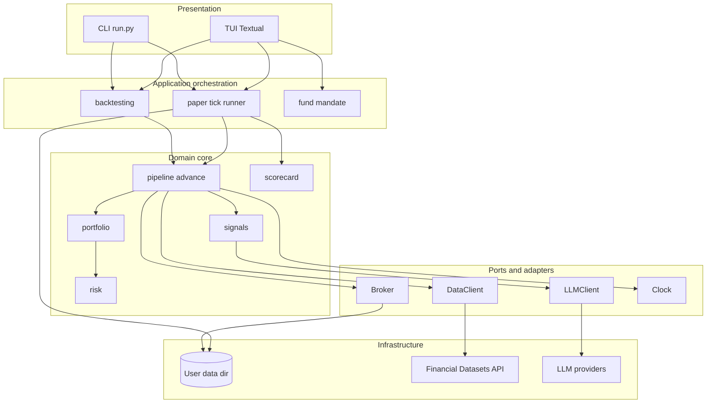

# 01. SYSTEM OVERVIEW - AI HEDGE FUND (aihf)

| Thuộc tính | Giá trị |
|---|---|
| Sản phẩm | `aihf` 2.6.4, gói Python `aihf` |
| Phạm vi tài liệu | Cấu trúc kho mã, cấu hình, điểm vào và mô hình kiến trúc tổng thể |
| Nguồn | `pyproject.toml`, `Makefile`, `.env.example`, `hedge_fund/`, `.are/summary.md` |
| Ngày | 2026-11-02 |
| Nhãn | `[OK]` có trong mã; `[UNKNOWN]` không có bằng chứng |

## 1. Tóm tắt điều hành

`aihf` là ứng dụng terminal (CLI và TUI) vận hành một quỹ đầu tư mô phỏng do AI điều hành. Hệ thống chạy trong một tiến trình, lưu trạng thái trên hệ thống tệp, gọi hai nhóm dịch vụ ngoài: dữ liệu thị trường (Financial Datasets) và mô hình LLM.

Đặc trưng kiến trúc:

| Đặc trưng | Mô tả |
|---|---|
| Một động cơ, ba chế độ | Hàm `advance` dùng chung cho backtest, quỹ giấy và (kế hoạch) giao dịch thật; chỉ đồng hồ, broker và nơi lưu trạng thái thay đổi |
| Lõi tất định | Pha trộn tín hiệu, giới hạn rủi ro và sinh lệnh là hàm thuần; LLM chỉ ảnh hưởng qua `Signal` |
| Sổ cái bất biến | Bản ghi phiên nối băm SHA-256; trạng thái quỹ luôn dựng lại từ chuỗi |
| Điểm mở rộng bằng giao thức | `DataClient`, `Broker`, `LLMClient`, `AlphaModel`, `Clock` là giao thức cấu trúc |
| Không có thành phần máy chủ | Không có HTTP server, cơ sở dữ liệu, hàng đợi hay cache ngoài |

## 2. Cấu trúc kho mã

Kho có 180 tệp được Git theo dõi. Mã nguồn sản phẩm: 12.282 dòng; mã kiểm thử: 7.983 dòng (40 tệp, 447 hàm kiểm thử).

| Đường dẫn | Vai trò |
|---|---|
| `pyproject.toml`, `poetry.lock` | Siêu dữ liệu gói, phụ thuộc, cấu hình công cụ |
| `Makefile` | Lệnh phát triển: `dev`, `console`, `test` |
| `.env.example` | Danh mục biến môi trường (khóa API) |
| `README.md`, `VISION.md`, `ROADMAP.md` | Mô tả sản phẩm, tầm nhìn, trạng thái hạng mục |
| `hedge_fund/` | Gói mã nguồn duy nhất (xem Mục 3) |
| `hedge_fund/strategies/` | Thư viện 4 strategy YAML: `deep-value`, `earnings-drift`, `fundamental-ls`, `inflections` |
| `docs/` | `AGILE_SRS.md`, `URD.md`, `WF_SRS.md`; `docs/rea/` chứa tài liệu phân tích kiến trúc |
| `scripts/` | `validate-mermaid.mjs`, `check_mockups.py` (kiểm tra tài liệu) |
| `.claude/skills/` | Kỹ năng của Claude Code (sinh tài liệu, ARE); không thuộc sản phẩm |
| `.github/` | Chỉ có mẫu issue; không có workflow CI `[UNKNOWN]` |
| `.are/` | Kết quả quét agents-reverse-engineer |

`requirements.txt`, `setup.py`, `setup.cfg` không tồn tại; Poetry là cơ chế quản lý phụ thuộc duy nhất `[OK]`.

## 3. Bản đồ module

| Module | Trách nhiệm | Tệp chính |
|---|---|---|
| `run.py` | Điểm vào CLI, định tuyến lệnh | `run.py` |
| `tui/` | Giao diện Textual: Home, Paper, Backtest, Builder, Funds, Report | `app.py`, `home.py`, `paper.py`, `backtest.py`, `builder.py` |
| `fund/` | Mandate (`FundSpec`), strategy, đọc và ghi YAML | `spec.py`, `storage.py` |
| `signals/` | Analyst: 5 persona LLM và mô hình PEAD | `llm_agent.py`, `pead.py` |
| `llm/` | Giao thức LLM, nhà cung cấp, registry, cache prompt | `client.py`, `registry.py`, `cache.py` |
| `features/` | Snapshot cơ bản point-in-time, bối cảnh trong ngày | `snapshot.py`, `intraday.py` |
| `data/` | Giao thức dữ liệu, máy khách API, cache đĩa, lịch phiên | `client.py`, `cached.py`, `sessions.py` |
| `pipeline/` | `advance`, đánh giá và thực thi, đồng hồ, bản ghi | `session.py`, `stages.py`, `clock.py` |
| `portfolio/` | Pha trộn tín hiệu, kiểm tra mục tiêu | `construction.py`, `validation.py` |
| `risk/` | Giới hạn rủi ro cứng | `limits.py` |
| `brokers/` | Broker mô phỏng và broker giấy, mô hình chi phí | `sim.py`, `paper.py`, `costs.py` |
| `paper/` | Quỹ đã triển khai, sổ cái, tick, runner | `deployed.py`, `ledger.py`, `tick.py`, `runner.py` |
| `backtesting/` | Vòng lặp `advance` trên lịch sử, lưu kết quả | `fund.py`, `research.py` |
| `scorecard/` | Chấm điểm analyst, quy kết lãi lỗ strategy | `analysts.py`, `strategies.py` |
| `validation/` | CPCV, PBO (chỉ có docstring) | `__init__.py` |
| `paths.py`, `models.py` | Vị trí dữ liệu người dùng; mô hình `Signal` | |

## 4. Cấu hình và phụ thuộc

### 4.1 `pyproject.toml`

| Hạng mục | Giá trị |
|---|---|
| Runtime | Python `^3.11` |
| Trình xây dựng | `poetry-core` |
| Gói đóng gói | `hedge_fund` (loại trừ `test_*.py` và `conftest.py`) |
| Entry point | `aihf = hedge_fund.run:main` |
| Định dạng | `black` (dòng 420, py311), `isort` (profile black) |

### 4.2 Phụ thuộc chạy

| Nhóm | Gói | Ràng buộc |
|---|---|---|
| Giao diện | `textual`, `rich` | `^8.2.8`, `^14.2.0` |
| Mô hình dữ liệu | `pydantic`, `pyyaml` | `^2.4.2`, `^6.0.3` |
| LLM | `langchain-anthropic` (cố định 0.3.5), `langchain-openai`, `langchain-deepseek`, `langchain-google-genai`, `langchain-xai` | Kimi dùng `langchain-openai` với `base_url` Moonshot; TypeSafe dùng `requests` trực tiếp |
| HTTP | `requests` | `^2.32.0` |
| Số liệu | `pandas`, `numpy`, `scipy`, `matplotlib` | `^2.1.0`, `^1.24.0`, `^1.11.0`, `^3.9.2` |
| Cấu hình | `python-dotenv` | Cố định 1.0.0 |

Phụ thuộc phát triển: `pytest ^7.4.0`, `black`, `isort`, `flake8`, `textual-dev`, `watchfiles`.

### 4.3 Biến môi trường (`.env.example`)

| Biến | Vai trò |
|---|---|
| `FINANCIAL_DATASETS_API_KEY` | Dữ liệu thị trường |
| `ANTHROPIC_API_KEY`, `OPENAI_API_KEY`, `DEEPSEEK_API_KEY`, `GOOGLE_API_KEY`, `XAI_API_KEY`, `TYPESAFE_API_KEY` | Khóa nhà cung cấp LLM |
| `MOONSHOT_API_KEY` (hoặc `KIMI_API_KEY`) | Nhà cung cấp Kimi |
| `HEDGE_FUND_LLM_MODEL` | Mô hình đang chọn (được đặt bởi `--model` hoặc bộ chọn TUI) |

Thứ tự ưu tiên: biến đã export, rồi `.env` ở thư mục làm việc, rồi `~/.hedge-fund/.env`.

## 5. Điểm vào

| Điểm vào | Lệnh | Mục đích |
|---|---|---|
| CLI chính | `aihf` (hoặc `python -m hedge_fund.run`) | Không tham số: mở TUI; có tham số: `backtest`, `paper ...` |
| TUI trực tiếp | `python -m hedge_fund.tui` | Mở `HedgeFundApp` |
| Chế độ phát triển | `make dev`, `make console` | Textual dev tools, tải lại tự động |
| Kiểm thử | `make test` (`poetry run pytest hedge_fund/`) | Chạy bộ kiểm thử |
| Runner nền | `python -m hedge_fund.run paper run <quỹ>` | Được `spawn_runner` khởi tạo từ TUI, tách phiên |
| Lập lịch ngoài | cron gọi `aihf paper tick <quỹ>` | Tiến hành phiên định kỳ |

Lệnh CLI: `backtest`, `paper create | tick | run | stop | status | list | scorecard | halt | resume`. Quy ước đầu ra: JSON thuần trên stdout, thông điệp trên stderr.

## 6. Mô hình kiến trúc

Kiến trúc là monolith module hóa, phân lớp theo miền, chạy trong một tiến trình, với lõi tính toán tách khỏi biên I/O (ports and adapters qua giao thức Python).

### 6.1 Luồng xử lý một phiên

`advance` thực hiện theo thứ tự: kiểm tra halt, đối soát sổ broker với sổ cái, thực thi quyết định chờ ở giá đóng cửa của phiên hiện tại, định giá sổ, kiểm tra dừng lỗ, đánh giá quyết định mới nếu là phiên tái cân bằng, ghi bản ghi băm chuỗi. Quyết định tại phiên T chỉ được thực thi ở phiên sau T.

### 6.2 Ba chế độ vận hành

| Chế độ | Đồng hồ | Broker | Trạng thái | Trạng thái triển khai |
|---|---|---|---|---|
| Backtest | Lịch sử | `SimBroker` | Bộ nhớ | `[OK]` |
| Paper | Thực | `PaperBroker` (`broker.json`) | Sổ cái trên đĩa | `[OK]` |
| Live | Thực | Broker thật | Sổ cái trên đĩa | `[SPEC]` |

### 6.3 Lưu trữ

Toàn bộ dữ liệu người dùng nằm ở `~/.hedge-fund/`:

| Thư mục | Nội dung |
|---|---|
| `mandates/` | Mandate YAML |
| `paper/<quỹ>/` | `fund.yaml`, `broker.json`, `ledger/`, `control.json`, `events.jsonl`, `runner.pid` |
| `research/` | Kết quả backtest JSON |
| `cache/data/`, `cache/llm/` | Cache phản hồi API và quyết định LLM |
| `.env` | Khóa API (quyền 0600) |

Tệp được ghi nguyên tử (tệp tạm rồi `os.replace`).

### 6.4 Tích hợp ngoài

| Hệ thống | Giao thức | Chính sách lỗi |
|---|---|---|
| Financial Datasets | HTTPS, header `X-API-Key` | Thử lại 429 (5, 15, 30 giây); 404 là không có dữ liệu; lỗi khác ném ngoại lệ |
| LLM (Anthropic, OpenAI, DeepSeek, Google, xAI, Kimi) | Thư viện LangChain | Lỗi chuyển thành abstain ở tầng analyst |
| TypeSafe (Jev) | HTTPS POST | Thử lại một lần; không theo chuyển hướng |

## 7. Điểm mở rộng

| Điểm mở rộng | Cách thêm | Điều kiện |
|---|---|---|
| Analyst | Cài `AlphaModel`, đăng ký vào `ALPHA_MODEL_REGISTRY` | Khai báo `investment_approach` và `horizon_days` trên chính lớp |
| Strategy | Thêm YAML vào `hedge_fund/strategies/` | Qua `StrategySpec` |
| Nguồn dữ liệu | Cài `DataClient` | Lỗi hạ tầng phải ném ngoại lệ; dữ liệu point-in-time |
| Broker | Cài `Broker` | Khớp trọn lệnh hoặc ném ngoại lệ |
| Nhà cung cấp LLM | Thêm vào `api_models.json` và `make_llm` | Cần biến khóa trong `PROVIDER_ENV_VARS` |

## 8. Nhận định và khoảng trống

| ID | Nội dung | Nhãn |
|---|---|---|
| G-01 | Không có CI; kiểm thử chạy thủ công bằng `make test` | `[UNKNOWN]` |
| G-02 | Không có RBAC hay xác thực; mọi tác nhân trên cùng tài khoản hệ điều hành có quyền như nhau | `[OK]` |
| G-03 | Không có cân bằng tải hay mở rộng ngang; một runner mỗi quỹ | `[OK]` |
| G-04 | Chuỗi sổ cái hỏng không có lệnh phục hồi trong mã | `[UNKNOWN]` |
| G-05 | `validation/` (CPCV, PBO), broker thật, Ollama, allocator động là kế hoạch | `[SPEC]` |
| G-06 | Hỗ trợ Windows cho runner nền (cơ chế POSIX) | `[ASSUMPTION]` |

Tài liệu liên quan: `docs/AGILE_SRS.md` (user story), `docs/URD.md` (yêu cầu tác nhân), `docs/WF_SRS.md` (đặc tả ISO 29148).
