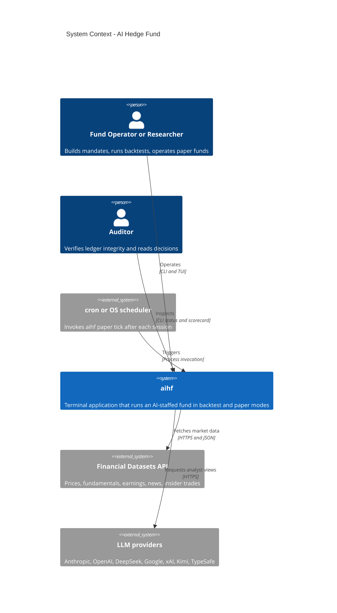
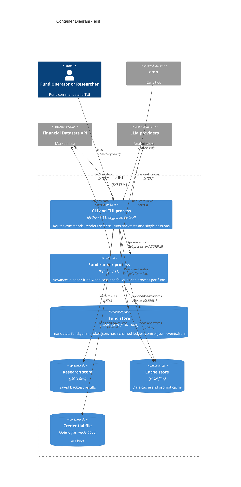
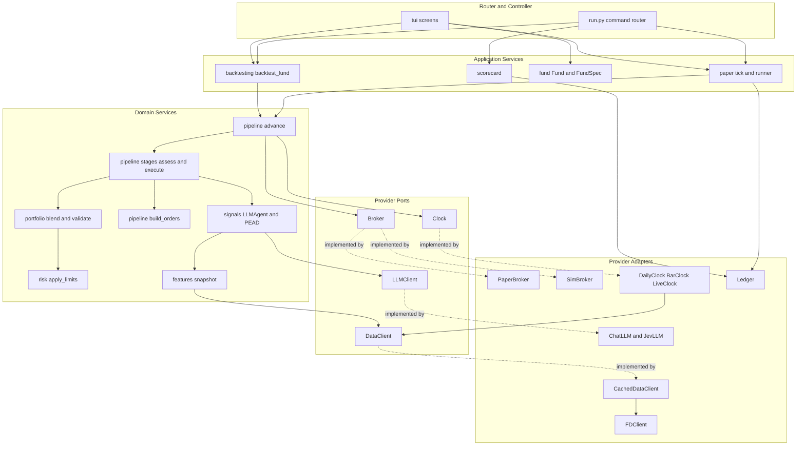

# 02. ARCHITECTURE C4 - AI HEDGE FUND (aihf)

| Thuộc tính | Giá trị |
|---|---|
| Phạm vi | Tương tác giữa các package: lớp điều phối (Router/Controller), lớp miền (Service), lớp nhà cung cấp (Provider); sơ đồ C4 mức System Context và Container |
| Nguồn | Mã nguồn `hedge_fund/`, đồ thị import giữa các package (tính trên mã không phải kiểm thử), `docs/rea/01_System_Overview.md` |
| Ngày | 2026-11-02 |
| Nhãn | `[OK]` có trong mã; `[UNKNOWN]` không có bằng chứng; `[SPEC]` kế hoạch |

## 1. Ghi chú phạm vi

Yêu cầu ban đầu nêu `openbb_platform`. Kho mã này (`ai-hedge-fund`) không chứa package đó nên không thể phân tích. Theo xác nhận của người yêu cầu, tài liệu áp dụng cùng phương pháp (Router/Controller, Service, Provider, sơ đồ C4) cho package `hedge_fund` của `aihf`.

## 2. Phân lớp và ánh xạ package

Ứng dụng không có HTTP router. Lớp Router/Controller tương ứng bộ định tuyến lệnh CLI và các màn hình TUI.

| Lớp | Vai trò | Package và tệp | Phụ thuộc cho phép |
|---|---|---|---|
| Router / Controller | Nhận lệnh hoặc thao tác, kiểm tra tham số, gọi dịch vụ, định dạng đầu ra | `run.py` (argparse), `tui/` (Textual screens) | Lớp Service, Provider (chỉ để dựng client) |
| Application Service | Điều phối một ca sử dụng | `backtesting/`, `paper/` (`tick`, `runner`, `deployed`), `fund/`, `scorecard/` | Domain core, Provider qua giao thức |
| Domain Service (core) | Quy tắc nghiệp vụ tất định | `pipeline/` (`advance`, `stages`, `execution`), `portfolio/`, `risk/`, `signals/`, `features/` | Giao thức Provider |
| Provider (port) | Giao thức do lõi định nghĩa | `data/protocol.py` (`DataClient`), `brokers/protocol.py` (`Broker`), `llm/client.py` (`LLMClient`), `pipeline/clock.py` (`Clock`) | Không |
| Provider (adapter) | Triển khai cụ thể và truy cập hệ thống ngoài | `data/client.py` (`FDClient`), `data/cached.py` (`CachedDataClient`), `llm/client.py` (`ChatLLM`, `JevLLM`), `brokers/sim.py`, `brokers/paper.py` | Hệ thống ngoài, `paths` |
| Persistence | Tệp trong `~/.hedge-fund/` | `paper/ledger.py`, `fund/storage.py`, `backtesting/research.py`, `llm/cache.py`, `paths.py` | Hệ thống tệp |

### 2.1 Đồ thị phụ thuộc giữa package (import tại thời điểm chạy)

| Package | Phụ thuộc vào |
|---|---|
| `run` | `backtesting`, `data`, `fund`, `paper`, `paths`, `pipeline`, `scorecard`, `tui` |
| `tui` | `backtesting`, `brokers`, `data`, `fund`, `llm`, `models`, `paper`, `paths`, `pipeline`, `scorecard`, `signals` |
| `backtesting` | `brokers`, `data`, `fund`, `pipeline` |
| `paper` | `brokers`, `data`, `fund`, `paths`, `pipeline` |
| `scorecard` | `pipeline`, `signals` |
| `pipeline` | `brokers`, `data`, `fund`, `llm`, `models`, `portfolio`, `risk`, `signals` |
| `fund` | `brokers`, `risk`, `signals` |
| `portfolio` | `signals`, `models` |
| `signals` | `data`, `features`, `llm`, `models` |
| `features` | `data`, `paths` |
| `data`, `brokers`, `llm`, `risk` | `paths` (hoặc không có) |

Nhận xét:

| ID | Nhận xét | Nhãn |
|---|---|---|
| A-01 | Phụ thuộc đi một chiều từ Controller xuống Service rồi xuống Provider; `data`, `brokers`, `llm`, `risk` không phụ thuộc ngược lên lõi | `[OK]` |
| A-02 | Các import ngược chiều `data` sang `fund`, `portfolio` sang `fund` và `pipeline` chỉ nằm trong khối `if TYPE_CHECKING`, không tạo vòng phụ thuộc lúc chạy | `[OK]` |
| A-03 | `pipeline` phụ thuộc trực tiếp `llm` (để đọc mô hình đóng dấu vào bản ghi) và `signals` phụ thuộc `llm` | `[OK]` |
| A-04 | `run` nạp `tui` theo hai cách: các hàm tiện ích nạp khi khởi động (`keys`, `report`, `scorecard_view`, `shared`); `app` nạp muộn để đường CLI không trả chi phí tải Textual | `[OK]` |
| A-05 | `fund` dựng đối tượng `Fund` (khởi tạo analyst) nên phụ thuộc `signals`; mandate và đối tượng chạy cùng một package | `[OK]` |

## 3. C4 Level 1 - System Context

| Thành phần | Mô tả | Giao tiếp |
|---|---|---|
| Fund Operator or Researcher | Tác nhân vận hành quỹ, nghiên cứu viên, người xây dựng quỹ | CLI `aihf ...`, TUI |
| Auditor | Tác nhân kiểm toán | `aihf paper status`, `aihf paper scorecard`, màn hình Sessions |
| cron or OS scheduler | Tác nhân hệ thống | Gọi tiến trình `aihf paper tick` |
| Financial Datasets API | Nguồn dữ liệu thị trường | HTTPS GET, header `X-API-Key` |
| LLM providers | Nguồn quan điểm định tính | LangChain; TypeSafe qua HTTPS POST |

Hệ thống không gọi broker thật (`[SPEC]`) và không mở cổng mạng.

## 4. C4 Level 2 - Container Diagram

Trong C4, container là đơn vị chạy được hoặc kho dữ liệu. `aihf` gồm hai tiến trình Python (ứng dụng CLI/TUI và runner nền) và các kho dữ liệu dạng tệp. Lõi miền và các adapter là thư viện nạp trong cả hai tiến trình, được thể hiện ở Mục 5.

| Container | Công nghệ | Trách nhiệm | Bằng chứng |
|---|---|---|---|
| CLI and TUI process | Python, `argparse`, Textual | Định tuyến lệnh, giao diện, backtest, tick đơn | `run.py`, `tui/` |
| Fund runner process | Python | Tiến hành phiên đến hạn; một tiến trình mỗi quỹ, xác định bằng `runner.pid` | `paper/runner.py` |
| Fund store | YAML, JSON, JSONL | Trạng thái quỹ; sổ cái bất biến; kill switch | `paper/`, `fund/storage.py` |
| Research store | JSON | Kết quả backtest dùng một lần | `backtesting/research.py` |
| Cache store | JSON | Phản hồi API hoàn tất và quyết định LLM | `data/cached.py`, `llm/cache.py` |
| Credential file | dotenv | Khóa API, quyền 0600 | `tui/keys.py` |

Hai tiến trình dùng chung mã nguồn và không giao tiếp trực tiếp; điều phối qua tệp (`runner.pid`, `control.json`, ledger) và tín hiệu `SIGTERM`.

## 5. Tương tác thành phần (bổ trợ cho Container Diagram)

Sơ đồ dưới đây mở rộng container tiến hành phiên, thể hiện chuỗi gọi từ Controller xuống Provider.

### 5.1 Chuỗi gọi cho ca sử dụng "tiến hành một phiên quỹ giấy"

| Bước | Lớp | Lời gọi | Tệp |
|---|---|---|---|
| 1 | Controller | `_paper` gọi `tick(directory, data_client)` | `run.py` |
| 2 | Application | `tick` nạp `DeployedFund`, `Ledger.replay`, xác định phiên đến hạn bằng `next_session` | `paper/tick.py` |
| 3 | Application | `_run` dựng `PaperBroker`, `Fund`, gọi `advance` | `paper/tick.py` |
| 4 | Domain | `advance`: kiểm tra halt, `reconcile`, `execute_decision`, định giá, `assess_fund` | `pipeline/session.py` |
| 5 | Domain | `assess_fund`: với mỗi strategy và mã, `model.predict` rồi `blend_signals`, `apply_limits`, `validate_targets` | `pipeline/stages.py` |
| 6 | Domain | `LLMAgent.predict`: `build_snapshot`, kiểm tra `PromptCache`, `LLMClient.complete` | `signals/llm_agent.py` |
| 7 | Provider | `CachedDataClient` đọc cache hoặc gọi `FDClient`; `ChatLLM` gọi nhà cung cấp | `data/`, `llm/` |
| 8 | Domain | `execute_decision`: `build_orders`, `Broker.place_order` | `pipeline/stages.py`, `pipeline/execution.py` |
| 9 | Application | `Ledger.append` ghi bản ghi băm chuỗi; sự kiện `tick` | `paper/ledger.py` |
| 10 | Controller | In JSON trên stdout, tóm tắt trên stderr | `run.py` |

## 6. Quy tắc phụ thuộc rút ra từ mã

| ID | Quy tắc | Bằng chứng |
|---|---|---|
| R-01 | Lõi miền chỉ phụ thuộc giao thức Provider, không phụ thuộc adapter cụ thể | `pipeline/stages.py` nhận `DataClient`, `Broker`, `Clock` qua tham số |
| R-02 | Adapter được dựng ở biên (Controller hoặc Application), rồi truyền xuống | `run.py` dựng `FDClient` và `CachedDataClient`; `paper/tick.py` dựng `PaperBroker` |
| R-03 | Backtest và quỹ giấy khác nhau ở đồng hồ, broker và nơi lưu trạng thái, không khác ở lõi | `backtesting/fund.py`, `paper/tick.py` đều gọi `advance` |
| R-04 | Phụ thuộc ngược chỉ qua `TYPE_CHECKING` | `data/bars.py`, `portfolio/*.py` |
| R-05 | Mọi đường dẫn dữ liệu người dùng lấy từ một module | `paths.py` |

## 7. Khoảng trống

| ID | Nội dung | Nhãn |
|---|---|---|
| G-01 | Các tiến trình không có kênh điều khiển ngoài tệp và tín hiệu | `[OK]` |
| G-02 | Broker thật chưa có; Container tương ứng sẽ là adapter của `Broker` | `[SPEC]` |
| G-03 | Không có phân tách quyền giữa các container; mọi tiến trình dùng cùng tài khoản hệ điều hành | `[OK]` |
| G-04 | Tài liệu không bao gồm C4 mức Component và Code đầy đủ; Mục 5 chỉ là sơ đồ tương tác bổ trợ | `[OK]` |
