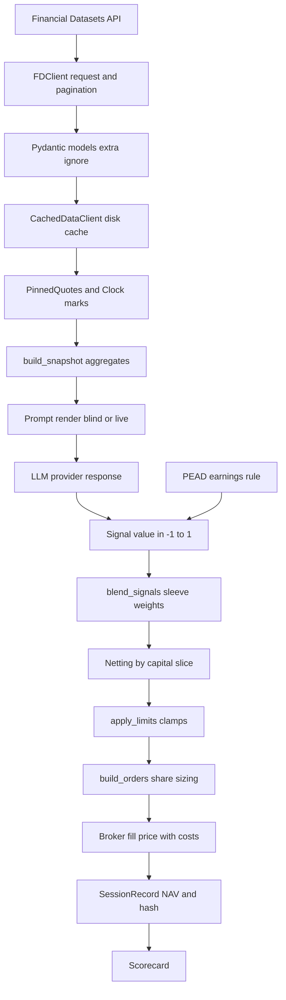

# 03. CORE BUSINESS LOGIC - DỮ LIỆU TÀI CHÍNH VÀ TÍCH HỢP PROVIDER

| Thuộc tính | Giá trị |
|---|---|
| Phạm vi | Logic xử lý dữ liệu tài chính, tích hợp provider ngoài, quy tắc chuyển đổi dữ liệu, xử lý lỗi, chuẩn hóa schema, công thức tài chính |
| Package khảo sát | `data/`, `features/`, `llm/`, `signals/`, `portfolio/`, `risk/`, `brokers/`, `pipeline/`, `scorecard/`, `backtesting/` |
| Ngày | 2026-11-02 |
| Nhãn | `[OK]` có trong mã; `[UNKNOWN]` không có bằng chứng; `[OPEN]` câu hỏi mở |
| Ký hiệu công thức | `E` equity; `w` trọng số; `G` `gross_target`; `P` `max_position_pct`; `q` tỷ lệ tham gia (số lượng lệnh / ADV); `σ` biến động hằng ngày |

## 1. Luồng dữ liệu từ provider đến lệnh

## 2. Bản đồ thư mục xử lý dữ liệu

| Thư mục | Trách nhiệm | Tệp chính |
|---|---|---|
| `data/` | Giao thức dữ liệu, máy khách API, cache đĩa, lịch phiên, lưới thanh | `protocol.py`, `client.py`, `cached.py`, `models.py`, `sessions.py`, `bars.py` |
| `features/` | Biến dữ liệu thô thành đầu vào cho analyst | `snapshot.py`, `intraday.py`, `breakpoints.py` |
| `llm/` | Chuẩn hóa phản hồi LLM về một hợp đồng JSON | `client.py`, `contract.py`, `cache.py`, `registry.py` |
| `signals/` | Chuyển dữ liệu và phản hồi thành `Signal` | `llm_agent.py`, `pead.py` |
| `portfolio/`, `risk/` | Từ `Signal` sang trọng số mục tiêu và giới hạn | `construction.py`, `validation.py`, `limits.py` |
| `pipeline/`, `brokers/` | Định giá sổ, sinh lệnh, giá khớp, chi phí | `stages.py`, `execution.py`, `clock.py`, `costs.py`, `sim.py` |
| `scorecard/`, `backtesting/` | Chỉ số hiệu suất, chấm điểm, quy kết | `analysts.py`, `strategies.py`, `fund.py` |

## 3. Tích hợp provider bên ngoài

### 3.1 Financial Datasets (`data/client.py`)

Giao thức `DataClient` (`data/protocol.py`) là biên duy nhất; `FDClient` là adapter. Mọi lớp bọc (`CachedDataClient`, `PinnedQuotes`) cũng thực hiện cùng giao thức.

| Phương thức | Điểm cuối | Tham số gửi đi | Mô hình đầu ra |
|---|---|---|---|
| `get_prices` | `GET /prices/` | `ticker`, `interval`, `interval_multiplier`, `start_date`, `end_date` | `list[Price]` |
| `get_snapshot` | `GET /prices/snapshot/` | `ticker` | `PriceSnapshot` hoặc `None` |
| `get_financial_metrics` | `GET /financial-metrics/` | `ticker`, `filing_date_lte = end_date`, `period` (mặc định `ttm`), `limit` | `list[FinancialMetrics]` |
| `get_news` | `GET /news/` | `ticker`, `end_date`, `start_date`, `limit = min(limit, 10)` | `list[CompanyNews]` |
| `get_insider_trades` | `GET /insider-trades/` | `ticker`, `filing_date_lte`, `filing_date_gte`, `limit` | `list[InsiderTrade]` |
| `get_company_facts` | `GET /company/facts/` | `ticker` | `CompanyFacts` hoặc `None` |
| `get_earnings` | `GET /earnings/` | `ticker`, `limit = 1` | `Earnings` hoặc `None` |
| `get_earnings_history` | `GET /earnings/` | `ticker`, `limit` (mặc định 12) | `list[EarningsRecord]` |
| `get_market_cap` | company facts, dự phòng metrics | `ticker`, `end_date` | `float` hoặc `None` |

Quy tắc tích hợp:

| ID | Quy tắc | Bằng chứng |
|---|---|---|
| INT-01 | Xác thực bằng header `X-API-Key`; khóa lấy từ `FINANCIAL_DATASETS_API_KEY` | `FDClient.__init__` |
| INT-02 | Phân trang: theo `next_page_url` (URL tuyệt đối, gửi nguyên văn) đến hết và nối các dòng; 404 giữa chừng giữ các dòng đã nhận | `FDClient._get` |
| INT-03 | Thời gian chờ mỗi yêu cầu 30 giây | `FDClient.__init__` |
| INT-04 | Point-in-time: chỉ số tài chính lọc theo `filing_date` (ngày hồ sơ được chấp nhận), không theo `report_period` | `get_financial_metrics` |
| INT-05 | `get_market_cap` ưu tiên `company_facts.market_cap` (giá trị mới nhất, có rò rỉ tương lai); `build_snapshot` không dùng hàm này mà lấy vốn hóa từ dòng chỉ số đã nộp gần nhất | `data/client.py`, `features/snapshot.py` |
| INT-06 | Sector và industry lấy từ company facts mới nhất; ghi nhận là xấp xỉ point-in-time chấp nhận được | `features/snapshot.py` |
| INT-07 | Quỹ phút không đọc lịch sử phút từ provider; giá phút lấy từ báo giá tức thời (`get_snapshot`) tại ranh giới thanh | `pipeline/clock.py: LiveClock`, `features/intraday.py` |

### 3.2 Provider LLM (`llm/`)

| Provider | Máy khách | Chuẩn hóa đầu ra |
|---|---|---|
| Anthropic, OpenAI, DeepSeek, Google, xAI | `ChatLLM` bọc mô hình LangChain, `max_retries=1`, `timeout=60` | Văn bản; khối "thinking" bị loại; trích JSON |
| Kimi | `ChatLLM` qua `langchain-openai` với `base_url` Moonshot (`MOONSHOT_BASE_URL` ghi đè) | Như trên |
| TypeSafe (Jev) | `JevLLM` gọi `POST https://api.typesafe.ai/v1/systemone` | `normalize_jev_response` đổi câu trả lời có kiểu thành JSON tương thích |
| OpenAI (ngoại lệ cấu hình) | `OPENAI_API_BASE` ghi đè `base_url` | Như trên |

Chọn nhà cung cấp: mã mô hình tra trong `api_models.json`; mã ngoài registry dùng Anthropic.

### 3.3 Nguồn bên thứ ba khác

| Nguồn | Dùng để | Quy tắc |
|---|---|---|
| Bảng ME Breakpoints (Dartmouth, Kenneth French) | Quy đổi vốn hóa sang phân vị quy mô cho prompt blind | Tải zip CSV, nhớ đệm `cache/breakpoints/ME_Breakpoints.csv`, làm mới sau 35 ngày; không đóng gói trong kho |

## 4. Chuẩn hóa schema đầu ra

### 4.1 Mô hình dữ liệu provider

| Quy tắc | Nội dung | Bằng chứng |
|---|---|---|
| SCH-01 | Mọi mô hình phản hồi dùng Pydantic với `extra="ignore"`: trường lạ bị bỏ qua, tương thích khi provider thêm trường | `data/models.py` |
| SCH-02 | Tên trường và tính null bám theo serializer của backend provider; các trường chỉ số tài chính đều `float \| None` | `data/models.py` |
| SCH-03 | `Price` gồm `open`, `close`, `high`, `low`, `volume`, `time`; `time` là chuỗi | `data/models.py` |
| SCH-04 | `EarningsRecord` giữ `source_type` (8-K, 10-Q, 10-K, 20-F) vì cùng `report_period` có thể xuất hiện nhiều lần | `data/models.py` |
| SCH-05 | Ngày lưu dạng chuỗi `YYYY-MM-DD`; thời điểm lưu dạng chuỗi ISO | `data/models.py` |

### 4.2 Chuẩn hóa khóa và định danh

| Quy tắc | Nội dung | Bằng chứng |
|---|---|---|
| SCH-06 | Mã cổ phiếu được `strip`, chuyển chữ hoa, bỏ trùng (giữ thứ tự); universe rỗng bị từ chối | `fund/spec.py: normalize_universe` |
| SCH-07 | `benchmark` chuyển chữ hoa | `FundSpec._uppercase_benchmark` |
| SCH-08 | Khóa phiên: ngày `YYYY-MM-DD` hoặc thanh `YYYY-MM-DDTHH:MM:SS` giờ New York; thời điểm của provider (có hoặc không múi giờ, hậu tố `Z`) được đổi về khóa New York, giá trị không múi giờ coi là giờ New York | `pipeline/clock.py: bar_key`, `data/bars.py: to_key` |
| SCH-09 | Khóa cache: SHA-256 của `phương thức\|JSON tham số (khóa sắp xếp)`, 24 ký tự đầu | `data/cached.py: _key` |
| SCH-10 | Khóa cache LLM: SHA-256 của `agent\|model\|system\|user`, 24 ký tự đầu; TypeSafe băm thêm phiên bản hợp đồng và yêu cầu gốc | `llm/cache.py`, `JevLLM.cache_key` |

### 4.3 Hợp đồng đầu ra thống nhất

| Quy tắc | Nội dung | Bằng chứng |
|---|---|---|
| SCH-11 | Mọi nhà cung cấp LLM được ép về một hợp đồng `{signal, confidence, reasoning}`; `signal` thuộc `bullish\|neutral\|bearish`, `confidence` trong `[0, 100]` | `signals/llm_agent.py: _parse` |
| SCH-12 | `Signal.value = dấu(signal) × confidence / 100`, dấu: bullish +1, neutral 0, bearish -1 | `_to_signal` |
| SCH-13 | Phản hồi Jev: `direction` chọn trong ba giá trị; `bullish_strength` và `bearish_strength` là điểm 0-4; xác suất của mỗi câu hỏi phải có đủ khóa và tổng bằng 1 (sai số 0,001); `confidence` gốc không thang hóa conviction | `llm/contract.py` |
| SCH-14 | Mọi bản ghi đầu ra có `schema_version` (hiện là 2) | `pipeline/session.py`, `backtesting/fund.py` |
| SCH-15 | Trường tùy chọn mới bị loại khỏi JSON khi rỗng (`horizon_days`, `adv`, `volatility`, `costs`, `max_net_exposure`, `max_drawdown_pct`, `max_adv_pct`, `snapshot_times`) để hash của bản ghi cũ còn hợp lệ | `models.py`, `brokers/models.py`, `risk/limits.py`, `fund/spec.py` |
| SCH-16 | Hash bản ghi phiên: SHA-256 của JSON bản ghi loại trừ `hash` | `SessionRecord.compute_hash` |
| SCH-17 | Hash nội dung snapshot loại trừ `as_of`: hai ngày giữa hai lần nộp hồ sơ tạo cùng một prompt và trúng cache | `FundamentalsSnapshot.content_hash` |

## 5. Quy tắc chuyển đổi dữ liệu

| ID | Quy tắc | Điều kiện và hành vi | Bằng chứng |
|---|---|---|---|
| DT-01 | Phiên hoàn tất | Ngày New York hiện tại không bao giờ hoàn tất, kể cả sau giờ đóng cửa; hoàn tất là mọi ngày trước đó | `data/sessions.py: completed_through` |
| DT-02 | Lưới phiên | Lấy ngày có giá đóng cửa của benchmark trong `[start, min(end, hoàn tất)]`; giá không hữu hạn hoặc không dương bị từ chối | `session_closes` |
| DT-03 | Giá đánh dấu cho đánh giá | Giá đóng cửa gần nhất trong 7 ngày lịch trước ngày đánh giá; mã không có giá bị loại khỏi đánh giá và ghi `TickerSkip` | `pipeline/stages.py: _mark_prices` |
| DT-04 | Giá đánh dấu cho thực thi | Cần đúng giá đóng cửa của ngày thực thi; thiếu, không hữu hạn hoặc không dương là lỗi | `pipeline/clock.py: exact_marks` |
| DT-05 | Cửa sổ lịch sử giá | 30 ngày lịch lùi từ ngày xét, dùng chung cho giá đánh dấu và thanh khoản | `history_start` |
| DT-06 | Snapshot | Lấy 20 dòng chỉ số `ttm` đã nộp, mới nhất trước; dưới 4 dòng thì ném `InsufficientData` | `build_snapshot`, `MIN_PERIODS` |
| DT-07 | Dòng kỳ | Chọn 14 trường từ `FinancialMetrics` vào `PeriodFundamentals` | `build_snapshot` |
| DT-08 | Thanh của quỹ phút | Snapshot chỉ hỏi provider theo phần ngày (`as_of[:10]`) nên mọi thanh trong ngày dùng chung một phản hồi và một prompt | `build_snapshot` |
| DT-09 | Prompt blind | Che mã, ngành, ngày lịch, giá trị tuyệt đối; kỳ gán nhãn `t-0, t-1, ...`; chỉ số trên cổ phiếu quy về kỳ cũ nhất bằng 100; quy mô là phân vị | `FundamentalsSnapshot._render_blind` |
| DT-10 | Định dạng số trong prompt | `\|v\| >= 1e9` thành `x.xB`; `>= 1e6` thành `x.xM`; còn lại 2 chữ số thập phân; `None` thành `-` | `_fmt` |
| DT-11 | Bối cảnh trong ngày | Biến động phần trăm được xếp vào dải; thanh yên tĩnh cho cùng khối văn bản nên trúng cache | `features/intraday.py` |
| DT-12 | Giá thanh lịch sử | Giá của thanh là giá đóng của thanh phút cuối cùng kết thúc trước ranh giới; thanh đầu cửa sổ lấy giá mở | `pipeline/clock.py: BarClock._price_at` |
| DT-13 | Giá thanh trực tiếp | Một báo giá mỗi mã tại ranh giới, lấy song song tối đa 8 luồng, ghi thời điểm từng báo giá | `LiveClock.observe` |
| DT-14 | Ghim báo giá cho analyst | Analyst nhận `PinnedQuotes`: báo giá là giá đồng hồ dùng để đánh dấu, không phải giá thị trường tức thời | `PinnedQuotes` |
| DT-15 | Thanh yên tĩnh | Khối bối cảnh không hiển thị giờ của thanh | `features/intraday.py` |
| DT-16 | Universe tradeable | Mã không có giá đánh dấu bị loại; mã đang giữ mà thiếu giá thực thi là lỗi | `assess_fund`, `execute_decision` |
| DT-17 | Bù trừ | Sleeve nhân tỷ trọng vốn đã chuẩn hóa rồi cộng theo mã | `assess_fund` |

## 6. Công thức tài chính

### 6.1 Đặc trưng cơ bản (`features/snapshot.py`)

| ID | Đại lượng | Công thức | Quy tắc biên |
|---|---|---|---|
| F-01 | Trung bình ROE, biên lợi nhuận ròng | `avg = round(Σx / n, 4)` trên các giá trị khác `None` | `None` nếu không có giá trị |
| F-02 | Xu hướng biên gộp | `trend = x_mới_nhất − x_cũ_nhất` (làm tròn 4) | Cần ít nhất 2 giá trị |
| F-03 | CAGR giá trị sổ sách trên cổ phiếu | `years = (n − 1) / 4`; `CAGR = (x_mới / x_cũ)^(1/years) − 1` | `None` nếu `n < 2` hoặc một đầu `<= 0` |
| F-04 | Tăng trưởng EPS theo năm | `EPS_t0 / EPS_t4 − 1` (làm tròn 4) | `None` nếu dưới 5 kỳ, thiếu EPS, hoặc `EPS_t4 <= 0` |
| F-05 | Chỉ số trên cổ phiếu (blind) | `idx = x / x_cũ_nhất × 100` | `-` nếu thiếu hoặc `x_cũ_nhất <= 0`; dấu của `x` được giữ |
| F-06 | Phân vị quy mô | `đạt = #{t : vốn_hóa/10^6 >= ngưỡng_t}`; `percentile = min(đạt, 19) × 5` | Hàng breakpoint là tháng cuối cùng nhỏ hơn tháng nộp hồ sơ; `None` nếu vốn hóa không dương hoặc không có hàng; tối đa 95 |
| F-07 | Biến động trong ngày | `move% = (giá_hiện_tại / đóng_cửa_trước − 1) × 100` | `None` nếu báo giá thuộc ngày trước hoặc đóng cửa trước không dương |
| F-08 | Dải biến động | Biên dải (%): 0,5; 1; 2; 3; 5. `\|move\| < 0,5` là "flat" | Prompt đổi khi biến động vượt biên dải |

Ví dụ F-03: giá trị sổ sách từ 100 lên 120 qua 9 kỳ ttm cách nhau một quý: `years = 2`, `CAGR = 1,2^0,5 − 1 = 9,54%`. Ví dụ F-04: EPS 2,2 so với 2,0 một năm trước cho `+10,0%`.

### 6.2 Từ quan điểm sang trọng số (`signals/`, `portfolio/`, `risk/`)

| ID | Đại lượng | Công thức | Ghi chú |
|---|---|---|---|
| F-09 | Tín hiệu LLM | `v = dấu × confidence / 100` | Trong `[-1, 1]` |
| F-10 | Tín hiệu Jev | `conviction = 25 × score` nếu hướng khác `neutral`, ngược lại 0 | `score` 0-4 |
| F-11 | PEAD | `v = +1` nếu BEAT, `−1` nếu MISS, trong `signal_window_days` (4) kể từ ngày nộp; ngược lại 0 | Hồ sơ nộp từ 45 ngày sau kỳ báo cáo bị loại; mặc định chỉ 8-K |
| F-12 | Conviction | `c_t = Σ w_i v_i / Σ w_i` trên analyst không abstain | Abstain bị loại khỏi mẫu số; tín hiệu 0 vẫn tính |
| F-13 | Đánh giá bán khống | `s_t = Σ w_i s_i / Σ w_i`, với `s_i = v_i` nếu analyst `long_short`, ngược lại `max(v_i, 0)` | Long-only không tạo bằng chứng bán khống |
| F-14 | Điểm đủ điều kiện | `score_t = max(c_t, 0) + min(s_t, 0)` (số hạng sau bằng 0 ở chế độ `long_only`) | |
| F-15 | Sleeve long_only, long_short | `w_t = score_t / Σ\|score\| × G` | Phẳng nếu `Σ\|score\| < 1e-9` |
| F-16 | Sleeve dollar_neutral | `L = Σ max(score,0)`, `S = Σ −min(score,0)`; `w_t = score_t / L × G/2` nếu `score_t > 0`, `score_t / S × G/2` nếu âm | Phẳng nếu thiếu một phía |
| F-17 | Bù trừ | `N_t = Σ_k (a_k / Σ a) × w_{k,t}` với `a_k` là trọng số strategy | |
| F-18 | Trần vị thế | `\|w_t\| <= P`; vượt thì `w_t = ±P` | Ghi `ClampEvent` |
| F-19 | Dải net | Với `net = L − S`: nếu `net > 0` nhân các trọng số dương với `(band + S)/L`; nếu `net < 0` nhân các trọng số âm với `(band + L)/S` | Chỉ khi đặt `max_net_exposure` |
| F-20 | Trần gross | Nếu `Σ\|w\| > Gmax` thì mọi `w` nhân `Gmax / Σ\|w\|` | |
| F-21 | Chế độ giữ tỷ lệ | `f = min(1, P / max\|w\|)`, rồi `f_net = Nmax / \|net\|`, rồi `f_gross = Gmax / gross`; mọi trọng số nhân cùng hệ số | Khi có strategy `dollar_neutral` |

Ví dụ F-12: hai analyst trọng số 2 và 1, tín hiệu +0,9 và −0,3: `c = (2×0,9 − 0,3) / 3 = 0,5`.

### 6.3 Định cỡ lệnh và chi phí (`pipeline/execution.py`, `brokers/`)

| ID | Đại lượng | Công thức | Ghi chú |
|---|---|---|---|
| F-22 | Số cổ phiếu mục tiêu | `target = int(w × E / mark)` (cắt về 0) | Không bao giờ vượt mục tiêu; phần lẻ ở lại tiền mặt |
| F-23 | Chênh lệch | `delta = target − hiện_tại` | Lệnh dưới 1 cổ phiếu không được tạo |
| F-24 | Dải không giao dịch | Lệnh tăng vị thế (`target × hiện_tại >= 0` và `\|target\| > \|hiện_tại\|`) bị bỏ nếu `\|delta\| × mark < min_trade_pct × E` | Giảm, đóng, đảo luôn được tạo |
| F-25 | Trần theo khối lượng | `max_shares = int(max_adv_pct × ADV)`; `delta` bị kẹp vào `[−max_shares, +max_shares]` | Ghi `ClampEvent` `max_adv_pct` |
| F-26 | ADV | Trung bình khối lượng của tối đa 20 thanh ngày gần nhất trong cửa sổ 30 ngày | Mã không có thanh: không giới hạn và không trả impact |
| F-27 | Biến động hằng ngày | `σ = stdev_mẫu(ln(close_t / close_{t−1}))` trên cùng các thanh | `0` nếu dưới 2 lợi suất |
| F-28 | Tỷ lệ tham gia | `q = quantity / ADV` | `0` nếu không có ADV |
| F-29 | Tác động thị trường (căn bậc hai) | `impact = Y × σ × sqrt(q)`, `Y = impact_coefficient` (mặc định 1,0) | Cơ sở: Almgren et al. 2005; Tóth, Bouchaud et al. 2011 |
| F-30 | Giá khớp | `c = spread_bps/10000 + impact`; mua: `mark × (1 + c)`; bán: `mark × (1 − c)` | Bán khống là bán; mua lại là mua |
| F-31 | Hoa hồng | `commission = quantity × commission_per_share` | Mặc định 0,005 USD mỗi cổ phiếu |
| F-32 | Tiền mặt sau lệnh | Mua: `cash −= qty × price + commission`; bán: `cash += qty × price − commission` | `SimBroker` không mô hình ký quỹ; tiền mặt có thể âm |
| F-33 | Thứ tự lệnh | Bán trước, mua sau; chữ cái trong mỗi nhóm | Bán giải phóng tiền cho mua |

Ví dụ F-29, F-30: `mark = 100`, `spread = 5 bps`, `q = 0,01`, `σ = 0,02`, `Y = 1`: `impact = 0,02 × 0,1 = 0,002`, `c = 0,0005 + 0,002 = 0,0025`, giá mua `100,25`, giá bán `99,75`. Ví dụ F-22: `w = 0,25`, `E = 100000`, giá 33,3: `int(750,75) = 750`.

### 6.4 Định giá sổ và rủi ro

| ID | Đại lượng | Công thức | Ghi chú |
|---|---|---|---|
| F-34 | NAV | `NAV = cash + Σ shares × mark` | Cổ phiếu có dấu |
| F-35 | Drawdown | `dd = max(0, 1 − NAV / peak_nav)`; `peak_nav = max(NAV đã ghi)` | Trạng thái cũ chưa theo dõi đỉnh dùng vốn làm đỉnh |
| F-36 | Dừng lỗ | Nếu `dd >= max_drawdown_pct` thì mục tiêu của mọi vị thế đang giữ bằng 0 | Không hỏi analyst |
| F-37 | Dung sai đối soát | Tiền mặt broker và ledger khớp khi `\|chênh lệch\| <= 0,01` | |
| F-38 | Slippage | `Σ (giá_khớp − giá_tham_chiếu) × qty × (+1 mua, −1 bán)` | |
| F-39 | Chi phí spread | `Σ qty × giá_tham_chiếu × spread_bps / 10000` | |
| F-40 | Impact thực | `slippage − chi phí spread` | |
| F-41 | Hoa hồng thực | `cash_trước − cash_sau − Σ qty × giá_khớp × (+1 mua, −1 bán)` | Suy ra từ sổ, không từ mô hình chi phí |
| F-42 | Chi phí giao dịch | `slippage + hoa hồng` | |

Ví dụ F-35: đỉnh NAV 112.400, NAV hiện tại 89.100: `dd = 20,7%`; vượt ngưỡng 20% thì dừng lỗ.

### 6.5 Chỉ số hiệu suất (`backtesting/fund.py`)

| ID | Đại lượng | Công thức | Ghi chú |
|---|---|---|---|
| F-43 | Tổng lợi suất | `NAV_cuối / capital − 1` | |
| F-44 | Lợi suất quy năm | `(1 + total)^(1/years) − 1`, `years = ngày_lịch / 365,25` | 0 nếu `years <= 0` |
| F-45 | Lợi suất phiên | `r_t = NAV_t / NAV_{t−1} − 1` | |
| F-46 | Sharpe | `mean(r) / std(r, ddof=1) × sqrt(P_năm)` | `P_năm = 252`; 0 nếu độ lệch chuẩn bằng 0; không trừ lãi suất phi rủi ro `[OPEN]` |
| F-47 | Mức sụt giảm tối đa | `max_t (peak_t − NAV_t) / peak_t` | |
| F-48 | NAV benchmark | `capital × close_t / close_0` | Cùng vốn |
| F-49 | Lợi suất vượt trội | `total − (benchmark_NAV_cuối / capital − 1)` | |

Ví dụ F-44, F-46: tổng lợi suất 9,1% trong 1,58 năm cho `1,091^(1/1,58) − 1 = 5,7%` mỗi năm; `mean(r) = 0,0005`, `std = 0,01` cho `Sharpe = 0,05 × 15,87 = 0,79`.

### 6.6 Chấm điểm và quy kết (`scorecard/`)

| ID | Đại lượng | Công thức | Ghi chú |
|---|---|---|---|
| F-50 | Lợi suất tương lai | `fwd = giá_{t+h} / giá_t − 1`, `h = horizon_days` phiên ghi sổ | Quan điểm chưa tới `h` là pending |
| F-51 | Lợi suất vượt benchmark | `excess = fwd − (bench_{t+h} / bench_t − 1)` | |
| F-52 | Tỷ lệ đúng | `hit = #{value > 0 và excess > 0, hoặc value < 0 và excess < 0} / #{value ≠ 0}` | `excess = 0` là sai |
| F-53 | Slugging | `(trung bình \|excess\| của hit) / (trung bình \|excess\| của miss)` | `None` nếu thiếu hit hoặc miss |
| F-54 | IC mỗi ngày | Tương quan Spearman giữa `value` và `fwd`: hệ số Pearson của hạng trung bình (hạng đồng điểm lấy trung bình vị trí) | Cần ít nhất 3 mã; `None` nếu một phía không có phương sai |
| F-55 | IC trung bình, t-stat | `IC_mean = mean(IC_d)`, `IC_std` mẫu (ddof 1), `t = IC_mean / IC_std × sqrt(n_ngày)` | `t` cần ít nhất 2 ngày |
| F-56 | Lợi suất kỳ strategy | `r_k = Σ_t a_{k,t} × (giá_next / giá_now − 1)`, `a` là `final_contribution` | Mã thiếu giá một đầu kỳ không đóng góp |
| F-57 | P&L strategy | `Σ_kỳ r_k × equity_trước_khớp` | |
| F-58 | Lợi suất ghép | `Π(1 + r_k) − 1` | |
| F-59 | Tỷ lệ thắng | `#{r_k > 0} / n_kỳ` | Kỳ bằng 0 không thắng |
| F-60 | P&L quỹ | `equity_trước_khớp(lần thực thi cuối) − equity_trước_khớp(lần đầu)` | Chi phí rơi vào phần chưa quy kết |
| F-61 | Phần chưa quy kết | `fund_pnl − Σ P&L strategy` | Luôn báo cáo |
| F-62 | Tỷ trọng P&L | `P&L_k / fund_pnl` | `None` nếu `fund_pnl = 0` |

## 7. Cơ chế xử lý lỗi

### 7.1 Nguyên tắc

| ID | Nguyên tắc | Hệ quả |
|---|---|---|
| ER-01 | Fail loud: lỗi hạ tầng dữ liệu phải ném ngoại lệ; chỉ HTTP 404 nghĩa là "không có dữ liệu" | Backtest không nhầm thiếu dữ liệu với không có tín hiệu |
| ER-02 | Lỗi LLM được hấp thụ ở tầng analyst thành abstain; lỗi dữ liệu thì không | Một phản hồi hỏng không làm sập phiên, một dữ liệu hỏng thì có |
| ER-03 | Kiểm tra sớm: mọi kiểm tra mục tiêu, giới hạn và vị thế dự kiến hoàn tất trước khi gửi lệnh đầu tiên | Không có lệnh nào được gửi khi vi phạm |
| ER-04 | Không sửa ngầm: lệch sổ broker và ledger bị nêu, không bị sửa | Nguồn sự thật không bị che |
| ER-05 | Lỗi trong tick làm halt quỹ | Cron không lặp lại trên sổ hỏng |

### 7.2 Ma trận theo lớp

| Lớp | Điều kiện | Xử lý | Bằng chứng |
|---|---|---|---|
| `FDClient` | Lỗi mạng | `FDClientError` (không có `status_code`) | `_request` |
| `FDClient` | HTTP 429 | Thử lại sau 5, 15, 30 giây; hết lượt thì `FDClientError(429)` | `_RETRY_DELAYS` |
| `FDClient` | HTTP 404 | Trả `None` | `_request` |
| `FDClient` | HTTP 400 trở lên khác | `FDClientError(status_code, path)` kèm 200 ký tự đầu của thân phản hồi | `_request` |
| `CachedDataClient` | Bản ghi cache hỏng | Coi là chưa có; ghi đè khi lấy lại | `_read` |
| `CachedDataClient` | Lỗi từ client bên dưới | Lan truyền; không ghi bản ghi | `_cached_*` |
| `session_closes` | Giá benchmark không hữu hạn hoặc không dương | `ValueError` | `data/sessions.py` |
| `backtest_fund` | Benchmark không có phiên | `ValueError` "cannot build the trading grid" | `backtesting/fund.py` |
| `exact_marks`, `Clock.marks` | Thiếu hoặc sai giá đúng phiên | `ValueError`; phiên thất bại | `pipeline/clock.py` |
| `LiveClock.observe` | Không có báo giá | `ValueError` "no quote" | `pipeline/clock.py` |
| `build_snapshot` | Dưới 4 kỳ chỉ số | `InsufficientData`; analyst abstain | `features/snapshot.py` |
| `load_breakpoints` | Tải lỗi | Dùng bản cũ nếu có; không có thì ném lỗi | `features/breakpoints.py` |
| `LLMAgent.predict` | Gọi LLM lỗi, JSON hỏng, giá trị ngoài miền | Signal abstain; lưu chẩn đoán hoặc phản hồi thô | `signals/llm_agent.py` |
| `JevLLM` | 429, 500, 502, 503, 504, 529 | Thử lại một lần; chờ `Retry-After` (tối thiểu 1 giây); chờ vượt thời gian chờ thì thất bại | `llm/client.py` |
| `JevLLM` | Lỗi truyền tải, HTTP khác 2xx, JSON hỏng, vi phạm hợp lệ | `LLMCallError` với `failure_category` (`transport`, `http`, `json_decode`, `contract`); khóa bị thay bằng `[REDACTED]` | `llm/client.py` |
| `blend_signals`, `apply_limits` | Giá trị không hữu hạn, ngoài miền | `ValueError` | `portfolio/`, `risk/` |
| `validate_targets` | Vi phạm mandate | `ValueError` | `portfolio/validation.py` |
| `execute_decision` | Phiên sai, mandate đổi, equity không dương, vị thế dự kiến vi phạm | `ValueError` trước khi gửi lệnh | `pipeline/stages.py` |
| `SimBroker.place_order` | Giá lệnh không hữu hạn hoặc không dương | `ValueError`; sổ không đổi | `brokers/sim.py` |
| `reconcile` | Lệch sổ | `BookMismatch` liệt kê mọi chênh lệch | `pipeline/session.py` |
| `Ledger` | Bản ghi trùng, sai thứ tự, đứt chuỗi, hash sai | `LedgerError` | `paper/ledger.py` |

### 7.3 Thất bại có chủ đích

| ID | Nội dung |
|---|---|
| ER-06 | Thiếu giá thực thi của một mã đang giữ là lỗi kể cả khi mục tiêu của mã đó bằng 0, vì không thể định giá sổ |
| ER-07 | Quyết định dừng lỗ không bao giờ được làm mới, để khoảng trống lịch không đưa sổ trở lại |
| ER-08 | Làm mới quan điểm thất bại không được quay về mục tiêu gốc |

## 8. Khoảng trống và giả định

| ID | Nội dung | Nhãn |
|---|---|---|
| G-01 | `FDClient` không chuẩn hóa chữ hoa của mã; việc chuẩn hóa nằm ở biên (`normalize_universe`) | `[OK]` |
| G-02 | Sector và industry dùng giá trị mới nhất, là xấp xỉ point-in-time | `[OK]` |
| G-03 | `get_market_cap` có rò rỉ tương lai nếu gọi trong backtest; mã phân tích không gọi hàm này | `[OK]` |
| G-04 | Sharpe không trừ lãi suất phi rủi ro | `[OPEN]` |
| G-05 | Điều chỉnh cổ tức, tách cổ phiếu và hành động doanh nghiệp: mã không xử lý, phụ thuộc vào giá của provider | `[UNKNOWN]` |
| G-06 | Đơn vị tiền tệ: trường `currency` được lưu nhưng không được dùng để quy đổi | `[UNKNOWN]` |
| G-07 | Hành vi hiển thị khi báo giá trực tiếp của danh sách quỹ không lấy được | `[UNKNOWN]` |
| G-08 | Dữ liệu thay thế, nhiều provider cùng lúc, hợp nhất nguồn | `[SPEC]` ROADMAP |
